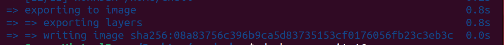

# 도커 이미지 빌드 (Docker Build)

## 작업 식별

| 항목 | 내용 |
|---|---|
| Task ID | CLD-DKR-009-MP |
| 목적 | Dockerfile이 있는 디렉터리에서 도커 이미지를 빌드하고 생성된 이미지를 확인한다 |
| 적용 대상 | 도커 엔진이 설치된 환경, `docker` 명령 사용 가능 |
| 소요 시간 | 약 5분 (이미지 크기에 따라 다르다) |
| 확인 상태 | 미검증 (원본 페이지의 절차를 정리한 것이며 실행해 확인하지 않았다) |
| 개정 | R1 (2026-11-18) |

## 1. 참조

| 참조 문서 | Task ID | 제목 |
|---|---|---|
| [Dockerfile 작성법 및 실습](dockerfile.md) | CLD-DKR-010-REF | Dockerfile 지시어 |
| [Ubuntu 환경 도커 설치](docker_install.md) | CLD-DKR-005-MP | 도커 설치 |
| [도커 필수 명령어](docker_commend.md) | CLD-DKR-007-REF | `docker build` 옵션 |

## 2. 필요 장비와 자재

| 번호 | 이름 | 사양·버전 | 비고 |
|---|---|---|---|
| 1 | 도커 엔진 | 설치 완료 | |
| 2 | `Dockerfile` | 확장자 없는 파일 | 빌드 대상 디렉터리에 둔다 |
| 3 | 배포 파일(deploy 등) | | Dockerfile이 `COPY`하는 파일 |

## 3. 안전 사항


CAUTION: 빌드 컨텍스트(`docker build`에 넘기는 디렉터리) 전체가 도커 엔진에 전송된다. 비밀값 파일(`.env`, 키 파일)이 그 디렉터리에 있으면 `COPY . ...` 지시어로 이미지에 들어갈 수 있다. 비밀값은 이미지에 넣지 않는다.


## 4. 준비

| 번호 | 항목 | 확인 방법 |
|---|---|---|
| 1 | 도커가 동작한다 | `docker --version`이 버전을 출력한다 |
| 2 | Dockerfile과 배포 파일을 한 디렉터리에 모은다 | `ls`에 `Dockerfile`이 보인다 |

## 5. 절차

### A. 빌드

1. (5-A-01) Dockerfile이 있는 디렉터리로 이동한다: `cd <빌드 디렉터리>`
2. (5-A-02) 이미지를 빌드한다: `docker build -t <이미지명>:<태그> .` → 결과: 마지막 줄에 `naming to docker.io/library/<이미지명>:<태그>`가 출력된다.


NOTE: 원본은 `docker build .`만 사용했다. 이 경우 이름과 태그가 없는 이미지(`<none>:<none>`)가 생겨 구분하기 어렵다. `-t`로 이름과 태그를 붙이는 방식을 권장한다. 파일 이름이 `Dockerfile`이 아니면 `-f <파일명>`을 추가한다.


### B. 확인

1. (5-B-01) 이미지 목록을 출력한다: `docker images` → 결과: 방금 만든 `<이미지명>`이 `<태그>`와 함께 보인다.

## 6. 기능 확인

| 번호 | 확인 동작 | 기대 결과 | 합격 기준 |
|---|---|---|---|
| 1 | `docker images` | 새 이미지가 있다 | `REPOSITORY`가 `<이미지명>`, `TAG`가 `<태그>`다 |
| 2 | `docker run --rm <이미지명>:<태그>` | 컨테이너가 실행된다 | Dockerfile의 `CMD` 또는 `ENTRYPOINT` 동작 결과가 출력된다 |

## 7. 복구

1. (7-01) 만든 이미지를 삭제한다: `docker rmi <이미지명>:<태그>` → 결과: `Untagged:` 또는 `Deleted:`가 출력된다. 그 이미지로 만든 컨테이너가 있으면 먼저 컨테이너를 삭제한다.

## 8. 개정 이력

| 개정 | 날짜 | 변경 내용 |
|---|---|---|
| R1 | 2026-11-18 | 3단계 stepper를 MP 형식으로 재작성. `-t` 태그 지정, 기능 확인, 복구, 비밀값 CAUTION을 추가했다. 외부 사이트에 있던 스크린샷 1장은 접근 불가 위험이 있어 제외했다 |
