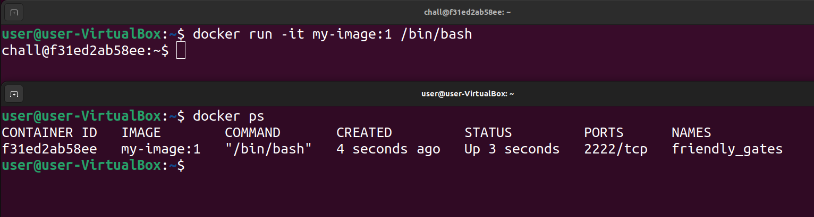
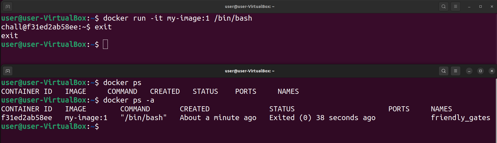

# 도커 필수 명령어 (Docker Command)

## 작업 식별

| 항목 | 내용 |
|---|---|
| Task ID | CLD-DKR-007-REF |
| 유형 | REF (명령 표) |
| 목적 | 자주 쓰는 도커 명령과 옵션을 찾는다 |
| 확인 상태 | 미검증 (원본 페이지와 도커 문서 지식을 정리한 것이며 이 환경에서 실행해 확인하지 않았다) |
| 개정 | R1 (2026-11-18) |

## 1. 이미지 명령

| 명령어 | 설명 | 형식 | 주요 옵션 |
|---|---|---|---|
| `docker build` | Dockerfile로 이미지를 만든다 | `docker build [옵션] <경로>` | `-t <이름:태그>`: 이미지 이름과 태그를 지정한다. 태그를 생략하면 `latest`가 붙는다 `-f <파일>`: 기본 `Dockerfile` 대신 지정한 파일을 쓴다 |
| `docker images` | 이미지 목록을 출력한다 | `docker images` | |
| `docker pull` | 레지스트리(Docker Hub)에서 이미지를 내려받는다 | `docker pull [옵션] <이미지명[:태그]>` | |
| `docker push` | 이미지를 레지스트리에 올린다 | `docker push <사용자명>/<이름>:<태그>` | |
| `docker tag` | 이미지에 이름과 태그를 추가한다 | `docker tag <원본 이미지> <사용자명>/<이름>:<태그>` | |
| `docker commit` | 컨테이너의 현재 상태를 이미지로 저장한다 | `docker commit <컨테이너 ID> <이름>:<태그>` | |
| `docker rmi` | 이미지를 삭제한다 | `docker rmi [옵션] <이미지명\|ID>` | 같은 동작: `docker image rm` |
| `docker image prune` | 사용하지 않는 이미지를 삭제한다 | `docker image prune` | |
| `docker login` | 레지스트리에 로그인한다 | `docker login -u <사용자명>` | 성공하면 인증 정보가 설정 파일(`~/.docker/config.json`)에 저장된다 |

## 2. 컨테이너 명령

| 명령어 | 설명 | 형식 | 주요 옵션 |
|---|---|---|---|
| `docker run` | 컨테이너를 만들고 실행한다 | `docker run [옵션] <이미지명\|ID> [명령어]` | `-d`: 백그라운드로 실행한다 `-it`: 입력(`-i`)과 가상 터미널(`-t`)을 켜 셸을 쓴다 `-p <호스트 포트>:<컨테이너 포트>`: 포트를 연결한다 `--name <이름>`: 컨테이너 이름을 지정한다 `--rm`: 컨테이너가 종료되면 자동 삭제한다 `-v <볼륨 또는 경로>:<컨테이너 경로>`: 볼륨을 연결한다 |
| `docker create` | 컨테이너를 만들기만 한다. 실행하지 않는다 | `docker create [옵션] <이미지명\|ID> [명령어]` | `docker run`과 같은 옵션을 쓴다 |
| `docker start` | 중지된 컨테이너를 시작한다 | `docker start [옵션] <컨테이너명\|ID>` | |
| `docker stop` | 실행 중인 컨테이너를 중지한다 | `docker stop [옵션] <컨테이너명\|ID>` | |
| `docker kill` | 컨테이너를 강제 종료한다 | `docker kill <컨테이너 ID>` | |
| `docker ps` | 실행 중인 컨테이너 목록을 출력한다 | `docker ps [옵션]` | `-a`: 종료된 컨테이너까지 출력한다 `-q`: ID만 출력한다 |
| `docker exec` | 실행 중인 컨테이너에서 명령을 실행한다 | `docker exec [옵션] <컨테이너명\|ID> [명령어]` | `-it`: 셸을 연다 |
| `docker rm` | 컨테이너를 삭제한다 | `docker rm [옵션] <컨테이너명\|ID>` | `-f`: 실행 중이어도 강제 삭제한다 |
| `docker top` | 컨테이너 안의 프로세스를 출력한다 | `docker top <컨테이너 ID>` | |
| `docker stats` | 컨테이너의 자원 사용량을 출력한다 | `docker stats [<컨테이너명\|ID>]` | |
| `docker logs` | 컨테이너 로그를 출력한다 | `docker logs <컨테이너명\|ID>` | |
| `docker inspect` | 이미지나 컨테이너의 상세 정보를 JSON으로 출력한다 | `docker inspect [옵션] <이미지 또는 컨테이너명\|ID>` | |
| `docker container prune` | 중지된 모든 컨테이너를 삭제한다 | `docker container prune` | |

## 3. 볼륨·시스템 명령

| 명령어 | 설명 | 형식 |
|---|---|---|
| `docker volume ls` | 볼륨 목록을 출력한다 | `docker volume ls` |
| `docker volume create` | 볼륨을 만든다 | `docker volume create <볼륨명>` |
| `docker volume inspect` | 볼륨의 상세 정보(마운트 위치 등)를 출력한다 | `docker volume inspect <볼륨명>` |
| `docker system df` | 도커가 쓰는 디스크 용량을 출력한다 | `docker system df` |
| `docker system prune` | 사용하지 않는 컨테이너, 네트워크, 이미지(dangling)를 삭제한다 | `docker system prune` |

## 4. 위험 명령


WARNING: 다음 명령은 데이터를 삭제하며 되돌릴 수 없다. 실행 전에 대상 목록(`docker ps -a`, `docker images`, `docker volume ls`)을 확인한다.


| 명령어 | 영향 |
|---|---|
| `docker rm -f <컨테이너명\|ID>` | 실행 중인 컨테이너를 강제 삭제한다. 컨테이너 안의 데이터는 볼륨에 없으면 사라진다 |
| `docker container rm -f $(docker container ls -a -q)` | 실행 중인 컨테이너를 포함한 모든 컨테이너를 강제 삭제한다. `docker container prune`은 중지된 컨테이너만 지운다 |
| `docker system prune` | 중지된 컨테이너, 사용하지 않는 네트워크, 매달린(dangling) 이미지를 삭제한다. `--volumes`를 붙이면 사용하지 않는 볼륨도 삭제한다 |
| `docker volume rm <볼륨명>` | 볼륨과 그 안의 데이터를 삭제한다 |
| `docker run --privileged` | 컨테이너에 호스트 장치 접근 권한을 거의 모두 준다. 호스트 보안 경계가 약해진다 |
| `docker run -p <호스트 포트>:<컨테이너 포트>` | 호스트 포트를 연다. 기본은 모든 네트워크 인터페이스(`0.0.0.0`)에 연결된다. 내부 전용이면 `127.0.0.1:<호스트 포트>:<컨테이너 포트>`로 쓴다 |

## 5. 사용 예

| 목적 | 명령 | 기대 결과 |
|---|---|---|
| 현재 디렉터리의 Dockerfile로 빌드 | `docker build .` | 이름 없는 이미지(`<none>:<none>`)가 생긴다 |
| 이름과 태그를 붙여 빌드 | `docker build -t my-image:1 .` | `my-image:1` 이미지가 생긴다 |
| 태그 없이 빌드 | `docker build -t my-image .` | `my-image:latest` 이미지가 생긴다 |
| 이미지 목록 확인 | `docker images` | `REPOSITORY`, `TAG`, `IMAGE ID`, `CREATED`, `SIZE` 열이 출력된다 |
| 컨테이너 실행과 포트 연결 | `docker run -p <호스트 포트>:<컨테이너 포트> <이미지명>` | 호스트 포트로 접속하면 컨테이너 서비스에 연결된다 |
| 셸로 컨테이너 실행 | `docker run -it my-image:1 /bin/bash` | 컨테이너 셸 프롬프트가 열린다 |
| 컨테이너 만들기와 시작 분리 | `docker create my-image:1` 후 `docker start <컨테이너 ID>` | `create`는 컨테이너 ID를 출력하고, `start` 후 `docker ps`에 `Up` 상태로 나타난다 |
| 실행 중인 컨테이너에 접속 | `docker exec -it <컨테이너명\|ID> /bin/bash` | 컨테이너 셸이 열린다 |
| 이미지 내려받기 | `docker pull ubuntu:18.04` | `Status: Downloaded newer image for ubuntu:18.04`가 출력된다 |
| 시작과 동시에 명령 실행 | `docker run -it --name web nginx df -h` | 명령 결과가 출력된다 |
| nginx 컨테이너 10개 생성 | `for i in $(seq 1 10); do docker container create nginx; done` | 10개 컨테이너가 `Created` 상태로 생긴다 |

원본의 10개 생성 예시는 `docker.sh` 파일에 `#!/bin/bash`와 같은 반복문을 적어 실행하는 방식이었다. 위 표의 한 줄 명령으로 같은 결과를 얻는다.

### 5.1 `docker ps` 출력 예

컨테이너를 실행한 상태에서 다른 터미널에서 `docker ps`를 입력하면 실행 중인 컨테이너가 나온다.

컨테이너 안에서 `exit`로 종료하면 `docker ps`에는 나오지 않고, `docker ps -a`에는 종료된 컨테이너가 나온다.

### 5.2 `docker inspect` 출력 예

`docker inspect ubuntu:18.04`는 JSON 배열을 출력한다. 주요 항목은 다음과 같다.

| 항목 | 의미 |
|---|---|
| `Id` | 이미지 ID(sha256) |
| `RepoTags` | 이미지 이름과 태그 |
| `Config.Cmd` | 컨테이너 시작 시 실행하는 기본 명령 (예: `/bin/bash`) |
| `Config.Env` | 환경 변수 |
| `Architecture`, `Os` | 이미지의 CPU 구조와 운영체제 (예: `amd64`, `linux`) |
| `Size` | 이미지 크기(바이트) |
| `GraphDriver` | 저장 드라이버와 경로 (예: `overlay2`) |
| `RootFS.Layers` | 이미지 레이어 목록 |


NOTE: 원본에는 약 100줄의 `docker inspect` 출력 전문이 있었다. 읽기 쉽도록 주요 항목 표로 줄였다.


## 6. 참조

| 참조 문서 | Task ID | 제목 |
|---|---|---|
| [도커 이미지 빌드](docker_build.md) | CLD-DKR-009-MP | `docker build` 절차 |
| [도커 컨테이너 실행과 관리](docker-container-run.md) | CLD-DKR-008-MP | 실행·중지·삭제 절차 |
| [Docker CLI 공식 문서](https://docs.docker.com/engine/reference/commandline/docker/) | - | 외부 문서 |

## 7. 개정 이력

| 개정 | 날짜 | 변경 내용 |
|---|---|---|
| R1 | 2026-11-18 | 명령별 절을 표로 재구성. `dockertheory.md`의 명령 메모(`commit`, `tag`, `kill`, `top`, 볼륨, `prune`)를 합치고 위험 명령 표를 추가. `inspect` 출력 전문은 항목 표로 줄였다 |
