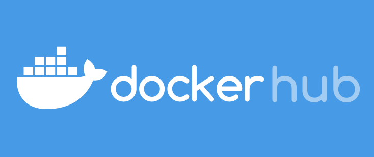
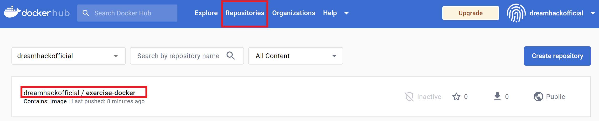
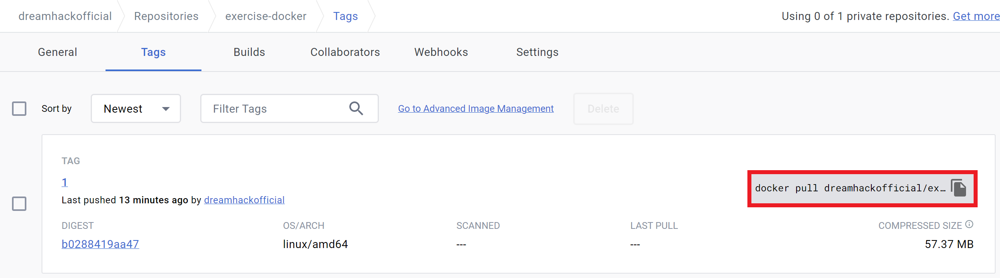
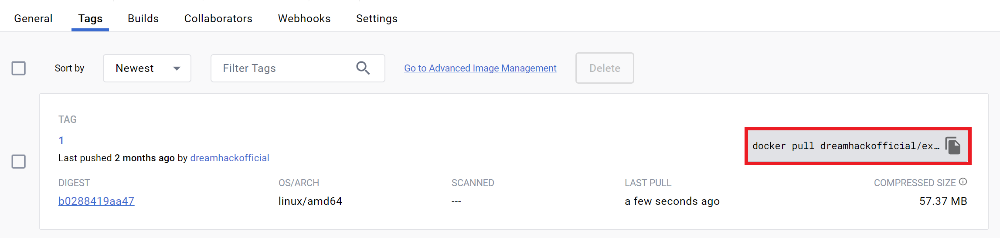

# 도커 허브 활용 가이드 (Docker Hub)

## 작업 식별

| 항목 | 내용 |
|---|---|
| Task ID | CLD-DKR-015-MP |
| 목적 | 로컬에서 빌드한 이미지를 Docker Hub 저장소에 올리고, 다른 곳에서 내려받는다 |
| 적용 대상 | 도커 엔진이 설치된 환경, Docker Hub 계정, 인터넷 연결 |
| 소요 시간 | 약 15분 |
| 확인 상태 | 미검증 (원본 페이지의 절차를 정리한 것이며 실행해 확인하지 않았다) |
| 개정 | R1 (2026-11-18) |

## 1. 참조

| 참조 문서 | Task ID | 제목 |
|---|---|---|
| [도커 이미지 빌드](docker_build.md) | CLD-DKR-009-MP | 이미지 만들기 |
| [도커 컨테이너 이미지화와 Compose 공유](docker-hub-compose-share.md) | CLD-DKR-016-MP | 컨테이너를 이미지로 저장해 공유 |
| [도커 개요](docker.md) | CLD-DKR-001-DO | 레지스트리 개념 |
| [Docker Hub](https://hub.docker.com/) | - | 외부 사이트 |

## 2. 필요 장비와 자재

| 번호 | 이름 | 사양·버전 | 비고 |
|---|---|---|---|
| 1 | 도커 엔진 | 설치 완료 | |
| 2 | Docker Hub 계정 | 사용자명 `<사용자명>` | |
| 3 | `Dockerfile`과 빌드 파일 | | 올릴 이미지의 원본 |

Docker Hub는 도커의 공식 레지스트리(이미지 저장소)다. 다른 사용자가 올린 이미지와 도커가 제공하는 공식 이미지(기본 OS, 언어 개발 환경 등)를 내려받을 수 있다. 비공개 저장소를 만들어 개인이나 팀이 쓸 수도 있다. Docker Hub에는 Dockerfile이 아니라 이미지 자체를 보관한다.

## 3. 안전 사항


WARNING: 공개 저장소에 올린 이미지는 누구나 내려받을 수 있다. 이미지 안에 비밀번호, 토큰, `.env` 내용, 개인 정보가 있으면 함께 공개된다. 올리기 전에 이미지에 비밀값이 없는지 확인한다.



CAUTION: 로그인 비밀번호나 토큰을 문서, 명령 기록, 스크립트에 적지 않는다. `docker login`의 입력 프롬프트에만 입력한다.


## 4. 준비

| 번호 | 항목 | 확인 방법 |
|---|---|---|
| 1 | 도커가 동작한다 | `docker --version`이 버전을 출력한다 |
| 2 | Docker Hub 계정이 있다 | 웹에서 로그인된다 |
| 3 | 올릴 이미지의 `Dockerfile`이 있는 디렉터리를 정한다 | `ls`에 `Dockerfile`이 보인다 |

## 5. 절차

### A. 이미지 올리기

1. (5-A-01) Docker Hub에 로그인한다: `docker login` → 결과: `Username:`과 `Password:` 입력을 요구하고, 성공하면 `Login Succeeded`가 출력된다.
2. (5-A-02) 사용자명과 비밀번호를 입력한다: 사용자명은 `<사용자명>`, 비밀번호는 `<비밀번호>`다. 입력한 비밀번호는 화면에 보이지 않는다.


NOTE: 로그인하면 인증 정보가 `~/.docker/config.json`에 저장된다. 자격 증명 도우미(credential helper)를 설정하지 않으면 암호화되지 않은 상태로 저장된다는 경고가 나온다.


3. (5-A-03) 이미지를 `<사용자명>/<저장소명>:<태그>` 이름으로 빌드한다: `docker build -t <사용자명>/<저장소명>:<태그> <Dockerfile 경로>` → 결과: 마지막 줄에 `naming to docker.io/<사용자명>/<저장소명>:<태그>`가 출력된다.
4. (5-A-04) 이미지를 확인한다: `docker images` → 결과: `<사용자명>/<저장소명>`이 `<태그>`와 함께 보인다.
5. (5-A-05) 이미지를 올린다: `docker push <사용자명>/<저장소명>:<태그>` → 결과: 레이어별로 `Pushed` 또는 `Mounted from`이 출력되고, 마지막 줄에 `digest: sha256:...`이 나온다.
6. (5-A-06) 웹에서 확인한다: Docker Hub의 저장소 페이지를 연다 → 결과: 올린 태그가 목록에 보인다. 화면 우측의 명령을 복사해 다른 사람이 내려받을 수 있다.

### B. 이미지 내려받기

1. (5-B-01) 저장소의 태그를 선택해 제공되는 `docker pull` 명령을 확인한다.

2. (5-B-02) 이미지를 내려받는다: `docker pull <사용자명>/<저장소명>:<태그>` → 결과: 마지막 줄에 `docker.io/<사용자명>/<저장소명>:<태그>`가 출력되고 `Status: Downloaded newer image`가 나온다.
3. (5-B-03) 이미지로 컨테이너를 실행한다: `docker run -it <사용자명>/<저장소명>:<태그>` → 결과: 이미지에 지정된 명령이 실행된다.

## 6. 기능 확인

| 번호 | 확인 동작 | 기대 결과 | 합격 기준 |
|---|---|---|---|
| 1 | 5-A-05 후 Docker Hub 저장소 페이지 | 태그가 보인다 | 올린 `<태그>`가 목록에 있다 |
| 2 | 5-B-02 후 `docker images` | 이미지가 로컬에 있다 | `<사용자명>/<저장소명>`이 `<태그>`로 보인다 |

## 7. 복구

1. (7-01) 로그아웃한다: `docker logout` → 결과: `Removing login credentials`가 출력된다.
2. (7-02) 올린 이미지를 지우려면 Docker Hub 웹의 저장소 설정에서 태그나 저장소를 삭제한다. 이미 내려받은 사람의 복사본은 지워지지 않는다.
3. (7-03) 로컬 이미지를 삭제한다: `docker rmi <사용자명>/<저장소명>:<태그>`

## 8. 개정 이력

| 개정 | 날짜 | 변경 내용 |
|---|---|---|
| R1 | 2026-11-18 | 업로드·다운로드 stepper를 MP 형식으로 재작성. 컨테이너 커밋과 Compose 공유 부분은 CLD-DKR-016-MP로 분리했다. 원본 예시의 특정 계정명·로그인 출력·긴 `push`/`pull` 로그는 `<사용자명>` 표기와 결과 문장으로 바꿨다. 공개 저장소 WARNING을 추가했다 |
