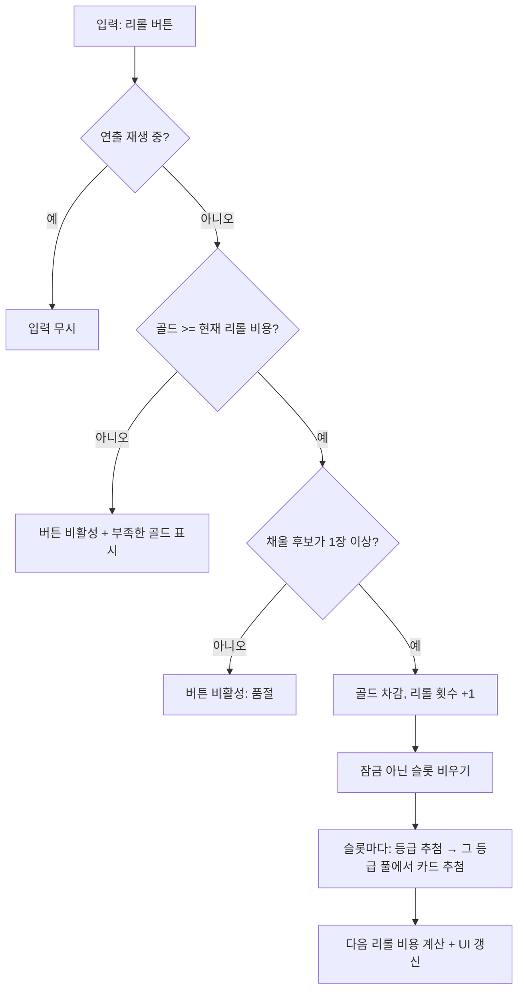
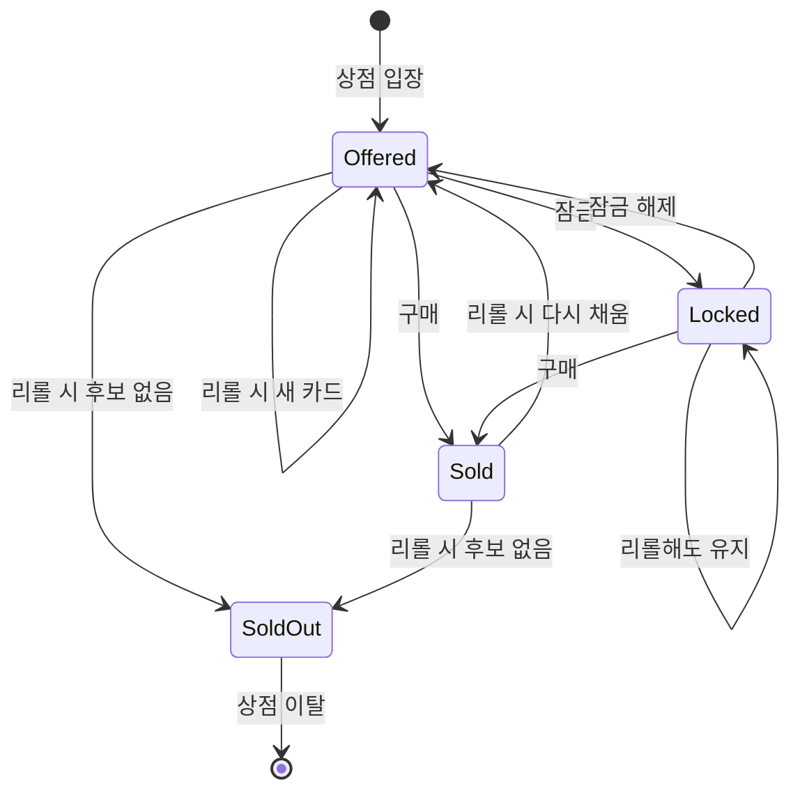

# 예시: 덱빌딩 로그라이트 — 상점 리롤 역기획

> **이 문서는 품질 기준을 보여 주는 예시다.** 가상의 덱빌딩 로그라이트(이하 '예시 게임')를 플레이했다고 가정하고 썼다. 연습 주제(전투 액션, 스트레스 판정 등)와 겹치지 않게 일부러 경제 시스템을 골랐다. 작성 중에는 이 파일을 닫아 둔다.

| 항목 | 내용 |
|---|---|
| 작성일 | 2026-11-17 |
| 소요 시간 | 28분 (+ AI 검증 10분) |
| 근거 | 직접 플레이 약 12시간, 리롤 50회 기록 |
| 한 문장 요약 | 상점 리롤은 플레이어가 골드를 '확률 교정'에 투자하게 만들어, 빌드를 계획하는 재미를 강화한다. |

## ① 목적: 왜 넣었는가

- **유도하는 행동**: 지금 카드를 사서 강해질지, 골드를 써서 원하는 카드를 찾을지 **저울질하게 만든다**.
- **해결하는 문제**: 무작위 상점에서 "운이 나빠서 런이 망했다"는 좌절을 줄이고, 후반에 남아도는 골드를 소모시킨다(골드 싱크).
- **제거 테스트**: 리롤이 없으면 빌드 완성 확률이 상점 방문 횟수에만 달려서 "특정 빌드를 노리는" 플레이가 불가능해진다. 런마다 주어진 카드로 버티는 플레이만 남는다.
- **코어 루프 위치**: 전투 → 골드 보상 → **상점 (구매 / 리롤 / 잠금)** → 덱 강화 → 다음 전투

## ② 작동 플로우: 입력 → 판정 → 출력 → 예외

### 흐름도



### 판정 순서

1. 연출 재생 중인지 (0.3초 동안 상점 입력 전체 잠금)
2. 골드가 현재 비용 이상인지 (`>=`, 같으면 허용)
3. 채울 수 있는 후보가 있는지 → 없으면 **골드를 차감하지 않는다**
4. 골드 차감과 리롤 횟수 증가는 **추첨보다 먼저** 한다. 추첨 도중 앱이 꺼져도 시드와 횟수가 저장돼 있으므로 재접속하면 같은 결과가 복원된다.

### 슬롯 상태 다이어그램



### 상태 전이표

| 현재 상태 | 이벤트 / 조건 | 다음 상태 | 부수 효과 |
|---|---|---|---|
| Offered | 잠금 (잠금 수 < `lock_limit`) | Locked | 자물쇠 아이콘 |
| Offered | 잠금 (잠금 수 = `lock_limit`) | Offered | 거부, "최대 2개" 토스트 |
| Locked | 잠금 해제 | Offered | — |
| Offered / Locked | 구매 (골드 >= 가격) | Sold | 골드 차감, 덱에 추가 |
| Offered / Sold | 리롤 | Offered 또는 SoldOut | 새 카드 진열 |
| Locked | 리롤 | Locked | 카드 유지 |
| 모든 상태 | 상점 이탈 | (소멸) | 잠금 해제, 리롤 횟수 0으로 초기화, 시드 폐기 |

### 예외 상황

| # | 상황 | 처리 | 근거 |
|---|---|---|---|
| 1 | 리롤 연출 중 재입력 | 입력 무시 (버퍼에 쌓지 않음) | 실수로 골드가 두 번 빠지는 것 방지 |
| 2 | 골드 = 비용 | 허용 (`>=`) | 경계값을 명시하지 않으면 구현자마다 다르게 짠다 |
| 3 | 선택된 등급의 풀이 비었음 | 한 단계 낮은 등급에서 추첨, 일반 등급까지 비었으면 SoldOut | 빈 슬롯보다 낮은 등급이라도 보여 주는 편이 낫다 |
| 4 | 채울 후보가 0장 | 리롤 버튼 비활성, 골드 차감 없음 | 돈만 나가고 아무것도 안 바뀌는 행동 차단 |
| 5 | 세이브 후 종료 → 재접속해서 결과 바꾸기 (세이브 스컴) | 결과 = f(상점 시드, 리롤 횟수). 시드는 입장할 때 정해지고 저장된다 | 공짜 리롤 악용 차단 |
| 6 | 보유 상한(`max_owned`)에 도달한 카드 | 후보 풀에서 제외 | 살 수 없는 카드가 슬롯을 차지하지 않게 |
| 7 | 슬롯 수 ≤ 잠금 상한으로 데이터가 잘못 입력됨 | 데이터 검증에서 에러 (`lock_limit < slot_count`) | 모든 슬롯이 잠겨 리롤이 무의미해지는 상태를 데이터 단계에서 차단 |
| 8 | `[AI]` 잠금 슬롯의 카드와 같은 카드가 리롤로 또 나옴 | 잠금 슬롯의 카드도 후보 풀에서 제외 | 같은 카드 2장 진열 방지 (보유 상한 1인 카드가 2장 보이는 문제) |

## ③ 핵심 변수와 데이터 테이블

### 변수

| 변수명 | 타입 | 범위 / 단위 | 의미 | 성격 |
|---|---|---|---|---|
| `reroll_base_cost` | int | 0–100 골드 | 첫 리롤 비용 | 튜닝값 |
| `reroll_cost_step` | int | 0–50 골드 | 리롤 1회마다 증가량 | 튜닝값 |
| `reroll_cost_cap` | int | `base` 이상 | 비용 상한 | 튜닝값 |
| `slot_count` | int | 3–6 | 진열 슬롯 수 | 튜닝값 |
| `lock_limit` | int | 0 – (`slot_count` − 1) | 동시 잠금 가능 수 | 튜닝값 |
| `reroll_count` | int | 0 이상 | 이번 방문에서 한 리롤 횟수 | 런타임값 (저장) |
| `shop_seed` | uint32 | — | 입장할 때 생성되는 난수 시드 | 런타임값 (저장) |
| `slot_state[i]` | enum | Offered / Locked / Sold / SoldOut | 슬롯 상태 | 런타임값 (저장) |

### 테이블 설계

`ShopConfig`: 한 행 = 상점 종류 하나

| 컬럼 | 타입 | 예시 값 | 설명 |
|---|---|---|---|
| `shop_id` | string | `shop_normal` | 고유 키 |
| `slot_count` | int | 5 | |
| `lock_limit` | int | 2 | `slot_count`보다 작아야 함 |
| `reroll_base_cost` | int | 10 | |
| `reroll_cost_step` | int | 5 | |
| `reroll_cost_cap` | int | 50 | `reroll_base_cost` 이상 |
| `rarity_weight_group` | string | `rw_default` | `RarityWeight.group_id` 참조 |

`RarityWeight`: 한 행 = (가중치 그룹, 스테이지, 등급) 하나

| 컬럼 | 타입 | 예시 값 | 설명 |
|---|---|---|---|
| `group_id` | string | `rw_default` | |
| `stage` | int | 3 | |
| `rarity` | enum | `LEGENDARY` | COMMON / RARE / EPIC / LEGENDARY |
| `weight` | int | 2 | 같은 (그룹, 스테이지)의 합이 0보다 커야 함 |

`Card`: 한 행 = 카드 하나

| 컬럼 | 타입 | 예시 값 | 설명 |
|---|---|---|---|
| `card_id` | string | `card_flame_slash` | |
| `rarity` | enum | `RARE` | |
| `price` | int | 75 | 골드 |
| `max_owned` | int | 3 | 0 = 무제한 |
| `shop_enabled` | bool | TRUE | 상점 등장 여부 |

> **설계 메모: 가로형 vs 세로형.** `RarityWeight`를 가로형(`stage | common | rare | epic | legendary`)으로 만들면 한눈에 보기 좋지만, 등급이 하나 늘 때마다 컬럼과 파싱 코드가 바뀐다. 세로형은 행만 추가하면 된다. 편집은 가로형 시트에서 하고 내보낼 때 세로형으로 변환하는 팀도 많다.

스테이지별 가중치 (편집용 가로형 보기):

| 스테이지 | 일반 | 희귀 | 영웅 | 전설 |
|---|---|---|---|---|
| 1 | 75 | 22 | 3 | 0 |
| 2 | 65 | 28 | 6 | 1 |
| 3 | 60 | 30 | 8 | 2 |
| 4 | 50 | 33 | 13 | 4 |

### 핵심 공식

```
리롤 비용(n)       = MIN(base + step × n, cap)        n = 이번 방문에서 이미 한 리롤 횟수 (0부터)
k회 리롤 누적 비용 = 비용(0) + 비용(1) + … + 비용(k−1)
슬롯 하나가 등급 r일 확률 p_r = weight(stage, r) ÷ 같은 스테이지 가중치 합
한 번 진열에 등급 r이 1장 이상 = 1 − (1 − p_r)^(잠금 아닌 슬롯 수)
```

- 비용: 10 → 15 → 20 → … → 45 → 50(9번째 리롤부터 상한)
- 마지막 공식은 해당 등급 풀이 고갈되지 않았을 때만 정확하다 (예외 #3의 하향 대체가 일어나면 달라진다).

### 숫자로 본 의도 (스테이지 3, 슬롯 5개, 잠금 없음)

| 질문 | 계산 | 값 |
|---|---|---|
| 한 번 진열에 전설이 1장 이상 | 1 − 0.98⁵ | 약 9.6% |
| 전설을 50% 확률로 보려면 | 진열 7번 (입장 1 + 리롤 6) | 리롤 비용 135골드 |
| 전설을 90% 확률로 보려면 | 진열 23번 (입장 1 + 리롤 22) | 리롤 비용 920골드 |
| 한 번 진열에 영웅이 1장 이상 | 1 − 0.92⁵ | 약 34% |
| 입장 + 리롤 2번 안에 영웅을 볼 확률 | 1 − 0.92¹⁵ (진열 3번 × 슬롯 5개) | 약 71% (리롤 비용 25골드) |

**해석**: 영웅은 25골드로 71%라서 **계획할 수 있는 대상**이다. 전설은 반반 승부까지는 노릴 수 있지만 확정하려면 920골드가 들어서 **계획할 수 없는 대상**이다. 즉 "빌드는 영웅 카드로 설계하고, 전설은 행운으로 남긴다"는 의도가 숫자로 드러난다.

## ④ 관찰 vs 추정

| 내용 | 관찰 / 추정 | 근거 | 확인 방법 |
|---|---|---|---|
| 리롤 비용이 10 → 15 → 20 선형 증가 | 관찰 | 연속 리롤 3회 | — |
| 비용 상한 50 | 추정 | 8회까지만 확인 | 12회 이상 연속 리롤 |
| 등급을 먼저 뽑고 그 안에서 카드를 뽑는다 | 추정 | 전설 카드 종류가 적은데도 전설 등장 빈도가 일정함 | 등급별 카드 수를 세고 100회 기록과 비교 |
| 재접속해도 리롤 결과가 같다 | 관찰 | 2회 시도 | — |
| 스테이지 3 전설 가중치 2% | 추정 | 리롤 50회(250슬롯) 중 전설 6장 = 2.4% | 표본 늘리기 |

## ⑤ 내가 바꾼다면

- **문제점**: 상점마다 비용이 10으로 초기화되니 "상점에 들어가면 일단 1–2번 리롤"이 지배 전략이 된다. 리롤이 선택이 아니라 의례가 된다.
- **개선안**: 다음 상점의 첫 리롤 비용 = `MAX(base, ROUND(직전 상점 마지막 비용 × 0.5))`
- **예상되는 수치 변화**: 직전 상점에서 6회 리롤했다면(마지막 비용 35) 다음 상점 첫 비용이 10 → 18. 몰아서 리롤하는 런은 비용이 오르고 아끼는 런은 그대로라서, 리롤에 '흐름'이 생긴다.
- **새로 생기는 리스크**: 규칙이 하나 늘어난다. 다음 리롤 비용을 UI에 항상 보여 줘야 한다.

## 점검과 AI 검증

- 스펙 체크리스트: 해당 항목 24개 중 21개 답함 (미답: 접근성, 로컬라이징 길이, 성능)
- 내가 찾은 예외: 7개
- AI 검증 후 추가된 유효 예외: 1개 (#8)

| AI 지적 | 판정 | 이유 |
|---|---|---|
| 잠금 카드와 같은 카드가 리롤로 다시 나올 수 있다 | 유효 → #8 | 후보 제외 규칙에 '이번 진열'만 있고 '잠금 슬롯'이 빠져 있었다 |
| 상한 50에서는 골드만 있으면 무한 리롤로 원하는 카드를 확정할 수 있다 | 유효 → 경제 이슈로 별도 기록 | 후반 골드 수입을 보고 상한을 정해야 한다. 이 문서 범위 밖 |
| 결제 중 네트워크가 끊기면 골드가 중복 차감될 수 있다 | 무효 | 오프라인 싱글 게임이라 해당 없음 |

> **배울 점**: 내가 놓친 #8은 "상태가 바뀌지 않는 슬롯(Locked)이 다른 규칙(후보 풀)과 만나는 지점"이었다. 다음부터는 상태 전이표의 '유지' 행마다 "이 상태가 다른 규칙에 영향을 주는가?"를 묻는다.
