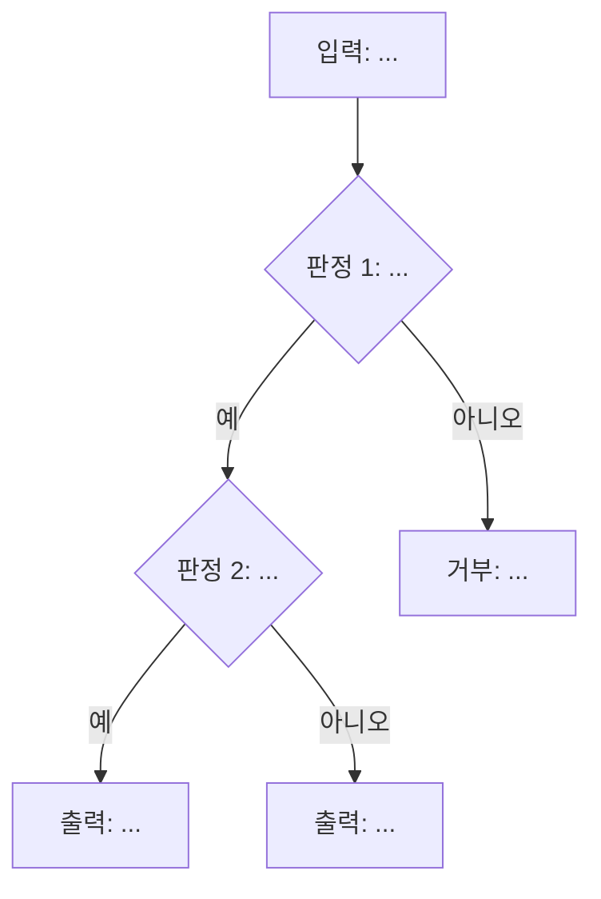

# 역기획 템플릿

## 작업 식별

| 항목 | 내용 |
|---|---|
| Task ID | GMD-SYS-001-REF |
| 유형 | REF (템플릿) |
| 목적 | 기존 게임의 시스템 하나를 목적, 플로우, 데이터로 쪼개 1장으로 정리한다 |
| 확인 상태 | 미검증 (원본을 읽고 형식을 정리했다) |
| 개정 | R1 (2026-11-18) |


NOTE: 위 "작업 식별" 표는 이 문서의 관리용이다. 템플릿을 새 페이지로 복사할 때는 이 표를 제외하고 아래 "새 페이지 제목 양식"부터 복사한다.


## 템플릿

새 페이지 제목 양식: `[게임명] — [시스템명] 역기획`

| 항목 | 내용 |
|---|---|
| 작성일 | YYYY-MM-DD |
| 소요 시간 | 분 |
| 근거 | 직접 플레이 N시간 / 기억 / 영상 (AI·위키 사용 안 함) |
| 한 문장 요약 | [시스템]은 플레이어가 [행동]하게 만들어 [경험/목표]를 강화한다. |

> `>`로 시작하는 인용 블록은 작성 가이드다. 다 쓰면 지운다. 칸마다 3줄 이내를 목표로 한다.

## ① 목적: 왜 넣었는가

> 기능 설명이 아니라 **의도**를 쓴다. "~할 수 있다"가 아니라 "~하게 만든다"로 끝나야 한다.

- **유도하는 행동** (동사로):
- **해결하는 문제**:
- **제거 테스트** (이 시스템을 빼면 무엇이 무너지는가):
- **코어 루프 위치** (루프의 어느 단계에 붙는가):

## ② 작동 플로우: 입력 → 판정 → 출력 → 예외

### 흐름도

> Mermaid 코드 블록으로 그린다. 렌더링 여부는 GitBook 설정에 따라 다르다. 렌더링되지 않으면 손으로 그린 사진을 넣는다. 라벨에 괄호나 기호가 있으면 따옴표로 감싼다.



### 판정 순서

> 조건 여러 개가 동시에 걸릴 때 무엇부터 검사하는가? 순서를 바꾸면 결과가 달라지는 곳이 핵심이다.

1.
2.
3.

### 상태 전이표

> 상태가 2개 이상이면 반드시 쓴다. "모든 상태 × 모든 이벤트" 중 빈칸이 곧 예외 처리 누락이다.

| 현재 상태 | 이벤트 / 조건 | 다음 상태 | 부수 효과 (수치·연출) |
|---|---|---|---|
| | | | |

### 예외 상황

> 최소 5개. 막히면 [스펙 체크리스트](spec-checklist.md)의 '예외'와 '어뷰징' 항목을 본다.

| # | 상황 | 처리 | 근거 (왜 그렇게 처리하나) |
|---|---|---|---|
| 1 | | | |
| 2 | | | |
| 3 | | | |
| 4 | | | |
| 5 | | | |

## ③ 핵심 변수와 데이터 테이블

### 변수

> **튜닝값**은 기획자가 시트에서 바꾸는 값, **런타임값**은 플레이 중에 변하는 값이다. 런타임값은 저장 대상인지도 적는다.

| 변수명 | 타입 | 범위 / 단위 | 의미 | 성격 |
|---|---|---|---|---|
| `example_value` | int | 0–100, % | | 튜닝값 / 런타임값(저장) |

### 테이블 설계 (시트 컬럼)

> 테이블마다 "한 행이 무엇을 뜻하는가"를 먼저 한 줄로 쓴다. 그 문장이 안 써지면 테이블을 잘못 나눈 것이다.

`TableName`: 한 행 = 

| 컬럼 | 타입 | 예시 값 | 설명 |
|---|---|---|---|
| `id` | string | | 고유 키 |
| | | | |

### 핵심 공식

```
결과 = 
```

- 입력이 0일 때 →
- 입력이 최대일 때 →
- 반올림 시점 (매번 / 최종 1회):

## ④ 관찰 vs 추정

> 역기획에는 추측이 섞일 수밖에 없다. 섞인 것을 숨기지 않고 분리해 두는 것이 실력이다.

| 내용 | 관찰 / 추정 | 근거 | 확인 방법 |
|---|---|---|---|
| | | | |

## ⑤ 내가 바꾼다면 (선택)

- 문제점:
- 개선안:
- 예상되는 수치 변화:
- 새로 생기는 리스크:

## 점검과 AI 검증

- 스펙 체크리스트: 해당 항목 __개 중 __개 답함
- 내가 찾은 예외: __개
- AI 검증 후 추가된 유효 예외: __개 (위 표에 `[AI]` 태그로 추가)

| AI 지적 | 판정 (유효/무효) | 이유 |
|---|---|---|
| | | |
