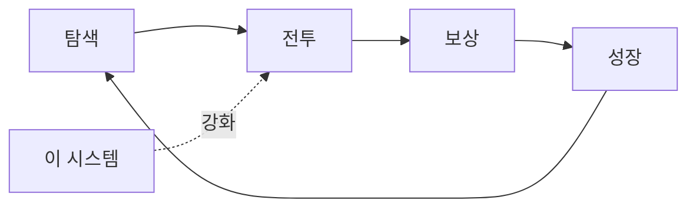
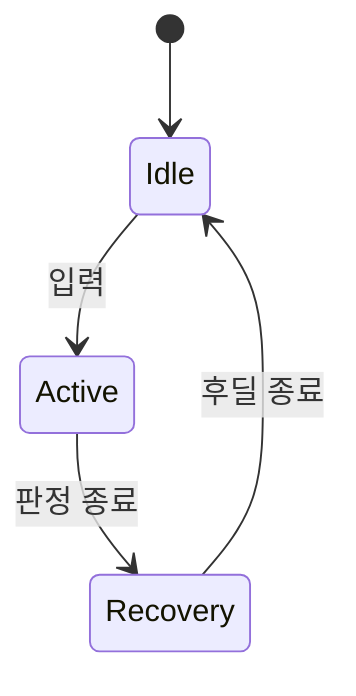

# 시스템 기획서 템플릿

## 작업 식별

| 항목 | 내용 |
|---|---|
| Task ID | GMD-PTF-001-REF |
| 유형 | REF (템플릿) |
| 목적 | 내가 만든 시스템을 포트폴리오용 시스템 기획서로 정리한다 |
| 확인 상태 | 미검증 (원본을 읽고 형식을 정리했다) |
| 개정 | R1 (2026-11-18) |


WARNING: 이 GitBook은 공개다. 템플릿을 채울 때 실명, 회사명, 연락처, 미공개 사업 정보, 내부 수치를 적지 않는다. 적어야 하면 일반화하거나 가린다.



NOTE: 위 "작업 식별" 표는 이 문서의 관리용이다. 템플릿을 새 페이지로 복사할 때는 이 표와 안내를 제외하고 "새 페이지 제목 양식" 줄부터 복사한다.


## 템플릿

새 페이지 제목 양식: `[시스템명] 시스템 기획서`

> 포트폴리오용 시스템 기획서. 근거는 [결정 카드](decision-card-template.md)에서 가져온다. 역기획 1장 요약이 "남의 시스템을 해부하는 연습"이라면, 이 문서는 "내 시스템을 설명하는 실전"이다.

## 0. 1페이지 요약

| 항목 | 내용 |
|---|---|
| 프로젝트 / 장르 / 팀 규모 | |
| 내 역할 | (결정 / 제안 / 실행 범위를 구분해서) |
| 이 시스템이 하는 일 (한 문장) | [시스템]은 플레이어가 [행동]하게 만들어 [핵심 재미]를 강화한다. |
| 핵심 수치 | (예: 패링 판정 6프레임, 그로기까지 평균 8타) |
| 가장 중요한 결정 | (DC-00X 링크) |
| 결과 | (플레이테스트, 지표, 출시 후 반응) |

## 1. 코어 루프와의 연결

> 이 시스템이 루프의 어느 단계에서 무엇을 강화하는지 그린다. 시스템을 빼면 루프의 어디가 끊기는지도 적는다.



- 강화하는 지점:
- 이 시스템이 없으면:

## 2. 조작감과 판정 기준

> 조작감은 형용사가 아니라 **프레임과 거리**로 쓴다. 60fps 기준인지 명시한다.

| 동작 | 선딜(F) | 판정(F) | 후딜(F) | 캔슬 가능 구간 | 입력 버퍼(F) | 이동 거리 |
|---|---|---|---|---|---|---|
| | | | | | | |

- 판정 기준 (히트박스 크기, 판정 우선순위):
- 이 수치를 고른 이유 (비교 대상, 테스트 결과):

## 3. 작동 플로우와 상태



| 현재 상태 | 이벤트 / 조건 | 다음 상태 | 부수 효과 |
|---|---|---|---|
| | | | |

### 예외 처리

| 상황 | 처리 | 근거 |
|---|---|---|
| | | |

## 4. 데이터 테이블과 공식

`TableName`: 한 행 =

| 컬럼 | 타입 | 예시 값 | 설명 |
|---|---|---|---|
| | | | |

```
핵심 공식 = 
```

- 의도한 수치와 그 근거 (밸런스 시트 링크):

## 5. 튜닝 이력

> 수치가 어떻게 바뀌었는지가 이 문서에서 가장 설득력 있는 부분이다.

| 버전 | 변경 | 이유 (관찰 / 데이터) | 결과 |
|---|---|---|---|
| v1 | | | |
| v2 | | | |

## 6. 회고

- 잘된 것:
- 다시 한다면:
- 이 시스템에서 배운 원칙 한 줄:
