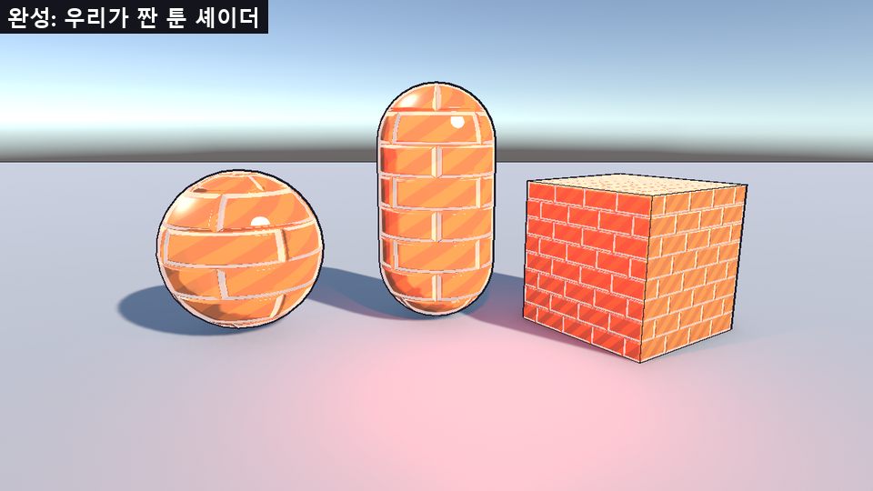

# 툰 셰이더 실습실 (Toon Shader Lab)

빈 Unity 프로젝트에서 HLSL 코드를 직접 입력해 툰 셰이더를 완성하는 22일 과정이다. 하루 분량은 약 1시간이다. 문서 번호(Task ID)는 `GMD-TSL-<번호>-<유형>` 형식이다. Day 01~21은 MP(실습 절차), Day 22는 INS(점검), 액기스는 REF(표)다.




NOTE: 원본에는 모든 날짜의 정답 셰이더를 Unity 6000.3에서 컴파일·렌더링해 확인했다고 적혀 있다. 이 문서의 개정에서는 Unity를 실행하지 않았으므로 모든 문서의 확인 상태는 `미검증`이다. URP 버전에 따라 API가 달라지는 곳은 각 문서에 NOTE로 표시했다.


## 문서 목록

| Task ID | 유형 | 문서 | 새로 배우는 것 |
|---|---|---|---|
| GMD-TSL-001-MP | 절차 | [Day 01. 실험실 열고 첫 셰이더 짜기](day01-first-shader.md) | 셰이더 뼈대, vert/frag, 머티리얼 |
| GMD-TSL-002-MP | 절차 | [Day 02. 버텍스 셰이더 — 점을 움직여 보자](day02-vertex-shader.md) | 좌표 공간, 노멀, `_Time`, `sin` |
| GMD-TSL-003-MP | 절차 | [Day 03. 머티리얼에서 색 고르기 — Properties와 CBUFFER](day03-properties.md) | Properties, CBUFFER, SRP Batcher |
| GMD-TSL-004-MP | 절차 | [Day 04. 택배 상자 늘리기 — 노멀과 UV를 눈으로 보기](day04-varyings-debug.md) | Varyings, 보간, 스위즐 |
| GMD-TSL-005-MP | 절차 | [Day 05. 텍스처 입히고 가위로 오리기](day05-textures.md) | 텍스처 샘플링, 타일링, `clip` |
| GMD-TSL-006-MP | 절차 | [Day 06. 첫 조명 — 손전등과 내적](day06-first-light.md) | 내적, 하프 램버트, `GetMainLight` |
| GMD-TSL-007-MP | 절차 | [Day 07. 툰 셰이딩의 심장 — 미끄럼틀을 계단으로](day07-toon-steps.md) | `smoothstep`, 함수, `lerp` |
| GMD-TSL-008-MP | 절차 | [Day 08. 그림자 받기 — 빛이 찍어 둔 거리 사진](day08-receive-shadows.md) | 섀도맵, `multi_compile` |
| GMD-TSL-009-MP | 절차 | [Day 09. 그림자 드리우기 — 패스를 더 만들고 코드를 나눠 쓰기](day09-cast-shadows.md) | `HLSLINCLUDE`, ShadowCaster, DepthOnly |
| GMD-TSL-010-MP | 절차 | [Day 10. 하늘빛과 안개 — 그림자 속이 깜깜하지 않은 이유](day10-ambient-fog.md) | SH 환경광, 안개 |
| GMD-TSL-011-MP | 절차 | [Day 11. 보조 조명 — 그리고 나만의 공구함 파일](day11-additional-lights.md) | 보조 조명 루프, Forward+, `.hlsl` 파일 |
| GMD-TSL-012-MP | 절차 | [Day 12. 림 라이트 — 테두리만 빛나게](day12-rim-light.md) | 프레넬, 시선 방향 V |
| GMD-TSL-013-MP | 절차 | [Day 13. 외곽선 ① — 뒤집힌 풍선](day13-outline-pass.md) | 두 번째 패스, `Cull Front` |
| GMD-TSL-014-MP | 절차 | [Day 14. 외곽선 ② — 두께를 픽셀로 고정하기](day14-outline-pixels.md) | 클립 공간 `w`, NDC |
| GMD-TSL-015-MP | 절차 | [Day 15. 반짝임 — 거울에 비친 해](day15-specular.md) | 하프 벡터, `pow` |
| GMD-TSL-016-MP | 절차 | [Day 16. MatCap — 반사가 그려진 구슬 스티커](day16-matcap.md) | 뷰 공간 노멀에서 UV |
| GMD-TSL-017-MP | 절차 | [Day 17. 노멀맵 — 빛에게만 하는 거짓말](day17-normal-map.md) | 탄젠트 공간, `cross` |
| GMD-TSL-018-MP | 절차 | [Day 18. 키워드 — 기능을 켜고 끄는 스위치](day18-keywords.md) | 키워드, 배리언트, `shader_feature` |
| GMD-TSL-019-MP | 절차 | [Day 19. 노멀 지도와 SSAO — 구석의 그늘](day19-depthnormals-ssao.md) | DepthNormals 패스, SSAO |
| GMD-TSL-020-MP | 절차 | [Day 20. 양면 그리기와 마무리 점검](day20-two-sided.md) | `Cull [_Cull]`, `IS_FRONT_VFACE`, 점검 |
| GMD-TSL-021-MP | 절차 | [Day 21. 화면 공간 외곽선 — 다 그린 그림 위에 펜으로](day21-screen-outline.md) | 풀스크린 셰이더, Renderer Feature |
| GMD-TSL-022-INS | 점검 | [Day 22. 졸업 — 내가 짠 셰이더 돌아보기](day22-graduation.md) | 전체 점검, 실제 게임 셰이더와 비교 |
| GMD-TSL-023-REF | 표 | [액기스 모음 — 22일치 핵심만](essence.md) | Day별 핵심 규칙과 코드 한 줄 |

짝꿍 과정 [툰 셰이더 공부 노트](../toon-shader-study/README.md)는 실제 게임에 쓰는 툰 셰이더를 읽으며 배우는 자료다. 이 과정에서 직접 만들고 그쪽에서 실전 구현을 본다. 각 Day의 참조 절에 대응 문서가 있다.

## 읽는 순서

1. 시작하기 절의 환경을 준비한다.
2. Day 01부터 번호 순서로 진행한다. 각 Day는 이전 Day의 코드 위에 추가한다.
3. 막히면 정답 셰이더(`Assets/Solutions/DayNN/`)와 비교한다.
4. 각 Day를 마칠 때 [액기스 모음](essence.md)의 해당 Day를 읽는다.

## 시작하기

1. Unity 6000.3(Unity 6.3 LTS)을 설치한다. 원본은 6000.3.27f2로 만들었다.
2. 저장소를 클론하고 작업용 브랜치를 만든다. 실습 저장소 [toon-shader-lab](https://github.com/JJH0204/toon-shader-lab)은 비공개이며 접근 권한이 필요하다.

   ```bash
   git clone https://github.com/JJH0204/toon-shader-lab.git
   cd toon-shader-lab
   git switch -c my-toon
   ```

3. Unity Hub에서 `Add` > `Add project from disk`로 이 폴더를 연다.
4. 프로젝트가 열리면 `Assets/Scenes/Lab`을 연다.
5. [Day 01](day01-first-shader.md)부터 시작한다.

## 폴더 규칙

| 폴더 | 내용 |
|---|---|
| `Assets/MyToon/` | 직접 작성하는 곳. 처음에는 없고 Day 01에 만든다 |
| `Assets/Solutions/DayNN/` | 날짜별 정답. 그날 끝난 상태의 셰이더 전체와 머티리얼. 셰이더 이름은 `Solutions/DayNN` |
| `Assets/Scenes/Lab.unity` | 실험 씬: 구, 캡슐, 큐브, 바닥, 해, 꺼진 빨간 전구, 꺼진 그림자 막대 |
| `Assets/Textures/` | 실습 텍스처: 줄무늬와 구멍(`Lab_Base`), MatCap 공(`Lab_MatCap`), 벽돌 노멀맵(`Lab_Normal`) |
| `Assets/LabTools/` | 메뉴 `Lab > Rebuild Lab Scene`(씬 초기화)과 문서용 캡처 도구 |
| `tools/` | 정답 셰이더와 문서 이미지를 다시 만드는 스크립트 (학습에는 필요 없다) |

## 커리큘럼

### 1주차: 셰이더의 뼈대

| Day | 만드는 것 | 새로 배우는 것 |
|---|---|---|
| [01](day01-first-shader.md) | 단색 셰이더 | 셰이더 뼈대, vert/frag, 머티리얼 |
| [02](day02-vertex-shader.md) | 숨쉬는 물체 | 좌표 공간, 노멀, `_Time`, `sin` |
| [03](day03-properties.md) | Inspector에서 색 고르기 | Properties, CBUFFER, SRP Batcher |
| [04](day04-varyings-debug.md) | 노멀, UV 디버그 보기 | Varyings, 보간, 스위즐 |
| [05](day05-textures.md) | 텍스처와 구멍 뚫기 | 텍스처 샘플링, 타일링, `clip` |

### 2주차: 빛과 그림자

| Day | 만드는 것 | 새로 배우는 것 |
|---|---|---|
| [06](day06-first-light.md) | 해를 받는 물체 | 내적, 하프 램버트, `GetMainLight` |
| [07](day07-toon-steps.md) | 툰 계단 두 칸 | `smoothstep`, 함수, `lerp` |
| [08](day08-receive-shadows.md) | 그림자 받기 | 섀도맵, `multi_compile` |
| [09](day09-cast-shadows.md) | 그림자 드리우기 | `HLSLINCLUDE`, ShadowCaster, DepthOnly |
| [10](day10-ambient-fog.md) | 맑은 그림자와 안개 | SH 환경광, 안개 |
| [11](day11-additional-lights.md) | 빨간 전구 받기 | 보조 조명 루프, Forward+, `.hlsl` 파일 |

### 3주차: 툰 효과

| Day | 만드는 것 | 새로 배우는 것 |
|---|---|---|
| [12](day12-rim-light.md) | 테두리 빛 | 프레넬, 시선 방향 V |
| [13](day13-outline-pass.md) | 외곽선 | 두 번째 패스, `Cull Front` |
| [14](day14-outline-pixels.md) | 항상 2픽셀 외곽선 | 클립 공간 `w`, NDC |
| [15](day15-specular.md) | 만화식 반짝임 | 하프 벡터, `pow` |
| [16](day16-matcap.md) | MatCap 광택 | 뷰 공간 노멀에서 UV |
| [17](day17-normal-map.md) | 벽돌 노멀맵 | 탄젠트 공간, `cross` |

### 4주차: 마무리

| Day | 만드는 것 | 새로 배우는 것 |
|---|---|---|
| [18](day18-keywords.md) | 기능 체크박스 | 키워드, 배리언트, `shader_feature` |
| [19](day19-depthnormals-ssao.md) | 구석 그늘 | DepthNormals 패스, SSAO |
| [20](day20-two-sided.md) | 양면 그리기 | `Cull [_Cull]`, `IS_FRONT_VFACE`, 점검 |
| [21](day21-screen-outline.md) | 화면 공간 외곽선 | 풀스크린 셰이더, Renderer Feature |
| [22](day22-graduation.md) | 졸업 점검 | 전체 복습, 실제 게임 셰이더와 비교 |

### 진도 체크

- [ ] 01
- [ ] 02
- [ ] 03
- [ ] 04
- [ ] 05
- [ ] 06
- [ ] 07
- [ ] 08
- [ ] 09
- [ ] 10
- [ ] 11
- [ ] 12
- [ ] 13
- [ ] 14
- [ ] 15
- [ ] 16
- [ ] 17
- [ ] 18
- [ ] 19
- [ ] 20
- [ ] 21
- [ ] 22

## 수학 참고

| 수학 | 처음 나오는 Day | 참고 자료 |
|---|---|---|
| 좌표 변환, 행렬 | Day 02 | [3Blue1Brown 선형 변환](https://www.3blue1brown.com/lessons/linear-transformations) |
| sin 파도 | Day 02 | [위키백과 삼각함수](https://ko.wikipedia.org/wiki/%EC%82%BC%EA%B0%81%ED%95%A8%EC%88%98) |
| 벡터, 내적 | Day 06 | [3Blue1Brown 내적](https://www.3blue1brown.com/lessons/dot-products) |
| smoothstep, lerp | Day 07 | [The Book of Shaders Shaping Functions (한국어)](https://thebookofshaders.com/05/?lan=kr) |
| 동차좌표 `w` | Day 14 | [위키백과 동차좌표](https://ko.wikipedia.org/wiki/%EB%8F%99%EC%B0%A8%EC%A2%8C%ED%91%9C) |
| 외적 | Day 17 | [3Blue1Brown 외적](https://www.3blue1brown.com/lessons/cross-products) |

## 정답 재생성 (관리용)

- 정답 셰이더는 `tools/templates/*.tpl` 한 벌에서 날짜별로 생성한다: `python tools/gen_solutions.py`. 템플릿의 `//@ 9-`(9일차부터), `//@ -8`(8일차까지), `//@ end` 표시로 날짜별 코드를 고른다.
- 문서 이미지: 에디터에서 `ToonShaderLab.Editor.LabDocCaptures.CaptureAll("<폴더>")`를 실행한 뒤 `python tools/compose_docs_images.py <폴더>`를 실행한다.
- 개념 그림(`docs/images/concept-*.png`)은 [toon-shader-study](../toon-shader-study/README.md)의 `tools/`에서 만든 것이다.

## 원본 레포

* [JJH0204/toon-shader-lab](https://github.com/JJH0204/toon-shader-lab) (비공개, 참고용): 실습용 Unity 프로젝트가 있는 레포다. 레슨은 이 GitBook에서 본다.
