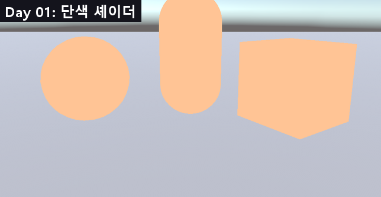
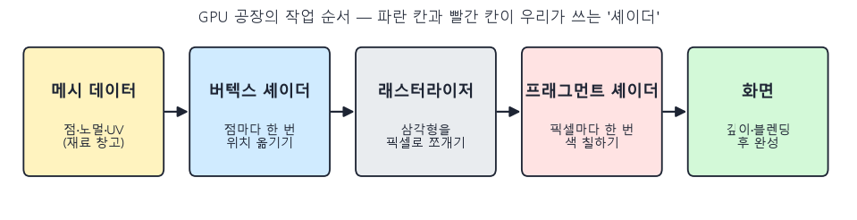

# Day 01. 실험실 열고 첫 셰이더 짜기

> ⏱ **약 1시간** — 프로젝트 열기 15분 · 코드 치기 25분 · 실험 20분
> 🧸 **오늘의 비유**: 셰이더는 **GPU 아르바이트생 수천 명이 똑같이 받는 작업 지시서**예요. 오늘은 "전부 주황색으로 칠해!"라는 한 줄짜리 지시서를 써요.



## 오늘 만들 것

물체를 **단색으로 칠하는 가장 작은 셰이더**. 빛도 그림자도 없어서 납작한 그림자 인형처럼 보여요. 이 40줄이 앞으로 22일 동안 자랄 씨앗이에요.

## 오늘 배울 것

- [ ] 실습 프로젝트를 열고 Lab 씬을 띄울 수 있다
- [ ] `.shader` 파일과 머티리얼을 만들어 물체에 입힐 수 있다
- [ ] 셰이더 파일의 뼈대(`Shader` / `SubShader` / `Pass` / `HLSLPROGRAM`)를 안다
- [ ] 버텍스 셰이더와 프래그먼트 셰이더가 각각 무슨 일을 하는지 안다
- [ ] 셰이더 오류가 나면 어디서 읽는지 안다

---

## 1. 실험실 열기 (15분)

실습 프로젝트는 **빈 Unity 6 URP 프로젝트**예요. 부모 프로젝트와 상관없이 혼자 돌아가요.

1. 레포를 클론해요.
   ```bash
   git clone https://github.com/JJH0204/toon-shader-lab.git
   cd toon-shader-lab
   git switch -c my-toon        # 내 작업용 브랜치. 정답(main)과 섞이지 않게
   ```
2. Unity Hub → **Add** → **Add project from disk** → 클론한 폴더 선택. 에디터 버전은 **6000.3.27f2**(Unity 6.3 LTS)예요. 다른 6000.3.x도 괜찮아요.
3. 처음 열 때는 라이브러리를 만드느라 몇 분 걸려요.
4. Project 창에서 `Assets/Scenes/Lab`을 더블클릭해요.

Lab 씬에 이미 들어 있는 것:

| 이름 | 하는 일 |
|---|---|
| Sphere · Capsule · Cube | 우리 셰이더를 입힐 **실험 대상** 셋 (둥근 것, 긴 것, 각진 것) |
| Ground | 바닥. Unity 기본 Lit 셰이더라 그림자를 잘 받아요 |
| Directional Light | 해. 오른쪽 앞 위에서 비춰요 |
| Point Light | 빨간 전구. **꺼져 있어요** (Day 11에서 켜요) |
| Shadow Beam | 화면 밖 위쪽에 떠 있는 막대. **꺼져 있어요** (Day 08에서 켜요) |


씬을 망가뜨렸다면 메뉴 **Lab → Rebuild Lab Scene**으로 처음 상태로 되돌릴 수 있어요.


## 2. 셰이더 파일 만들기

1. Project 창 `Assets`에서 우클릭 → **Create → Folder** → 이름 `MyToon`. **앞으로 내가 짜는 코드는 전부 여기**에 둬요.
2. `MyToon` 폴더에서 우클릭 → **Create → Shader → Unlit Shader** → 이름 `MyToon`.
3. 만들어진 `MyToon.shader`를 더블클릭해서 코드 편집기로 열어요.
4. 안에 들어 있는 코드를 **전부 지워요.** (옛날 방식 셰이더 예제라 우리와 안 맞아요.)

## 3. 코드 치기 (25분)

아래 코드를 **복사하지 말고 직접 쳐 보세요.** 손으로 치면서 단어 하나하나에 눈이 가는 게 공부예요.

```shaderlab
Shader "MyToon/Toon"
{
    SubShader
    {
        Tags { "RenderPipeline" = "UniversalPipeline" "RenderType" = "Opaque" "Queue" = "Geometry" }

        Pass
        {
            Name "Forward"
            Tags { "LightMode" = "UniversalForward" }

            HLSLPROGRAM
            #pragma vertex vert
            #pragma fragment frag

            #include "Packages/com.unity.render-pipelines.universal/ShaderLibrary/Core.hlsl"

            struct Attributes
            {
                float4 positionOS : POSITION;
            };

            struct Varyings
            {
                float4 positionCS : SV_POSITION;
            };

            Varyings vert(Attributes input)
            {
                Varyings o = (Varyings)0;
                o.positionCS = TransformObjectToHClip(input.positionOS.xyz);   // 오브젝트 주소 → 클립 주소
                return o;
            }

            half4 frag(Varyings input) : SV_Target
            {
                return half4(1.0h, 0.55h, 0.3h, 1.0h);   // 주황색 (R, G, B, A)
            }
            ENDHLSL
        }
    }
}
```

저장하고 Unity로 돌아오면 자동으로 컴파일돼요.

## 4. 머티리얼 만들어 입히기

**셰이더 = 레시피, 머티리얼 = 그 레시피로 만든 한 접시**예요.

1. `MyToon` 폴더 우클릭 → **Create → Material** → 이름 `MyToon`.
2. 머티리얼 Inspector 맨 위 **Shader** 드롭다운 → **MyToon → Toon**.
3. 머티리얼을 Scene 뷰의 Sphere, Capsule, Cube 위로 **끌어다 놓아요.**

맨 위 그림처럼 세 물체가 **주황색 그림자 인형**이 되면 성공이에요! 🎉


`Assets/Solutions/Day01/MyToon.shader`가 오늘의 **정답**이에요. 이름만 `Solutions/Day01`로 다르고 내용은 같아요. 막히면 열어서 비교하세요.


## 5. 한 줄씩 뜯어보기



GPU는 위 그림 순서로 일해요. 우리가 쓴 건 **파란 칸(vert)** 과 **빨간 칸(frag)** 이에요.

| 코드 | 뜻 |
|---|---|
| `Shader "MyToon/Toon"` | 셰이더 이름. `/`는 드롭다운의 폴더가 돼요 |
| `SubShader` + `Tags { "RenderPipeline" = "UniversalPipeline" ... }` | "URP 주방용 레시피예요". `Queue = Geometry`는 보통 물체 순서로 그리라는 뜻 |
| `Pass` | 화면에 **한 번 그리기**. 나중에 그림자용, 외곽선용 패스가 더 생겨요 |
| `Tags { "LightMode" = "UniversalForward" }` | "URP가 **색칠할 때** 이 패스를 불러 주세요" 이름표 |
| `HLSLPROGRAM` … `ENDHLSL` | 여기부터 GPU가 실제로 실행하는 코드(HLSL) |
| `#pragma vertex vert` | "버텍스 셰이더는 `vert` 함수예요" |
| `#pragma fragment frag` | "프래그먼트 셰이더는 `frag` 함수예요" |
| `#include ".../Core.hlsl"` | URP 공구함 가져오기. `TransformObjectToHClip` 같은 함수가 여기 있어요 |
| `struct Attributes` | 📦 메시 → 버텍스 셰이더로 오는 **택배 상자**. `: POSITION`은 "정점 위치를 이 칸에" 라는 이름표 |
| `struct Varyings` | 📦 버텍스 → 프래그먼트로 가는 택배 상자. `SV_POSITION`(화면 위치)은 **필수** 칸 |
| `vert` | 점 하나마다 한 번. "이 점이 화면 어디에 찍히나?"를 계산 |
| `frag` | 픽셀 하나마다 한 번. "이 픽셀은 무슨 색?"을 돌려줘요. `: SV_Target` = "이게 최종 색" |
| `half4(1.0h, 0.55h, 0.3h, 1.0h)` | 빨강 1, 초록 0.55, 파랑 0.3, 불투명도 1. `h`는 "half 숫자예요" 표시 |

`OS`, `CS` 같은 변수 이름 끝은 **어느 동네 주소인지**를 알려줘요(Day 02에서 자세히). `positionOS`는 오브젝트 기준 위치, `positionCS`는 클립(화면 직전) 위치예요.

## 6. 실험해 보기 (20분)

1. **색 바꾸기** — `half4(0.3h, 0.8h, 1.0h, 1.0h)`로 바꾸면? 하늘색이 돼요.
2. **일부러 틀려 보기** — `return` 줄 끝의 `;`를 지우고 저장하세요.
   - 물체가 **분홍색(마젠타)** 으로 변해요. "셰이더가 망가졌어요!" 신호예요.
   - **Console** 창(Window → General → Console)과 셰이더 파일 Inspector에 오류가 몇 번째 줄인지 나와요.
   - `;`를 되돌리면 다시 주황색. **오류 메시지를 읽는 습관**이 셰이더 공부의 절반이에요.
3. **이름 바꾸기** — `Shader "MyToon/Toon"`을 `Shader "Study/Hello"`로 바꾸면 머티리얼 드롭다운에서 위치가 바뀌어요. (확인 후 되돌려 두세요. 다음 날 설명이 `MyToon/Toon`을 기준으로 해요.)
4. **커밋하기** — 오늘 작업을 저장해요.
   ```bash
   git add Assets/MyToon
   git commit -m "Day 01: 단색 셰이더"
   ```

## 7. 오늘의 액기스

👉 [ESSENCE.md — Day 01](essence.md#day-01)

## 더 읽을거리

- 개념을 더 천천히: [toon-shader-study Day 01 — 셰이더가 뭐예요?](../toon-shader-study/day01-what-is-a-shader.md) · [Day 03 — 셰이더 파일의 뼈대](../toon-shader-study/day03-shaderlab-skeleton.md)
- [The Book of Shaders (한국어)](https://thebookofshaders.com/?lan=kr) · [LearnOpenGL — Hello Triangle](https://learnopengl.com/Getting-started/Hello-Triangle) (파이프라인 그림)
- [URP에서 셰이더 쓰기 (Unity 공식)](https://docs.unity3d.com/Packages/com.unity.render-pipelines.universal@17.0/manual/writing-custom-shaders-urp.html)

---

[목차](README.md) · [다음: Day 02 →](day02-vertex-shader.md)
