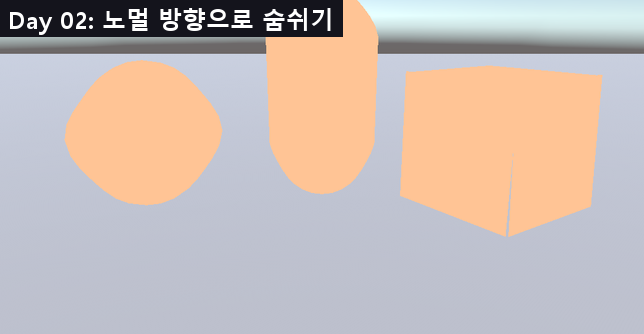

# Day 02. 버텍스 셰이더 — 점을 움직여 보자

## 작업 식별

| 항목 | 내용 |
|---|---|
| Task ID | GMD-TSL-002-MP |
| 목적 | 정점을 월드 공간에서 노멀 방향으로 움직여 시간에 따라 부풀었다 줄어드는 물체를 만든다 |
| 적용 대상 | Unity 6000.3, URP 17.x. Day 01 완료 상태의 `MyToon.shader` |
| 소요 시간 | 약 60분 (개념 20분, 코드 15분, 실험 25분) |
| 확인 상태 | 미검증 (원본 코드를 읽고 정리한 것이며 이 환경에서 컴파일·실행하지 않았다) |
| 개정 | R1 (2026-11-18) |


NOTE: 숨쉬기 효과는 이 Day의 실험용이다. Day 03에서 원래 코드로 되돌린다. 실제 툰 셰이더는 정점을 움직이지 않지만, 버텍스 셰이더가 할 수 있는 일을 확인하는 것이 목적이다.



NOTE: `TransformObjectToWorld`, `TransformObjectToWorldNormal`, `TransformWorldToHClip`, `_Time`은 URP 버전에 따라 이름과 정의 위치가 다를 수 있다. URP 버전 확인 필요.


## 1. 참조

| 참조 문서 | Task ID | 제목 |
|---|---|---|
| [day01-first-shader.md](day01-first-shader.md) | GMD-TSL-001-MP | 이전: 첫 셰이더 |
| [day03-properties.md](day03-properties.md) | GMD-TSL-003-MP | 다음: Properties와 CBUFFER |
| [toon-shader-study Day 02](../toon-shader-study/day02-coordinate-spaces.md) | - | 좌표 공간 (짝꿍 과정) |
| [3Blue1Brown 벡터](https://www.3blue1brown.com/lessons/vectors), [선형 변환](https://www.3blue1brown.com/lessons/linear-transformations), [행렬 곱셈](https://www.3blue1brown.com/lessons/matrix-multiplication) | - | 수학 참고 |
| [LearnOpenGL Transformations](https://learnopengl.com/Getting-started/Transformations), [Coordinate Systems](https://learnopengl.com/Getting-started/Coordinate-Systems) | - | 좌표 변환 참고 |
| [위키백과 삼각함수](https://ko.wikipedia.org/wiki/%EC%82%BC%EA%B0%81%ED%95%A8%EC%88%98) | - | `sin` 참고 |

## 2. 필요 장비와 자재

| 번호 | 이름 | 사양·버전 | 비고 |
|---|---|---|---|
| 1 | Day 01의 `Assets/MyToon/MyToon.shader` | GMD-TSL-001-MP 완료 | |
| 2 | Lab 씬 | `Assets/Scenes/Lab` | |

## 3. 안전 사항


CAUTION: 수정 전에 현재 셰이더 파일을 커밋하거나 복사해 둔다. 실험 후 Day 03에서 되돌릴 때 기준이 된다.


## 4. 준비

| 번호 | 항목 | 확인 방법 |
|---|---|---|
| 1 | Day 01 셰이더가 주황색으로 보인다 | Lab 씬 물체 셋이 주황색이다 |
| 2 | Console에 오류가 없다 | 빨간 오류 0건 |

## 5. 절차

### A. 개념 확인: 좌표 공간

같은 점도 기준에 따라 주소(좌표)가 다르다.

| 공간 | 변수 끝 | 기준 | 예 |
|---|---|---|---|
| 오브젝트 | `OS` | 모델 자신 | 모델 원점에서 오른쪽 10cm |
| 월드 | `WS` | 씬 전체 | 씬 원점 기준 좌표 |
| 뷰 | `VS` | 카메라 | 카메라에서 앞으로 50cm |
| 클립 | `CS` | 화면 직전 상자 (`x, y, z, w`) | GPU가 `w`로 나누기 전의 값 |

Day 01의 `TransformObjectToHClip`은 오브젝트에서 클립으로 한 번에 변환했다. 이 Day에서는 월드 공간을 거쳐 위치를 수정한다. `TransformAToB`는 A 공간 좌표를 B 공간 좌표로 바꾸는 함수다. 변환은 행렬이 수행하며 URP가 행렬을 미리 제공한다.


NOTE: `HClip`의 H는 동차(Homogeneous)를 뜻한다. 클립 좌표는 `x, y, z, w` 4개이며, GPU가 마지막에 `x, y`를 `w`로 나눠(원근 나눗셈) 먼 물체를 작게 만든다. `w`는 Day 14에서 다시 사용한다.


### B. Attributes에 노멀 추가

노멀(normal)은 표면이 바라보는 방향의 단위 벡터다.

1. (5-B-01) `struct Attributes`를 다음과 같이 수정한다. → 결과: 저장 후 컴파일 오류가 없다.

```hlsl
struct Attributes
{
    float4 positionOS : POSITION;
    float3 normalOS   : NORMAL;      // 추가: 표면이 바라보는 방향
};
```

### C. vert 함수 수정

1. (5-C-01) `vert` 함수 전체를 다음으로 바꾼다. → 결과: 저장 후 컴파일 오류가 없다.

```hlsl
Varyings vert(Attributes input)
{
    Varyings o = (Varyings)0;
    float3 positionWS = TransformObjectToWorld(input.positionOS.xyz);
    float3 normalWS   = TransformObjectToWorldNormal(input.normalOS);
    // 숨쉬기: 시간에 따라 노멀 방향으로 부풀었다 줄었다 한다. 높이마다 박자가 다르다.
    positionWS += normalWS * (sin(_Time.y * 3.0 + positionWS.y * 8.0) * 0.03);
    o.positionCS = TransformWorldToHClip(positionWS);
    return o;
}
```

| 줄 | 동작 |
|---|---|
| `TransformObjectToWorld` | 오브젝트 좌표를 월드 좌표로 바꾼다 |
| `TransformObjectToWorldNormal` | 노멀을 월드 방향으로 바꾼다. 노멀은 위치가 아니라 방향이므로 전용 함수를 쓴다. 비균등 스케일에도 노멀이 틀어지지 않는다 |
| `_Time.y` | 게임 시작 후 경과 시간(초). URP가 매 프레임 넣는다 |
| `sin(...)` | -1과 1 사이를 오가는 값. 시간을 넣으면 왕복한다 |
| `positionWS.y * 8.0` | 높이를 섞어 위치마다 박자를 다르게 한다 |
| `* 0.03` | 최대 이동량을 0.03 단위(미터)로 제한한다 |
| `positionWS += normalWS * (...)` | 노멀 방향으로 민다. 부풀리기 효과다 |
| `TransformWorldToHClip` | 수정한 월드 좌표를 클립 좌표로 바꾼다 |


NOTE: "노멀 방향으로 민다"는 Day 13의 외곽선(법선 확장)에서 같은 방식으로 쓴다.


### D. 화면 확인

1. (5-D-01) Scene 뷰 툴바의 `Effects` 메뉴에서 `Always Refresh`를 켠다. 또는 `Play`를 누른다. → 결과: 물체 표면이 위로 올라가는 물결처럼 부풀었다 줄어든다. (Scene 뷰는 기본값에서 `_Time`이 갱신되지 않을 수 있다.)
2. (5-D-02) 움직임이 없으면 Console의 오류를 확인한다. → 결과: 오타(특히 `TransformObjectToWorldNormal`)가 흔한 원인이다.



정답 파일: [`Assets/Solutions/Day02/MyToon.shader`](https://github.com/JJH0204/toon-shader-lab/blob/main/Assets/Solutions/Day02/MyToon.shader)

### E. 실험

1. (5-E-01) 진폭을 키운다: `0.03`을 `0.2`로 바꾼다. → 결과: 풍선처럼 부푼다. Cube는 면이 서로 떨어져 보인다. 큐브는 모서리 정점이 면마다 따로 있어 노멀이 서로 다르기 때문이다. Day 13에서 외곽선을 만들 때 같은 문제를 다시 다룬다.
2. (5-E-02) 좌표 공간을 바꿔 본다: `positionWS.y * 8.0`을 `input.positionOS.y * 8.0`으로 바꾸고 Capsule을 위로 옮긴다. → 결과: `positionWS.y`일 때는 물결이 씬에 고정돼 물체 위를 미끄러진다. `positionOS.y`일 때는 물결이 물체와 함께 움직인다.
3. (5-E-03) 좌우 흔들림을 추가한다: `TransformWorldToHClip` 줄 앞에 `positionWS.x += sin(_Time.y * 2.0) * 0.3;`을 넣는다. → 결과: 세 물체가 같은 박자로 좌우로 흔들린다.
4. (5-E-04) 커밋한다: `git commit -am "Day 02: 숨쉬는 버텍스 셰이더"`

## 6. 기능 확인

| 번호 | 확인 동작 | 기대 결과 | 합격 기준 |
|---|---|---|---|
| 1 | `Always Refresh`를 켜고 Scene 뷰를 본다 | 표면이 물결치듯 움직인다 | 3초 안에 형태 변화가 보인다 |
| 2 | Console을 본다 | 오류 없음 | 빨간 오류 0건 |
| 3 | 5-E-02 실험을 한다 | 좌표 공간에 따라 무늬 고정 대상이 달라진다 | 두 경우의 차이를 설명할 수 있다 |

## 7. 복구

1. (7-01) 숨쉬기를 제거한다: Day 03의 5-A 절차를 따른다(GMD-TSL-003-MP). `vert`를 Day 01의 한 줄 변환으로 되돌린다.
2. (7-02) 에디터에서 되돌린다: `Ctrl+Z` 또는 `git restore Assets/MyToon/MyToon.shader`.

## 8. 개정 이력

| 개정 | 날짜 | 변경 내용 |
|---|---|---|
| R1 | 2026-11-18 | 기존 Day 02 페이지를 AMM 형식으로 재작성. 비유 삭제, 외부 링크를 참조 절로 이동 |

[← Day 01](day01-first-shader.md) · [목차](README.md) · [다음: Day 03 →](day03-properties.md)
