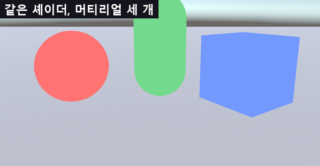

# Day 03. 머티리얼에서 색 고르기 — Properties와 CBUFFER

## 작업 식별

| 항목 | 내용 |
|---|---|
| Task ID | GMD-TSL-003-MP |
| 목적 | 코드에 고정된 색을 머티리얼 Inspector에서 고르는 `Properties` 값으로 바꾸고 SRP Batcher 호환 구조(CBUFFER)로 선언한다 |
| 적용 대상 | Unity 6000.3, URP 17.x. Day 02 완료 상태의 `MyToon.shader` |
| 소요 시간 | 약 60분 (코드 20분, 설명 20분, 실험 20분) |
| 확인 상태 | 미검증 (원본 코드를 읽고 정리한 것이며 이 환경에서 컴파일·실행하지 않았다) |
| 개정 | R1 (2026-11-18) |


NOTE: SRP Batcher 호환 표시 위치와 이유 문구는 Unity와 URP 버전마다 다르다. URP 버전 확인 필요.


## 1. 참조

| 참조 문서 | Task ID | 제목 |
|---|---|---|
| [day02-vertex-shader.md](day02-vertex-shader.md) | GMD-TSL-002-MP | 이전: 버텍스 셰이더 |
| [day04-varyings-debug.md](day04-varyings-debug.md) | GMD-TSL-004-MP | 다음: Varyings와 디버그 보기 |
| [Unity Properties 블록](https://docs.unity3d.com/Manual/SL-Properties.html) | - | 공식 문서 |
| [Unity SRP Batcher](https://docs.unity3d.com/Manual/SRPBatcher.html) | - | 공식 문서 |
| [toon-shader-study Day 03](../toon-shader-study/day03-shaderlab-skeleton.md), [Day 20](../toon-shader-study/day20-performance.md) | - | 더 깊이 (짝꿍 과정) |

## 2. 필요 장비와 자재

| 번호 | 이름 | 사양·버전 | 비고 |
|---|---|---|---|
| 1 | `Assets/MyToon/MyToon.shader` | Day 02 완료 상태 | |
| 2 | 머티리얼 `MyToon` | Day 01에서 생성 | |

## 3. 안전 사항


CAUTION: `Properties`의 이름과 HLSL 변수 이름은 대소문자까지 같아야 연결된다. `_BaseColor`와 `_Basecolor`는 다른 변수다. 이름이 틀려도 컴파일 오류는 나지 않고 값이 0(검정)이 된다.


## 4. 준비

| 번호 | 항목 | 확인 방법 |
|---|---|---|
| 1 | Day 02 코드가 컴파일된다 | Console 오류 0건 |
| 2 | `normalOS`가 `Attributes`에 있다 | Day 04에서 다시 쓰므로 지우지 않는다 |

## 5. 절차

### A. 숨쉬기 되돌리기

1. (5-A-01) `vert` 안을 Day 01의 한 줄 변환으로 되돌린다. `Attributes`의 `normalOS`는 그대로 둔다. → 결과: 물체가 움직이지 않는다.

```hlsl
Varyings vert(Attributes input)
{
    Varyings o = (Varyings)0;
    o.positionCS = TransformObjectToHClip(input.positionOS.xyz);
    return o;
}
```

### B. Properties 블록 추가

한 줄의 형식은 다음과 같다.

```
[꾸밈] 변수이름 ("Inspector에 표시할 이름", 종류) = 기본값
```

| 종류 | 의미 |
|---|---|
| `Color` | 색 선택 칸 |
| `Range(0, 1)` | 슬라이더 |
| `Float` | 숫자 |
| `2D` | 텍스처 (Day 05부터 사용) |

`[MainColor]`는 이 머티리얼의 대표 색 표시다. C#의 `material.color`가 이 칸에 연결된다. 변수 이름은 관례상 `_`로 시작한다.

1. (5-B-01) `Shader "MyToon/Toon"` 바로 아래, `SubShader` 위에 다음을 추가한다. → 결과: 머티리얼 Inspector에 `Base Color` 칸이 나타난다.

```shaderlab
Shader "MyToon/Toon"
{
    Properties
    {
        [MainColor] _BaseColor ("Base Color", Color) = (1, 0.55, 0.3, 1)
    }

    SubShader
    ...
```

### C. CBUFFER 선언과 frag 수정

CBUFFER는 머티리얼 값을 GPU에 보내는 상수 버퍼다.

1. (5-C-01) `#include` 줄 아래, `struct Attributes` 위에 추가한다.

```hlsl
#include "Packages/com.unity.render-pipelines.universal/ShaderLibrary/Core.hlsl"

CBUFFER_START(UnityPerMaterial)
    half4  _BaseColor;
CBUFFER_END
```

2. (5-C-02) `frag`가 `_BaseColor`를 반환하게 바꾼다. → 결과: 머티리얼의 `Base Color`를 바꾸면 물체 색이 바뀐다.

```hlsl
half4 frag(Varyings input) : SV_Target
{
    return _BaseColor;
}
```

머티리얼마다 다른 값을 `UnityPerMaterial` 한 상자에 모으면 SRP Batcher가 그 상자를 GPU 메모리에 미리 올려 두고 그릴 때 위치만 지정한다. 그래서 머티리얼이 많아도 드로 콜 비용이 줄어든다.

3. (5-C-03) `Project` 창에서 `MyToon.shader`를 선택한다. → 결과: Inspector에 `SRP Batcher: compatible`이 표시된다.

정답 파일: [`Assets/Solutions/Day03/MyToon.shader`](https://github.com/JJH0204/toon-shader-lab/blob/main/Assets/Solutions/Day03/MyToon.shader)



### D. 실험

1. (5-D-01) 머티리얼 `MyToon`을 선택하고 `Ctrl+D`를 두 번 눌러 `MyToon_Red`, `MyToon_Green`, `MyToon_Blue`를 만든다. 색을 지정하고 물체마다 다른 머티리얼을 입힌다. → 결과: 셰이더 하나로 서로 다른 색이 나온다. 확인 후 `MyToon` 하나로 되돌린다.
2. (5-D-02) 밝기 슬라이더를 추가한다. 확인 후 삭제한다(정답 코드에는 없다).
   - Properties: `_Brightness ("Brightness", Range(0, 2)) = 1`
   - CBUFFER: `half _Brightness;`
   - frag: `return half4(_BaseColor.rgb * _Brightness, _BaseColor.a);`
   → 결과: 슬라이더로 밝기가 바뀐다.
3. (5-D-03) `half4 _BaseColor;`를 `CBUFFER_END` 아래로 옮긴다. → 결과: Inspector의 SRP Batcher 표시가 compatible에서 바뀐다. 확인 후 되돌린다.
4. (5-D-04) 커밋한다: `git commit -am "Day 03: Properties와 CBUFFER"`

## 6. 기능 확인

| 번호 | 확인 동작 | 기대 결과 | 합격 기준 |
|---|---|---|---|
| 1 | 머티리얼 `Base Color`를 바꾼다 | 물체 색이 즉시 바뀐다 | 선택한 색과 일치 |
| 2 | `MyToon.shader`를 선택한다 | `SRP Batcher: compatible` | 표시 일치 |
| 3 | Console을 본다 | 오류 없음 | 빨간 오류 0건 |

## 7. 복구

1. (7-01) 실험 변경을 되돌린다: `Ctrl+Z` 또는 `git restore Assets/MyToon/MyToon.shader`.
2. (7-02) 머티리얼을 정리한다: 복제한 `MyToon_Red`, `MyToon_Green`, `MyToon_Blue`를 삭제하고 물체에 `MyToon`을 다시 입힌다.

## 8. 개정 이력

| 개정 | 날짜 | 변경 내용 |
|---|---|---|
| R1 | 2026-11-18 | 기존 Day 03 페이지를 AMM 형식으로 재작성. 비유 삭제 |

[← Day 02](day02-vertex-shader.md) · [목차](README.md) · [다음: Day 04 →](day04-varyings-debug.md)
