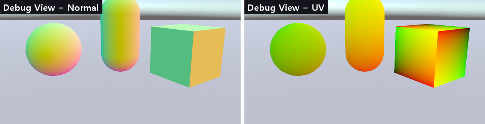
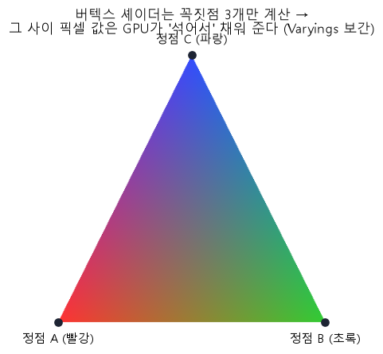

# Day 04. 택배 상자 늘리기 — 노멀과 UV를 눈으로 보기

> ⏱ **약 1시간** — 코드 25분 · 설명 15분 · 실험 20분
> 🧸 **오늘의 비유**: `Varyings`는 버텍스 셰이더가 프래그먼트 셰이더에게 보내는 **택배 상자**예요. 오늘은 상자에 칸을 두 개 더 만들고, 안에 든 걸 **색으로 꺼내 봐요.**



## 오늘 만들 것

인스펙터의 **Debug View** 드롭다운으로 눈에 안 보이는 값(노멀, UV)을 색으로 보여 주는 장치. 앞으로 22일 내내 쓸 **돋보기**예요.

## 오늘 배울 것

- [ ] `Attributes`와 `Varyings`에 칸을 추가하고 값을 넘긴다
- [ ] 프래그먼트에 도착한 값이 **보간된 값**이라는 걸 안다
- [ ] 스위즐(`.xyz`, `.rg`, `.xxx`)로 값을 꺼낸다
- [ ] `[Enum]` 프로퍼티와 `if`로 디버그 화면을 고른다

---

## 1. 코드 고치기 (25분)

### ① 재료 목록에 Debug View 추가

`Properties` 안, `_BaseColor` 아래에:

```shaderlab
        [Header(Debug)]
        [Enum(Off,0,Normal,1,UV,2)] _DebugView ("Debug View", Float) = 0
```

`[Enum(이름,값,…)]`은 숫자 칸을 **드롭다운**으로 보여 줘요. `[Header(Debug)]`는 인스펙터에 제목 줄을 그려요.

CBUFFER에도 추가해요. (Properties에 추가하면 CBUFFER에도 — 이제 습관!)

```hlsl
CBUFFER_START(UnityPerMaterial)
    half4  _BaseColor;
    half   _DebugView;
CBUFFER_END
```

### ② 택배 상자 늘리기

```hlsl
struct Attributes
{
    float4 positionOS : POSITION;
    float3 normalOS   : NORMAL;
    float2 uv         : TEXCOORD0;    // ← 추가: 텍스처 좌표
};

struct Varyings
{
    float4 positionCS : SV_POSITION;
    float2 uv         : TEXCOORD0;    // ← 추가
    float3 normalWS   : TEXCOORD1;    // ← 추가
};
```

- `Attributes`의 `TEXCOORD0` = "메시의 **첫 번째 UV**를 이 칸에".
- `Varyings`의 `TEXCOORD0, 1, 2…`는 그냥 **칸 번호**예요. 이름은 TEXCOORD지만 노멀을 담아도 돼요.

### ③ vert에서 채우기

```hlsl
Varyings vert(Attributes input)
{
    Varyings o = (Varyings)0;
    o.positionCS = TransformObjectToHClip(input.positionOS.xyz);
    o.normalWS   = TransformObjectToWorldNormal(input.normalOS);   // ← 추가
    o.uv         = input.uv;                                        // ← 추가
    return o;
}
```

### ④ frag에서 꺼내 보기

```hlsl
half4 frag(Varyings input) : SV_Target
{
    half3 N = normalize(input.normalWS);

    // 디버그 보기: 눈에 안 보이는 값을 색으로 꺼내 본다
    if (_DebugView > 1.5h) return half4(input.uv, 0.0h, 1.0h);
    if (_DebugView > 0.5h) return half4(N * 0.5h + 0.5h, 1.0h);

    return _BaseColor;
}
```

정답: [`Assets/Solutions/Day04/MyToon.shader`](https://github.com/JJH0204/toon-shader-lab/blob/main/Assets/Solutions/Day04/MyToon.shader)

## 2. 확인하기

머티리얼의 **Debug View**를 바꿔 보세요(맨 위 그림).

- **Normal**: 오른쪽을 보는 면은 빨강, 위를 보는 면은 초록, 뒤(카메라 반대)를 보는 면은 파랑 쪽이에요. 노멀 `(x, y, z)`는 -1~1인데 색은 0~1이라서 `N * 0.5 + 0.5`로 옮겼어요.
- **UV**: 왼쪽 아래(0,0)가 검정, u가 커질수록 빨강, v가 커질수록 초록. 큐브는 **면마다** 0~1이 반복되는 게 보여요.

## 3. 설명 (15분)

### 택배는 "섞여서" 도착해요



`vert`는 삼각형의 **꼭짓점 3개**에서만 실행돼요. 그 사이 수많은 픽셀에는 GPU가 세 꼭짓점 값을 **거리에 따라 섞어서** 넣어 줘요. 이걸 **보간**이라고 해요. Normal 화면의 구가 매끈한 그라데이션인 이유예요.


길이 1인 노멀 두 개를 섞으면 **길이가 1보다 짧아져요.** 그래서 frag 첫 줄에서 `normalize`로 길이를 다시 1로 맞춰요. 내일부터 이 `N`으로 빛을 계산하니까 꼭 필요해요.


### 스위즐: 레고 블록 꺼내기

`float4 v`에서 점 뒤에 글자를 붙여 원하는 칸만 꺼내요.

| 코드 | 결과 |
|---|---|
| `v.xyz` / `v.rgb` | 앞 세 칸 (위치는 xyz, 색은 rgb로 쓰는 게 읽기 좋아요) |
| `v.xz` | 1번·3번 칸 (높이 빼고 바닥 평면만) |
| `v.xxx` | 1번 칸을 세 번 → 흑백 색을 만들 때 |
| `half4(input.uv, 0, 1)` | 2칸짜리 uv에 0과 1을 붙여 4칸으로 |

### 디버그 `if`는 느리지 않을까?

`_DebugView`는 머티리얼 값이라 **한 물체의 모든 픽셀이 같은 답**을 내요. GPU는 수천 명이 같은 줄을 동시에 읽는데, 모두 같은 쪽으로 가는 `if`는 거의 공짜예요. (픽셀마다 답이 다른 `if`는 비쌀 수 있어요.)

## 4. 실험해 보기 (20분)

1. **normalize 빼 보기** — `half3 N = input.normalWS;`로 바꾸고 Normal 화면을 보세요. 큐브처럼 면이 평평하면 차이가 없지만, 저폴리 구라면 색이 살짝 어두워지는 곳이 생겨요. 되돌려 두세요.
2. **노멀 한 칸만** — `return half4(N.yyy * 0.5h + 0.5h, 1.0h);` → 위를 볼수록 하얀 흑백. 해가 바로 위에 있을 때의 "밝기"와 비슷하죠? 내일 배울 조명의 예고편이에요.
3. **UV 반복** — `return half4(frac(input.uv * 4.0), 0.0h, 1.0h);` → `frac`은 소수 부분만 남겨요. 4×4로 반복되는 격자가 보여요.
4. 커밋: `git commit -am "Day 04: 노멀과 UV 디버그 보기"`

## 5. 오늘의 액기스

👉 [ESSENCE.md — Day 04](essence.md#day-04)

## 더 읽을거리

- [Microsoft — HLSL 시맨틱](https://learn.microsoft.com/en-us/windows/win32/direct3dhlsl/dx-graphics-hlsl-semantics) · [자료형](https://learn.microsoft.com/en-us/windows/win32/direct3dhlsl/dx-graphics-hlsl-data-types)
- 수학: [Wikipedia — Barycentric coordinates](https://en.wikipedia.org/wiki/Barycentric_coordinate_system) (보간이 쓰는 무게중심 좌표) · [Swizzling](https://en.wikipedia.org/wiki/Swizzling_(computer_graphics))
- 더 깊이: [toon-shader-study Day 04 — HLSL 문법 기초](../toon-shader-study/day04-hlsl-basics.md)

---

[← Day 03](day03-properties.md) · [목차](README.md) · [다음: Day 05 →](day05-textures.md)
