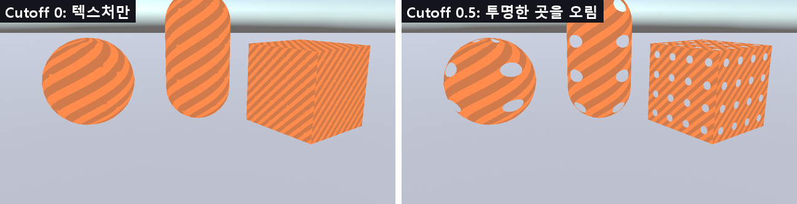

# Day 05. 텍스처 입히고 가위로 오리기

> ⏱ **약 1시간** — 코드 25분 · 설명 15분 · 실험 20분
> 🧸 **오늘의 비유**: UV는 **상자 전개도에 적힌 좌표**, `clip()`은 **가위**예요.



## 오늘 만들 것

물체에 줄무늬 텍스처를 입히고, 텍스처의 **투명한 동그라미를 오려 내요.** 오른쪽 그림처럼 구멍 뚫린 물체가 돼요.

## 오늘 배울 것

- [ ] `2D` 프로퍼티, `TEXTURE2D` / `SAMPLER` 선언으로 텍스처를 받는다
- [ ] `SAMPLE_TEXTURE2D`로 색을 읽고 `_BaseColor`를 곱한다
- [ ] 타일링·오프셋(`_BaseMap_ST`, `TRANSFORM_TEX`)을 이해한다
- [ ] `clip()`으로 픽셀을 버린다

---

## 1. 코드 고치기 (25분)

### ① Properties

`_BaseColor` 아래에 두 줄:

```shaderlab
        [MainTexture] _BaseMap ("Base Map", 2D) = "white" {}
        _Cutoff ("Alpha Cutoff", Range(0, 1)) = 0
```

- `2D` = 텍스처 칸. `"white" {}`는 텍스처를 안 넣었을 때 쓸 색이에요. 흰색(1)을 곱하면 아무 변화가 없으니 **안 넣어도 안전**해요.
- `[MainTexture]` = 이 머티리얼의 대표 텍스처 표시.

### ② 텍스처 선언 + CBUFFER

`#include` 아래, CBUFFER 위에 텍스처를 선언하고, CBUFFER에 두 줄을 추가해요.

```hlsl
TEXTURE2D(_BaseMap);    SAMPLER(sampler_BaseMap);

CBUFFER_START(UnityPerMaterial)
    float4 _BaseMap_ST;    // ← 추가: 타일링(xy)·오프셋(zw). 이름 끝 _ST 는 Unity 가 자동으로 채운다
    half4  _BaseColor;
    half   _Cutoff;        // ← 추가
    half   _DebugView;
CBUFFER_END
```

- **텍스처**(`TEXTURE2D`)는 그림 자체, **샘플러**(`SAMPLER`)는 그림을 **읽는 규칙**(확대할 때 부드럽게? 끝을 넘으면 반복?)이에요.
- 텍스처는 숫자가 아니라서 CBUFFER **밖에** 선언해요.
- `_BaseMap_ST`는 Properties에 안 적어도 돼요. 머티리얼의 Tiling·Offset 칸 값이 `텍스처이름_ST`로 들어와요.

### ③ vert: 타일링·오프셋 적용

```hlsl
    o.uv         = TRANSFORM_TEX(input.uv, _BaseMap);   // 타일링·오프셋 적용
```

`TRANSFORM_TEX(uv, _BaseMap)`은 `uv * _BaseMap_ST.xy + _BaseMap_ST.zw`를 줄여 쓴 매크로예요.

### ④ frag: 읽고, 곱하고, 오리기

```hlsl
half4 frag(Varyings input) : SV_Target
{
    half4 baseColor = SAMPLE_TEXTURE2D(_BaseMap, sampler_BaseMap, input.uv) * _BaseColor;
    clip(baseColor.a - _Cutoff);   // 투명도가 기준보다 낮으면 이 픽셀을 버린다
    half3 N = normalize(input.normalWS);

    // 디버그 보기: 눈에 안 보이는 값을 색으로 꺼내 본다
    if (_DebugView > 1.5h) return half4(input.uv, 0.0h, 1.0h);
    if (_DebugView > 0.5h) return half4(N * 0.5h + 0.5h, 1.0h);

    return baseColor;
}
```

### ⑤ 텍스처 넣기

머티리얼 `MyToon`의 **Base Map** 칸에 `Assets/Textures/Lab_Base`를 끌어다 놓아요. 흰 바탕에 연한 줄무늬, 그리고 **투명한 동그라미**가 있는 실습용 그림이에요.

정답: [`Assets/Solutions/Day05/MyToon.shader`](https://github.com/JJH0204/toon-shader-lab/blob/main/Assets/Solutions/Day05/MyToon.shader)

## 2. 확인하기

- **Alpha Cutoff = 0**: 줄무늬 × 주황색. 구멍은 안 보여요(맨 위 왼쪽).
- **Alpha Cutoff = 0.5**: 투명한 동그라미가 **뚫려요**(맨 위 오른쪽).

## 3. 설명 (15분)

### UV = 전개도 좌표

종이 상자를 펼치면 전개도가 되죠. 3D 모델도 펼쳐서 그림 위에 놓아요. 점마다 "나는 그림의 어디야" 하는 좌표가 UV예요. 그림 크기와 상관없이 **항상 0~1**이라서 텍스처 해상도를 바꿔도 모델을 다시 만들 필요가 없어요.

### `clip(x)` = 가위

`x`가 **0보다 작으면 이 픽셀을 버려요.** 색도, 깊이도 안 남겨요.

| 텍스처 알파 | Base Color 알파 | Cutoff | `a - Cutoff` | 결과 |
|---|---|---|---|---|
| 1.0 | 1.0 | 0.5 | +0.5 | 남김 |
| 0.0 (구멍) | 1.0 | 0.5 | -0.5 | ✂️ 버림 |
| 0.0 (구멍) | 1.0 | 0 | 0 | 남김 (0은 음수가 아니에요) |

그래서 Cutoff 기본값 0이면 **아무것도 안 오려요.** 이렇게 "기본값이면 효과 없음"이 되도록 기본값을 고르는 게 좋은 습관이에요.


바닥을 보면 물체의 그림자가 아예 없어요. 우리 셰이더에는 아직 "그림자를 드리우는 패스"가 없어서예요. Day 09에서 그 패스를 직접 짜면서, 그림자에도 구멍이 뚫리도록 **모든 패스가 같은 가위를 쓰게** 만들어요.


## 4. 실험해 보기 (20분)

1. **Tiling** — 머티리얼 Base Map의 Tiling을 (3, 3)으로. 무늬가 촘촘해져요. Debug View를 UV로 바꾸면? UV 값이 0~3이 되면서 색이 1을 넘어 노랗게 뭉개져요.
2. **Base Color 알파** — Cutoff 0.5인 상태에서 Base Color의 A를 0.4로 내리면? `a × 0.4`가 전부 0.5보다 작아져서 **물체가 통째로 사라져요.** 알파가 곱해진다는 증거예요.
3. **기본 텍스처** — Base Map을 비우면(None) 흰 텍스처가 쓰여서 Day 04처럼 단색이 돼요.
4. 커밋: `git commit -am "Day 05: 텍스처와 알파 클립"`

## 5. 오늘의 액기스

👉 [ESSENCE.md — Day 05](essence.md#day-05)

## 더 읽을거리

- [LearnOpenGL — Textures](https://learnopengl.com/Getting-started/Textures) — 샘플러, 필터링, 반복 모드
- [Wikipedia — UV mapping](https://en.wikipedia.org/wiki/UV_mapping) · [Microsoft — clip](https://learn.microsoft.com/en-us/windows/win32/direct3dhlsl/dx-graphics-hlsl-clip)
- 더 깊이: [toon-shader-study Day 05 — 텍스처와 UV](../toon-shader-study/day05-textures-and-uv.md) (채널 패킹, ILM 맵)

---

[← Day 04](day04-varyings-debug.md) · [목차](README.md) · [다음: Day 06 →](day06-first-light.md)
