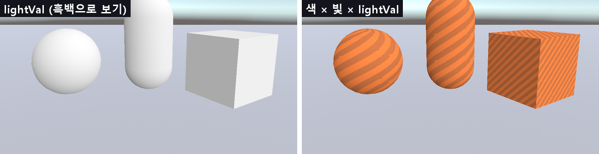

# Day 06. 첫 조명 — 손전등과 내적

## 작업 식별

| 항목 | 내용 |
|---|---|
| Task ID | GMD-TSL-006-MP |
| 목적 | 메인 라이트의 방향과 노멀의 내적으로 하프 램버트 밝기 `lightVal`을 계산해 물체에 음영을 입힌다 |
| 적용 대상 | Unity 6000.3, URP 17.x. Day 05 완료 상태의 `MyToon.shader` |
| 소요 시간 | 약 60분 (개념 20분, 코드 15분, 실험 25분) |
| 확인 상태 | 미검증 (원본 코드를 읽고 정리한 것이며 이 환경에서 컴파일·실행하지 않았다) |
| 개정 | R1 (2026-11-18) |


NOTE: `Lighting.hlsl`의 `GetMainLight()`와 `Light` 구조체 필드는 URP 버전에 따라 다르다. 그림자 인자를 받는 `GetMainLight(shadowCoord)` 오버로드는 Day 08에서 쓴다. URP 버전 확인 필요.


## 1. 참조

| 참조 문서 | Task ID | 제목 |
|---|---|---|
| [day05-textures.md](day05-textures.md) | GMD-TSL-005-MP | 이전: 텍스처와 알파 클립 |
| [day07-toon-steps.md](day07-toon-steps.md) | GMD-TSL-007-MP | 다음: 툰 계단 |
| [toon-shader-study Day 06](../toon-shader-study/day06-vectors-and-light.md) | - | 빛의 수학 (짝꿍 과정) |
| [3Blue1Brown 내적](https://www.3blue1brown.com/lessons/dot-products), [위키백과 스칼라곱](https://ko.wikipedia.org/wiki/%EC%8A%A4%EC%B9%BC%EB%9D%BC%EA%B3%B1), [Khan Academy 벡터](https://www.khanacademy.org/math/linear-algebra/vectors-and-spaces) | - | 내적 참고 |
| [Valve Half Lambert](https://developer.valvesoftware.com/wiki/Half_Lambert), [Lambertian reflectance](https://en.wikipedia.org/wiki/Lambertian_reflectance), [LearnOpenGL Basic Lighting](https://learnopengl.com/Lighting/Basic-Lighting), [Catlike Coding The First Light](https://catlikecoding.com/unity/tutorials/rendering/part-4/) | - | 조명 모델 참고 |

## 2. 필요 장비와 자재

| 번호 | 이름 | 사양·버전 | 비고 |
|---|---|---|---|
| 1 | `Assets/MyToon/MyToon.shader` | Day 05 완료 상태 | |
| 2 | Lab 씬의 Directional Light | 해 | |

## 3. 안전 사항


NOTE: 이 Day의 `lightVal`은 아직 계단이 아니라 연속 값이다. Day 07에서 `smoothstep`으로 계단화한다.


## 4. 준비

| 번호 | 항목 | 확인 방법 |
|---|---|---|
| 1 | Day 05 코드가 컴파일된다 | Console 오류 0건 |
| 2 | `N`이 `normalize(input.normalWS)`로 계산된다 | frag 코드 확인 |

## 5. 절차

### A. 개념 확인: 내적과 하프 램버트

`dot(A, B) = A.x*B.x + A.y*B.y + A.z*B.z`이다. 길이가 1인 두 벡터의 내적은 둘 사이 각도의 cos 값이다. 같은 방향이면 1, 직각이면 0, 반대 방향이면 -1이다.

| 기호 | 의미 |
|---|---|
| `N` | 표면이 바라보는 방향(월드 노멀, 정규화) |
| `L` | 표면에서 광원을 향하는 방향. URP의 `mainLight.direction` |

| 모델 | 수식 | 특징 |
|---|---|---|
| 램버트 | `saturate(dot(N, L))` (= `max(0, N·L)`) | 광원 반대쪽 절반이 모두 0이라 완전히 어둡다 |
| 하프 램버트 | `dot(N, L) * 0.5 + 0.5` | -1~1을 0~1로 옮긴다. 뒤쪽도 서서히 변한다. 값 0.5가 빛과 직각인 위치다 |

### B. Lighting.hlsl 포함

1. (5-B-01) `Core.hlsl` include 바로 아래에 한 줄을 추가한다. → 결과: 컴파일 오류가 없다.

```hlsl
#include "Packages/com.unity.render-pipelines.universal/ShaderLibrary/Core.hlsl"
#include "Packages/com.unity.render-pipelines.universal/ShaderLibrary/Lighting.hlsl"   // 추가
```

### C. Debug View에 LightVal 추가

1. (5-C-01) Properties의 `Debug View` 줄을 다음으로 바꾼다. → 결과: 드롭다운에 `LightVal`이 추가된다.

```shaderlab
        [Enum(Off,0,Normal,1,UV,2,LightVal,3)] _DebugView ("Debug View", Float) = 0
```

### D. frag에 빛 계산 추가

1. (5-D-01) `half3 N = ...` 줄 아래부터 `frag`의 끝까지를 다음과 같이 바꾼다. `baseColor` 계산과 `clip` 줄은 Day 05 상태를 유지한다. → 결과: 컴파일 오류가 없다.

```hlsl
    half3 N = normalize(input.normalWS);

    Light mainLight = GetMainLight();
    half lightVal = dot(N, mainLight.direction) * 0.5h + 0.5h;   // 하프 램버트: 0(뒤) ~ 1(정면)

    // 디버그 보기: 눈에 안 보이는 값을 색으로 꺼내 본다
    if (_DebugView > 2.5h) return half4(lightVal.xxx, 1.0h);
    if (_DebugView > 1.5h) return half4(input.uv, 0.0h, 1.0h);
    if (_DebugView > 0.5h) return half4(N * 0.5h + 0.5h, 1.0h);

    half3 color = baseColor.rgb * mainLight.color * lightVal;
    return half4(color, baseColor.a);
}
```

| 코드 | 의미 |
|---|---|
| `Light` | URP 구조체. `direction`(광원 방향), `color`(색 x 세기), `shadowAttenuation`(그림자 감쇠, Day 08에서 사용) 등을 가진다 |
| `lightVal.xxx` | 값 하나를 세 칸에 복사해 흑백 색으로 만든다 |
| `baseColor.rgb * mainLight.color * lightVal` | 바탕색 x 빛 색 x 밝기 |

정답 파일: [`Assets/Solutions/Day06/MyToon.shader`](https://github.com/JJH0204/toon-shader-lab/blob/main/Assets/Solutions/Day06/MyToon.shader)

### E. 화면 확인

1. (5-E-01) `Debug View`를 `LightVal`로 바꾼다. → 결과: 해 쪽(오른쪽 위)이 흰색이고 반대쪽으로 갈수록 회색이다. 하프 램버트이므로 완전한 검정은 나오지 않는다.
2. (5-E-02) `Debug View`를 `Off`로 바꾼다. → 결과: 오른쪽이 밝고 왼쪽이 어두운 주황색 물체가 보인다.



### F. 실험

1. (5-F-01) Hierarchy에서 Directional Light를 선택하고 Rotation Y를 돌린다. → 결과: 밝은 쪽이 따라 돈다. 광원을 물체 뒤로 보내면 앞면이 어두워진다.
2. (5-F-02) `lightVal`을 `saturate(dot(N, mainLight.direction))`로 바꾼다. `saturate`는 값을 0~1로 제한한다. → 결과: 광원 반대쪽 절반이 완전한 검정이 된다. 비교 후 되돌린다.
3. (5-F-03) Directional Light의 `Color`를 주황으로 바꾼다. → 결과: `mainLight.color`가 곱해져 물체도 물든다.
4. (5-F-04) 손계산을 한다. N = (0, 1, 0), L = (0.6, 0.8, 0)이면 `dot = 0.8`, `lightVal = 0.9`다. L = (1, 0, 0)이면 `dot = 0`, `lightVal = 0.5`다. → 결과: 0.5가 빛과 직각인 경계임을 확인한다.
5. (5-F-05) 커밋한다: `git commit -am "Day 06: 하프 램버트 조명"`

## 6. 기능 확인

| 번호 | 확인 동작 | 기대 결과 | 합격 기준 |
|---|---|---|---|
| 1 | `Debug View = LightVal` | 광원 방향이 밝고 반대쪽이 어둡다 | 완전한 검정이 없다 |
| 2 | Directional Light 회전 | 밝은 면이 광원을 따라 움직인다 | 회전과 같은 방향으로 이동 |
| 3 | 손계산 | `lightVal = 0.9`, `0.5` | 값 일치 |

## 7. 복구

1. (7-01) 변경을 되돌린다: `Ctrl+Z` 또는 `git restore Assets/MyToon/MyToon.shader`.
2. (7-02) Directional Light의 Rotation과 Color를 처음 값으로 되돌린다. 씬 전체는 `Lab > Rebuild Lab Scene`으로 초기화한다.

## 8. 개정 이력

| 개정 | 날짜 | 변경 내용 |
|---|---|---|
| R1 | 2026-11-18 | 기존 Day 06 페이지를 AMM 형식으로 재작성. 비유 삭제 |

[← Day 05](day05-textures.md) · [목차](README.md) · [다음: Day 07 →](day07-toon-steps.md)
