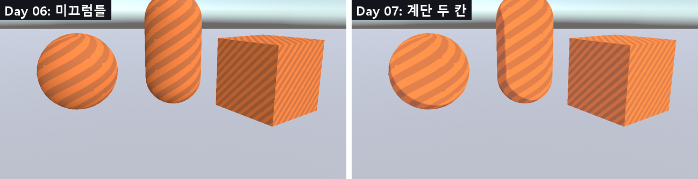
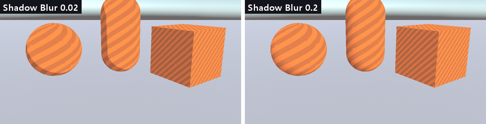

# Day 07. 툰 셰이딩의 심장 — 미끄럼틀을 계단으로

## 작업 식별

| 항목 | 내용 |
|---|---|
| Task ID | GMD-TSL-007-MP |
| 목적 | 연속 값 `lightVal`을 `smoothstep`으로 밝은 칸, 1차 그림자, 2차 그림자 세 단계로 나눠 툰 음영을 만든다 |
| 적용 대상 | Unity 6000.3, URP 17.x. Day 06 완료 상태의 `MyToon.shader` |
| 소요 시간 | 약 60분 (개념 15분, 코드 25분, 실험 20분) |
| 확인 상태 | 미검증 (원본 코드를 읽고 정리한 것이며 이 환경에서 컴파일·실행하지 않았다) |
| 개정 | R1 (2026-11-18) |

## 1. 참조

| 참조 문서 | Task ID | 제목 |
|---|---|---|
| [day06-first-light.md](day06-first-light.md) | GMD-TSL-006-MP | 이전: 첫 조명 (`lightVal`) |
| [day08-receive-shadows.md](day08-receive-shadows.md) | GMD-TSL-008-MP | 다음: 그림자 받기 |
| [toon-shader-study Day 07](../toon-shader-study/day07-toon-steps.md) | - | 툰 계단, Ramp 텍스처, ILM 편향 (짝꿍 과정) |
| [The Book of Shaders 5장 (한국어)](https://thebookofshaders.com/05/?lan=kr), [Wikipedia Smoothstep](https://en.wikipedia.org/wiki/Smoothstep), [Microsoft smoothstep](https://learn.microsoft.com/en-us/windows/win32/direct3dhlsl/dx-graphics-hlsl-smoothstep), [lerp](https://learn.microsoft.com/en-us/windows/win32/direct3dhlsl/dx-graphics-hlsl-lerp), [Desmos](https://www.desmos.com/calculator) | - | `step`, `smoothstep`, `lerp` 참고 |

## 2. 필요 장비와 자재

| 번호 | 이름 | 사양·버전 | 비고 |
|---|---|---|---|
| 1 | `Assets/MyToon/MyToon.shader` | Day 06 완료 상태 | |

## 3. 안전 사항


WARNING: `smoothstep(a, b, x)`에서 `a`와 `b`가 같으면 내부 계산 `(x - a) / (b - a)`가 0으로 나누기가 되어 결과가 NaN이 되고 화면이 깨진다. Blur 값이 0이어도 안전하도록 반드시 `max(blur, 1e-4h)`를 쓴다.


## 4. 준비

| 번호 | 항목 | 확인 방법 |
|---|---|---|
| 1 | Day 06 코드가 컴파일된다 | Console 오류 0건 |
| 2 | `lightVal`이 frag에 있다 | `Debug View = LightVal` 동작 |

## 5. 절차

### A. 개념 확인

`step(0.5, x)`는 x가 0.5 이상이면 1, 아니면 0이다. 경계가 날카로워 화면에서 계단 현상이 보이므로 모서리를 다듬는 `smoothstep`을 쓴다.

| 수식 | 의미 |
|---|---|
| `smoothstep(a, b, x)` | `x <= a`이면 0, `x >= b`이면 1, 그 사이는 S자 곡선 `t*t*(3-2t)` (`t = (x-a)/(b-a)`, 0~1로 제한) |
| `a = Border - Blur`, `b = Border + Blur` | Border는 계단 위치, Blur는 경계 폭의 절반 |
| `lerp(a, b, t)` | `a*(1-t) + b*t`. t가 0이면 a, 1이면 b |

그림자 색은 회색을 섞지 않고 `바탕색 x 틴트`로 만든다. 틴트를 약간 푸르게 하면 그림자가 차분해 보인다.

### B. Properties 추가

1. (5-B-01) `Debug` 묶음 위에 다음을 추가한다. → 결과: Inspector에 `Toon Shading` 묶음이 나타난다.

```shaderlab
        [Header(Toon Shading)]
        _ShadowColor ("Shadow Color", Color) = (0.72, 0.74, 0.88, 1)
        _ShadowBorder ("Shadow Border", Range(0, 1)) = 0.5
        _ShadowBlur ("Shadow Blur", Range(0, 0.5)) = 0.02
        _Shadow2ndColor ("2nd Shadow Color", Color) = (0.56, 0.56, 0.74, 1)
        _Shadow2ndBorder ("2nd Shadow Border", Range(0, 1)) = 0.25
        _Shadow2ndBlur ("2nd Shadow Blur", Range(0, 0.5)) = 0.02
```

### C. CBUFFER 추가

1. (5-C-01) `_Cutoff` 아래에 추가한다.

```hlsl
    half4  _ShadowColor;
    half   _ShadowBorder;
    half   _ShadowBlur;
    half4  _Shadow2ndColor;
    half   _Shadow2ndBorder;
    half   _Shadow2ndBlur;
```

### D. 계단 함수 추가

HLSL은 함수가 사용 위치보다 위에 정의돼 있어야 한다.

1. (5-D-01) `vert` 아래, `frag` 위에 추가한다. → 결과: 컴파일 오류가 없다.

```hlsl
// 계단 하나: value 가 border 를 넘으면 1, 아니면 0. blur 폭만큼 모서리를 다듬는다.
half CelStep(half value, half border, half blur)
{
    half b = max(blur, 1e-4h);   // blur 가 0 이면 0 으로 나누게 되므로 바닥을 깐다
    return smoothstep(border - b, border + b, value);
}
```

### E. frag 끝부분 수정

1. (5-E-01) 디버그 줄 아래의 Day 06 `half3 color = ...` 두 줄을 지우고 다음으로 바꾼다. → 결과: 구의 어두운 쪽이 경계가 뚜렷한 두 단계 그림자 색으로 나뉜다.

```hlsl
    // 미끄럼틀(lightVal)을 계단 두 칸으로
    half shadow1 = 1.0h - CelStep(lightVal, _ShadowBorder, _ShadowBlur);
    half shadow2 = 1.0h - CelStep(lightVal, _Shadow2ndBorder, _Shadow2ndBlur);
    half3 albedo = baseColor.rgb;
    half3 toon = lerp(albedo, albedo * _ShadowColor.rgb, shadow1);   // 1차 그림자 색 덧칠
    toon = lerp(toon, albedo * _Shadow2ndColor.rgb, shadow2);        // 2차 그림자 색 덧칠

    half3 color = toon * mainLight.color;
    return half4(color, baseColor.a);
}
```

| 줄 | 의미 |
|---|---|
| `1.0h - CelStep(...)` | `CelStep`은 빛 쪽인 정도다. 뒤집으면 그림자 쪽인 정도가 된다 |
| `albedo` | 빛을 받기 전 물체 고유 색 |
| 1차 다음 2차 순서 | 밝은 색 위에 1차 그림자를 덧칠하고 그 위에 2차를 덧칠한다 |

2차 Border(0.25)가 1차(0.5)보다 작으므로 2차 그림자는 그림자 안쪽 깊은 곳에만 생긴다.

정답 파일: [`Assets/Solutions/Day07/MyToon.shader`](https://github.com/JJH0204/toon-shader-lab/blob/main/Assets/Solutions/Day07/MyToon.shader)



### F. 실험

1. (5-F-01) 계단 가장자리가 깨져 보이면 `Shadow Blur`를 0.02에서 0.04로 올린다. → 결과: 경계가 약간 부드러워진다.
2. (5-F-02) `Shadow Blur`를 0.2로 올린다. → 결과: 경계가 다시 연속 그라데이션에 가까워진다. 0으로 내리면 `1e-4h` 바닥 때문에 깨지지 않고 칼 같은 경계가 나온다.
3. (5-F-03) `Shadow Border`를 0.7과 0.3으로 바꾼다. → 결과: 0.7이면 그림자 영역이 넓어지고 0.3이면 좁아진다.
4. (5-F-04) `Shadow Color`를 보라색으로 바꾼다. → 결과: 그림자가 보랏빛 계열이 된다.
5. (5-F-05) 손계산을 한다. `lightVal = 0.55`, Border 0.5, Blur 0.1이면 `t = (0.55-0.4)/0.2 = 0.75`, `smoothstep = 0.75^2 * (3-1.5) = 0.84375`, `shadow1 = 0.15625`다. → 결과: 거의 밝은 픽셀이다.
6. (5-F-06) 커밋한다: `git commit -am "Day 07: 툰 계단"`



## 6. 기능 확인

| 번호 | 확인 동작 | 기대 결과 | 합격 기준 |
|---|---|---|---|
| 1 | Lab 씬의 구를 본다 | 밝은 칸, 1차, 2차 그림자의 세 영역 | 경계가 뚜렷하다 |
| 2 | `Shadow Blur`를 0으로 설정한다 | 깨짐 없이 칼 같은 경계 | NaN 얼룩이 없다 |
| 3 | 손계산 | `shadow1 = 0.156` | 소수점 둘째 자리 일치 |

## 7. 복구

1. (7-01) 변경을 되돌린다: `Ctrl+Z` 또는 `git restore Assets/MyToon/MyToon.shader`.
2. (7-02) 머티리얼 값을 기본값으로 되돌린다: Border 0.5와 0.25, Blur 0.02, 색은 5-B-01의 기본값.

## 8. 개정 이력

| 개정 | 날짜 | 변경 내용 |
|---|---|---|
| R1 | 2026-11-18 | 기존 Day 07 페이지를 AMM 형식으로 재작성. 손계산 값을 정확한 값(0.84375)으로 표기 |

[← Day 06](day06-first-light.md) · [목차](README.md) · [다음: Day 08 →](day08-receive-shadows.md)
