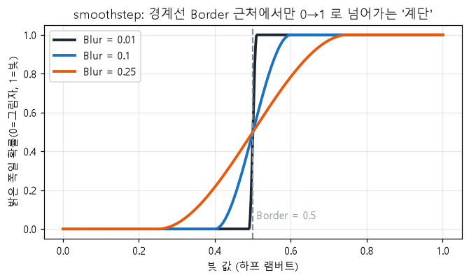
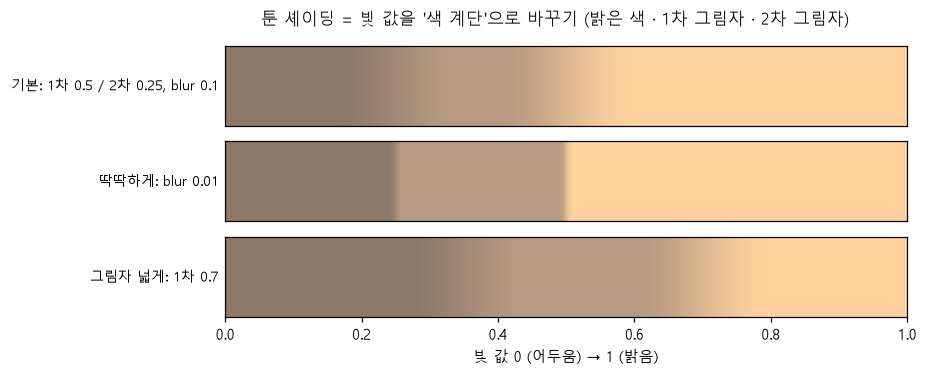

# Day 07. 툰 셰이딩의 심장 — 미끄럼틀을 계단으로

> ⏱ **약 1시간** — 개념 15분 · 코드 25분 · 실험 20분
> 🧸 **오늘의 비유**: 실사 빛은 **미끄럼틀**, 툰 빛은 **계단**. `smoothstep`은 계단 모서리를 다듬는 **사포**예요.


## 오늘 만들 것

부드러운 밝기를 **밝은 칸 · 1차 그림자 · 2차 그림자** 세 칸으로 나눠요. 오늘 비로소 "툰" 셰이더가 돼요.

## 오늘 배울 것

- [ ] `smoothstep`으로 부드러운 값을 계단으로 바꾼다
- [ ] Border(계단 위치)와 Blur(모서리 부드러움)를 조절한다
- [ ] 같은 계산을 **함수**로 만든다
- [ ] `lerp`로 그림자 색을 덧칠한다

---

## 1. 계단 만들기 (개념 15분)

가장 단순한 계단은 `step(0.5, x)` — x가 0.5 이상이면 1, 아니면 0. 그런데 모서리가 칼같이 날카로우면 화면에서 **톱니**처럼 깨져요. 그래서 모서리를 살짝 다듬은 `smoothstep`을 써요.



```
smoothstep(a, b, x)    x ≤ a 이면 0, x ≥ b 이면 1, 그 사이는 부드러운 S자
a = Border - Blur,  b = Border + Blur
```


Blur가 **0**이면 a와 b가 같아져서 `(x - a) / (b - a)`가 **0으로 나누기**가 돼요. 결과는 NaN(숫자 아님)이라 화면이 깨져요. 그래서 항상 `max(blur, 1e-4)`로 아주 작은 바닥을 깔아요.




그림자 색은 **회색을 섞지 않고 바탕색 × 틴트**로 만들어요. 빨간 옷의 그림자는 "어두운 빨강"이어야 만화 같아요. 틴트를 살짝 푸르게 하면 그림자가 차분해 보여요.

## 2. 코드 고치기 (25분)

### ① Properties (Debug 위에)

```shaderlab
        [Header(Toon Shading)]
        _ShadowColor ("Shadow Color", Color) = (0.72, 0.74, 0.88, 1)
        _ShadowBorder ("Shadow Border", Range(0, 1)) = 0.5
        _ShadowBlur ("Shadow Blur", Range(0, 0.5)) = 0.02
        _Shadow2ndColor ("2nd Shadow Color", Color) = (0.56, 0.56, 0.74, 1)
        _Shadow2ndBorder ("2nd Shadow Border", Range(0, 1)) = 0.25
        _Shadow2ndBlur ("2nd Shadow Blur", Range(0, 0.5)) = 0.02
```

### ② CBUFFER (`_Cutoff` 아래에)

```hlsl
    half4  _ShadowColor;
    half   _ShadowBorder;
    half   _ShadowBlur;
    half4  _Shadow2ndColor;
    half   _Shadow2ndBorder;
    half   _Shadow2ndBlur;
```

### ③ 계단 함수 (`vert` 아래, `frag` 위에)

같은 계산을 1차·2차 두 번 하니까 **함수**로 만들어요.

```hlsl
// 계단 하나: value 가 border 를 넘으면 1, 아니면 0. blur 폭만큼 모서리를 다듬는다.
half CelStep(half value, half border, half blur)
{
    half b = max(blur, 1e-4h);   // blur 가 0 이면 0 으로 나누게 되므로 바닥을 깐다
    return smoothstep(border - b, border + b, value);
}
```

`half CelStep(...)` = "half 숫자 하나를 돌려주는 CelStep 함수". HLSL에서는 **쓰기 전에** 함수가 위에 있어야 해요.

### ④ frag 끝부분 바꾸기

디버그 줄 아래, Day 06의 `half3 color = ...` 두 줄을 지우고 이렇게:

```hlsl
    // 미끄럼틀(lightVal)을 계단 두 칸으로
    half shadow1 = 1.0h - CelStep(lightVal, _ShadowBorder, _ShadowBlur);
    half shadow2 = 1.0h - CelStep(lightVal, _Shadow2ndBorder, _Shadow2ndBlur);
    half3 albedo = baseColor.rgb;
    half3 toon = lerp(albedo, albedo * _ShadowColor.rgb, shadow1);   // 1차 그림자 색 덧칠
    toon = lerp(toon, albedo * _Shadow2ndColor.rgb, shadow2);        // 2차 그림자 색 덧칠

    half3 color = toon * mainLight.color;
    return half4(color, baseColor.a);
}
```

| 줄 | 뜻 |
|---|---|
| `1.0h - CelStep(...)` | CelStep은 "빛 쪽인 정도". 뒤집어서 **"그림자 쪽인 정도"** |
| `albedo` | 바탕색(알베도). 빛을 받기 전 물체 고유의 색 |
| `lerp(a, b, t)` | **물감 섞기**. t=0이면 a, t=1이면 b, 0.3이면 a 70% + b 30% |
| 1차 → 2차 순서 | 밝은 색 위에 1차 그림자를 덧칠하고, 그 위에 더 진한 2차를 덧칠 |

2차 Border(0.25)가 1차(0.5)보다 작으니 2차 그림자는 **그림자 안쪽 깊은 곳**에만 생겨요.

정답: [`Assets/Solutions/Day07/MyToon.shader`](https://github.com/JJH0204/toon-shader-lab/blob/main/Assets/Solutions/Day07/MyToon.shader)

## 3. 확인하기

구의 왼쪽 아래가 **또렷한 경계**로 나뉘어요. 경계가 계단처럼 깨져 보이면 Shadow Blur를 0.02 → 0.04로 살짝 올려 보세요.

## 4. 실험해 보기 (20분)


1. **Blur** — Shadow Blur를 0.2로 올리면 다시 부드러워져요(위 오른쪽). 0으로 내리면? 바닥(`1e-4`) 덕분에 깨지지 않고 칼같은 경계.
2. **Border** — Shadow Border를 0.7로 올리면 그림자가 넓어져요. 0.3이면 좁아져요. 캐릭터 인상이 확 바뀌는 다이얼이에요.
3. **그림자 색** — Shadow Color를 보라색으로. 만화가가 그림자를 보랏빛으로 칠하는 이유가 느껴지나요?
4. **손계산** — `lightVal = 0.55`, Border 0.5, Blur 0.1이면 `t = (0.55-0.4)/0.2 = 0.75`, `smoothstep = 0.75²×(3-1.5) ≈ 0.84`, `shadow1 ≈ 0.16`. 거의 밝은 픽셀이에요.
5. 커밋: `git commit -am "Day 07: 툰 계단"`

## 5. 오늘의 액기스

👉 [ESSENCE.md — Day 07](essence.md#day-07)

## 수학 참고 자료

- [The Book of Shaders — 5장 Shaping Functions (한국어)](https://thebookofshaders.com/05/?lan=kr) — `step`, `smoothstep`을 직접 바꿔 보며. **강력 추천!**
- [Wikipedia — Smoothstep](https://en.wikipedia.org/wiki/Smoothstep) · [Microsoft — smoothstep](https://learn.microsoft.com/en-us/windows/win32/direct3dhlsl/dx-graphics-hlsl-smoothstep) · [lerp](https://learn.microsoft.com/en-us/windows/win32/direct3dhlsl/dx-graphics-hlsl-lerp)
- [Desmos](https://www.desmos.com/calculator)에 `s(x) = \min(\max((x-(B-b))/(2b), 0), 1)`, `y = s(x)^2 (3 - 2s(x))`를 입력하고 B, b 슬라이더를 움직여 보세요
- 더 깊이: [toon-shader-study Day 07 — 툰 계단](../toon-shader-study/day07-toon-steps.md) (Ramp 텍스처 방식, ILM 편향)

---

[← Day 06](day06-first-light.md) · [목차](README.md) · [다음: Day 08 →](day08-receive-shadows.md)
