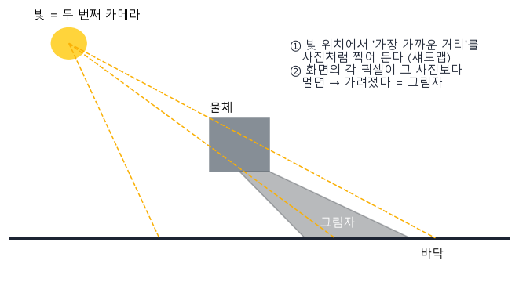

# Day 08. 그림자 받기 — 빛이 찍어 둔 거리 사진

> ⏱ **약 1시간** — 개념 20분 · 코드 20분 · 실험 20분
> 🧸 **오늘의 비유**: 섀도맵은 **빛이 자기 자리에서 찍어 둔 거리 사진**이에요. 내가 그 사진보다 멀리 있으면 누가 빛을 가린 거예요.


## 오늘 만들 것

화면 밖 막대(Shadow Beam)가 드리운 그림자가 우리 물체 위에 **같은 툰 계단 색으로** 떨어져요(오른쪽).

## 오늘 배울 것

- [ ] "모양 그림자"(N·L)와 "드리운 그림자"(섀도맵)의 차이를 안다
- [ ] `multi_compile`로 URP의 그림자 키워드를 받는다
- [ ] 월드 위치를 프래그먼트까지 넘긴다
- [ ] 그림자 결과를 `lightVal`에 곱해 계단에 합친다

---

## 1. 섀도맵 (개념 20분)

`dot(N, L)`은 내 표면 방향만 봐요. 내 앞에 **누가 서 있는지는 몰라요.** 다른 물체가 가린 그림자는 다른 방법이 필요해요.



1. URP가 **빛의 자리에서** 장면을 찍어요. 색 대신 "가장 가까운 물체까지 거리"만 적어요 = **섀도맵**.
2. 우리 픽셀의 "빛까지 거리"를 섀도맵 값과 비교해요. 더 멀면 → 누가 가렸다 → **그림자**.

URP가 비교까지 해서 `mainLight.shadowAttenuation`에 넣어 줘요. **1이면 빛, 0이면 그림자**예요. 우리는 그 값을 받기만 하면 돼요.

## 2. 코드 고치기 (20분)

### ① 키워드 받기 (`#pragma fragment frag` 아래)

```hlsl
#pragma multi_compile _ _MAIN_LIGHT_SHADOWS _MAIN_LIGHT_SHADOWS_CASCADE
#pragma multi_compile_fragment _ _SHADOWS_SOFT
```

URP는 그림자를 켰는지·부드럽게 할지 같은 설정을 **키워드**로 알려 줘요. `multi_compile`은 "이 키워드가 켜진 버전과 꺼진 버전을 **모두 미리 만들어 둬**"라는 뜻이에요. (키워드는 Day 18에서 자세히 배워요.)

| 키워드 | 뜻 |
|---|---|
| `_MAIN_LIGHT_SHADOWS` | 해의 그림자 켜짐 |
| `_MAIN_LIGHT_SHADOWS_CASCADE` | 가까운 곳은 촘촘한 지도, 먼 곳은 듬성한 지도를 따로 씀 (캐스케이드) |
| `_SHADOWS_SOFT` | 그림자 가장자리를 여러 번 비교해 부드럽게 |

### ② Properties + CBUFFER

```shaderlab
        _ReceiveShadow ("Receive Shadow", Range(0, 1)) = 1      // Toon Shading 묶음 맨 아래
```

```hlsl
    half   _ReceiveShadow;                                       // CBUFFER, _Shadow2ndBlur 아래
```

### ③ 월드 위치를 택배에 담기

그림자 지도에서 내 자리를 찾으려면 **월드 위치**가 필요해요.

```hlsl
struct Varyings
{
    float4 positionCS : SV_POSITION;
    float2 uv         : TEXCOORD0;
    float3 normalWS   : TEXCOORD1;
    float3 positionWS : TEXCOORD2;    // ← 추가
};
```

`vert`의 첫 줄(`o.positionCS = TransformObjectToHClip(...)`)을 두 줄로 바꿔요. 월드 위치를 저장하고, 그걸로 클립 위치를 만들어요.

```hlsl
    o.positionWS = TransformObjectToWorld(input.positionOS.xyz);
    o.positionCS = TransformWorldToHClip(o.positionWS);
```

### ④ frag: 그림자 받기

`Light mainLight = GetMainLight();` 한 줄을 두 줄로 바꾸고, `lightVal` 아래에 두 줄을 추가해요.

```hlsl
    float4 shadowCoord = TransformWorldToShadowCoord(input.positionWS);   // 섀도맵 위 내 주소
    Light mainLight = GetMainLight(shadowCoord);                          // 그림자 결과가 담긴 빛
    half lightVal = dot(N, mainLight.direction) * 0.5h + 0.5h;   // 하프 램버트: 0(뒤) ~ 1(정면)
    half receive = lerp(1.0h, mainLight.shadowAttenuation, _ReceiveShadow);
    lightVal *= receive;   // 드리운 그림자 속이면 계단 아래로
```

**툰 셰이더의 비결**이 마지막 줄이에요. 그림자 결과를 색에 곱하지 않고 **`lightVal`에 곱해서** 계단에 넣어요. 그러면 드리운 그림자도 **같은 1차·2차 그림자 색**으로 칠해져요. 만화에서 모자 그림자와 얼굴 음영이 같은 색인 것처럼요.

`receive` 변수는 Day 15(반짝임)에서 또 써요.

정답: [`Assets/Solutions/Day08/MyToon.shader`](https://github.com/JJH0204/toon-shader-lab/blob/main/Assets/Solutions/Day08/MyToon.shader)

## 3. 확인하기

1. Hierarchy에서 **Shadow Beam**을 켜요(이름 옆 체크박스). 화면 밖 위에 떠 있는 막대예요.
2. 물체 가운데를 가로지르는 **그림자 띠**가 1차·2차 그림자 색으로 보이면 성공(맨 위 오른쪽).
3. **Receive Shadow를 0**으로 내리면 띠가 사라져요(맨 위 왼쪽). 바닥의 띠는 남아요. 바닥은 Unity Lit 셰이더라 우리 슬라이더와 상관없으니까요.


바닥에 **우리 물체의 그림자가 없어요!** 우리 셰이더는 아직 섀도맵에 "찍히는" 법을 몰라요. 그림자를 **받기**만 하고 **드리우지는** 못해요. 내일(Day 09) 해결해요.


## 4. 실험해 보기 (20분)

1. **Soft Shadows 끄기** — Directional Light의 Shadow Type을 Hard Shadows로. 띠 가장자리가 거칠어져요(`_SHADOWS_SOFT` 키워드가 꺼진 버전이 쓰여요).
2. **Receive 0.5** — 그림자가 반만 들어와요. `lerp(1, 0, 0.5) = 0.5`라서 그림자 속 `lightVal`이 반으로 줄어요.
3. **손계산** — `shadowAttenuation = 0`, `_ReceiveShadow = 0.6`이면 `receive = 0.4`. `lightVal = 0.9`였다면 `0.36` → 1차 Border 0.5보다 작으니 1차 그림자, 2차 Border 0.25보다 크니 2차는 아직.
4. 다 봤으면 Shadow Beam을 다시 꺼요. 커밋: `git commit -am "Day 08: 그림자 받기"`

## 5. 오늘의 액기스

👉 [ESSENCE.md — Day 08](essence.md#day-08)

## 더 읽을거리

- [LearnOpenGL — Shadow Mapping](https://learnopengl.com/Advanced-Lighting/Shadows/Shadow-Mapping) · [Wikipedia — Shadow mapping](https://en.wikipedia.org/wiki/Shadow_mapping)
- [Catlike Coding — Rendering 7: Shadows](https://catlikecoding.com/unity/tutorials/rendering/part-7/)
- 더 깊이: [toon-shader-study Day 08 — 그림자](../toon-shader-study/day08-shadows.md)

---

[← Day 07](day07-toon-steps.md) · [목차](README.md) · [다음: Day 09 →](day09-cast-shadows.md)
