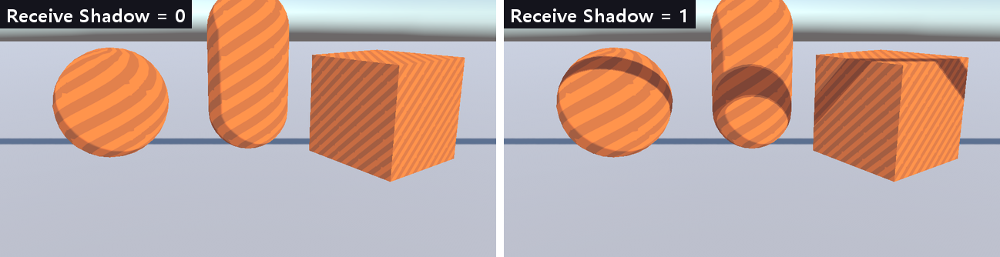

# Day 08. 그림자 받기 — 빛이 찍어 둔 거리 사진

## 작업 식별

| 항목 | 내용 |
|---|---|
| Task ID | GMD-TSL-008-MP |
| 목적 | URP 섀도맵에서 메인 라이트의 그림자 결과를 받아 `lightVal`에 곱하고, 드리운 그림자를 툰 계단 색으로 표현한다 |
| 적용 대상 | Unity 6000.3, URP 17.x, Forward 렌더링. Day 07 완료 상태의 `MyToon.shader` |
| 소요 시간 | 약 60분 (개념 20분, 코드 20분, 실험 20분) |
| 확인 상태 | 미검증 (원본 코드를 읽고 정리한 것이며 이 환경에서 컴파일·실행하지 않았다) |
| 개정 | R1 (2026-11-18) |


NOTE: `TransformWorldToShadowCoord`, `GetMainLight(shadowCoord)`, 키워드 `_MAIN_LIGHT_SHADOWS`, `_MAIN_LIGHT_SHADOWS_CASCADE`, `_SHADOWS_SOFT`는 URP 버전에 따라 이름과 조합이 다르다. Unity 6의 URP에는 `_MAIN_LIGHT_SHADOWS_SCREEN` 등 키워드가 추가됐다. URP 버전 확인 필요.


## 1. 참조

| 참조 문서 | Task ID | 제목 |
|---|---|---|
| [day07-toon-steps.md](day07-toon-steps.md) | GMD-TSL-007-MP | 이전: 툰 계단 |
| [day09-cast-shadows.md](day09-cast-shadows.md) | GMD-TSL-009-MP | 다음: 그림자 드리우기 |
| [day18-keywords.md](day18-keywords.md) | GMD-TSL-018-MP | 키워드 상세 |
| [toon-shader-study Day 08](../toon-shader-study/day08-shadows.md) | - | 그림자 (짝꿍 과정) |
| [LearnOpenGL Shadow Mapping](https://learnopengl.com/Advanced-Lighting/Shadows/Shadow-Mapping), [Wikipedia Shadow mapping](https://en.wikipedia.org/wiki/Shadow_mapping), [Catlike Coding Rendering 7](https://catlikecoding.com/unity/tutorials/rendering/part-7/) | - | 섀도맵 참고 |

## 2. 필요 장비와 자재

| 번호 | 이름 | 사양·버전 | 비고 |
|---|---|---|---|
| 1 | `Assets/MyToon/MyToon.shader` | Day 07 완료 상태 | |
| 2 | Lab 씬의 `Shadow Beam` | 기본 비활성 | 그림자를 드리울 막대 |

## 3. 안전 사항


NOTE: 이 Day의 셰이더는 그림자를 받기만 한다. 물체가 그림자를 드리우려면 `ShadowCaster` 패스가 필요하다(Day 09). 바닥에 물체 그림자가 없는 것은 오류가 아니다.


## 4. 준비

| 번호 | 항목 | 확인 방법 |
|---|---|---|
| 1 | Day 07 코드가 컴파일된다 | Console 오류 0건 |
| 2 | URP Asset에서 `Main Light`의 그림자가 켜져 있다 | URP Asset의 `Shadows` 항목 확인 |

## 5. 절차

### A. 개념 확인

`dot(N, L)`은 표면 방향만 보므로 다른 물체가 가린 그림자는 알 수 없다. 섀도맵(shadow map)은 광원 위치에서 장면을 렌더링해 "광원에서 가장 가까운 표면까지의 거리"를 저장한 텍스처다.

1. URP가 광원 위치에서 장면을 그려 섀도맵을 만든다.
2. 각 픽셀의 광원까지 거리를 섀도맵 값과 비교한다. 더 멀면 다른 물체가 가린 것이다.
3. 결과가 `mainLight.shadowAttenuation`에 들어간다. 1이면 빛, 0이면 그림자다.

### B. 키워드 선언

`multi_compile`은 키워드가 켜진 버전과 꺼진 버전의 셰이더 변형(variant)을 모두 미리 만든다.

1. (5-B-01) `#pragma fragment frag` 아래에 두 줄을 추가한다. → 결과: 컴파일 오류가 없다.

```hlsl
#pragma multi_compile _ _MAIN_LIGHT_SHADOWS _MAIN_LIGHT_SHADOWS_CASCADE
#pragma multi_compile_fragment _ _SHADOWS_SOFT
```

| 키워드 | 의미 |
|---|---|
| `_MAIN_LIGHT_SHADOWS` | 메인 라이트 그림자 켜짐 |
| `_MAIN_LIGHT_SHADOWS_CASCADE` | 거리별로 해상도가 다른 섀도맵을 쓴다(캐스케이드) |
| `_SHADOWS_SOFT` | 가장자리를 여러 번 샘플링해 부드럽게 한다 |

### C. Properties와 CBUFFER

1. (5-C-01) `Toon Shading` 묶음 맨 아래에 추가한다.

```shaderlab
        _ReceiveShadow ("Receive Shadow", Range(0, 1)) = 1      // Toon Shading 묶음 맨 아래
```

2. (5-C-02) CBUFFER의 `_Shadow2ndBlur` 아래에 추가한다.

```hlsl
    half   _ReceiveShadow;                                       // CBUFFER, _Shadow2ndBlur 아래
```

### D. 월드 위치 전달

섀도맵에서 픽셀의 좌표를 찾으려면 월드 위치가 필요하다.

1. (5-D-01) `Varyings`에 `positionWS`를 추가한다.

```hlsl
struct Varyings
{
    float4 positionCS : SV_POSITION;
    float2 uv         : TEXCOORD0;
    float3 normalWS   : TEXCOORD1;
    float3 positionWS : TEXCOORD2;    // 추가
};
```

2. (5-D-02) `vert`의 `o.positionCS = TransformObjectToHClip(...)` 줄을 다음 두 줄로 바꾼다. → 결과: 컴파일 오류가 없다.

```hlsl
    o.positionWS = TransformObjectToWorld(input.positionOS.xyz);
    o.positionCS = TransformWorldToHClip(o.positionWS);
```

### E. frag에서 그림자 받기

1. (5-E-01) `Light mainLight = GetMainLight();` 줄과 `lightVal` 줄을 다음으로 바꾼다. → 결과: 컴파일 오류가 없다.

```hlsl
    float4 shadowCoord = TransformWorldToShadowCoord(input.positionWS);   // 섀도맵 위 내 주소
    Light mainLight = GetMainLight(shadowCoord);                          // 그림자 결과가 담긴 빛
    half lightVal = dot(N, mainLight.direction) * 0.5h + 0.5h;   // 하프 램버트: 0(뒤) ~ 1(정면)
    half receive = lerp(1.0h, mainLight.shadowAttenuation, _ReceiveShadow);
    lightVal *= receive;   // 드리운 그림자 속이면 계단 아래로
```

그림자 결과를 색에 곱하지 않고 `lightVal`에 곱한 뒤 계단에 넣는 것이 툰 셰이더의 핵심이다. 드리운 그림자도 같은 1차, 2차 그림자 색으로 칠해진다. `receive` 변수는 Day 15에서 다시 쓴다.

정답 파일: [`Assets/Solutions/Day08/MyToon.shader`](https://github.com/JJH0204/toon-shader-lab/blob/main/Assets/Solutions/Day08/MyToon.shader)

### F. 화면 확인

1. (5-F-01) Hierarchy에서 `Shadow Beam`을 켠다. → 결과: 화면 밖 위쪽 막대가 활성화된다.
2. (5-F-02) 물체 위를 가로지르는 그림자 띠를 확인한다. → 결과: 띠가 1차, 2차 그림자 색으로 칠해진다.
3. (5-F-03) `Receive Shadow`를 0으로 내린다. → 결과: 물체 위 띠가 사라진다. 바닥의 띠는 남는다. 바닥은 Unity 기본 Lit 셰이더라 이 슬라이더와 무관하다.



### G. 실험

1. (5-G-01) Directional Light의 `Shadow Type`을 `Hard Shadows`로 바꾼다. → 결과: 띠 가장자리가 거칠어진다(`_SHADOWS_SOFT`가 꺼진 변형 사용).
2. (5-G-02) `Receive Shadow`를 0.5로 설정한다. → 결과: `lerp(1, 0, 0.5) = 0.5`이므로 그림자 속 `lightVal`이 절반이 된다.
3. (5-G-03) 손계산을 한다. `shadowAttenuation = 0`, `_ReceiveShadow = 0.6`이면 `receive = 0.4`다. `lightVal = 0.9`이면 `0.36`이다. → 결과: 0.36은 1차 Border(0.5)보다 작아 1차 그림자이고, 2차 Border(0.25)보다 커서 2차는 아니다.
4. (5-G-04) `Shadow Beam`을 다시 끄고 커밋한다: `git commit -am "Day 08: 그림자 받기"`

## 6. 기능 확인

| 번호 | 확인 동작 | 기대 결과 | 합격 기준 |
|---|---|---|---|
| 1 | `Shadow Beam` 켬, `Receive Shadow = 1` | 물체 위에 그림자 띠 | 1차 또는 2차 그림자 색으로 보인다 |
| 2 | `Receive Shadow = 0` | 물체 위 띠 없음 | 띠가 사라진다 |
| 3 | 바닥을 본다 | 물체 그림자는 없다 | Day 09 전에는 정상 |

## 7. 복구

1. (7-01) `Shadow Beam`을 비활성화한다.
2. (7-02) 변경을 되돌린다: `Ctrl+Z` 또는 `git restore Assets/MyToon/MyToon.shader`.
3. (7-03) Directional Light의 `Shadow Type`을 `Soft Shadows`로 되돌린다.

## 8. 개정 이력

| 개정 | 날짜 | 변경 내용 |
|---|---|---|
| R1 | 2026-11-18 | 기존 Day 08 페이지를 AMM 형식으로 재작성. 키워드 이름 버전 의존 NOTE 추가 |

[← Day 07](day07-toon-steps.md) · [목차](README.md) · [다음: Day 09 →](day09-cast-shadows.md)
