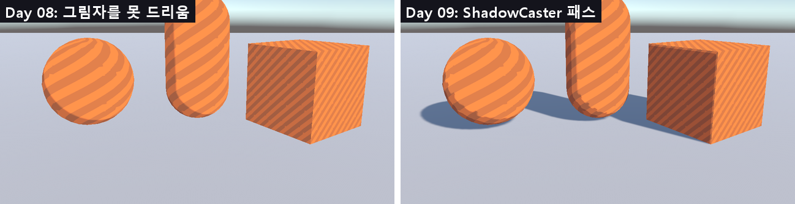

# Day 09. 그림자 드리우기 — 패스를 더 만들고 코드를 나눠 쓰기

## 작업 식별

| 항목 | 내용 |
|---|---|
| Task ID | GMD-TSL-009-MP |
| 목적 | 공용 코드를 `HLSLINCLUDE`로 모으고 `ShadowCaster`, `DepthOnly` 패스를 추가해 물체가 그림자와 깊이 텍스처에 기록되게 한다 |
| 적용 대상 | Unity 6000.3, URP 17.x, Forward 렌더링. Day 08 완료 상태의 `MyToon.shader` |
| 소요 시간 | 약 60분 (정리 15분, 새 패스 두 개 30분, 확인 15분) |
| 확인 상태 | 미검증 (원본 코드를 읽고 정리한 것이며 이 환경에서 컴파일·실행하지 않았다) |
| 개정 | R1 (2026-11-18) |


NOTE: `ShadowCaster` 패스의 `ApplyShadowBias`, `_LightDirection`, `_LightPosition`, `_CASTING_PUNCTUAL_LIGHT_SHADOW`, `UNITY_REVERSED_Z` 처리와 `DepthOnly` 패스의 `LightMode` 이름은 URP 버전에 따라 다르다. URP 버전 확인 필요. 렌더링 경로가 Deferred이거나 Render Graph 기반인 경우 패스 호출 방식이 다를 수 있다.


## 1. 참조

| 참조 문서 | Task ID | 제목 |
|---|---|---|
| [day05-textures.md](day05-textures.md) | GMD-TSL-005-MP | `clip` 도입 |
| [day08-receive-shadows.md](day08-receive-shadows.md) | GMD-TSL-008-MP | 이전: 그림자 받기 |
| [day10-ambient-fog.md](day10-ambient-fog.md) | GMD-TSL-010-MP | 다음: 환경광과 안개 |
| [day19-depthnormals-ssao.md](day19-depthnormals-ssao.md) | GMD-TSL-019-MP | 깊이 텍스처 사용처 (SSAO) |
| [day21-screen-outline.md](day21-screen-outline.md) | GMD-TSL-021-MP | 깊이 텍스처 사용처 (화면 외곽선) |
| [toon-shader-study Day 08](../toon-shader-study/day08-shadows.md), [Day 18](../toon-shader-study/day18-passes.md) | - | 그림자, 패스 총정리 (짝꿍 과정) |
| [LearnOpenGL Shadow Mapping](https://learnopengl.com/Advanced-Lighting/Shadows/Shadow-Mapping), [Unity Pass 태그(LightMode)](https://docs.unity3d.com/Manual/SL-Pass.html) | - | 그림자 여드름, LightMode 참고 |

## 2. 필요 장비와 자재

| 번호 | 이름 | 사양·버전 | 비고 |
|---|---|---|---|
| 1 | `Assets/MyToon/MyToon.shader` | Day 08 완료 상태 | |

## 3. 안전 사항


WARNING: 모든 패스의 `UnityPerMaterial` CBUFFER는 모양이 같아야 SRP Batcher가 동작한다. CBUFFER를 패스마다 따로 쓰지 말고 `HLSLINCLUDE`의 한 곳에만 둔다.



CAUTION: 5-B 절차는 코드를 옮기기만 한다. 5-B 이후 화면이 Day 08과 같아야 한다. 다르면 5-C로 넘어가지 말고 코드 이동 오류를 먼저 찾는다.


## 4. 준비

| 번호 | 항목 | 확인 방법 |
|---|---|---|
| 1 | Day 08 코드가 컴파일된다 | Console 오류 0건 |
| 2 | 현재 코드를 커밋한다 | `git commit -am "Day 08 완료"` 후 `git status`가 깨끗하다 |

## 5. 절차

### A. 개념 확인

| 패스 | `LightMode` | 하는 일 |
|---|---|---|
| Forward | `UniversalForward` | 색칠 |
| ShadowCaster | `ShadowCaster` | 광원 위치에서 거리만 기록(섀도맵 생성) |
| DepthOnly | `DepthOnly` | 카메라 기준 깊이만 기록(`_CameraDepthTexture`) |

### B. 공용 코드를 HLSLINCLUDE로 이동

`SubShader` 안, `Pass`보다 위에 둔 `HLSLINCLUDE` 블록은 모든 패스의 `HLSLPROGRAM` 앞에 자동으로 붙는다.

1. (5-B-01) Forward 패스의 `HLSLPROGRAM`에서 다음 세 가지를 잘라 낸다.
   - `#include ".../Core.hlsl"` 줄
   - `TEXTURE2D(_BaseMap); SAMPLER(sampler_BaseMap);` 줄
   - `CBUFFER_START` ~ `CBUFFER_END` 블록 전체
2. (5-B-02) `Tags { "RenderPipeline" ... }` 줄 아래에 붙여 넣고 `ClipAlpha` 함수를 추가한다. → 결과: Forward 패스에는 `Lighting.hlsl` include만 남는다.

```hlsl
        Tags { "RenderPipeline" = "UniversalPipeline" "RenderType" = "Opaque" "Queue" = "Geometry" }

        // 여러 패스가 함께 쓰는 코드. 모든 패스의 HLSLPROGRAM 앞에 자동으로 붙는다.
        HLSLINCLUDE
        #include "Packages/com.unity.render-pipelines.universal/ShaderLibrary/Core.hlsl"

        TEXTURE2D(_BaseMap);    SAMPLER(sampler_BaseMap);

        // 머티리얼 값 상자. 모든 패스가 같은 모양이어야 SRP Batcher 가 동작한다.
        CBUFFER_START(UnityPerMaterial)
            float4 _BaseMap_ST;
            half4  _BaseColor;
            half   _Cutoff;
            half4  _ShadowColor;
            half   _ShadowBorder;
            half   _ShadowBlur;
            half4  _Shadow2ndColor;
            half   _Shadow2ndBorder;
            half   _Shadow2ndBlur;
            half   _ReceiveShadow;
            half   _DebugView;
        CBUFFER_END

        // 모든 패스가 같은 가위를 쓴다: 투명도가 기준보다 낮으면 버린다.
        void ClipAlpha(float2 uv)
        {
            half alpha = SAMPLE_TEXTURE2D(_BaseMap, sampler_BaseMap, uv).a * _BaseColor.a;
            clip(alpha - _Cutoff);
        }
        ENDHLSL

        Pass
        {
            Name "Forward"
            ...
```

3. (5-B-03) Forward frag의 `clip(baseColor.a - _Cutoff);`를 공용 함수 호출로 바꾼다. `void`는 반환값이 없다는 뜻이다. → 결과: 저장 후 화면이 Day 08과 같다(리팩터링).

```hlsl
    half4 baseColor = SAMPLE_TEXTURE2D(_BaseMap, sampler_BaseMap, input.uv) * _BaseColor;
    ClipAlpha(input.uv);
```

### C. ShadowCaster 패스 추가

1. (5-C-01) Forward 패스의 마지막 `}` 다음(SubShader 안)에 새 패스를 추가한다. → 결과: 컴파일 오류가 없다.

```hlsl
        // 그림자 지도 찍기: 빛의 자리에서 '거리'만 기록한다
        Pass
        {
            Name "ShadowCaster"
            Tags { "LightMode" = "ShadowCaster" }
            ZWrite On
            ZTest LEqual
            ColorMask 0

            HLSLPROGRAM
            #pragma vertex ShadowVert
            #pragma fragment ShadowFrag
            #pragma multi_compile_vertex _ _CASTING_PUNCTUAL_LIGHT_SHADOW
            #include "Packages/com.unity.render-pipelines.universal/ShaderLibrary/Shadows.hlsl"

            float3 _LightDirection;   // URP 가 채워 준다: 해의 방향
            float3 _LightPosition;    // 포인트·스폿 조명의 위치

            struct ShadowAttributes
            {
                float4 positionOS : POSITION;
                float3 normalOS   : NORMAL;
                float2 uv         : TEXCOORD0;
            };

            struct ShadowVaryings
            {
                float4 positionCS : SV_POSITION;
                float2 uv         : TEXCOORD0;
            };

            ShadowVaryings ShadowVert(ShadowAttributes input)
            {
                ShadowVaryings o = (ShadowVaryings)0;
                float3 positionWS = TransformObjectToWorld(input.positionOS.xyz);
                float3 normalWS   = TransformObjectToWorldNormal(input.normalOS);
            #if defined(_CASTING_PUNCTUAL_LIGHT_SHADOW)
                float3 lightDirWS = normalize(_LightPosition - positionWS);
            #else
                float3 lightDirWS = _LightDirection;
            #endif
                // 표면을 살짝 밀어서 '그림자 여드름'(자기 자신을 가리는 착각)을 막는다
                o.positionCS = TransformWorldToHClip(ApplyShadowBias(positionWS, normalWS, lightDirWS));
            #if UNITY_REVERSED_Z
                o.positionCS.z = min(o.positionCS.z, UNITY_NEAR_CLIP_VALUE);
            #else
                o.positionCS.z = max(o.positionCS.z, UNITY_NEAR_CLIP_VALUE);
            #endif
                o.uv = TRANSFORM_TEX(input.uv, _BaseMap);
                return o;
            }

            half4 ShadowFrag(ShadowVaryings input) : SV_Target
            {
                ClipAlpha(input.uv);   // 오려 낸 곳은 그림자도 안 생긴다
                return 0;
            }
            ENDHLSL
        }
```

| 부분 | 의미 |
|---|---|
| `LightMode = ShadowCaster` | URP가 섀도맵을 만들 때 이 패스를 호출한다 |
| `ColorMask 0` | 색을 쓰지 않고 깊이만 기록한다 |
| `_CASTING_PUNCTUAL_LIGHT_SHADOW` | 포인트, 스폿 조명은 위치가 있어 정점마다 광원 방향을 계산한다 |
| `_LightDirection`, `_LightPosition` | 이름을 맞춰 선언하면 URP가 값을 넣는다 |
| `ApplyShadowBias` | 섀도맵은 해상도가 있는 텍스처라 비스듬한 면이 자기 자신을 가린다고 판정하는 오류(그림자 여드름)가 난다. 표면을 광원과 노멀 방향으로 조금 밀어 막는다 |
| `UNITY_REVERSED_Z` 블록 | 광원 카메라의 앞 클립 경계를 넘은 점을 경계에 붙여 그림자가 잘리지 않게 한다 (URP 표준 코드) |
| `ClipAlpha` | 공용 가위. Day 05의 구멍이 그림자에도 뚫린다 |

### D. DepthOnly 패스 추가

DepthOnly 패스는 카메라 기준 깊이 텍스처(`_CameraDepthTexture`)에 물체를 기록한다. Day 19의 SSAO와 Day 21의 화면 외곽선이 이 텍스처를 읽는다.

1. (5-D-01) `ShadowCaster` 패스 다음에 추가한다. → 결과: 컴파일 오류가 없다.

```hlsl
        // 깊이 지도 찍기: 카메라에서 얼마나 먼지만 기록한다
        Pass
        {
            Name "DepthOnly"
            Tags { "LightMode" = "DepthOnly" }
            ZWrite On
            ColorMask R

            HLSLPROGRAM
            #pragma vertex DepthVert
            #pragma fragment DepthFrag

            struct DepthAttributes
            {
                float4 positionOS : POSITION;
                float2 uv         : TEXCOORD0;
            };

            struct DepthVaryings
            {
                float4 positionCS : SV_POSITION;
                float2 uv         : TEXCOORD0;
            };

            DepthVaryings DepthVert(DepthAttributes input)
            {
                DepthVaryings o = (DepthVaryings)0;
                o.positionCS = TransformObjectToHClip(input.positionOS.xyz);
                o.uv = TRANSFORM_TEX(input.uv, _BaseMap);
                return o;
            }

            half4 DepthFrag(DepthVaryings input) : SV_Target
            {
                ClipAlpha(input.uv);
                return 0;
            }
            ENDHLSL
        }
```

정답 파일: [`Assets/Solutions/Day09/MyToon.shader`](https://github.com/JJH0204/toon-shader-lab/blob/main/Assets/Solutions/Day09/MyToon.shader)

### E. 화면 확인

1. (5-E-01) Lab 씬의 바닥을 본다. → 결과: 세 물체의 그림자가 생기고 Capsule 그림자가 Cube에도 떨어진다.
2. (5-E-02) 머티리얼 `Alpha Cutoff`를 0.5로 올린다. → 결과: 바닥 그림자에도 구멍이 보인다. 확인 후 0으로 되돌린다.



모든 패스가 같은 `ClipAlpha`를 써야 한다. 색칠 패스만 오리면 없는 부분이 그림자를 드리우고 깊이 텍스처에 유령 모양이 남는다. 실제 게임 셰이더에서도 자주 나오는 버그다.


CAUTION: 구의 그림자 경계에 얼룩덜룩한 계단이 보일 수 있다. 자기 그림자가 빛과 거의 직각인 경계에 걸릴 때 툰 계단이 오차를 키워서 생긴다. Directional Light의 `Shadows > Bias`를 `Custom`으로 바꿔 `Normal` 값을 올리거나, 머티리얼의 `Receive Shadow`를 낮추면 줄어든다.


### F. 실험

1. (5-F-01) `ShadowCaster` 패스를 `/* ... */`로 주석 처리한다. → 결과: 그림자가 사라진다. 확인 후 되돌린다.
2. (5-F-02) Directional Light의 `Shadows > Bias`를 `Custom`으로 바꾸고 `Depth`, `Normal`을 0으로 내린다. → 결과: 표면에 줄무늬 그림자 여드름이 생긴다. 확인 후 `Use settings from Render Pipeline Asset`으로 되돌린다.
3. (5-F-03) 커밋한다: `git commit -am "Day 09: 그림자 드리우기와 깊이 패스"`

## 6. 기능 확인

| 번호 | 확인 동작 | 기대 결과 | 합격 기준 |
|---|---|---|---|
| 1 | 5-B 완료 후 화면을 Day 08과 비교한다 | 동일 | 차이 없음 |
| 2 | 바닥을 본다 | 세 물체의 그림자 | 그림자 3개 |
| 3 | `Alpha Cutoff = 0.5` | 그림자에도 구멍 | 구멍이 보인다 |
| 4 | 셰이더 Inspector | `SRP Batcher: compatible` | 표시 일치 |

## 7. 복구

1. (7-01) 변경을 되돌린다: `git restore Assets/MyToon/MyToon.shader` (4절에서 만든 Day 08 커밋 기준).
2. (7-02) `Bias`, `Alpha Cutoff`를 기본값으로 되돌린다.

## 8. 개정 이력

| 개정 | 날짜 | 변경 내용 |
|---|---|---|
| R1 | 2026-11-18 | 기존 Day 09 페이지를 AMM 형식으로 재작성. URP 버전 의존 NOTE 추가 |

[← Day 08](day08-receive-shadows.md) · [목차](README.md) · [다음: Day 10 →](day10-ambient-fog.md)
