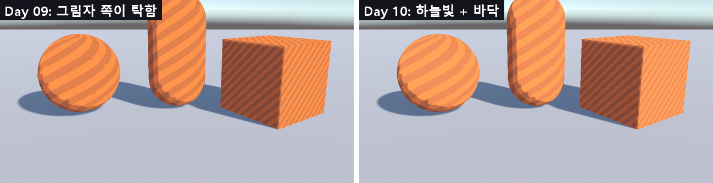
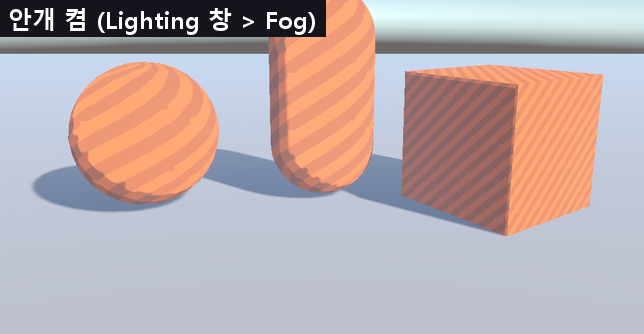

# Day 10. 하늘빛과 안개 — 그림자 속이 깜깜하지 않은 이유

## 작업 식별

| 항목 | 내용 |
|---|---|
| Task ID | GMD-TSL-010-MP |
| 목적 | `SampleSH`로 환경광(간접광)을 그림자 쪽에 덜 더하고, 그림자 바닥값과 URP 안개를 적용한다 |
| 적용 대상 | Unity 6000.3, URP 17.x. Day 09 완료 상태의 `MyToon.shader` |
| 소요 시간 | 약 60분 (개념 15분, 코드 25분, 실험 20분) |
| 확인 상태 | 미검증 (원본 코드를 읽고 정리한 것이며 이 환경에서 컴파일·실행하지 않았다) |
| 개정 | R1 (2026-11-18) |


NOTE: `SampleSH`, `ComputeFogFactor`, `MixFog`, 키워드 `multi_compile_fog`는 URP 버전에 따라 시그니처와 동작이 다를 수 있다. Unity 6의 Adaptive Probe Volumes를 쓰면 환경광 샘플링 방식이 다르다. URP 버전 확인 필요.


## 1. 참조

| 참조 문서 | Task ID | 제목 |
|---|---|---|
| [day09-cast-shadows.md](day09-cast-shadows.md) | GMD-TSL-009-MP | 이전: 그림자 드리우기 |
| [day11-additional-lights.md](day11-additional-lights.md) | GMD-TSL-011-MP | 다음: 보조 조명 |
| [toon-shader-study Day 10](../toon-shader-study/day10-ambient-gi-ssao.md) | - | 환경광, GI, SSAO (짝꿍 과정) |
| [Spherical harmonic lighting](https://en.wikipedia.org/wiki/Spherical_harmonic_lighting), [Unity 라이트 프로브 기술 정보](https://docs.unity3d.com/Manual/LightProbes-TechnicalInformation.html) | - | SH 참고 |

## 2. 필요 장비와 자재

| 번호 | 이름 | 사양·버전 | 비고 |
|---|---|---|---|
| 1 | `Assets/MyToon/MyToon.shader` | Day 09 완료 상태 | |

## 3. 안전 사항


CAUTION: 밝은 조명에서 빛 쪽과 그림자 쪽 모두에 환경광을 더하면 두 영역이 1을 넘어 하얗게 잘리고 툰 계단이 사라진다. 환경광은 그림자 쪽에 덜 더한다(`환경광 * (1 - 그림자 정도)`).


## 4. 준비

| 번호 | 항목 | 확인 방법 |
|---|---|---|
| 1 | Day 09 코드가 컴파일된다 | Console 오류 0건 |
| 2 | Fog가 꺼져 있다 | `Window > Rendering > Lighting > Environment`의 `Fog` 체크 해제 |

## 5. 절차

### A. 개념 확인

그늘이 완전히 까맣지 않은 것은 하늘과 주변 표면에서 반사된 간접광이 들어오기 때문이다. Unity는 사방의 빛을 SH(구면 조화, spherical harmonics) 계수 몇 개로 요약한다. 노멀 방향을 넣으면 그 방향에서 오는 환경광을 돌려주는 함수가 `SampleSH(N)`이다.

### B. Properties와 CBUFFER

1. (5-B-01) `_ReceiveShadow` 아래에 Properties를 추가한다.

```shaderlab
        _AmbientStrength ("Ambient Strength", Range(0, 2)) = 1
        _ShadeFloor ("Shade Floor", Range(0, 1)) = 0.15
```

2. (5-B-02) `HLSLINCLUDE` 안 CBUFFER의 `_ReceiveShadow` 아래에 추가한다. → 결과: 모든 패스가 같은 CBUFFER 모양을 유지한다.

```hlsl
            half   _AmbientStrength;
            half   _ShadeFloor;
```

### C. 안개 키워드와 Varyings

1. (5-C-01) Forward 패스의 `#pragma` 줄들 아래에 추가한다.

```hlsl
            #pragma multi_compile_fog
```

2. (5-C-02) Forward 패스의 `Varyings`에 추가한다.

```hlsl
                half   fogFactor  : TEXCOORD3;    // Varyings 에 추가
```

3. (5-C-03) `vert`의 `return` 바로 위에 추가한다. 안개는 카메라에서 먼 정도로 정해지므로 정점마다 한 번 계산해 넘긴다. → 결과: 컴파일 오류가 없다.

```hlsl
                o.fogFactor  = ComputeFogFactor(o.positionCS.z);   // vert 의 return 바로 위
```

### D. frag 끝부분 수정

1. (5-D-01) `toon = lerp(...)` 두 줄 다음부터 `frag` 끝까지를 다음으로 바꾼다. → 결과: 그림자 쪽이 은은하게 밝아진다.

```hlsl
                half shadeMask = max(shadow1, shadow2);   // 얼마나 그림자인가 (0~1)

                half3 color = toon * mainLight.color;
                half3 ambient = SampleSH(N) * albedo * _AmbientStrength;   // 하늘에서 오는 은은한 빛
                color += ambient * (1.0h - shadeMask);                     // 그림자 쪽엔 덜 더한다
                color = max(color, albedo * _ShadeFloor);                  // 너무 까매지지 않게 바닥

                color = MixFog(color, input.fogFactor);
                return half4(color, baseColor.a);
            }
```

| 줄 | 의미 |
|---|---|
| `shadeMask` | 1차, 2차 중 더 진한 그림자 정도. 0은 빛, 1은 그림자 |
| `SampleSH(N) * albedo` | 환경광 색 x 바탕색 |
| `* (1 - shadeMask)` | 그림자 쪽에 덜 더한다 |
| `max(color, albedo * _ShadeFloor)` | 색이 바탕색의 `_ShadeFloor`(기본 15%) 아래로 내려가지 않게 한다 |
| `MixFog` | 안개 색과 섞는다. 안개가 꺼져 있으면 변화가 없다 |

정답 파일: [`Assets/Solutions/Day10/MyToon.shader`](https://github.com/JJH0204/toon-shader-lab/blob/main/Assets/Solutions/Day10/MyToon.shader)

### E. 화면 확인

1. (5-E-01) Lab 씬의 그림자 쪽을 본다. → 결과: 그림자 쪽이 살짝 푸르고 맑게 밝아진다. 스카이박스가 파랗기 때문이다.



2. (5-E-02) `Window > Rendering > Lighting > Environment`에서 `Fog`를 체크하고 `Mode`를 `Exponential Squared`, `Density`를 0.08로 설정한다. → 결과: 먼 물체가 안개에 묻힌다.



3. (5-E-03) 확인 후 `Fog`를 끈다. → 결과: 이후 Day의 화면이 정답 이미지와 같아진다.

### F. 실험

1. (5-F-01) `color += ambient * (1.0h - shadeMask);`를 `color += ambient;`로 바꾸고 Directional Light `Intensity`를 3으로 올린다. → 결과: 그림자 계단이 하얗게 사라진다. 코드와 `Intensity`(원래 값 1.2)를 되돌린다.
2. (5-F-02) `Ambient Strength`를 0으로 두고 `Shade Floor`를 0과 0.5 사이로 움직인다. → 결과: 2차 그림자의 바닥 밝기가 따라 변한다.
3. (5-F-03) `Lighting > Environment`의 `Environment Lighting Source`를 `Color`로 바꾸고 주황색을 지정한다. → 결과: 그림자 쪽이 주황빛이 된다. 확인 후 `Skybox`로 되돌린다.
4. (5-F-04) 커밋한다: `git commit -am "Day 10: 환경광과 안개"`

## 6. 기능 확인

| 번호 | 확인 동작 | 기대 결과 | 합격 기준 |
|---|---|---|---|
| 1 | 그림자 쪽을 본다 | 검정이 아닌 푸른 빛 | 바탕색의 15% 이상 밝기 |
| 2 | `Fog` 켬 | 먼 물체가 안개색에 가까워진다 | 거리에 따라 변화 |
| 3 | `Fog` 끔 | 안개 없음 | Day 09와 같은 화면 |

## 7. 복구

1. (7-01) 변경을 되돌린다: `Ctrl+Z` 또는 `git restore Assets/MyToon/MyToon.shader`.
2. (7-02) `Fog`를 끄고 `Environment Lighting Source`를 `Skybox`로, `Intensity`를 1.2로 되돌린다.

## 8. 개정 이력

| 개정 | 날짜 | 변경 내용 |
|---|---|---|
| R1 | 2026-11-18 | 기존 Day 10 페이지를 AMM 형식으로 재작성. 비유 삭제, 버전 의존 NOTE 추가 |

[← Day 09](day09-cast-shadows.md) · [목차](README.md) · [다음: Day 11 →](day11-additional-lights.md)
