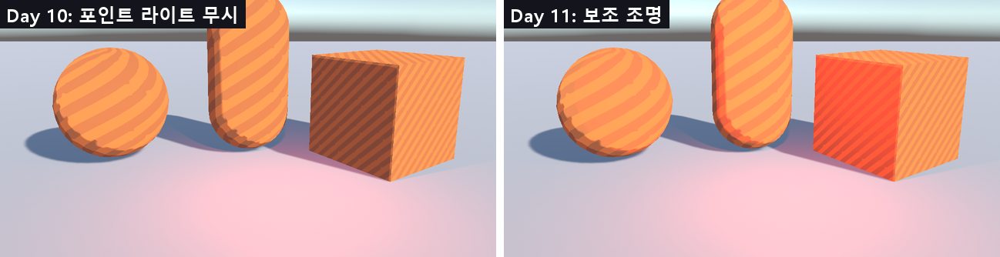

# Day 11. 보조 조명 — 그리고 나만의 공구함 파일

> ⏱ **약 1시간** — 파일 만들기 25분 · 연결 15분 · 실험 20분
> 🧸 **오늘의 비유**: 해는 **주인공 조명**, 포인트·스폿 라이트는 **보조 조명**이에요. 보조 조명은 **더하기만** 해요. 주인공 조명이 만든 그림자 모양은 건드리지 않아요.



## 오늘 만들 것

빨간 **포인트 라이트**가 물체를 툰 계단으로 비춰요(오른쪽). 그리고 조명 계산을 **내 `.hlsl` 공구함 파일**로 옮겨요.

## 오늘 배울 것

- [ ] `.hlsl` 파일을 만들어 `#include`로 가져온다
- [ ] `#ifndef` 중복 방지 스티커를 붙인다
- [ ] 보조 조명을 하나씩 돌며 더하는 루프를 짠다
- [ ] Forward와 Forward+의 차이를 안다

---

## 1. 공구함 파일 만들기 (25분)

같은 계단 계산(`CelStep`)을 해와 보조 조명이 함께 써요. 셰이더 파일이 길어지니까 **조명 도구만 따로 파일**로 빼요.

1. Project 창 `MyToon` 폴더 우클릭 → **Show in Explorer**.
2. 탐색기에서 새 텍스트 파일을 만들고 이름을 **`MyToonLighting.hlsl`** 로 바꿔요(확장자 `.txt`가 남지 않게).
3. 아래 내용을 쳐요.

```hlsl
// 툰 조명 공구함. URP Lighting.hlsl 다음에 include 할 것 (Light 타입, GetAdditionalLight 가 필요하다).
#ifndef MYTOON_LIGHTING_INCLUDED
#define MYTOON_LIGHTING_INCLUDED

// 계단 하나: value 가 border 를 넘으면 1, 아니면 0. blur 폭만큼 모서리를 다듬는다.
half CelStep(half value, half border, half blur)
{
    half b = max(blur, 1e-4h);   // blur 가 0 이면 0 으로 나누게 되므로 바닥을 깐다
    return smoothstep(border - b, border + b, value);
}

// 보조 조명 하나의 툰 기여. 빛 쪽만 밝히고 그림자 쪽은 건드리지 않는다(더하기만).
half3 ShadeAdditionalLight(Light light, half3 N, half3 albedo, half border, half blur)
{
    half lightVal = dot(N, light.direction) * 0.5h + 0.5h;
    half lit = CelStep(lightVal, border, blur);
    return albedo * light.color * (light.distanceAttenuation * light.shadowAttenuation * lit);
}

// 이 픽셀에 닿는 보조 조명을 모두 더한다. Forward 와 Forward+ 둘 다 동작한다.
half3 AdditionalLightsToon(float3 positionWS, float4 positionCS, half3 N, half3 albedo, half border, half blur)
{
    half3 sum = 0;
#if defined(_ADDITIONAL_LIGHTS)
    // LIGHT_LOOP_BEGIN 매크로가 'inputData' 라는 이름의 변수를 읽는다 (Forward+ 의 바둑판 칸 찾기)
    InputData inputData = (InputData)0;
    inputData.positionWS = positionWS;
    inputData.normalizedScreenSpaceUV = GetNormalizedScreenSpaceUV(positionCS);
    half4 shadowMask = half4(1, 1, 1, 1);

  #if USE_CLUSTER_LIGHT_LOOP
    // Forward+: 해가 아닌 다른 Directional 조명은 바둑판에 안 들어가서 따로 돈다
    for (uint di = 0u; di < min(URP_FP_DIRECTIONAL_LIGHTS_COUNT, MAX_VISIBLE_LIGHTS); di++)
        sum += ShadeAdditionalLight(GetAdditionalLight(di, positionWS, shadowMask), N, albedo, border, blur);
  #endif

    uint count = GetAdditionalLightsCount();
    LIGHT_LOOP_BEGIN(count)
        // 인자 3개짜리 GetAdditionalLight 라야 보조 조명의 그림자가 들어간다
        sum += ShadeAdditionalLight(GetAdditionalLight(lightIndex, positionWS, shadowMask), N, albedo, border, blur);
    LIGHT_LOOP_END
#endif
    return sum;
}

#endif // MYTOON_LIGHTING_INCLUDED
```

### 처음 보는 것들

| 코드 | 뜻 |
|---|---|
| `#ifndef X` / `#define X` / `#endif` | **중복 방지 스티커**. "아직 X 스티커가 없으면 붙이고 내용을 넣어라. 이미 있으면 통째로 건너뛰어라." 같은 파일이 두 번 include 돼도 함수가 두 번 정의되지 않아요 |
| `light.distanceAttenuation` | 거리 감쇠. 촛불에서 멀어질수록 어두워지는 것 (대략 거리의 제곱에 반비례) |
| `light.shadowAttenuation` | 보조 조명의 그림자. **인자 3개**짜리 `GetAdditionalLight`라야 들어와요. 2개짜리는 항상 1(그림자 없음)이에요 |
| `LIGHT_LOOP_BEGIN` / `END` | URP가 주는 반복문 매크로. 렌더러 설정에 따라 알맞은 반복문으로 바뀌어요 |
| `#if defined(_ADDITIONAL_LIGHTS)` | 보조 조명이 꺼진 설정이면 이 계산을 통째로 빼요 |

### Forward vs Forward+

화면에 보조 조명이 50개면 픽셀마다 50개를 다 계산하긴 너무 비싸요. "이 픽셀에 닿는 조명만" 골라야 해요.

| 방식 | 비유 |
|---|---|
| Forward | **물체마다** "너한테 닿는 조명" 쪽지를 줌 (물체당 개수 제한) |
| Forward+ | 화면을 **바둑판**으로 나누고 **칸마다** 조명 목록을 만듦 (이 프로젝트 PC 설정) |

`inputData.normalizedScreenSpaceUV`는 Forward+에서 "내가 바둑판 몇 번 칸인지" 찾는 데 써요. 해가 아닌 Directional 조명은 어디에나 닿아서 바둑판에 안 들어가니 앞에서 따로 돌아요.

## 2. 셰이더에 연결하기 (15분)

### ① CelStep 옮기기

`MyToon.shader`의 `CelStep` 함수(Day 07에 만든 것)를 **지워요.** 이제 공구함에 있으니까요.

### ② include + 키워드

Forward 패스 `#pragma` 들 아래에 키워드 세 줄, `Lighting.hlsl` include 아래에 내 공구함:

```hlsl
            #pragma multi_compile _ _ADDITIONAL_LIGHTS
            #pragma multi_compile_fragment _ _ADDITIONAL_LIGHT_SHADOWS
            #pragma multi_compile _ _CLUSTER_LIGHT_LOOP
```

```hlsl
            #include "Packages/com.unity.render-pipelines.universal/ShaderLibrary/Lighting.hlsl"
            #include "MyToonLighting.hlsl"     // ← 같은 폴더의 내 파일
```

### ③ 세기 조절 + frag

```shaderlab
        _AdditionalLightStrength ("Additional Light Strength", Range(0, 2)) = 1     // _ShadeFloor 아래
```

```hlsl
            half   _AdditionalLightStrength;     // CBUFFER, _ShadeFloor 아래
```

frag의 `color = max(...)` 다음, `MixFog` 전에:

```hlsl
                // 보조 조명(포인트·스폿)은 더하기만 한다
                color += AdditionalLightsToon(input.positionWS, input.positionCS, N, albedo,
                                              _ShadowBorder, _ShadowBlur) * _AdditionalLightStrength;
```

`input.positionCS`는 frag에서는 **픽셀 좌표**가 들어 있어요. 바둑판 칸을 찾는 데 써요.

정답: [`Assets/Solutions/Day11/MyToon.shader`](https://github.com/JJH0204/toon-shader-lab/blob/main/Assets/Solutions/Day11/MyToon.shader) · [`MyToonLighting.hlsl`](https://github.com/JJH0204/toon-shader-lab/blob/main/Assets/Solutions/Day11/MyToonLighting.hlsl)

## 3. 확인하기

1. Hierarchy에서 **Point Light**를 켜요.
2. 큐브 앞면과 캡슐 옆이 **빨간 계단**으로 밝아져요(맨 위 오른쪽). 같은 Border/Blur를 쓰니 경계가 해 그림자와 같은 느낌이에요.
3. Point Light를 움직이면 빛이 따라와요. 큐브 뒤로 보내면 큐브 그림자에 가려 캡슐에 안 닿아요(보조 조명 그림자).

## 4. 실험해 보기 (20분)

1. **2인자로 바꿔 보기** — `GetAdditionalLight(lightIndex, positionWS, shadowMask)`의 세 번째 인자를 지우면? 그림자 없이 **물체를 뚫고** 비춰요. 실제 프로젝트에서 있었던 버그예요. 되돌려요.
2. **스폿 라이트** — Point Light의 Type을 Spot으로 바꾸고 각도를 좁혀 보세요. 같은 코드로 동작해요.
3. **더하기만?** — Point Light Intensity를 10으로 올려도 해가 만든 그림자 **모양**은 그대로고, 빨간 쪽만 밝아져요. 끝나면 Point Light를 끄세요.
4. 커밋: `git add Assets/MyToon && git commit -m "Day 11: 보조 조명과 공구함 파일"`

## 5. 오늘의 액기스

👉 [ESSENCE.md — Day 11](essence.md#day-11)

## 더 읽을거리

- [LearnOpenGL — Light casters](https://learnopengl.com/Lighting/Light-casters) (거리 감쇠 공식) · [Multiple lights](https://learnopengl.com/Lighting/Multiple-lights)
- [URP — Forward+ 렌더링 경로](https://docs.unity3d.com/Packages/com.unity.render-pipelines.universal@17.0/manual/rendering/forward-plus-rendering-path.html)
- 더 깊이: [toon-shader-study Day 09 — 여러 개의 빛](../toon-shader-study/day09-many-lights.md) (라이트 레이어, 캐릭터 전용 조명)

---

[← Day 10](day10-ambient-fog.md) · [목차](README.md) · [다음: Day 12 →](day12-rim-light.md)
