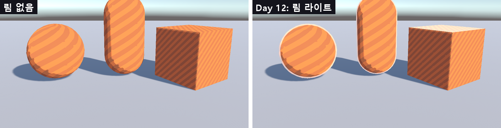
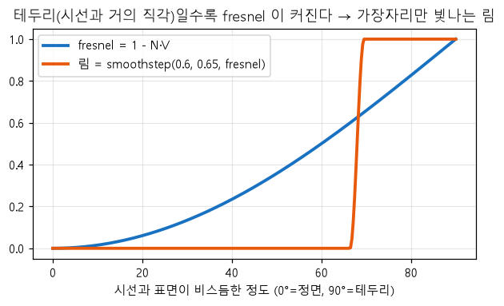

# Day 12. 림 라이트 — 테두리만 빛나게

> ⏱ **약 1시간** — 개념 15분 · 코드 15분 · 실험 30분
> 🧸 **오늘의 비유**: 역광 사진에서 **머리카락 가장자리가 반짝이는 것**이 림 라이트예요.



## 오늘 만들 것

물체 **가장자리에 하얀 테두리 빛**이 생겨요(오른쪽). 배경에서 물체가 또렷하게 떨어져 보여요.

## 오늘 배울 것

- [ ] 시선 방향 V를 구한다
- [ ] 프레넬 `1 - N·V`가 "테두리 정도"가 되는 이유를 안다
- [ ] 공구함의 `CelStep`을 다른 용도로 재사용한다

---

## 1. 테두리 = 시선과 직각인 곳 (개념 15분)



공을 정면에서 보면 가운데는 나를 **똑바로** 보고(N·V = 1), 가장자리로 갈수록 옆을 보다가 테두리에서는 나와 **직각**이에요(N·V = 0). 그러니까

```
fresnel = 1 - dot(N, V)     가운데 0 → 테두리 1
```

이 값을 Day 07의 계단(`CelStep`)에 넣으면 **테두리만 딱 끊겨서** 빛나요.

## 2. 코드 고치기 (15분)

### ① Properties (Toon Shading 묶음 다음, Debug 위)

```shaderlab

        [Header(Rim)]
        [HDR] _RimColor ("Rim Color", Color) = (1, 1, 1, 1)
        _RimThreshold ("Rim Threshold", Range(0, 1)) = 0.7
        _RimSoftness ("Rim Softness", Range(0, 0.5)) = 0.02
        _RimStrength ("Rim Strength", Range(0, 4)) = 0.5
```

`[HDR]`은 1보다 밝은 색(빛나는 색)도 고를 수 있게 해요.

### ② CBUFFER (`_AdditionalLightStrength` 아래)

```hlsl
            half4  _RimColor;
            half   _RimThreshold;
            half   _RimSoftness;
            half   _RimStrength;
```

### ③ frag

`N` 바로 다음에 시선 방향:

```hlsl
                half3 N = normalize(input.normalWS);
                half3 V = GetWorldSpaceNormalizeViewDir(input.positionWS);   // 표면 → 내 눈 (길이 1)
```

보조 조명 줄 다음, `MixFog` 전에:

```hlsl
                // 림: 테두리(시선과 직각인 곳)만 빛나게
                half fresnel = 1.0h - saturate(dot(N, V));
                half rim = CelStep(fresnel, _RimThreshold, _RimSoftness);
                color += rim * _RimColor.rgb * _RimStrength;
```

`saturate(dot(N, V))` — 뒷면에서 내적이 음수가 될 수 있어 0~1로 울타리를 쳐요.

정답: [`Assets/Solutions/Day12/MyToon.shader`](https://github.com/JJH0204/toon-shader-lab/blob/main/Assets/Solutions/Day12/MyToon.shader)

## 3. 확인하기

구와 캡슐 둘레에 **하얀 테두리**가 생겨요. 그런데 큐브는? **윗면 전체가 하얗게** 떠요. 왜일까요?


큐브 윗면은 평평해서 **면 전체가 같은 노멀**이에요. 카메라가 위에서 비스듬히 내려다보니 윗면 전체가 "시선과 거의 직각"으로 판정돼 통째로 빛나요. 프레넬 림은 **둥근 물체**에서 잘 동작하고 **평평한 면**에서는 약해요. 실제 툰 셰이더는 이걸 보완하려고 화면의 **깊이 차이**로 테두리를 찾는 "깊이 림"을 따로 써요([toon-shader-study Day 11](../toon-shader-study/day11-rim-light.md)).


## 4. 실험해 보기 (30분)

1. **Threshold** — 0.7 → 0.5면 테두리가 두꺼워지고, 0.9면 아주 얇아져요.
2. **Softness** — 0.02 → 0.2면 부드럽게 번져요. 만화 느낌은 작을수록.
3. **역광 림** — 지금 림은 빛 방향과 상관없이 테두리 전체가 빛나요. 빛을 등진 테두리만 빛나게 해 볼까요? `rim *= saturate(dot(-N, mainLight.direction) + 0.5h);`를 `color +=` 앞에 넣어 보세요. 해 반대쪽 테두리만 남아요. (정답 코드에는 없는 응용이에요.)
4. **색** — Rim Color를 하늘색 HDR(Intensity 1~2)로. 차가운 역광 느낌이 나요.
5. 커밋: `git commit -am "Day 12: 림 라이트"`

## 5. 오늘의 액기스

👉 [ESSENCE.md — Day 12](essence.md#day-12)

## 수학 참고 자료

- [Wikipedia — Schlick's approximation](https://en.wikipedia.org/wiki/Schlick%27s_approximation) (게임에서 쓰는 프레넬 근사식) · [Fresnel equations](https://en.wikipedia.org/wiki/Fresnel_equations) (진짜 물리)
- 🎥 [3Blue1Brown — 내적](https://www.3blue1brown.com/lessons/dot-products)

---

[← Day 11](day11-additional-lights.md) · [목차](README.md) · [다음: Day 13 →](day13-outline-pass.md)
