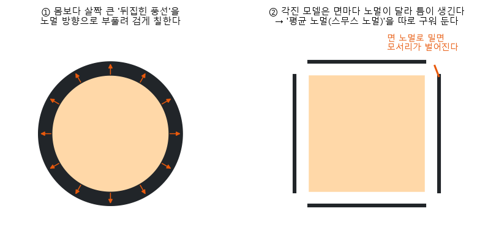
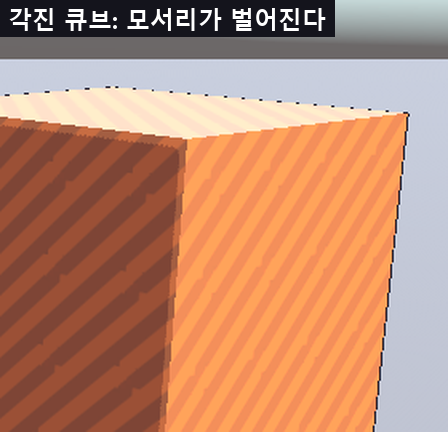

# Day 13. 외곽선 ① — 뒤집힌 풍선

> ⏱ **약 1시간** — 개념 10분 · 코드 25분 · 실험 25분
> 🧸 **오늘의 비유**: 몸보다 살짝 큰 **검은 풍선을 뒤집어 씌우면**, 몸 뒤로 테두리만 삐죽 보여요.


## 오늘 만들 것

물체에 **검은 외곽선**이 생겨요(오른쪽). 만화 그림의 마지막 퍼즐 조각이에요.

## 오늘 배울 것

- [ ] 한 셰이더에 **두 번째 색칠 패스**를 만든다
- [ ] `Cull Front`(뒷면만 그리기)로 외곽선을 만드는 원리를 안다
- [ ] Day 02의 "노멀 방향으로 밀기"를 다시 쓴다
- [ ] 각진 모델에서 외곽선이 갈라지는 이유를 안다

---

## 1. 뒤집힌 풍선 (개념 10분)



1. 물체를 **한 번 더** 그려요. 이번엔 점마다 **노멀 방향으로 살짝 밀어서** 부풀려요(Day 02의 숨쉬기와 같은 기술!).
2. 부푼 껍질의 **앞면은 버리고 뒷면만** 그려요(`Cull Front`).
3. 검은색으로 칠해요.

정면에서 보면 부푼 껍질의 뒷면은 **원래 몸에 가려지고**, 몸 밖으로 삐져나온 **가장자리만** 보여요. 이 방식을 "인버티드 헐(뒤집힌 껍질)"이라고 불러요.

## 2. 코드 고치기 (25분)

### ① Properties (Rim 묶음 다음, Debug 위) + CBUFFER

```shaderlab

        [Header(Outline)]
        _OutlineColor ("Outline Color", Color) = (0.12, 0.1, 0.16, 1)
        _OutlineWidth ("Outline Width (cm)", Range(0, 5)) = 1
```

```hlsl
            half4  _OutlineColor;     // CBUFFER, _RimStrength 아래
            half   _OutlineWidth;
```

외곽선 색을 완전한 검정 대신 **어두운 보라**로 하면 덜 딱딱해 보여요.

### ② Outline 패스 (Forward 패스 바로 다음)

```hlsl
        // 외곽선: 살짝 부풀린 몸을 뒷면만 그려서 테두리만 보이게 한다 (뒤집힌 풍선)
        Pass
        {
            Name "Outline"
            Tags { "LightMode" = "SRPDefaultUnlit" }
            Cull Front

            HLSLPROGRAM
            #pragma vertex OutlineVert
            #pragma fragment OutlineFrag
            #pragma multi_compile_fog

            struct OutlineAttributes
            {
                float4 positionOS : POSITION;
                float3 normalOS   : NORMAL;
                float2 uv         : TEXCOORD0;
            };

            struct OutlineVaryings
            {
                float4 positionCS : SV_POSITION;
                float2 uv         : TEXCOORD0;
                half   fogFactor  : TEXCOORD1;
            };

            OutlineVaryings OutlineVert(OutlineAttributes input)
            {
                OutlineVaryings o = (OutlineVaryings)0;
                float3 positionWS = TransformObjectToWorld(input.positionOS.xyz);
                float3 normalWS   = TransformObjectToWorldNormal(input.normalOS);
                positionWS += normalWS * (_OutlineWidth * 0.01);   // 노멀 방향으로 부풀리기 (cm → m)
                o.positionCS = TransformWorldToHClip(positionWS);
                o.uv = TRANSFORM_TEX(input.uv, _BaseMap);
                o.fogFactor = ComputeFogFactor(o.positionCS.z);
                return o;
            }

            half4 OutlineFrag(OutlineVaryings input) : SV_Target
            {
                ClipAlpha(input.uv);
                return half4(MixFog(_OutlineColor.rgb, input.fogFactor), 1.0h);
            }
            ENDHLSL
        }
```

| 부분 | 뜻 |
|---|---|
| `LightMode = SRPDefaultUnlit` | URP가 물체를 그릴 때 **덤으로 한 번 더** 그려 주는 이름표. 따로 설정할 게 없어요 |
| `Cull Front` | **뒷면만** 그리기. 기본은 `Cull Back`(앞면만) |
| `_OutlineWidth * 0.01` | 슬라이더는 cm, 계산은 m |
| `ClipAlpha` | 공용 가위 — 오려 낸 곳엔 외곽선도 없게 |
| `MixFog` | 외곽선도 안개에 묻히게 |

정답: [`Assets/Solutions/Day13/MyToon.shader`](https://github.com/JJH0204/toon-shader-lab/blob/main/Assets/Solutions/Day13/MyToon.shader)

## 3. 확인하기

구와 캡슐에 **어두운 외곽선**이 생겨요. 이제 큐브의 모서리를 가까이 보세요.



**선이 끊기고 점선처럼** 보여요. 큐브는 모서리의 점이 **면마다 따로** 있어서(노멀이 다르니까) 노멀 방향으로 밀면 면들이 **각자 다른 쪽으로 벌어져요.** Day 02에서 숨쉬기를 크게 했을 때 큐브가 쪼개지던 것과 같은 이유예요.


실제 게임에서는 같은 위치 점들의 노멀을 **평균 낸 "스무스 노멀"** 을 따로 구워 두고 외곽선에만 써요. 메시 데이터를 고치는 C# 도구가 필요해서 이 과정에서는 다루지 않아요. 궁금하면 [toon-shader-study Day 12](../toon-shader-study/day12-outline-inverted-hull.md)를 보세요.


## 4. 실험해 보기 (25분)

1. **Cull Back으로** — `Cull Front`를 `Cull Back`으로 바꾸면? 부푼 껍질의 **앞면**이 몸을 덮어서 물체가 통째로 검게 돼요. 되돌려요.
2. **두께** — Outline Width를 5로 올려 보세요. 그리고 **Scene 뷰에서 카메라를 멀리** 빼 보세요. 멀어질수록 외곽선이 가늘어지다가 **끊기고 반짝거려요.** 월드 단위(cm)로 밀었으니 멀리서는 1픽셀보다 얇아지거든요. 내일(Day 14) 해결해요.
3. **색** — Outline Color를 진한 주황으로 하면 부드러운 선이 돼요.
4. 커밋: `git commit -am "Day 13: 외곽선 패스"`

## 5. 오늘의 액기스

👉 [ESSENCE.md — Day 13](essence.md#day-13)

## 더 읽을거리

- [LearnOpenGL — Face culling](https://learnopengl.com/Advanced-OpenGL/Face-culling) · [Unity — Cull](https://docs.unity3d.com/Manual/SL-Cull.html)
- [lilToon (GitHub)](https://github.com/lilxyzw/lilToon) — 인버티드 헐 외곽선을 정교하게 다루는 유명한 툰 셰이더
- 더 깊이: [toon-shader-study Day 12 — 외곽선 ① 인버티드 헐](../toon-shader-study/day12-outline-inverted-hull.md)

---

[← Day 12](day12-rim-light.md) · [목차](README.md) · [다음: Day 14 →](day14-outline-pixels.md)
