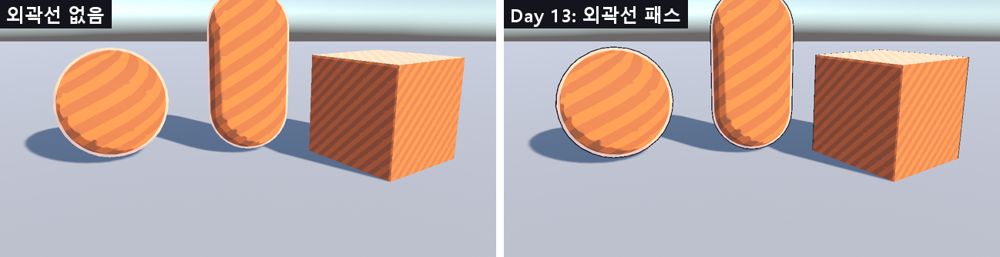

# Day 13. 외곽선 ① — 뒤집힌 풍선

## 작업 식별

| 항목 | 내용 |
|---|---|
| Task ID | GMD-TSL-013-MP |
| 목적 | 정점을 노멀 방향으로 부풀린 뒷면만 그리는 두 번째 패스로 인버티드 헐(법선 확장, 역면) 외곽선을 만든다 |
| 적용 대상 | Unity 6000.3, URP 17.x, Forward 렌더링. Day 12 완료 상태의 `MyToon.shader` |
| 소요 시간 | 약 60분 (개념 10분, 코드 25분, 실험 25분) |
| 확인 상태 | 미검증 (원본 코드를 읽고 정리한 것이며 이 환경에서 컴파일·실행하지 않았다) |
| 개정 | R1 (2026-11-18) |


NOTE: `LightMode = "SRPDefaultUnlit"` 패스가 URP에서 추가로 그려지는 동작은 URP 버전과 렌더링 경로(Forward, Forward+, Deferred), Render Graph 사용 여부에 따라 달라질 수 있다. Deferred에서는 이 패스가 그려지지 않는다. URP 버전 확인 필요.


## 1. 참조

| 참조 문서 | Task ID | 제목 |
|---|---|---|
| [day02-vertex-shader.md](day02-vertex-shader.md) | GMD-TSL-002-MP | 노멀 방향으로 밀기 |
| [day09-cast-shadows.md](day09-cast-shadows.md) | GMD-TSL-009-MP | `ClipAlpha`와 `HLSLINCLUDE` |
| [day12-rim-light.md](day12-rim-light.md) | GMD-TSL-012-MP | 이전: 림 라이트 |
| [day14-outline-pixels.md](day14-outline-pixels.md) | GMD-TSL-014-MP | 다음: 외곽선 2 |
| [toon-shader-study Day 12](../toon-shader-study/day12-outline-inverted-hull.md) | - | 스무스 노멀 (짝꿍 과정) |
| [LearnOpenGL Face culling](https://learnopengl.com/Advanced-OpenGL/Face-culling), [Unity Cull](https://docs.unity3d.com/Manual/SL-Cull.html), [lilToon](https://github.com/lilxyzw/lilToon) | - | 컬링, 참고 구현 |

## 2. 필요 장비와 자재

| 번호 | 이름 | 사양·버전 | 비고 |
|---|---|---|---|
| 1 | `Assets/MyToon/MyToon.shader` | Day 12 완료 상태 | |

## 3. 안전 사항


CAUTION: `Cull Front`를 `Cull Back`으로 바꾸면 부푼 껍질의 앞면이 몸을 덮어 물체 전체가 외곽선 색이 된다. 외곽선 패스의 컬링 방향을 확인한다.


## 4. 준비

| 번호 | 항목 | 확인 방법 |
|---|---|---|
| 1 | Day 12 코드가 컴파일된다 | Console 오류 0건 |
| 2 | `HLSLINCLUDE`에 `ClipAlpha`가 있다 | Day 09 상태 확인 |

## 5. 절차

### A. 개념 확인

인버티드 헐(inverted hull) 외곽선의 순서는 다음과 같다.

1. 물체를 한 번 더 그린다. 이번에는 정점을 노멀 방향으로 살짝 밀어 부풀린다(Day 02와 같은 기술).
2. 부푼 껍질의 앞면은 버리고 뒷면만 그린다(`Cull Front`).
3. 외곽선 색으로 칠한다.

정면에서 보면 부푼 껍질의 뒷면은 원래 몸에 가려지고 몸 밖으로 삐져나온 가장자리만 보인다.

### B. Properties와 CBUFFER

1. (5-B-01) `Rim` 묶음 다음, `Debug` 위에 Properties를 추가한다. → 결과: Inspector에 `Outline` 묶음이 나타난다. 색은 완전한 검정 대신 어두운 보라를 쓰면 덜 딱딱하다.

```shaderlab

        [Header(Outline)]
        _OutlineColor ("Outline Color", Color) = (0.12, 0.1, 0.16, 1)
        _OutlineWidth ("Outline Width (cm)", Range(0, 5)) = 1
```

2. (5-B-02) `HLSLINCLUDE`의 CBUFFER에서 `_RimStrength` 아래에 추가한다.

```hlsl
            half4  _OutlineColor;     // CBUFFER, _RimStrength 아래
            half   _OutlineWidth;
```

### C. Outline 패스 추가

1. (5-C-01) Forward 패스 바로 다음에 새 패스를 추가한다. → 결과: 컴파일 오류가 없다.

```hlsl
        // 외곽선: 살짝 부풀린 몸을 뒷면만 그려서 테두리만 보이게 한다 (뒤집힌 풍선)
        Pass
        {
            Name "Outline"
            Tags { "LightMode" = "SRPDefaultUnlit" }
            Cull Front

            HLSLPROGRAM
            #pragma vertex OutlineVert
            #pragma fragment OutlineFrag
            #pragma multi_compile_fog

            struct OutlineAttributes
            {
                float4 positionOS : POSITION;
                float3 normalOS   : NORMAL;
                float2 uv         : TEXCOORD0;
            };

            struct OutlineVaryings
            {
                float4 positionCS : SV_POSITION;
                float2 uv         : TEXCOORD0;
                half   fogFactor  : TEXCOORD1;
            };

            OutlineVaryings OutlineVert(OutlineAttributes input)
            {
                OutlineVaryings o = (OutlineVaryings)0;
                float3 positionWS = TransformObjectToWorld(input.positionOS.xyz);
                float3 normalWS   = TransformObjectToWorldNormal(input.normalOS);
                positionWS += normalWS * (_OutlineWidth * 0.01);   // 노멀 방향으로 부풀리기 (cm → m)
                o.positionCS = TransformWorldToHClip(positionWS);
                o.uv = TRANSFORM_TEX(input.uv, _BaseMap);
                o.fogFactor = ComputeFogFactor(o.positionCS.z);
                return o;
            }

            half4 OutlineFrag(OutlineVaryings input) : SV_Target
            {
                ClipAlpha(input.uv);
                return half4(MixFog(_OutlineColor.rgb, input.fogFactor), 1.0h);
            }
            ENDHLSL
        }
```

| 부분 | 의미 |
|---|---|
| `LightMode = SRPDefaultUnlit` | URP가 물체를 그릴 때 추가로 한 번 더 그리는 패스 이름표 |
| `Cull Front` | 뒷면만 그린다. 기본값은 `Cull Back`(앞면만) |
| `_OutlineWidth * 0.01` | 슬라이더는 cm 단위, 계산은 m 단위 |
| `ClipAlpha` | 공용 가위. 오려 낸 곳에는 외곽선도 없다 |
| `MixFog` | 외곽선도 안개에 묻힌다 |

정답 파일: [`Assets/Solutions/Day13/MyToon.shader`](https://github.com/JJH0204/toon-shader-lab/blob/main/Assets/Solutions/Day13/MyToon.shader)

### D. 화면 확인

1. (5-D-01) Sphere와 Capsule을 본다. → 결과: 어두운 외곽선이 생긴다.



2. (5-D-02) Cube의 모서리를 가까이서 본다. → 결과: 선이 끊겨 점선처럼 보인다. Cube는 모서리 정점이 면마다 따로 있어 노멀이 다르고, 노멀 방향으로 밀면 면들이 각자 다른 쪽으로 벌어지기 때문이다. Day 02에서 숨쉬기를 크게 했을 때 Cube가 쪼개진 것과 같은 원인이다.



NOTE: 실제 게임에서는 같은 위치 정점들의 노멀을 평균낸 스무스 노멀을 따로 저장해 외곽선에만 쓴다. 메시 데이터를 수정하는 C# 도구가 필요하므로 이 과정에서는 다루지 않는다. 상세는 [toon-shader-study Day 12](../toon-shader-study/day12-outline-inverted-hull.md)를 본다.


### E. 실험

1. (5-E-01) `Cull Front`를 `Cull Back`으로 바꾼다. → 결과: 물체 전체가 외곽선 색이 된다. 확인 후 되돌린다.
2. (5-E-02) `Outline Width`를 5로 올리고 Scene 뷰 카메라를 멀리 뺀다. → 결과: 멀어질수록 외곽선이 가늘어지다가 끊기고 반짝인다. 월드 단위(cm)로 밀었으므로 멀리서는 1픽셀보다 얇아진다. Day 14에서 해결한다.
3. (5-E-03) `Outline Color`를 진한 주황으로 바꾼다. → 결과: 부드러운 선이 된다.
4. (5-E-04) 커밋한다: `git commit -am "Day 13: 외곽선 패스"`

## 6. 기능 확인

| 번호 | 확인 동작 | 기대 결과 | 합격 기준 |
|---|---|---|---|
| 1 | Sphere, Capsule을 본다 | 둘레에 일정한 외곽선 | 끊김 없음 |
| 2 | Cube 모서리를 본다 | 모서리에서 선이 갈라진다 | 5-D-02의 설명과 일치 |
| 3 | `Cull Back`으로 바꾼다 | 물체 전체가 외곽선 색 | 되돌리면 정상 |

## 7. 복구

1. (7-01) 변경을 되돌린다: `Ctrl+Z` 또는 `git restore Assets/MyToon/MyToon.shader`.
2. (7-02) 외곽선만 끄려면 `Outline Width`를 0으로 설정한다.

## 8. 개정 이력

| 개정 | 날짜 | 변경 내용 |
|---|---|---|
| R1 | 2026-11-18 | 기존 Day 13 페이지를 AMM 형식으로 재작성. `SRPDefaultUnlit` 의존 NOTE 추가 |

[← Day 12](day12-rim-light.md) · [목차](README.md) · [다음: Day 14 →](day14-outline-pixels.md)
