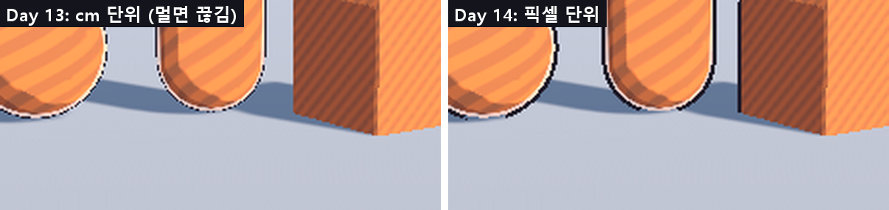
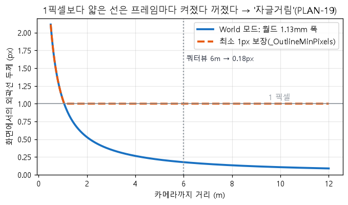

# Day 14. 외곽선 ② — 두께를 픽셀로 고정하기

> ⏱ **약 1시간** — 개념 20분 · 코드 15분 · 실험 25분
> 🧸 **오늘의 비유**: 친구가 받은 돈을 반드시 **4명이 나눠 갖는다**는 걸 알면, 친구 한 명에게 1000원을 주고 싶을 때 처음부터 **4000원**을 주면 돼요. `w`로 나눠질 걸 알고 미리 `w`를 곱하는 거예요.



## 오늘 만들 것

카메라가 멀어져도 외곽선이 **항상 2픽셀**로 또렷해요(오른쪽). 어제 버전(왼쪽)은 멀어지면 가늘어지다 끊겨요.

## 오늘 배울 것

- [ ] 월드 단위 외곽선이 멀리서 끊기는 이유를 안다
- [ ] 클립 공간 `w`와 원근 나눗셈을 다시 이해한다
- [ ] NDC에서 1픽셀이 `2 / 화면크기`인 이유를 안다
- [ ] 클립 공간에서 픽셀 단위로 점을 미는 코드를 짠다

---

## 1. 왜 끊길까 (개념 20분)



Day 02에서 GPU가 클립 좌표의 `x, y`를 `w`(멀리 있는 정도)로 나눠서 먼 것을 작게 만든다고 했어요. 월드에서 1cm 민 외곽선도 멀리 가면 화면에서 0.2픽셀처럼 얇아져요. 픽셀은 **가운데 점이 덮였을 때만** 칠해지니까, 0.2픽셀짜리 띠는 어떤 프레임엔 칠해지고 어떤 프레임엔 안 칠해져요. 그래서 **끊기고 반짝거려요.**

### 해결: 화면에서 직접 밀기

```
NDC.x = clip.x / w           GPU 가 나중에 하는 나눗셈
(clip.x + d × w) / w = NDC.x + d      ← 미리 w 를 곱해 두면 나눗셈 후 정확히 d 만큼!
```

그리고 NDC(나눗셈 후 화면 좌표)는 왼쪽 끝 -1부터 오른쪽 끝 +1까지 **폭이 2**예요. 화면이 1920픽셀이면 1픽셀 = `2 / 1920`.

```
클립 공간 오프셋 = 방향 × (원하는 픽셀 × 2 / 화면크기) × w
```

## 2. 코드 고치기 (15분)

### ① 슬라이더 단위 바꾸기

```shaderlab
        _OutlineWidth ("Outline Width (px)", Range(0, 8)) = 2
```


머티리얼에 이미 저장된 값(1)은 그대로 남아요. 머티리얼 인스펙터에서 2로 바꿔 주세요.


### ② OutlineVert 바꾸기

`OutlineVert`의 위치 계산 네 줄(`positionWS` ~ `o.positionCS = ...`)을 아래로 바꿔요.

```hlsl
                float4 positionCS = TransformObjectToHClip(input.positionOS.xyz);
                float3 normalWS   = TransformObjectToWorldNormal(input.normalOS);
                // 노멀이 화면 위에서 가리키는 방향. 가로세로 비율을 맞추려고 픽셀 단위로 바꾼다.
                float2 dirPx = mul((float3x3)GetWorldToHClipMatrix(), normalWS).xy * _ScaledScreenParams.xy;
                float  len   = length(dirPx);
                if (len > 1e-5)
                {
                    // 픽셀 → NDC(화면 폭 = 2) → 클립(× w). GPU 가 나중에 w 로 나누니 미리 곱해 둔다.
                    positionCS.xy += (dirPx / len) * (_OutlineWidth * 2.0 / _ScaledScreenParams.xy) * positionCS.w;
                }
                o.positionCS = positionCS;
```

| 줄 | 뜻 |
|---|---|
| `mul((float3x3)GetWorldToHClipMatrix(), normalWS)` | 노멀(방향)을 클립 공간으로. 방향이라 이동은 빼고 3×3만 써요 |
| `.xy * _ScaledScreenParams.xy` | 화면이 가로로 기니까 픽셀 단위로 늘려서 **진짜 화면 방향**을 구해요 |
| `if (len > 1e-5)` | 노멀이 카메라를 정면으로 보면 화면 방향이 없어요(길이 0). 0으로 나누지 않게 건너뛰어요 |
| `dirPx / len` | 길이 1인 화면 방향 |
| `_OutlineWidth * 2.0 / _ScaledScreenParams.xy` | 픽셀 → NDC |
| `* positionCS.w` | 나중의 나눗셈을 미리 상쇄 |


`_ScaledScreenParams`는 **실제로 그리는 도화지 크기**예요. 모바일은 성능 때문에 화면을 80% 크기로 그린 뒤 확대하기도 하는데(Render Scale), 그럴 때 출력 해상도(`_ScreenParams`)로 재면 "2픽셀"이 1.6픽셀이 돼서 끊김이 돌아와요. 실제 프로젝트에서 있었던 버그예요.


정답: [`Assets/Solutions/Day14/MyToon.shader`](https://github.com/JJH0204/toon-shader-lab/blob/main/Assets/Solutions/Day14/MyToon.shader)

## 3. 확인하기

Scene 뷰나 Main Camera를 멀리 빼 보세요. 물체가 작아져도 외곽선은 **같은 두께**예요(맨 위 오른쪽). 가까이 가면 오히려 상대적으로 얇아 보이는 것도 확인해 보세요. 화면 기준이니까요.

## 4. 실험해 보기 (25분)

1. **손계산** — 화면 높이 1080, 2픽셀이면 NDC 오프셋은 `2 × 2 / 1080 ≈ 0.0037`. 그 점의 `w`가 6이면 클립 오프셋은 `0.022`, `w`가 60이면 `0.22`. 멀수록 **10배 더 크게** 밀어야 화면에선 같은 2픽셀이에요.
2. **w 빼 보기** — `* positionCS.w`를 지우면? 가까운 물체는 외곽선이 거의 안 보이고 먼 물체는 두꺼워져요(거꾸로). 되돌려요.
3. **두께 8** — 큐브 모서리 틈이 더 크게 벌어져 보여요. 화면 공간에서 밀어도 노멀이 다르면 갈라지는 건 그대로예요.
4. 커밋: `git commit -am "Day 14: 픽셀 단위 외곽선"`

## 5. 오늘의 액기스

👉 [ESSENCE.md — Day 14](essence.md#day-14)

## 수학 참고 자료

- [LearnOpenGL — Coordinate Systems](https://learnopengl.com/Getting-started/Coordinate-Systems) — 원근 투영과 `w` 나눗셈
- [위키백과 — 동차좌표](https://ko.wikipedia.org/wiki/%EB%8F%99%EC%B0%A8%EC%A2%8C%ED%91%9C) · [Wikipedia — Spatial anti-aliasing](https://en.wikipedia.org/wiki/Spatial_anti-aliasing) (1픽셀보다 얇은 것이 왜 깜빡이는지)
- 더 깊이: [toon-shader-study Day 13 — 외곽선 ② 픽셀 두께](../toon-shader-study/day13-outline-pixel-width.md) (최소 1px 보장, Depth Priming 함정)

---

[← Day 13](day13-outline-pass.md) · [목차](README.md) · [다음: Day 15 →](day15-specular.md)
