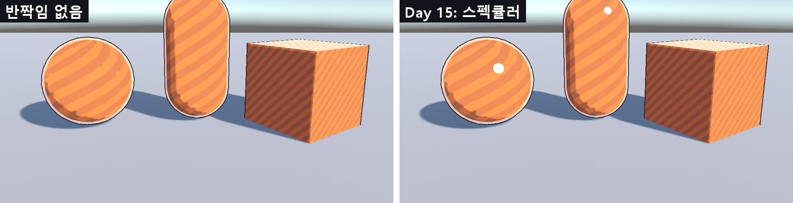
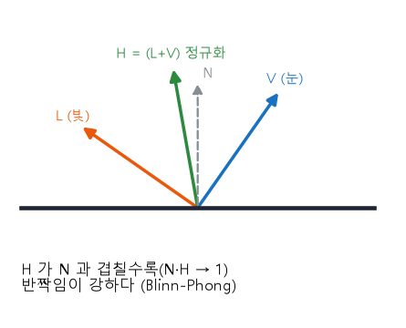

# Day 15. 반짝임 — 거울에 비친 해

> ⏱ **약 1시간** — 개념 20분 · 코드 15분 · 실험 25분
> 🧸 **오늘의 비유**: 스펙큘러는 **거울에 비친 해**예요. 빛이 표면에 튕겨서 **정확히 내 눈으로** 들어오는 자리만 반짝여요.



## 오늘 만들 것

물체 위에 **동그랗고 딱 끊긴 하이라이트**(만화식 반짝임)가 생겨요(오른쪽).

## 오늘 배울 것

- [ ] 하프 벡터 `H = normalize(L + V)`를 안다
- [ ] `pow`의 지수가 하이라이트 크기를 정하는 원리를 안다
- [ ] 부드러운 하이라이트를 `CelStep`으로 딱 끊는다
- [ ] 그림자 속에서는 반짝임을 꺼야 하는 이유를 안다

---

## 1. 하프 벡터 (개념 20분)



빛 방향 L과 눈 방향 V의 **딱 중간 방향** H를 만들어요.

```
H = normalize(L + V)
```

표면의 노멀 N이 H와 같은 방향이면 빛이 거울처럼 튕겨 눈으로 와요. 그러니까 `dot(N, H)`가 1에 가까울수록 반짝여요. 이걸 **블린-퐁** 하이라이트라고 해요.

### pow로 크기 정하기

`dot(N, H)`는 넓게 퍼져 있어서 거듭제곱으로 좁혀요.

| `dot(N, H)` | `pow(…, 20)` | `pow(…, 200)` |
|---|---|---|
| 1.00 | 1.00 | 1.00 |
| 0.99 | 0.82 | 0.13 |
| 0.95 | 0.36 | 0.00 |

지수가 클수록 **1에 아주 가까운 곳만** 남아서 점이 작아져요. 매끈한 물체일수록 하이라이트가 작고 날카롭죠.

## 2. 코드 고치기 (15분)

### ① Properties (Rim 다음, Outline 위) + CBUFFER

```shaderlab

        [Header(Specular)]
        _SpecularColor ("Specular Color", Color) = (1, 1, 1, 1)
        _Smoothness ("Smoothness", Range(0, 1)) = 0.6
        _SpecularStep ("Specular Step", Range(0, 0.5)) = 0.02
```

```hlsl
            half4  _SpecularColor;    // CBUFFER, _RimStrength 아래
            half   _Smoothness;
            half   _SpecularStep;
```

### ② frag (림 다음, `MixFog` 전)

```hlsl
                // 반짝임: 빛과 눈의 중간 방향(H)이 노멀과 겹치는 곳
                half3 H = SafeNormalize(mainLight.direction + V);
                half spec = pow(saturate(dot(N, H)), exp2(_Smoothness * 11.0h));   // 매끈할수록 작고 날카롭게
                half specMask = CelStep(spec, 0.5h, _SpecularStep);
                color += specMask * _SpecularColor.rgb * mainLight.color * receive;  // 그림자 속에선 끈다
```

| 줄 | 뜻 |
|---|---|
| `SafeNormalize` | L과 V가 정반대면 `L + V = 0`이라 normalize가 0으로 나눠요. 그럴 때도 안전한 URP 함수 |
| `exp2(_Smoothness * 11)` | 2의 거듭제곱. 슬라이더 0~1을 지수 1~2048로 바꿔요 (0.6이면 약 97) |
| `CelStep(spec, 0.5, …)` | 부드러운 하이라이트를 0.5에서 **딱 끊어요** — 툰의 단골 기술 |
| `* receive` | Day 08의 그림자 값. **그림자 속에서는 반짝임을 끈다** |


`* receive`를 빼면 그림자 속에서도 하이라이트가 둥둥 떠 있어요. 실제 프로젝트에서 출시 직전까지 남아 있던 버그예요. Shadow Beam을 켜고 하이라이트가 그림자 띠에 들어가게 해 보세요.


정답: [`Assets/Solutions/Day15/MyToon.shader`](https://github.com/JJH0204/toon-shader-lab/blob/main/Assets/Solutions/Day15/MyToon.shader)

## 3. 확인하기

구와 캡슐에 **흰 점**이 생겨요. 해(Directional Light)를 돌리면 점이 따라 움직여요. 큐브는? 평평한 면은 노멀이 한 방향이라 딱 맞는 각도가 아니면 안 보여요.

## 4. 실험해 보기 (25분)

1. **Smoothness** — 0.3이면 넓은 하이라이트, 0.9면 바늘 끝처럼 작아져요.
2. **Specular Step** — 0.2로 올리면 부드러운 실사풍 하이라이트가 돼요.
3. **receive 빼기** — 위 IMPORTANT 상자 실험. 꼭 해 보고 되돌려요.
4. **카메라 따라 움직임** — Scene 뷰를 돌려 보세요. 하이라이트 위치가 **보는 방향에 따라** 바뀌어요(V가 들어가니까). 림(Day 12)과 같은 성질이에요.
5. 커밋: `git commit -am "Day 15: 툰 스펙큘러"`

## 5. 오늘의 액기스

👉 [ESSENCE.md — Day 15](essence.md#day-15)

## 수학 참고 자료

- [Wikipedia — Blinn–Phong reflection model](https://en.wikipedia.org/wiki/Blinn%E2%80%93Phong_reflection_model) · [Specular highlight](https://en.wikipedia.org/wiki/Specular_highlight)
- [LearnOpenGL — Advanced Lighting (Blinn-Phong)](https://learnopengl.com/Advanced-Lighting/Advanced-Lighting)
- [Desmos](https://www.desmos.com/calculator)에서 `y = x^n` (n 슬라이더 1~200, x는 0~1)
- 더 깊이: [toon-shader-study Day 17 — 반짝임 3종](../toon-shader-study/day17-highlights.md) (머리카락 천사 고리, 금속 반사)

---

[← Day 14](day14-outline-pixels.md) · [목차](README.md) · [다음: Day 16 →](day16-matcap.md)
