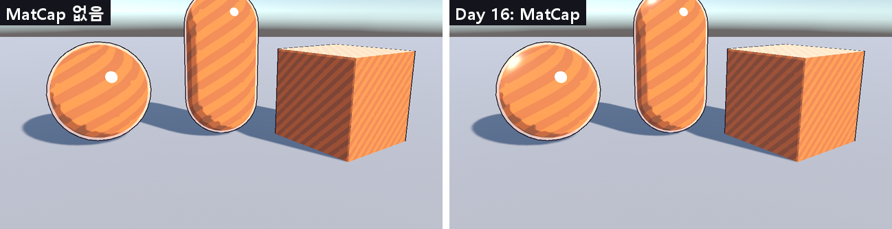

# Day 16. MatCap — 반사가 그려진 구슬 스티커

## 작업 식별

| 항목 | 내용 |
|---|---|
| Task ID | GMD-TSL-016-MP |
| 목적 | 뷰 공간 노멀 xy를 UV로 써서 MatCap 텍스처를 샘플링하고 광택을 더한다 |
| 적용 대상 | Unity 6000.3, URP 17.x. Day 15 완료 상태의 `MyToon.shader`, `Assets/Textures/Lab_MatCap` |
| 소요 시간 | 약 60분 (개념 15분, 코드 15분, 실험 30분) |
| 확인 상태 | 미검증 (원본 코드를 읽고 정리한 것이며 이 환경에서 컴파일·실행하지 않았다) |
| 개정 | R1 (2026-11-18) |

## 1. 참조

| 참조 문서 | Task ID | 제목 |
|---|---|---|
| [day02-vertex-shader.md](day02-vertex-shader.md) | GMD-TSL-002-MP | 뷰 공간 |
| [day15-specular.md](day15-specular.md) | GMD-TSL-015-MP | 이전: 스페큘러 |
| [day17-normal-map.md](day17-normal-map.md) | GMD-TSL-017-MP | 다음: 노멀맵 |
| [toon-shader-study Day 17](../toon-shader-study/day17-highlights.md) | - | MatCap 마스크, 블러 (짝꿍 과정) |
| [Sphere mapping](https://en.wikipedia.org/wiki/Sphere_mapping) | - | MatCap의 원조 기법 |

## 2. 필요 장비와 자재

| 번호 | 이름 | 사양·버전 | 비고 |
|---|---|---|---|
| 1 | `Assets/MyToon/MyToon.shader` | Day 15 완료 상태 | |
| 2 | `Assets/Textures/Lab_MatCap` | 검은 공 왼쪽 위에 반짝임이 그려진 텍스처 | 실습 저장소에 포함 |

## 3. 안전 사항


NOTE: MatCap은 더하기 연산이므로 기본 텍스처를 `"black"`으로 둔다. 검정(0)을 더하면 변화가 없으므로 텍스처를 넣지 않으면 효과가 없다.


## 4. 준비

| 번호 | 항목 | 확인 방법 |
|---|---|---|
| 1 | Day 15 코드가 컴파일된다 | Console 오류 0건 |
| 2 | `Lab_MatCap` 텍스처가 있다 | `Assets/Textures` 확인 |

## 5. 절차

### A. 개념 확인

| 단계 | 수식 | 의미 |
|---|---|---|
| 1 | `normalVS = mul((float3x3)UNITY_MATRIX_V, N)` | 노멀을 뷰 공간(카메라 기준)으로 바꾼다 |
| 2 | `uv = normalVS.xy * 0.5 + 0.5` | -1~1을 0~1로 옮겨 UV로 쓴다 |
| 3 | `SAMPLE_TEXTURE2D(_MatCap, ..., uv)` | 카메라를 향한 표면은 UV (0.5, 0.5), 오른쪽을 향한 표면은 오른쪽 끝에서 색을 읽는다 |

MatCap 텍스처는 공 하나를 찍은 이미지다. 모든 방향의 표면이 한 장에 들어 있어 노멀만 알면 색을 찾을 수 있다.

### B. Properties

1. (5-B-01) `Specular` 다음, `Outline` 위에 추가한다. → 결과: Inspector에 `MatCap` 묶음이 나타난다.

```shaderlab

        [Header(MatCap)]
        _MatCap ("MatCap", 2D) = "black" {}
        _MatCapStrength ("MatCap Strength", Range(0, 2)) = 1
```

### C. 텍스처 선언과 CBUFFER

1. (5-C-01) `HLSLINCLUDE`의 `_BaseMap` 선언 아래에 추가한다.

```hlsl
        TEXTURE2D(_MatCap);     SAMPLER(sampler_MatCap);
```

2. (5-C-02) CBUFFER의 `_SpecularStep` 아래에 추가한다.

```hlsl
            half   _MatCapStrength;     // CBUFFER, _SpecularStep 아래
```

### D. frag 수정

1. (5-D-01) 스페큘러 다음, `MixFog` 앞에 추가한다. `UNITY_MATRIX_V`는 월드에서 뷰로 가는 행렬이며 노멀은 방향이므로 이동을 빼고 3x3만 쓴다. → 결과: 컴파일 오류가 없다.

```hlsl
                // MatCap: 내 눈 기준 노멀로 '반사 구슬 사진'에서 색을 찾아 붙인다
                half3 normalVS = mul((float3x3)UNITY_MATRIX_V, N);
                half2 matcapUV = normalVS.xy * 0.5h + 0.5h;
                color += SAMPLE_TEXTURE2D(_MatCap, sampler_MatCap, matcapUV).rgb * _MatCapStrength;
```

2. (5-D-02) 머티리얼의 `MatCap` 칸에 `Assets/Textures/Lab_MatCap`을 넣는다. → 결과: 광택이 나타난다.

정답 파일: [`Assets/Solutions/Day16/MyToon.shader`](https://github.com/JJH0204/toon-shader-lab/blob/main/Assets/Solutions/Day16/MyToon.shader)



### E. 화면 확인

1. (5-E-01) 물체 왼쪽 위를 본다. → 결과: 은은한 광택이 있다.
2. (5-E-02) Directional Light를 회전한다. → 결과: 광택이 움직이지 않는다. MatCap은 빛이 아니라 보는 방향으로 결정된다.
3. (5-E-03) Scene 뷰 카메라를 회전한다. → 결과: 광택이 화면의 같은 자리에 붙어 따라온다.

| 항목 | 스페큘러 (Day 15) | MatCap (Day 16) |
|---|---|---|
| 결정 요소 | 빛 방향과 보는 방향 | 보는 방향만 |
| 광원을 돌리면 | 따라 움직인다 | 그대로 |
| 장점 | 빛에 반응한다 | 텍스처 한 장으로 금속, 유리 질감을 자유롭게 만든다 |
| 용도 | 빛을 따라야 하는 하이라이트 | 금속 장신구, 머리카락 광택, 눈동자 |

### F. 실험

1. (5-F-01) 256x256 이미지에 검은 바탕, 원, 그 안의 오른쪽 아래 흰 점을 그려 `MatCap` 칸에 넣는다. → 결과: 광택이 오른쪽 아래로 이동한다.
2. (5-F-02) `MatCap Strength`를 2로 올린다. → 결과: 금속처럼 번쩍인다.
3. (5-F-03) `color +=` 줄을 `color *= lerp(1, SAMPLE_TEXTURE2D(_MatCap, sampler_MatCap, matcapUV).rgb, 0.5);`로 바꾼다. → 결과: 곱하기이므로 어둡게 만드는 MatCap(가짜 그늘)이 된다. 확인 후 되돌린다.
4. (5-F-04) 물체를 화면 구석으로 옮긴다. → 결과: MatCap이 약간 어긋나 보인다. 뷰 공간 노멀은 카메라가 정면이라고 가정하므로 원근 가장자리에서 오차가 생긴다. MatCap의 한계다.
5. (5-F-05) 커밋한다: `git commit -am "Day 16: MatCap"`

## 6. 기능 확인

| 번호 | 확인 동작 | 기대 결과 | 합격 기준 |
|---|---|---|---|
| 1 | `MatCap`에 텍스처를 넣는다 | 왼쪽 위 광택 | 광택이 보인다 |
| 2 | 광원을 회전한다 | 광택 불변 | 위치 변화 없음 |
| 3 | `MatCap = None` | 효과 없음 | Day 15와 같은 화면 |

## 7. 복구

1. (7-01) 변경을 되돌린다: `Ctrl+Z` 또는 `git restore Assets/MyToon/MyToon.shader`.
2. (7-02) `MatCap` 텍스처를 비우거나 `MatCap Strength`를 0으로 둔다.

## 8. 개정 이력

| 개정 | 날짜 | 변경 내용 |
|---|---|---|
| R1 | 2026-11-18 | 기존 Day 16 페이지를 AMM 형식으로 재작성. 비교 표 보존 |

[← Day 15](day15-specular.md) · [목차](README.md) · [다음: Day 17 →](day17-normal-map.md)
