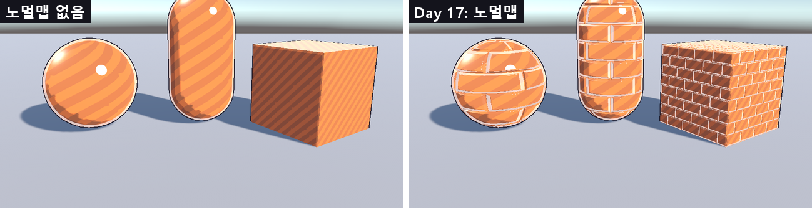

# Day 17. 노멀맵 — 빛에게만 하는 거짓말

## 작업 식별

| 항목 | 내용 |
|---|---|
| Task ID | GMD-TSL-017-MP |
| 목적 | 탄젠트 공간(TBN) 행렬로 노멀맵의 법선을 월드 공간으로 변환해 표면 요철 음영을 만든다 |
| 적용 대상 | Unity 6000.3, URP 17.x. Day 16 완료 상태의 `MyToon.shader`, `Assets/Textures/Lab_Normal` |
| 소요 시간 | 약 60분 (개념 20분, 코드 20분, 실험 20분) |
| 확인 상태 | 미검증 (원본 코드를 읽고 정리한 것이며 이 환경에서 컴파일·실행하지 않았다) |
| 개정 | R1 (2026-11-18) |


NOTE: `UnpackNormalScale`, `TransformObjectToWorldDir`, `GetOddNegativeScale`은 URP(SRP Core) 버전과 노멀맵 압축 포맷에 따라 동작이 다르다. URP 버전 확인 필요.


## 1. 참조

| 참조 문서 | Task ID | 제목 |
|---|---|---|
| [day04-varyings-debug.md](day04-varyings-debug.md) | GMD-TSL-004-MP | `Debug View = Normal` |
| [day16-matcap.md](day16-matcap.md) | GMD-TSL-016-MP | 이전: MatCap |
| [day18-keywords.md](day18-keywords.md) | GMD-TSL-018-MP | 다음: 키워드 |
| [toon-shader-study Day 16](../toon-shader-study/day16-normal-maps-and-derivatives.md) | - | 탄젠트 없이 `ddx/ddy`로 만드는 방법 (짝꿍 과정) |
| [LearnOpenGL Normal Mapping](https://learnopengl.com/Advanced-Lighting/Normal-Mapping), [Normal mapping](https://en.wikipedia.org/wiki/Normal_mapping), [Catlike Coding Bumpiness](https://catlikecoding.com/unity/tutorials/rendering/part-6/), [3Blue1Brown 외적](https://www.3blue1brown.com/lessons/cross-products), [위키백과 벡터곱](https://ko.wikipedia.org/wiki/%EB%B2%A1%ED%84%B0%EA%B3%B1) | - | 노멀맵, 외적 참고 |

## 2. 필요 장비와 자재

| 번호 | 이름 | 사양·버전 | 비고 |
|---|---|---|---|
| 1 | `Assets/MyToon/MyToon.shader` | Day 16 완료 상태 | |
| 2 | `Assets/Textures/Lab_Normal` | 벽돌 노멀맵, Texture Type은 `Normal map` | 실습 저장소에 설정되어 있다 |

## 3. 안전 사항


CAUTION: 노멀맵 텍스처의 `Texture Type`이 `Normal map`이 아니면 `UnpackNormalScale`이 값을 잘못 해석해 음영이 어긋난다.


## 4. 준비

| 번호 | 항목 | 확인 방법 |
|---|---|---|
| 1 | Day 16 코드가 컴파일된다 | Console 오류 0건 |
| 2 | `Lab_Normal`의 `Texture Type`이 `Normal map`이다 | 텍스처 Inspector 확인 |

## 5. 절차

### A. 개념 확인

노멀맵은 법선 `(x, y, z)`를 색 `(r, g, b)`로 저장한다. 법선은 -1~1, 색은 0~1이므로 변환한다.

| 방향 | 수식 |
|---|---|
| 저장 | `색 = 법선 * 0.5 + 0.5` |
| 읽기 | `법선 = 색 * 2 - 1` (`UnpackNormal`이 수행) |

평평한 곳의 법선은 `(0, 0, 1)`, 색은 `(0.5, 0.5, 1)`(연보라)다. 노멀맵이 보라색인 이유다.

노멀맵의 법선은 표면 기준(탄젠트 공간)이다.

| 축 | 이름 | 의미 |
|---|---|---|
| T | 탄젠트 | 텍스처 u가 증가하는 방향 |
| B | 바이탄젠트 | v가 증가하는 방향. N과 T에 수직이므로 `cross`로 만든다 |
| N | 노멀 | 표면 바깥 방향 |

T, B, N으로 3x3 행렬(TBN)을 만들어 노멀맵 법선을 월드로 변환한다. T는 메시의 `TANGENT` 입력에 있다.

### B. Properties

1. (5-B-01) `_Cutoff` 아래에 추가한다. `"bump"` 기본값은 평평한 노멀맵(0.5, 0.5, 1)이라 텍스처를 넣지 않으면 효과가 없다. `[Normal]`은 Inspector가 노멀맵이 아닌 텍스처에 경고를 표시하게 한다.

```shaderlab

        [Header(Normal Map)]
        [Normal] _BumpMap ("Normal Map", 2D) = "bump" {}
        _BumpScale ("Normal Strength", Range(0, 2)) = 1
```

### C. 텍스처 선언과 CBUFFER

1. (5-C-01) `HLSLINCLUDE`의 `_BaseMap` 아래에 추가한다.

```hlsl
        TEXTURE2D(_BumpMap);    SAMPLER(sampler_BumpMap);     // HLSLINCLUDE, _BaseMap 아래
```

2. (5-C-02) CBUFFER의 `_Cutoff` 아래에 추가한다.

```hlsl
            half   _BumpScale;                                // CBUFFER, _Cutoff 아래
```

### D. Attributes, Varyings, vert 수정

1. (5-D-01) Forward 패스의 `Attributes`에 `tangentOS`를 추가한다. `tangentOS.w`는 UV를 거울처럼 뒤집은 곳에서 B의 방향을 뒤집는 ±1이다.

```hlsl
            struct Attributes
            {
                float4 positionOS : POSITION;
                float3 normalOS   : NORMAL;
                float4 tangentOS  : TANGENT;    // 추가: xyz = 탄젠트, w = 거울 UV 부호
                float2 uv         : TEXCOORD0;
            };
```

2. (5-D-02) `Varyings`에 추가한다.

```hlsl
                half4  tangentWS  : TEXCOORD4;   // xyz = 탄젠트, w = 바이탄젠트 방향(+1/-1)   ← Varyings 에 추가
```

3. (5-D-03) `vert`의 `o.normalWS` 줄 아래에 추가한다. `GetOddNegativeScale()`은 오브젝트를 음수 스케일로 뒤집었을 때 부호를 한 번 더 보정한다. → 결과: 컴파일 오류가 없다.

```hlsl
                float3 tangentWS = TransformObjectToWorldDir(input.tangentOS.xyz);
                o.tangentWS  = half4(tangentWS, input.tangentOS.w * GetOddNegativeScale());
```

### E. frag 수정

1. (5-E-01) `half3 N = normalize(...)` 바로 아래에 추가한다. `mul(normalTS, half3x3(T, B, N))`은 행 벡터 곱으로 `normalTS.x*T + normalTS.y*B + normalTS.z*N`이다. → 결과: 컴파일 오류가 없다.

```hlsl
                half3 normalTS = UnpackNormalScale(SAMPLE_TEXTURE2D(_BumpMap, sampler_BumpMap, input.uv), _BumpScale);
                half3 T = normalize(input.tangentWS.xyz);
                half3 B = cross(N, T) * input.tangentWS.w;
                N = normalize(mul(normalTS, half3x3(T, B, N)));   // 표면 지도(탄젠트 공간) → 월드
```

이 줄 아래의 모든 계산(빛, 림, 스페큘러, MatCap)이 갱신된 `N`을 쓰므로 모두 요철에 반응한다.

2. (5-E-02) 머티리얼의 `Normal Map` 칸에 `Assets/Textures/Lab_Normal`을 넣는다. → 결과: 벽돌 홈 음영이 나타난다.

정답 파일: [`Assets/Solutions/Day17/MyToon.shader`](https://github.com/JJH0204/toon-shader-lab/blob/main/Assets/Solutions/Day17/MyToon.shader)



### F. 화면 확인

1. (5-F-01) 물체를 본다. → 결과: 벽돌 홈이 음영과 하이라이트로 보인다.
2. (5-F-02) `Debug View`를 `Normal`로 바꾼다. → 결과: 노멀 색이 벽돌 모양으로 흔들린다.

### G. 실험

1. (5-G-01) `Normal Strength`를 0과 2로 바꾼다. → 결과: 0은 평평하고 2는 홈이 깊어진다.
2. (5-G-02) 색 (1, 0.5, 0.5)가 어떤 법선인지 계산한다. → 결과: `(1, 0, 0)`, 완전히 오른쪽으로 누운 법선이다.
3. (5-G-03) 외곽선을 본다. → 결과: 외곽선 패스는 메시 노멀로 밀어 노멀맵을 쓰지 않으므로 테두리는 매끈하다. 노멀맵은 음영에만 영향을 주고 실루엣은 바꾸지 않는다.
4. (5-G-04) 커밋한다: `git commit -am "Day 17: 노멀맵"`

## 6. 기능 확인

| 번호 | 확인 동작 | 기대 결과 | 합격 기준 |
|---|---|---|---|
| 1 | `Normal Map`에 `Lab_Normal` 지정 | 벽돌 홈 음영 | 홈이 보인다 |
| 2 | `Normal Strength = 0` | 평평 | 홈이 보이지 않는다 |
| 3 | `Normal Map = None` | 효과 없음 | Day 16과 같은 화면 |

## 7. 복구

1. (7-01) 변경을 되돌린다: `Ctrl+Z` 또는 `git restore Assets/MyToon/MyToon.shader`.
2. (7-02) `Normal Map` 칸을 비운다.

## 8. 개정 이력

| 개정 | 날짜 | 변경 내용 |
|---|---|---|
| R1 | 2026-11-18 | 기존 Day 17 페이지를 AMM 형식으로 재작성. 비유 삭제, TBN 수식 설명 보강 |

[← Day 16](day16-matcap.md) · [목차](README.md) · [다음: Day 18 →](day18-keywords.md)
