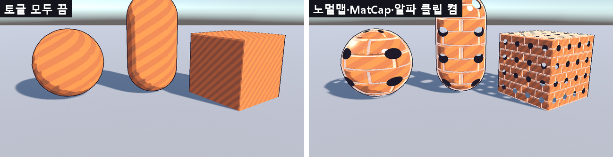

# Day 18. 키워드 — 기능을 켜고 끄는 스위치

## 작업 식별

| 항목 | 내용 |
|---|---|
| Task ID | GMD-TSL-018-MP |
| 목적 | `shader_feature`와 `[Toggle]`로 노멀맵, 림, 스페큘러, MatCap, 알파 클립을 머티리얼 체크박스로 켜고 끄는 키워드를 만든다 |
| 적용 대상 | Unity 6000.3, URP 17.x. Day 17 완료 상태의 `MyToon.shader` |
| 소요 시간 | 약 60분 (개념 20분, 코드 25분, 실험 15분) |
| 확인 상태 | 미검증 (원본 코드를 읽고 정리한 것이며 이 환경에서 컴파일·실행하지 않았다) |
| 개정 | R1 (2026-11-18) |


NOTE: URP 키워드(`_MAIN_LIGHT_SHADOWS`, `_ADDITIONAL_LIGHTS`, `_CLUSTER_LIGHT_LOOP` 등)의 종류와 개수는 URP 버전에 따라 달라 아래 배리언트 수(192, 6,144)도 달라진다. URP 버전 확인 필요.


## 1. 참조

| 참조 문서 | Task ID | 제목 |
|---|---|---|
| [day04-varyings-debug.md](day04-varyings-debug.md) | GMD-TSL-004-MP | 숫자 `if` 디버그 분기 |
| [day08-receive-shadows.md](day08-receive-shadows.md) | GMD-TSL-008-MP | `multi_compile` 키워드 |
| [day17-normal-map.md](day17-normal-map.md) | GMD-TSL-017-MP | 이전: 노멀맵 |
| [day19-depthnormals-ssao.md](day19-depthnormals-ssao.md) | GMD-TSL-019-MP | 다음: DepthNormals와 SSAO |
| [toon-shader-study Day 19](../toon-shader-study/day19-keywords-and-variants.md) | - | 키워드와 배리언트 (짝꿍 과정) |
| [Unity 셰이더 배리언트와 키워드](https://docs.unity3d.com/Manual/SL-MultipleProgramVariants.html), [배리언트 스트리핑](https://docs.unity3d.com/Manual/shader-variant-stripping.html), [MaterialPropertyDrawer](https://docs.unity3d.com/ScriptReference/MaterialPropertyDrawer.html) | - | 공식 문서 |

## 2. 필요 장비와 자재

| 번호 | 이름 | 사양·버전 | 비고 |
|---|---|---|---|
| 1 | `Assets/MyToon/MyToon.shader` | Day 17 완료 상태 | |

## 3. 안전 사항


WARNING: 키워드 선언(`#pragma`)은 패스마다 따로 한다. `HLSLINCLUDE`의 `ClipAlpha`가 `#if defined(_ALPHATEST_ON)`을 써도 그 패스에 선언이 없으면 키워드가 항상 꺼진 상태로 동작한다. 색칠 패스만 오려지고 그림자는 오려지지 않는 버그가 여기서 생긴다.



CAUTION: 셰이더를 바꾼 뒤 기존 머티리얼은 체크박스 값과 키워드가 어긋날 수 있다. 각 체크박스를 한 번씩 껐다 켜서 맞춘다.


## 4. 준비

| 번호 | 항목 | 확인 방법 |
|---|---|---|
| 1 | Day 17 코드가 컴파일된다 | Console 오류 0건 |
| 2 | 현재 코드를 커밋한다 | `git status`가 깨끗하다 |

## 5. 절차

### A. 개념 확인

`#if defined(_USE_RIM)` ~ `#endif` 사이 코드는 키워드가 꺼져 있으면 컴파일 전에 제거된다. 키워드 조합마다 별도의 셰이더 프로그램이 만들어지며 이를 배리언트(variant)라 한다.

- 장점: 꺼진 기능은 비용이 0이다. `if`로 건너뛰는 것보다 빠르다.
- 단점: 키워드 하나에 사본이 2배가 된다. 빌드 시간과 메모리가 늘어난다.

| 종류 | 선택 주체 | 빌드에 포함 |
|---|---|---|
| `multi_compile` | 엔진이 실행 중에 정한다(그림자, 안개, 보조 조명) | 모든 조합 |
| `shader_feature` | 머티리얼 체크박스 | 머티리얼이 실제로 쓰는 조합만 |

| 꼬리말 | 의미 |
|---|---|
| `_local` | 이 셰이더 전용 키워드. 프로젝트 전체 키워드 한도를 아낀다 |
| `_fragment` | 프래그먼트 단계에서만 코드가 갈린다. 버텍스 사본을 만들지 않는다 |

`_ _USE_RIM`의 맨 앞 `_`는 "키워드 없음" 선택지다. 그래서 끔과 켬 두 가지가 된다.

### B. 체크박스 Properties 추가

`[Toggle(KEY)]`는 체크하면 값 1과 함께 키워드 KEY를 켠다. HLSL은 키워드를 보므로 이 숫자들은 CBUFFER에 넣지 않는다.

1. (5-B-01) 다음 표대로 Properties에 줄을 추가한다. → 결과: Inspector에 체크박스 5개가 나타난다.

| 위치 | 추가할 줄 |
|---|---|
| `_Cutoff` 위 | `[Toggle(_ALPHATEST_ON)] _AlphaClip ("Alpha Clip", Float) = 0` |
| `[Header(Normal Map)]` 아래 | `[Toggle(_USE_NORMALMAP)] _UseNormalMap ("Use Normal Map", Float) = 0` |
| `[Header(Rim)]` 아래 | `[Toggle(_USE_RIM)] _UseRim ("Use Rim", Float) = 1` |
| `[Header(Specular)]` 아래 | `[Toggle(_USE_SPECULAR)] _UseSpecular ("Use Specular", Float) = 1` |
| `[Header(MatCap)]` 아래 | `[Toggle(_USE_MATCAP)] _UseMatCap ("Use MatCap", Float) = 0` |

2. (5-B-02) `_Cutoff`의 기본값을 `0`에서 `0.5`로 바꾼다. → 결과: Alpha Clip 체크박스가 켜고 끄므로 기준값은 0.5가 적절하다.

### C. 키워드 선언 (주문서)

1. (5-C-01) Forward 패스의 `#pragma` 아래에 추가한다. 노멀맵만 `_fragment`가 없는 이유는 `vert`에서도 탄젠트를 계산하기 때문이다.

```hlsl
            #pragma shader_feature_local _ _USE_NORMALMAP
            #pragma shader_feature_local_fragment _ _USE_RIM
            #pragma shader_feature_local_fragment _ _USE_SPECULAR
            #pragma shader_feature_local_fragment _ _USE_MATCAP
            #pragma shader_feature_local_fragment _ _ALPHATEST_ON
```

2. (5-C-02) Outline, ShadowCaster, DepthOnly 패스의 `#pragma` 줄 끝에 각각 한 줄을 추가한다. 세 패스 모두 `ClipAlpha`를 쓴다. → 결과: 4개 패스 모두 `_ALPHATEST_ON`을 선언한다.

```hlsl
            #pragma shader_feature_local_fragment _ _ALPHATEST_ON
```

### D. 코드에 스위치 달기

1. (5-D-01) `HLSLINCLUDE`의 `ClipAlpha`를 다음으로 바꾼다.

```hlsl
        void ClipAlpha(float2 uv)
        {
        #if defined(_ALPHATEST_ON)
            half alpha = SAMPLE_TEXTURE2D(_BaseMap, sampler_BaseMap, uv).a * _BaseColor.a;
            clip(alpha - _Cutoff);
        #endif
        }
```

2. (5-D-02) `vert`의 탄젠트 두 줄을 감싼다.

```hlsl
            #if defined(_USE_NORMALMAP)
                float3 tangentWS = TransformObjectToWorldDir(input.tangentOS.xyz);
                o.tangentWS  = half4(tangentWS, input.tangentOS.w * GetOddNegativeScale());
            #endif
```

3. (5-D-03) frag의 노멀맵 네 줄을 감싼다.

```hlsl
            #if defined(_USE_NORMALMAP)
                half3 normalTS = UnpackNormalScale(SAMPLE_TEXTURE2D(_BumpMap, sampler_BumpMap, input.uv), _BumpScale);
                half3 T = normalize(input.tangentWS.xyz);
                half3 B = cross(N, T) * input.tangentWS.w;
                N = normalize(mul(normalTS, half3x3(T, B, N)));   // 표면 지도(탄젠트 공간) → 월드
            #endif
```

4. (5-D-04) frag의 림 코드를 감싼다. 스페큘러는 `_USE_SPECULAR`, MatCap은 `_USE_MATCAP`으로 같은 방식으로 감싼다. → 결과: 컴파일 오류가 없다.

```hlsl
                // 림: 테두리(시선과 직각인 곳)만 빛나게
            #if defined(_USE_RIM)
                half fresnel = 1.0h - saturate(dot(N, V));
                half rim = CelStep(fresnel, _RimThreshold, _RimSoftness);
                color += rim * _RimColor.rgb * _RimStrength;
            #endif
```

정답 파일: [`Assets/Solutions/Day18/MyToon.shader`](https://github.com/JJH0204/toon-shader-lab/blob/main/Assets/Solutions/Day18/MyToon.shader)

### E. 화면 확인

1. (5-E-01) 각 체크박스를 끄고 켠다. → 결과: 해당 효과가 사라지고 나타난다.
2. (5-E-02) `Alpha Clip`을 켠다. → 결과: 구멍이 뚫리고 그림자에도 구멍이 생긴다.
3. (5-E-03) 구멍 속을 본다. → 결과: 검은 점이 보인다. Day 13 외곽선 껍질의 안쪽 면이 구멍으로 보이는 것이다. Day 20에서 고친다.



### F. 실험

1. (5-F-01) 배리언트 수를 손으로 센다. Forward 패스의 `multi_compile`만 세면 그림자 3 x 부드러운 그림자 2 x 안개 4(끔, Linear, Exp, Exp2) x 보조 조명 2 x 보조 조명 그림자 2 x Forward+ 2 = 192다. 여기에 `shader_feature` 5개(2^5 = 32)를 곱하면 이론상 6,144가지다. → 결과: `shader_feature`는 머티리얼이 실제로 쓰는 조합만 빌드에 넣으므로 실제 수는 크게 줄어든다.
2. (5-F-02) Inspector 오른쪽 위 `⋮` > `Debug`로 바꾼다. → 결과: `Valid Keywords`가 보이고 체크박스를 누를 때마다 목록이 바뀐다. 확인 후 `Normal` 모드로 되돌린다.
3. (5-F-03) `Debug View`가 키워드가 아닌 숫자 `if`인 이유를 설명한다. → 결과: 분기가 가볍고 한 물체의 픽셀이 모두 같은 분기를 택해 비용이 거의 없으므로 사본을 늘릴 가치가 없다.
4. (5-F-04) 커밋한다: `git commit -am "Day 18: 키워드 토글"`

## 6. 기능 확인

| 번호 | 확인 동작 | 기대 결과 | 합격 기준 |
|---|---|---|---|
| 1 | `Use Rim` 해제 | 림이 사라진다 | 테두리 빛 없음 |
| 2 | `Alpha Clip` 켬 | 물체와 그림자에 구멍 | 두 곳 모두 구멍 |
| 3 | `Debug` 모드의 `Valid Keywords` | 체크한 키워드가 목록에 있다 | 체크박스와 일치 |

## 7. 복구

1. (7-01) 변경을 되돌린다: `git restore Assets/MyToon/MyToon.shader`.
2. (7-02) 머티리얼의 체크박스를 껐다 켜서 키워드와 맞춘다.

## 8. 개정 이력

| 개정 | 날짜 | 변경 내용 |
|---|---|---|
| R1 | 2026-11-18 | 기존 Day 18 페이지를 AMM 형식으로 재작성. 비유 삭제, 키워드 개수 버전 의존 NOTE 추가 |

[← Day 17](day17-normal-map.md) · [목차](README.md) · [다음: Day 19 →](day19-depthnormals-ssao.md)
