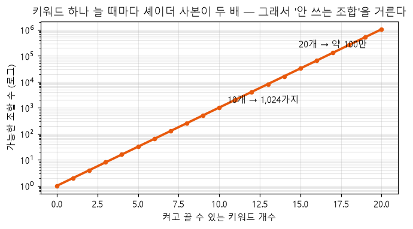

# Day 18. 키워드 — 기능을 켜고 끄는 스위치

> ⏱ **약 1시간** — 개념 20분 · 코드 25분 · 실험 15분
> 🧸 **오늘의 비유**: 셰이더는 **옵션마다 따로 굽는 빵집**이에요. 옵션(키워드)이 하나 늘 때마다 빵 종류가 **두 배**가 돼요.


## 오늘 만들 것

머티리얼 인스펙터에 **체크박스**가 생겨요: 노멀맵, 림, 반짝임, MatCap, 알파 클립. 끄면 그 기능의 코드가 **아예 사라져서** 비용이 0이 돼요.

## 오늘 배울 것

- [ ] `#if defined(키워드)`로 코드를 켜고 끈다
- [ ] `[Toggle(키워드)]` 체크박스를 만든다
- [ ] `shader_feature`와 `multi_compile`의 차이를 안다
- [ ] `_local`, `_fragment` 꼬리말의 뜻을 안다
- [ ] 키워드는 **패스마다** 따로 선언해야 한다는 걸 안다

---

## 1. 배리언트 (개념 20분)

`#if defined(_USE_RIM)` … `#endif` 사이 코드는 키워드가 꺼져 있으면 **컴파일 전에 지워져요.** 그러니까 림을 켠 셰이더와 끈 셰이더는 **서로 다른 프로그램**이에요. 이걸 **배리언트**(variant)라고 해요.



- 장점: 꺼진 기능은 **비용 0**. `if`로 건너뛰는 것보다 빨라요.
- 단점: 키워드 하나에 사본 2배. 빌드 시간과 메모리가 늘어요.

| 종류 | 비유 | 누가 켜나 | 빌드에 포함 |
|---|---|---|---|
| `multi_compile` | **매일 굽는 기본 빵** | 엔진이 실행 중에 (그림자, 안개, 보조 조명…) | 전부 |
| `shader_feature` | **주문받은 것만 굽는 빵** | 머티리얼 체크박스 | 머티리얼이 **실제로 쓰는** 조합만 |

| 꼬리말 | 뜻 |
|---|---|
| `_local` | 이 셰이더 전용 키워드. 프로젝트 전체 키워드 한도를 아껴요 |
| `_fragment` | 프래그먼트에서만 코드가 갈림 → 버텍스 사본을 안 만들어 절약 |

`_ _USE_RIM`의 맨 앞 `_`는 "아무 키워드도 없음" 선택지예요. 그래서 "끔 / 켬" 두 가지가 돼요.

## 2. 코드 고치기 (25분)

### ① 체크박스 (Properties)

| 위치 | 추가할 줄 |
|---|---|
| `_Cutoff` **위** | `[Toggle(_ALPHATEST_ON)] _AlphaClip ("Alpha Clip", Float) = 0` |
| `[Header(Normal Map)]` 아래 | `[Toggle(_USE_NORMALMAP)] _UseNormalMap ("Use Normal Map", Float) = 0` |
| `[Header(Rim)]` 아래 | `[Toggle(_USE_RIM)] _UseRim ("Use Rim", Float) = 1` |
| `[Header(Specular)]` 아래 | `[Toggle(_USE_SPECULAR)] _UseSpecular ("Use Specular", Float) = 1` |
| `[Header(MatCap)]` 아래 | `[Toggle(_USE_MATCAP)] _UseMatCap ("Use MatCap", Float) = 0` |

그리고 `_Cutoff`의 기본값을 `0`에서 **`0.5`** 로 바꿔요. 이제 Alpha Clip 체크박스가 켜고 끄니까 기준값은 평범한 0.5가 좋아요.

`[Toggle(KEY)]`는 체크하면 숫자 1과 함께 **키워드 KEY를 켜요.** 이 숫자들은 CBUFFER에 넣지 않아도 돼요. HLSL은 숫자 대신 키워드를 보니까요.

### ② 주문서 (Forward 패스 pragma 아래)

```hlsl
            #pragma shader_feature_local _ _USE_NORMALMAP
            #pragma shader_feature_local_fragment _ _USE_RIM
            #pragma shader_feature_local_fragment _ _USE_SPECULAR
            #pragma shader_feature_local_fragment _ _USE_MATCAP
            #pragma shader_feature_local_fragment _ _ALPHATEST_ON
```

노멀맵만 `_fragment`가 없어요. 노멀맵은 **vert**에서도 탄젠트를 계산하니까요.

**Outline, ShadowCaster, DepthOnly 패스**에도 각각 `#pragma` 줄 끝에 한 줄씩 추가해요. 세 패스 모두 `ClipAlpha`를 쓰니까요.

```hlsl
            #pragma shader_feature_local_fragment _ _ALPHATEST_ON
```


키워드 선언(`#pragma`)은 **패스마다 따로**예요. HLSLINCLUDE에 넣은 `ClipAlpha`의 `#if`도, 그 패스에 선언이 없으면 키워드가 영원히 꺼진 것처럼 동작해요. "색칠은 오려지는데 그림자는 안 오려지는" 버그가 여기서 생겨요.


### ③ 스위치 달기

**가위** (HLSLINCLUDE의 `ClipAlpha`):

```hlsl
        void ClipAlpha(float2 uv)
        {
        #if defined(_ALPHATEST_ON)
            half alpha = SAMPLE_TEXTURE2D(_BaseMap, sampler_BaseMap, uv).a * _BaseColor.a;
            clip(alpha - _Cutoff);
        #endif
        }
```

**노멀맵** (vert의 탄젠트 두 줄, frag의 노멀맵 네 줄을 각각 감싸요):

```hlsl
            #if defined(_USE_NORMALMAP)
                float3 tangentWS = TransformObjectToWorldDir(input.tangentOS.xyz);
                o.tangentWS  = half4(tangentWS, input.tangentOS.w * GetOddNegativeScale());
            #endif
```

```hlsl
            #if defined(_USE_NORMALMAP)
                half3 normalTS = UnpackNormalScale(SAMPLE_TEXTURE2D(_BumpMap, sampler_BumpMap, input.uv), _BumpScale);
                half3 T = normalize(input.tangentWS.xyz);
                half3 B = cross(N, T) * input.tangentWS.w;
                N = normalize(mul(normalTS, half3x3(T, B, N)));   // 표면 지도(탄젠트 공간) → 월드
            #endif
```

**림 · 반짝임 · MatCap** (frag에서 각 블록의 주석 아래 코드를 감싸요):

```hlsl
                // 림: 테두리(시선과 직각인 곳)만 빛나게
            #if defined(_USE_RIM)
                half fresnel = 1.0h - saturate(dot(N, V));
                half rim = CelStep(fresnel, _RimThreshold, _RimSoftness);
                color += rim * _RimColor.rgb * _RimStrength;
            #endif
```

반짝임은 `_USE_SPECULAR`, MatCap은 `_USE_MATCAP`으로 똑같이 감싸요.

정답: [`Assets/Solutions/Day18/MyToon.shader`](https://github.com/JJH0204/toon-shader-lab/blob/main/Assets/Solutions/Day18/MyToon.shader)

## 3. 확인하기


셰이더를 바꾼 뒤 **기존 머티리얼은 체크박스 값과 키워드가 어긋나 있을 수 있어요.** 각 체크박스를 한 번씩 껐다 켜 주면 맞춰져요.


- 체크박스를 끄고 켤 때마다 효과가 사라지고 나타나요(맨 위 그림).
- **Alpha Clip**을 켜면 구멍이 뚫리고, 그림자에도 구멍이 생겨요.
- 그런데 구멍 속이 **검은 점**으로 보여요! 외곽선 풍선(Day 13)의 **안쪽 면**이 구멍으로 보이는 거예요. Day 20에서 고쳐요.

## 4. 실험해 보기 (15분)

1. **배리언트 세기 (손계산)** — Forward 패스의 `multi_compile`만 세어 보세요: 그림자 3 × 부드러운 그림자 2 × 안개 4(`multi_compile_fog`는 끔·Linear·Exp·Exp2) × 보조 조명 2 × 보조 조명 그림자 2 × Forward+ 2 = **192**. 여기에 `shader_feature` 5개(2⁵ = 32)를 곱하면 이론상 6,144가지예요. `shader_feature`는 머티리얼이 실제로 쓰는 조합만 빌드에 넣어서 이 숫자가 크게 줄어요.
2. **Debug 키워드** — Inspector 오른쪽 위 ⋮ → **Debug** 모드로 바꾸면 머티리얼의 **Valid Keywords**가 보여요. 체크박스를 누를 때마다 키워드 목록이 바뀌어요. 다 보면 Normal 모드로.
3. **숫자 분기와 비교** — Debug View는 키워드가 아니라 **숫자 `if`**예요(Day 04). 왜 이건 키워드로 안 만들었을까요? (가벼운 분기라 사본을 늘릴 가치가 없어요. 한 물체의 픽셀이 모두 같은 답을 내서 거의 공짜예요.)
4. 커밋: `git commit -am "Day 18: 키워드 토글"`

## 5. 오늘의 액기스

👉 [ESSENCE.md — Day 18](essence.md#day-18)

## 더 읽을거리

- [Unity — 셰이더 배리언트와 키워드](https://docs.unity3d.com/Manual/SL-MultipleProgramVariants.html) · [배리언트 스트리핑](https://docs.unity3d.com/Manual/shader-variant-stripping.html) · [MaterialPropertyDrawer (Toggle…)](https://docs.unity3d.com/ScriptReference/MaterialPropertyDrawer.html)
- 더 깊이: [toon-shader-study Day 19 — 키워드와 배리언트](../toon-shader-study/day19-keywords-and-variants.md) (빌드에서 안 쓰는 조합 버리기)

---

[← Day 17](day17-normal-map.md) · [목차](README.md) · [다음: Day 19 →](day19-depthnormals-ssao.md)
