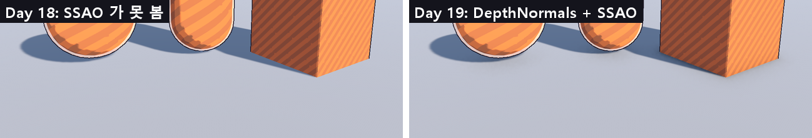

# Day 19. 노멀 지도와 SSAO — 구석의 그늘

## 작업 식별

| 항목 | 내용 |
|---|---|
| Task ID | GMD-TSL-019-MP |
| 목적 | `DepthNormals` 패스를 추가해 깊이·노멀 텍스처에 물체를 기록하고, URP SSAO 결과를 직접광과 간접광에 곱한다 |
| 적용 대상 | Unity 6000.3, URP 17.x, `Assets/Settings/PC_Renderer`에 SSAO Renderer Feature가 켜져 있다. Day 18 완료 상태의 `MyToon.shader` |
| 소요 시간 | 약 60분 (개념 15분, 코드 25분, 실험 20분) |
| 확인 상태 | 미검증 (원본 코드를 읽고 정리한 것이며 이 환경에서 컴파일·실행하지 않았다) |
| 개정 | R1 (2026-11-18) |


NOTE: 이 Day는 URP 버전 의존이 크다. `DepthNormals` 패스의 출력 형식(원본은 월드 노멀을 그대로 반환, 일부 URP 버전은 옥타헤드럴 인코딩 사용), SSAO의 `Source`(`Depth` 또는 `Depth Normals`) 설정, `_SCREEN_SPACE_OCCLUSION` 키워드, `GetScreenSpaceAmbientOcclusion`, `AmbientOcclusionFactor` 필드, Render Graph 기반 Renderer Feature 구현은 버전마다 다르다. URP 버전 확인 필요. SSAO `Source`가 `Depth`이면 `DepthNormals` 패스를 쓰지 않을 수 있다.


## 1. 참조

| 참조 문서 | Task ID | 제목 |
|---|---|---|
| [day09-cast-shadows.md](day09-cast-shadows.md) | GMD-TSL-009-MP | `DepthOnly` 패스 |
| [day10-ambient-fog.md](day10-ambient-fog.md) | GMD-TSL-010-MP | `shadeMask`, 환경광 코드 |
| [day18-keywords.md](day18-keywords.md) | GMD-TSL-018-MP | 이전: 키워드 |
| [day20-two-sided.md](day20-two-sided.md) | GMD-TSL-020-MP | 다음: 양면 그리기 |
| [toon-shader-study Day 10](../toon-shader-study/day10-ambient-gi-ssao.md), [Day 18](../toon-shader-study/day18-passes.md) | - | 환경광/GI/SSAO, 패스 총정리 (짝꿍 과정) |
| [Screen space ambient occlusion](https://en.wikipedia.org/wiki/Screen_space_ambient_occlusion), [LearnOpenGL SSAO](https://learnopengl.com/Advanced-Lighting/SSAO), [URP Ambient Occlusion 설정](https://docs.unity3d.com/Packages/com.unity.render-pipelines.universal@17.0/manual/post-processing-ssao.html) | - | SSAO 참고 |

## 2. 필요 장비와 자재

| 번호 | 이름 | 사양·버전 | 비고 |
|---|---|---|---|
| 1 | `Assets/MyToon/MyToon.shader` | Day 18 완료 상태 | |
| 2 | `Assets/Settings/PC_Renderer` | SSAO Renderer Feature 활성 | 실습 저장소 기본값 |

## 3. 안전 사항


CAUTION: 확인을 위해 SSAO `Intensity`를 바꾸면 반드시 원래 값으로 되돌린다. 렌더러 에셋은 프로젝트 전체에 적용된다.


## 4. 준비

| 번호 | 항목 | 확인 방법 |
|---|---|---|
| 1 | Day 18 코드가 컴파일된다 | Console 오류 0건 |
| 2 | 렌더러에 SSAO가 켜져 있다 | `PC_Renderer`의 `Screen Space Ambient Occlusion` 체크 확인 |

## 5. 절차

### A. 개념 확인

SSAO(Screen Space Ambient Occlusion)는 화면 전체의 깊이와 노멀 텍스처를 읽어 주변이 막힌 구석을 찾아 어둡게 한다. 그 텍스처는 각 물체의 `DepthNormals` 패스가 그린다.

Day 18까지 이 셰이더에는 `DepthNormals` 패스가 없어 SSAO가 이 물체를 인식하지 못한다. 바닥(Unity Lit)에도 이 물체 주변의 그늘이 생기지 않는다. 할 일은 두 가지다.

| 번호 | 작업 | 효과 |
|---|---|---|
| 1 | `DepthNormals` 패스 추가 | 노멀 텍스처에 기록되어 다른 물체가 이 물체를 인식한다 |
| 2 | SSAO 결과 받기 | 이 물체의 구석도 어두워진다 |

### B. DepthNormals 패스 추가

1. (5-B-01) `DepthOnly` 패스 다음, `SubShader` 끝 앞에 추가한다. 색 대신 월드 노멀을 반환하고 깊이는 GPU가 `ZWrite On`으로 기록한다. → 결과: 컴파일 오류가 없다.

```hlsl
        // 깊이 + 노멀 지도 찍기: SSAO 와 화면 공간 효과들이 쓴다
        Pass
        {
            Name "DepthNormals"
            Tags { "LightMode" = "DepthNormals" }
            ZWrite On

            HLSLPROGRAM
            #pragma vertex DepthNormalsVert
            #pragma fragment DepthNormalsFrag
            #pragma shader_feature_local_fragment _ _ALPHATEST_ON

            struct DepthNormalsAttributes
            {
                float4 positionOS : POSITION;
                float3 normalOS   : NORMAL;
                float2 uv         : TEXCOORD0;
            };

            struct DepthNormalsVaryings
            {
                float4 positionCS : SV_POSITION;
                float3 normalWS   : TEXCOORD0;
                float2 uv         : TEXCOORD1;
            };

            DepthNormalsVaryings DepthNormalsVert(DepthNormalsAttributes input)
            {
                DepthNormalsVaryings o = (DepthNormalsVaryings)0;
                o.positionCS = TransformObjectToHClip(input.positionOS.xyz);
                o.normalWS = TransformObjectToWorldNormal(input.normalOS);
                o.uv = TRANSFORM_TEX(input.uv, _BaseMap);
                return o;
            }

            half4 DepthNormalsFrag(DepthNormalsVaryings input) : SV_Target
            {
                ClipAlpha(input.uv);
                return half4(normalize(input.normalWS), 0.0h);
            }
            ENDHLSL
        }
```

### C. SSAO 결과 받기

1. (5-C-01) Forward 패스의 `#pragma` 아래에 키워드를 추가한다.

```hlsl
            #pragma multi_compile_fragment _ _SCREEN_SPACE_OCCLUSION
```

2. (5-C-02) frag의 `shadeMask` 줄 다음부터 `color +=` 줄까지를 다음으로 바꾼다. → 결과: 컴파일 오류가 없다.

```hlsl
                half shadeMask = max(shadow1, shadow2);   // 얼마나 그림자인가 (0~1)

                half aoDirect = 1.0h, aoIndirect = 1.0h;
            #if defined(_SCREEN_SPACE_OCCLUSION)
                AmbientOcclusionFactor ao = GetScreenSpaceAmbientOcclusion(GetNormalizedScreenSpaceUV(input.positionCS));
                aoDirect   = ao.directAmbientOcclusion;
                aoIndirect = ao.indirectAmbientOcclusion;
            #endif

                half3 color = toon * mainLight.color * aoDirect;                  // * aoDirect 추가
                half3 ambient = SampleSH(N) * albedo * _AmbientStrength;   // 하늘에서 오는 은은한 빛
                color += ambient * (1.0h - shadeMask) * aoIndirect;        // * aoIndirect 추가
```

| 값 | 곱하는 곳 | 의미 |
|---|---|---|
| `indirectAmbientOcclusion` | 환경광(간접광) | 구석에는 환경광이 덜 들어온다. 주된 효과 |
| `directAmbientOcclusion` | 메인 라이트(직접광) | 아주 약하게 반영 |

`GetNormalizedScreenSpaceUV`는 현재 픽셀의 화면 위치(0~1)를 돌려준다. SSAO 결과가 화면 크기 텍스처이므로 그 위치를 읽는다.

정답 파일: [`Assets/Solutions/Day19/MyToon.shader`](https://github.com/JJH0204/toon-shader-lab/blob/main/Assets/Solutions/Day19/MyToon.shader)

### D. 화면 확인

1. (5-D-01) 물체 아래 바닥을 본다. → 결과: 접지 그늘이 생긴다. 바닥(Unity Lit)이 이 물체를 인식한 것이다.
2. (5-D-02) 효과가 약하면 `Assets/Settings/PC_Renderer`의 SSAO `Intensity`를 잠깐 올린다. → 결과: 그늘이 진해진다. 확인 후 원래 값으로 되돌린다.



### E. 실험

1. (5-E-01) `DepthNormals` 패스를 주석 처리한다. → 결과: 바닥의 접지 그늘이 사라진다. 패스가 없으면 다른 효과가 이 물체를 인식하지 못한다. 확인 후 되돌린다.
2. (5-E-02) SSAO `Intensity`를 4로 올린다. → 결과: 진한 AO가 깔끔한 셀 그림자를 뭉개 보이게 한다. 그래서 실제 툰 셰이더는 AO 세기 조절을 따로 둔다. 확인 후 되돌린다.
3. (5-E-03) 렌더러에서 SSAO 피처를 끈다. → 결과: `_SCREEN_SPACE_OCCLUSION` 키워드가 꺼져 `aoDirect = aoIndirect = 1`이 된다. 확인 후 다시 켠다.
4. (5-E-04) 커밋한다: `git commit -am "Day 19: DepthNormals와 SSAO"`

## 6. 기능 확인

| 번호 | 확인 동작 | 기대 결과 | 합격 기준 |
|---|---|---|---|
| 1 | 바닥의 물체 접지 부분을 본다 | 접지 그늘 | 그늘이 보인다 |
| 2 | `DepthNormals` 패스를 주석 처리한다 | 접지 그늘이 사라진다 | 그늘 없음 |
| 3 | SSAO 피처를 끈다 | AO 효과 없음 | Day 18과 같은 화면 |

## 7. 복구

1. (7-01) 변경을 되돌린다: `Ctrl+Z` 또는 `git restore Assets/MyToon/MyToon.shader`.
2. (7-02) `PC_Renderer`의 SSAO 설정(활성, 기본 `Intensity`)을 원래 값으로 되돌린다: `git restore Assets/Settings/PC_Renderer.asset` (변경했다면).

## 8. 개정 이력

| 개정 | 날짜 | 변경 내용 |
|---|---|---|
| R1 | 2026-11-18 | 기존 Day 19 페이지를 AMM 형식으로 재작성. `DepthNormals` 출력 형식과 SSAO 설정의 URP 버전 의존 NOTE 추가 |

[← Day 18](day18-keywords.md) · [목차](README.md) · [다음: Day 20 →](day20-two-sided.md)
