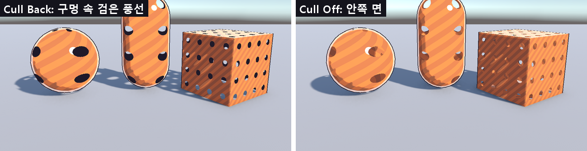

# Day 20. 양면 그리기와 마무리 점검

> ⏱ **약 1시간** — 코드 20분 · 점검 25분 · 실험 15분
> 🧸 **오늘의 비유**: 종이 인형은 **앞면만** 칠하면 뒤에서 볼 때 하얘요. 양면을 칠하되, 뒷면에서는 **"앞"이 반대**라는 걸 알려 줘야 해요.



## 오늘 만들 것

구멍 뚫린 물체에서 구멍 너머로 **안쪽 면**이 제대로 칠해져 보여요(오른쪽). 어제까지는 외곽선 풍선의 검은 안쪽이 보였어요(왼쪽).

## 오늘 배울 것

- [ ] `Cull [_Cull]`로 앞면/뒷면/양면을 머티리얼에서 고른다
- [ ] 뒷면에서 노멀을 뒤집는 `IS_FRONT_VFACE`를 쓴다
- [ ] **모든 패스가 같은 규칙**(가위, 컬)을 따라야 하는 이유를 정리한다
- [ ] SRP Batcher와 Frame Debugger로 셰이더를 점검한다

---

## 1. 코드 고치기 (20분)

### ① Render Face 드롭다운 (Properties, `_Cutoff` 아래)

```shaderlab
        [Enum(UnityEngine.Rendering.CullMode)] _Cull ("Render Face (Cull)", Float) = 2
```

`[Enum(UnityEngine.Rendering.CullMode)]`는 Unity의 컬 모드 목록(Off=0, Front=1, Back=2)을 드롭다운으로 보여 줘요.

### ② 네 패스 모두에 `Cull [_Cull]`

**Forward, ShadowCaster, DepthOnly, DepthNormals** 패스의 `Tags` 줄 아래(또는 `ColorMask` 줄 아래)에 한 줄씩:

```shaderlab
            Cull [_Cull]
```

**Outline 패스는 `Cull Front` 그대로** 둬요. 외곽선은 늘 뒷면만 그려야 하니까요.


색칠 팀만 양면으로 그리고 그림자 팀이 앞면만 그리면, 뒷면은 그림자를 안 드리워요. **"모든 팀이 같은 대본"** — Day 09의 가위와 같은 규칙이에요.


### ③ 뒷면이면 노멀 뒤집기 (Forward frag)

frag의 매개변수와 첫 줄을 바꿔요.

```hlsl
            half4 frag(Varyings input, FRONT_FACE_TYPE faceSign : FRONT_FACE_SEMANTIC) : SV_Target
            {
                input.normalWS *= IS_FRONT_VFACE(faceSign, 1.0, -1.0);   // 뒷면이면 노멀을 뒤집는다
```

메시의 노멀은 **앞면 기준**이라 뒷면에서는 반대를 가리켜요. 그대로 쓰면 빛 계산이 거꾸로 돼요. GPU는 "지금 칠하는 게 앞면인가"를 알려 줄 수 있고, URP 매크로 `IS_FRONT_VFACE(값, 앞이면, 뒤면)`가 플랫폼 차이를 감싸 줘요.

### ④ DepthNormals도 똑같이

```hlsl
            half4 DepthNormalsFrag(DepthNormalsVaryings input, FRONT_FACE_TYPE faceSign : FRONT_FACE_SEMANTIC) : SV_Target
            {
                ClipAlpha(input.uv);
                half3 normalWS = normalize(input.normalWS) * IS_FRONT_VFACE(faceSign, 1.0, -1.0);
                return half4(normalWS, 0.0h);
            }
```

안 뒤집으면 SSAO가 뒷면에서 틀린 노멀을 봐요. 실제 프로젝트에서 나뭇잎 뒷면 SSAO가 깨졌던 원인이에요.

정답: [`Assets/Solutions/Day20/MyToon.shader`](https://github.com/JJH0204/toon-shader-lab/blob/main/Assets/Solutions/Day20/MyToon.shader)

## 2. 확인하기

1. 머티리얼에서 **Alpha Clip** 켜기 → 구멍 속이 검은 점(외곽선 풍선의 안쪽)으로 보여요(맨 위 왼쪽).
2. **Render Face = Off** → 구멍 너머로 **안쪽 면**이 제대로 칠해져요(맨 위 오른쪽). 큐브 안쪽 벽이 그림자 색으로 보이는 게 노멀 뒤집기 덕분이에요.
3. 확인 후 Alpha Clip을 끄고 Render Face를 **Back**으로 되돌려요. 양면은 그리는 면이 두 배라 필요할 때만 켜요(나뭇잎, 머리카락 카드, 망토).

## 3. 마무리 점검 (25분)

20일 동안 만든 셰이더를 점검해요.

### ① SRP Batcher 호환

`MyToon.shader`를 선택하고 Inspector에서 **SRP Batcher: compatible**인지 보세요. 모든 패스가 HLSLINCLUDE의 **같은 CBUFFER**를 쓰니까 호환이에요.

### ② Frame Debugger

Window → Analysis → **Frame Debugger** → Enable.
- 왼쪽 목록에서 이름에 **Shadow**가 들어간 단계 → 우리 물체가 ShadowCaster 패스로 그려지는 게 보여요.
- 이름에 **DepthNormals**가 들어간 단계 → DepthNormals 패스.
- **Draw Opaque Objects** → Forward 패스, 그 다음 Outline 패스(`SRPDefaultUnlit`).
- 단계 이름은 Unity 버전마다 조금씩 달라요. 항목을 하나씩 눌러 보며 찾아보세요.
- 항목을 클릭하면 오른쪽에 쓰인 셰이더·패스·키워드가 나와요. **"SRP Batch"** 로 묶인 것도 보여요.

### ③ 패스 표 정리

| 패스 | LightMode | 그리는 것 | 누가 쓰나 | 배운 날 |
|---|---|---|---|---|
| Forward | `UniversalForward` | 색 | 화면 | Day 01~ |
| Outline | `SRPDefaultUnlit` | 외곽선 | 화면 | Day 13 |
| ShadowCaster | `ShadowCaster` | 빛 기준 거리 | 그림자 판정 | Day 09 |
| DepthOnly | `DepthOnly` | 카메라 기준 깊이 | 깊이 텍스처 | Day 09 |
| DepthNormals | `DepthNormals` | 깊이 + 노멀 | SSAO, 화면 효과 | Day 19 |

## 4. 실험해 보기 (15분)

1. **뒤집기 빼 보기** — `input.normalWS *= ...` 줄을 지우고 Render Face Off + Alpha Clip을 보세요. 안쪽 벽이 **엉뚱하게 밝아요.** 되돌려요.
2. **그림자 팀만 Back** — ShadowCaster의 `Cull [_Cull]`을 `Cull Back`으로 바꾸면 양면일 때 그림자 모양이 달라지는지 보세요. 되돌려요.
3. 커밋: `git commit -am "Day 20: 양면과 마무리 점검"`

## 5. 오늘의 액기스

👉 [ESSENCE.md — Day 20](essence.md#day-20)

## 더 읽을거리

- [Unity — Cull](https://docs.unity3d.com/Manual/SL-Cull.html) · [Frame Debugger](https://docs.unity3d.com/Manual/FrameDebugger.html) · [SRP Batcher](https://docs.unity3d.com/Manual/SRPBatcher.html)
- [LearnOpenGL — Face culling](https://learnopengl.com/Advanced-OpenGL/Face-culling)
- 더 깊이: [toon-shader-study Day 18 — 패스 총정리](../toon-shader-study/day18-passes.md) · [Day 20 — 성능](../toon-shader-study/day20-performance.md) (인스턴싱, GPU Resident Drawer)

---

[← Day 19](day19-depthnormals-ssao.md) · [목차](README.md) · [다음: Day 21 →](day21-screen-outline.md)
