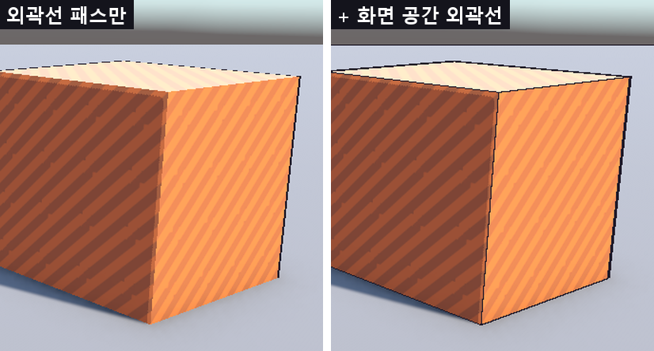
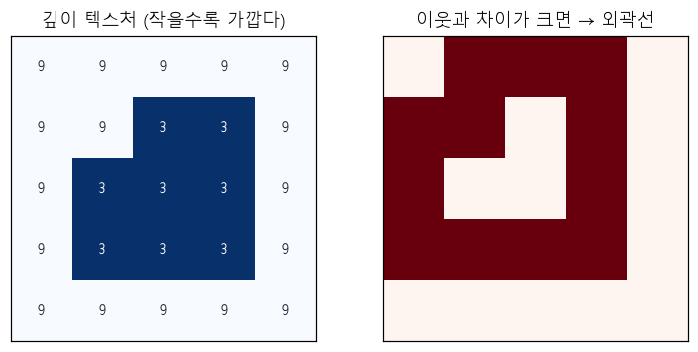

# Day 21. 화면 공간 외곽선 — 다 그린 그림 위에 펜으로

> ⏱ **약 1시간** — 개념 10분 · 셰이더 25분 · 연결 15분 · 실험 10분
> 🧸 **오늘의 비유**: 그림을 다 그린 뒤 **"깊이나 면 방향이 확 바뀌는 곳"을 찾아 펜으로 선을 긋는 화가**예요.



## 오늘 만들 것

물체 하나가 아니라 **화면 전체**에 한 번 칠하는 셰이더. 외곽선 패스(Day 13)가 못 그리는 **큐브의 안쪽 모서리**에도 선이 생겨요(오른쪽).

## 오늘 배울 것

- [ ] 화면 전체에 칠하는 셰이더(풀스크린 셰이더)를 짠다
- [ ] 깊이 텍스처·노멀 텍스처를 읽어 경계를 찾는다
- [ ] URP의 **Full Screen Pass Renderer Feature**에 연결한다

---

## 1. 이웃과 비교하기 (개념 10분)



화면의 각 픽셀에서 **이웃 픽셀과 깊이를 비교**해요. 몸통과 배경 사이처럼 깊이가 확 뛰는 곳이 경계예요. 깊이만으로는 **같은 거리에서 꺾인 면**(큐브 모서리)을 못 찾으니 **노멀**도 비교해요.

| | 외곽선 패스 (Day 13) | 화면 외곽선 (오늘) |
|---|---|---|
| 방식 | 물체마다 부푼 껍질 | 다 그린 화면에서 경계 찾기 |
| 잘하는 것 | 실루엣, 물체별 색·두께 | **안쪽 모서리**, 배경 전체 |
| 필요한 것 | 메시 노멀 | DepthOnly·DepthNormals 패스 (Day 09, 19!) |

## 2. 풀스크린 셰이더 짜기 (25분)

`MyToon` 폴더에 **Create → Shader → Unlit Shader** → 이름 `MyScreenOutline` → 내용을 지우고:

```hlsl
// 화면 전체에 한 번 칠하는 셰이더. URP 의 Full Screen Pass Renderer Feature 가 이 머티리얼로 화면을 다시 그린다.
Shader "MyToon/Screen Outline"
{
    Properties
    {
        _OutlineColor ("Outline Color", Color) = (0.12, 0.1, 0.16, 1)
        _Thickness ("Thickness (px)", Range(0.5, 4)) = 1
        _DepthThreshold ("Depth Threshold", Range(0.001, 1)) = 0.05
        _NormalThreshold ("Normal Threshold", Range(0.01, 2)) = 0.6
    }

    SubShader
    {
        Tags { "RenderPipeline" = "UniversalPipeline" "RenderType" = "Opaque" }
        ZWrite Off
        ZTest Always
        Cull Off

        Pass
        {
            Name "ScreenOutline"

            HLSLPROGRAM
            #pragma vertex Vert          // Blit.hlsl 이 주는 '화면 전체 삼각형' 버텍스 셰이더
            #pragma fragment Frag

            #include "Packages/com.unity.render-pipelines.universal/ShaderLibrary/Core.hlsl"
            #include "Packages/com.unity.render-pipelines.core/Runtime/Utilities/Blit.hlsl"
            #include "Packages/com.unity.render-pipelines.universal/ShaderLibrary/DeclareDepthTexture.hlsl"
            #include "Packages/com.unity.render-pipelines.universal/ShaderLibrary/DeclareNormalsTexture.hlsl"

            half4 _OutlineColor;
            float _Thickness;
            float _DepthThreshold;
            float _NormalThreshold;

            float EyeDepth(float2 uv)
            {
                return LinearEyeDepth(SampleSceneDepth(uv), _ZBufferParams);   // 깊이 버퍼 값 → 진짜 거리(m)
            }

            half4 Frag(Varyings input) : SV_Target
            {
                UNITY_SETUP_STEREO_EYE_INDEX_POST_VERTEX(input);
                float2 uv = input.texcoord;
                half4 color = SAMPLE_TEXTURE2D_X(_BlitTexture, sampler_LinearClamp, uv);   // 지금까지 그린 그림

                float2 t = _Thickness / _ScaledScreenParams.xy;   // 몇 픽셀 옆을 볼지 (UV 단위)

                // ① 깊이 경계: 나와 오른쪽·위·대각선 이웃의 거리 차이. 멀수록 차이가 커지니 내 거리로 나눈다.
                float d  = EyeDepth(uv);
                float dx = EyeDepth(uv + float2(t.x, 0));
                float dy = EyeDepth(uv + float2(0, t.y));
                float dd = EyeDepth(uv + t);
                float depthEdge = (abs(d - dx) + abs(d - dy) + abs(d - dd)) / max(d, 1e-3);

                // ② 노멀 경계: 면이 꺾이는 곳
                half3 n  = SampleSceneNormals(uv);
                half3 nx = SampleSceneNormals(uv + float2(t.x, 0));
                half3 ny = SampleSceneNormals(uv + float2(0, t.y));
                float normalEdge = distance(n, nx) + distance(n, ny);

                float edge = saturate(step(_DepthThreshold, depthEdge) + step(_NormalThreshold, normalEdge));
                return lerp(color, _OutlineColor, edge * _OutlineColor.a);
            }
            ENDHLSL
        }
    }
}
```

| 부분 | 뜻 |
|---|---|
| `#pragma vertex Vert` + `Blit.hlsl` | 화면을 덮는 삼각형 하나를 그려 주는 URP 표준 버텍스 셰이더. 우리는 frag만 짜면 돼요 |
| `_BlitTexture` | URP가 넘겨주는 **지금까지 그린 화면** |
| `SampleSceneDepth` / `SampleSceneNormals` | Day 09·19의 패스가 그린 깊이·노멀 지도 읽기 |
| `LinearEyeDepth` | 깊이 버퍼는 가까운 곳을 촘촘하게 저장해서 거리와 비례하지 않아요. 진짜 거리(m)로 바꿔요 |
| `/ max(d, 1e-3)` | 멀리 있는 바닥은 원래 깊이 차가 커서 줄무늬가 생겨요. 내 거리로 나눠 **비율**로 비교해요 |
| `distance(n, nx)` | 노멀 화살표끼리의 거리. 같은 면이면 0, 꺾이면 커요 |
| `step(기준, 값)` | 값이 기준 이상이면 1 (딱딱한 문턱) |
| `lerp(color, 선색, edge)` | 경계면 선 색, 아니면 원래 그림 |

이 셰이더는 화면 전체에 한 번만 쓰여서 SRP Batcher와 상관없어요. 그래서 CBUFFER 없이 간단히 선언했어요.

## 3. URP에 연결하기 (15분)

1. `MyToon` 폴더에서 **Create → Material** → 이름 `MyScreenOutline` → Shader: **MyToon → Screen Outline**.
2. Project 창에서 `Assets/Settings/PC_Renderer` 선택 → Inspector 맨 아래 **Add Renderer Feature** → **Full Screen Pass Renderer Feature**.
3. 추가된 피처를 이렇게 설정해요.

| 항목 | 값 | 이유 |
|---|---|---|
| Pass Material | `MyScreenOutline` | 우리 셰이더 |
| Injection Point | **Before Rendering Post Processing** | 불투명·투명을 다 그린 뒤, 후처리 전 |
| Fetch Color Buffer | ✅ 켬 | 지금까지 그린 화면을 `_BlitTexture`로 받기 |
| Requirements | **Depth**, **Normal** | 깊이·노멀 지도가 필요하다고 URP에 알려 줌 |

Game 뷰와 Scene 뷰 모두에 선이 생겨요.

정답: [`Assets/Solutions/Day21/MyScreenOutline.shader`](https://github.com/JJH0204/toon-shader-lab/blob/main/Assets/Solutions/Day21/MyScreenOutline.shader)


실습 프로젝트의 `PC_Renderer`에는 일부러 이 피처를 넣어 두지 않았어요. 직접 붙여 보는 게 오늘의 실습이니까요.


## 4. 확인하고 실험하기 (10분)

1. 큐브의 **안쪽 모서리**(면과 면이 만나는 세로선)에 선이 생겼는지 보세요(맨 위 오른쪽). Day 13 외곽선은 실루엣에만 있었어요.
2. **Normal Threshold**를 0.1로 내리면 노멀맵 홈까지 선이 생겨요(Use Normal Map 켰다면). 2로 올리면 안쪽 선이 사라져요.
3. **Thickness** 2 → 굵은 선.
4. **Depth만 / Normal만** — 한쪽 기준을 최대로 올려서 각각이 어떤 선을 그리는지 비교해 보세요.
5. 렌더러 피처 체크를 껐다 켜며 비교해요. 커밋: `git add Assets && git commit -m "Day 21: 화면 공간 외곽선"`

## 5. 오늘의 액기스

👉 [ESSENCE.md — Day 21](essence.md#day-21)

## 수학 참고 자료

- [Wikipedia — Roberts cross](https://en.wikipedia.org/wiki/Roberts_cross) · [Sobel operator](https://en.wikipedia.org/wiki/Sobel_operator) · [Edge detection](https://en.wikipedia.org/wiki/Edge_detection) — 이미지에서 경계 찾기
- [LearnOpenGL — Depth testing](https://learnopengl.com/Advanced-OpenGL/Depth-testing) — 깊이 값이 왜 비선형인지
- 더 깊이: [toon-shader-study Day 14 — 화면 공간 외곽선](../toon-shader-study/day14-screen-space-outline.md) (C# Renderer Feature와 RenderGraph로 직접 만드는 방법)

---

[← Day 20](day20-two-sided.md) · [목차](README.md) · [다음: Day 22 →](day22-graduation.md)
