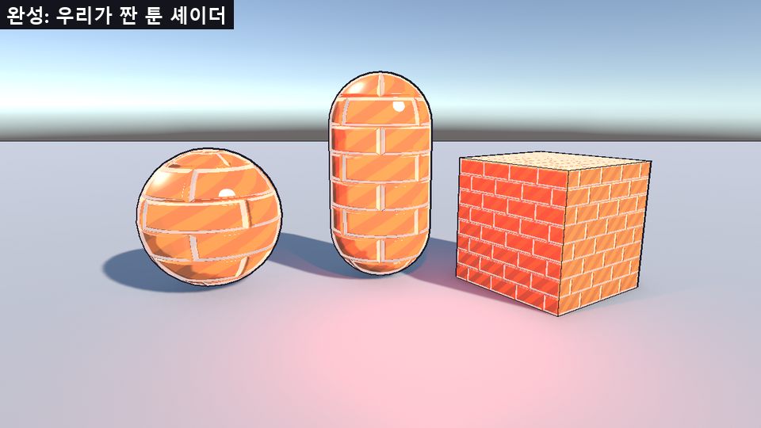

# Day 22. 졸업 — 내가 짠 셰이더 돌아보기

> ⏱ **약 1시간** — 통째로 읽기 25분 · 실제 게임 셰이더와 비교 20분 · 다음 도전 15분
> 🧸 **오늘의 비유**: 22일 전 40줄짜리 씨앗이 **450줄짜리 나무**가 됐어요. 오늘은 나무를 한 바퀴 돌아보고, 옆 숲(실제 게임 셰이더)을 구경해요.

## 오늘 배울 것

- [ ] 내 셰이더의 frag를 처음부터 끝까지 막힘없이 설명한다
- [ ] 실제 게임 툰 셰이더에 있고 내 셰이더에 없는 것을 안다
- [ ] 다음 도전 과제를 하나 고른다

---

## 1. 한 픽셀의 여행 (25분)

[`Assets/Solutions/Day20/MyToon.shader`](https://github.com/JJH0204/toon-shader-lab/blob/main/Assets/Solutions/Day20/MyToon.shader)의 `frag`(또는 내 `MyToon.shader`)를 열고 위에서부터 읽어요. 모르는 줄이 나오면 그 Day로 돌아가세요.

| 순서 | 하는 일 | Day |
|---|---|---|
| 1 | 뒷면이면 노멀 뒤집기 | 20 |
| 2 | 바탕색 = 텍스처 × Base Color, 가위질 | 05, 09 |
| 3 | N 정규화, (노멀맵으로 흔들기) | 04, 17 |
| 4 | V = 눈 방향 | 12 |
| 5 | 해와 그림자 받기 → `lightVal` = 하프 램버트 × 그림자 | 06, 08 |
| 6 | (디버그 보기) | 04 |
| 7 | **계단 두 칸**으로 그림자 색 덧칠 | 07 |
| 8 | SSAO 값 받기 | 19 |
| 9 | 색 = 계단 × 빛 색, + 하늘빛(그림자 쪽엔 덜), 바닥 깔기 | 10 |
| 10 | + 보조 조명 | 11 |
| 11 | + 림, + 반짝임, + MatCap (키워드로 켜고 끔) | 12, 15, 16, 18 |
| 12 | 안개 섞고 출력 | 10 |


뼈대는 딱 세 줄이에요. ① **`lightVal` 만들기** ② **계단으로 색 정하기** ③ **빛나는 것들 더하기**. 나머지는 전부 장식이에요.


그리고 패스 다섯 개(Forward · Outline · ShadowCaster · DepthOnly · DepthNormals)와 화면 셰이더 하나. 모든 패스가 같은 CBUFFER와 같은 가위(`ClipAlpha`), 같은 컬(`_Cull`)을 써요.

## 2. 실제 게임 셰이더와 비교 (20분)

[toon-shader-study](../toon-shader-study/README.md)는 실제 게임에 쓰는 툰 셰이더(`com.blueigloo.shader`)를 한 줄씩 읽는 레포예요. 이제 그 코드가 훨씬 잘 읽힐 거예요. 같은 기능은 어떻게 다르게 했는지, 우리에게 없는 건 뭔지 보세요.

| 기능 | 내 셰이더 | 실제 게임 셰이더 | 읽을 곳 |
|---|---|---|---|
| 셀 밴드 1·2차 | ✅ | ✅ + Ramp 텍스처 방식, ILM 맵으로 부위별 그림자 편향 | [Day 07](../toon-shader-study/day07-toon-steps.md) |
| 외곽선 | 픽셀 단위 | + 최소 1px 보장, 부위별 두께 마스크, **스무스 노멀 굽기** | [Day 12](../toon-shader-study/day12-outline-inverted-hull.md) · [13](../toon-shader-study/day13-outline-pixel-width.md) |
| 림 | 프레넬 | + **깊이 림**(화면 깊이 차로 평평한 면도) | [Day 11](../toon-shader-study/day11-rim-light.md) |
| 얼굴 그림자 | ❌ | **SDF 얼굴 그림자** (그림자 모양을 그림으로) | [Day 15](../toon-shader-study/day15-face-sdf.md) |
| 머리카락 | ❌ | **천사 고리**(이방성 하이라이트) | [Day 17](../toon-shader-study/day17-highlights.md) |
| 노멀맵 | 메시 탄젠트 | `ddx/ddy`로 탄젠트 없이 (탄젠트 칸을 외곽선에 씀) | [Day 16](../toon-shader-study/day16-normal-maps-and-derivatives.md) |
| 조명 | 해 + 보조 조명 | + **캐릭터 전용 조명**(C#이 글로벌로 주입), 라이트 레이어 | [Day 09](../toon-shader-study/day09-many-lights.md) |
| 패스 | 5개 | + MotionVectors(TAA·모션 블러), 스텐실(앞머리 너머 눈썹) | [Day 18](../toon-shader-study/day18-passes.md) |
| 키워드 관리 | `shader_feature` | + 빌드 스트리퍼, 머티리얼 정리기, 전용 인스펙터 | [Day 19](../toon-shader-study/day19-keywords-and-variants.md) |
| 성능 | SRP Batcher | + 거리 품질 페이드, (배경) 인스턴싱·GPU Resident Drawer | [Day 20](../toon-shader-study/day20-performance.md) |

## 3. 다음 도전 (15분)

하나를 골라 내 `MyToon.shader`에 직접 넣어 보세요. 정답은 없어요. 위 표의 "읽을 곳"이 힌트예요.

1. **🟢 쉬움 — 외곽선 끄기 토글**: `[Toggle(_USE_OUTLINE)]`을 만들고, 꺼졌을 때 Outline 패스의 vert에서 점을 화면 밖으로 보내 보세요. (더 나은 방법: C#의 `material.SetShaderPassEnabled("SRPDefaultUnlit", false)`)
2. **🟢 쉬움 — 역광 림**: 해를 등진 쪽 테두리만 빛나게 (Day 12 실험 3).
3. **🟡 보통 — 최소 1px 외곽선**: Day 14의 외곽선에 "마스크가 0이 아니면 최소 1픽셀" 규칙을 넣어 보세요.
4. **🟡 보통 — 그림자 색 텍스처(Ramp)**: 가로 그라데이션 그림 한 장에서 `lightVal`을 U로 써서 그림자 색을 찾아오기.
5. **🔴 어려움 — 깊이 림**: Day 21의 깊이 텍스처 읽기를 Forward 패스에서 써서, 옆 픽셀이 훨씬 멀면(배경) 테두리를 빛나게.

### 새 기능을 넣을 때의 체크리스트

- [ ] Properties 추가 → **CBUFFER(HLSLINCLUDE)** 에도 추가 (이름 똑같이)
- [ ] 키워드로 할까, 숫자 `if`로 할까? 키워드면 **필요한 모든 패스**에 `#pragma`
- [ ] 나눗셈·`normalize`·`smoothstep` 폭에 0 방지 바닥
- [ ] 모양이나 구멍을 바꾸면 **모든 패스**에 같은 규칙
- [ ] 기본값에서는 **화면이 안 바뀌는지**(중립 값) 확인
- [ ] 바꾸기 전·후 **화면을 캡처해서 비교** — "고쳤다고 생각한 것"과 "화면이 바뀐 것"은 다를 수 있어요

## 4. 다음 공부

| 하고 싶은 것 | 추천 자료 |
|---|---|
| 셰이더 수학을 손에 익히기 | [The Book of Shaders (한국어)](https://thebookofshaders.com/?lan=kr) — 모양 함수, 노이즈, 패턴 |
| Unity 렌더링을 바닥부터 | [Catlike Coding — Rendering](https://catlikecoding.com/unity/tutorials/rendering/part-1/) → [Custom SRP](https://catlikecoding.com/unity/tutorials/custom-srp/) |
| URP 함수가 진짜 뭘 하나 | [URP ShaderLibrary 소스](https://github.com/Unity-Technologies/Graphics/tree/master/Packages/com.unity.render-pipelines.universal/ShaderLibrary) — `Lighting.hlsl`, `Shadows.hlsl`부터 |
| 다른 툰 셰이더 | [Unity Toon Shader](https://github.com/Unity-Technologies/com.unity.toonshader) · [lilToon](https://github.com/lilxyzw/lilToon) · [URP Toon Lit 예제](https://github.com/ColinLeung-NiloCat/UnityURPToonLitShaderExample) |
| 선형대수 제대로 | 🎥 [3Blue1Brown — Essence of Linear Algebra](https://www.3blue1brown.com/topics/linear-algebra) |

## 5. 22일 돌아보기

[ESSENCE.md](essence.md)를 처음부터 끝까지 읽어 보세요. 각 줄을 읽을 때 **비유와 코드가 바로 떠오르면** 졸업이에요. 🎓

마지막 커밋: `git commit -am "졸업!"` — 그리고 내 `Assets/MyToon/MyToon.shader`와 정답 `Assets/Solutions/Day20/MyToon.shader`를 나란히 열어 비교해 보세요(VS Code라면 두 파일을 선택하고 우클릭 → *Compare Selected*). 내 방식이 더 마음에 드는 곳도 있을 거예요.

## 6. 오늘의 액기스

👉 [ESSENCE.md — Day 22](essence.md#day-22)

---

[← Day 21](day21-screen-outline.md) · [목차](README.md)
