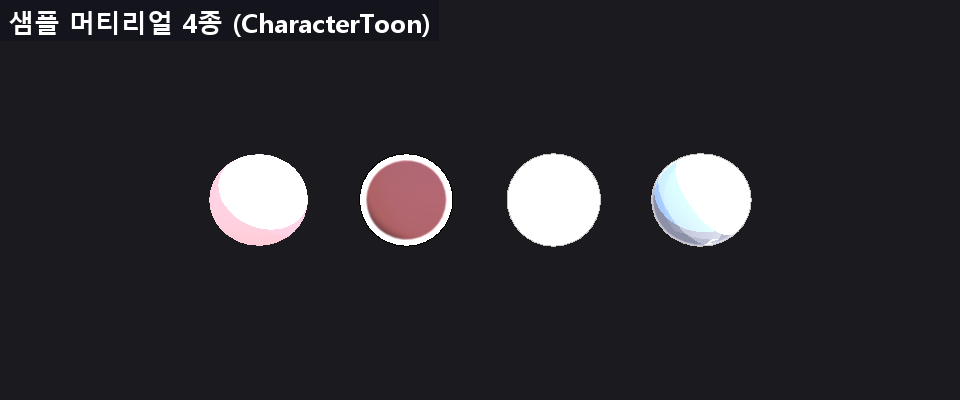

# 툰 셰이더 공부 노트 (Toon Shader Study)

## 작업 식별

| 항목 | 내용 |
|---|---|
| Task ID | GMD-TSS-001-REF |
| 유형 | 그룹 README (커리큘럼 표·자료 목록) |
| 목적 | 실제 게임 프로젝트의 Unity URP 툰 셰이더(`com.blueigloo.shader` v0.2.0) 소스를 읽으며 셰이더 이론을 22일 과정으로 학습한다 |
| 소요 시간 | 하루 약 1시간, 22일 (주 5일 기준 약 4주 반) |
| 대상 환경 | Unity 6, URP (소스 기준 버전. 버전 의존 내용은 각 Day의 NOTE에 적는다) |
| 확인 상태 | 미검증 (소스를 읽고 작성했으며 Unity에서 컴파일·실행하지 않았다) |
| 개정 | R1 (2026-11-18) |

## 이 자료의 역할

이 폴더는 완성된 툰 셰이더의 소스를 읽고 이론을 학습하는 자료다. 같은 주제를 직접 구현하며 학습하는 자료는 [툰 셰이더 실습실](../toon-shader-lab/README.md)이다.

| 구분 | 이 폴더 (공부 노트) | 실습실 (`toon-shader-lab`) |
|---|---|---|
| 방식 | 실제 게임용 셰이더 소스를 읽는다 | 빈 프로젝트에서 HLSL을 한 줄씩 작성한다 |
| 중심 | 개념(D&O)과 코드 읽기 | 구현 절차와 정답 셰이더 비교 |
| 권장 순서 | 실습실을 먼저 하고 이 자료로 실전 구조를 확인한다 | 이 자료의 "실습"에서 Unity 작업이 필요하면 실습실 프로젝트를 써도 된다 |

## 이 자료의 구성

- 매일 한 파일이다. 각 파일은 학습 목표, 정의, 구성 요소, 동작 원리, 코드 읽기, 주의, 실습, 참조, 내 말로 채우기 순서다.
- 개념은 비유로 짧게 시작하고 소스 줄 링크로 끝난다.
- 매일 끝에 [액기스 모음](essence.md)이 있다.

## 학습 방법

하루 한 파일을 아래 순서로 진행한다.

1. "배울 것" 체크리스트를 읽는다. (1분)
2. 정의·구성 요소·동작 원리를 읽는다. (20~25분)
3. 코드 읽기 절에서 링크를 눌러 `source/`의 해당 줄을 확인한다. (20분)
4. 실습을 수행한다. 손계산, [Desmos](https://www.desmos.com/calculator) 그래프, Unity 슬라이더 조작 중 가능한 것을 한다. (15분)
5. [액기스](essence.md)로 복습한다. (2분)


NOTE: 처음에는 각 줄의 역할만 파악하고 넘어간다. [Day 22](day22-graduation.md)에서 전체를 다시 읽을 때 연결된다.


## 준비물

| 번호 | 이름 | 비고 |
|---|---|---|
| 1 | Unity 6, URP | 선택. 실습에서 슬라이더를 직접 조작할 때 쓴다. 없어도 손계산과 그림으로 진행할 수 있다 |
| 2 | 부모 프로젝트 `unity-toonshader` 또는 [실습실](../toon-shader-lab/README.md) 프로젝트 | 선택 |


NOTE: 소스는 `com.blueigloo.shader` v0.2.0 기준이다. URP 버전에 따라 Forward+, Render Graph, GPU Resident Drawer 등 기능의 유무가 다르다. 해당 Day에서 NOTE로 표시한다.


## 커리큘럼

### 1주차 — 셰이더의 기본기

| Day | 주제 | 비유 | 주로 읽는 소스 |
|---|---|---|---|
| [01](day01-what-is-a-shader.md) | 셰이더가 뭐예요? | GPU 공장의 작업 지시서 | 소스 전체 지도 |
| [02](day02-coordinate-spaces.md) | 좌표 공간 여행 | 주소 체계와 주소 바꾸는 기계 | `vert()` 함수들 |
| [03](day03-shaderlab-skeleton.md) | 셰이더 파일의 뼈대 | 요리책 한 권 | `SceneToon_Sky.shader` 통째로 |
| [04](day04-hlsl-basics.md) | HLSL 문법 기초 | 택배 상자와 이름표 | `ToonRim.hlsl`, `ToonInput.hlsl` |
| [05](day05-textures-and-uv.md) | 텍스처와 UV | 전개도 좌표와 가위 | `ClipToonSurface`, ILM 맵 |

### 2주차 — 빛과 그림자

| Day | 주제 | 비유 | 주로 읽는 소스 |
|---|---|---|---|
| [06](day06-vectors-and-light.md) | 벡터와 빛 | 화살표 점수, 손전등 | 하프 램버트, `lightVal` |
| [07](day07-toon-steps.md) | 툰 계단 만들기 | 미끄럼틀 → 계단, 사포 | 1·2차 그림자 밴드 |
| [08](day08-shadows.md) | 그림자 | 빛이 찍은 거리 사진 | ShadowCaster 패스 |
| [09](day09-many-lights.md) | 여러 개의 빛 | 무대 조명 팀 | 추가광, Forward+, 캐릭터 조명 |
| [10](day10-ambient-gi-ssao.md) | 환경광, GI, SSAO | 튕겨 온 빛, 날씨 엽서, 구석 그늘 | `SampleSH`, `ToonPosterize` |
| [11](day11-rim-light.md) | 림 라이트 | 역광에 빛나는 가장자리 | 프레넬 림, 깊이 림 |

### 3주차 — 툰 효과들

| Day | 주제 | 비유 | 주로 읽는 소스 |
|---|---|---|---|
| [12](day12-outline-inverted-hull.md) | 외곽선 ① 인버티드 헐 | 뒤집힌 검은 풍선 | Outline 패스, 스무스 노멀 |
| [13](day13-outline-pixel-width.md) | 외곽선 ② 픽셀 두께 | 멀면 깜빡이는 가는 실 | `ToonOutline.hlsl`의 `× w` |
| [14](day14-screen-space-outline.md) | 외곽선 ③ 화면 공간 | 다 그린 그림에 펜으로 | `ScreenSpaceOutline`, Renderer Feature |
| [15](day15-face-sdf.md) | 얼굴 SDF 그림자 | 밀물 지도 | Face SDF, MaterialPropertyBlock |
| [16](day16-normal-maps-and-derivatives.md) | 노멀맵과 미분 | 빛에게 하는 거짓말, 옆자리 답안 | `ddx/ddy`, 탄젠트 없는 노멀맵 |
| [17](day17-highlights.md) | 반짝임 3종 | 거울의 해, 결 따라 빛 띠, 구슬 스티커 | 스펙큘러, 천사 고리, MatCap |

### 4주차 — 엔지니어링과 마무리

| Day | 주제 | 비유 | 주로 읽는 소스 |
|---|---|---|---|
| [18](day18-passes.md) | 패스 총정리 | 촬영 팀 여섯 | Depth/Normals/MotionVectors, 스텐실 |
| [19](day19-keywords-and-variants.md) | 키워드와 배리언트 | 옵션별로 굽는 빵집 | `#pragma`, 스트리퍼, 정리기 |
| [20](day20-performance.md) | 성능 | 택배 건수와 창고 재료표 | SRP Batcher, 인스턴싱, GRD |
| [21](day21-background-shaders.md) | 배경 셰이더 | 물감 네 통 지도 | SceneToon, 지형, 바람 |
| [22](day22-graduation.md) | 졸업 — 한 픽셀의 일생 | 픽셀의 여행기 | `frag` 전체 + 숙제 |

### 진도 체크

- [ ] Day 01 · [ ] Day 02 · [ ] Day 03 · [ ] Day 04 · [ ] Day 05
- [ ] Day 06 · [ ] Day 07 · [ ] Day 08 · [ ] Day 09 · [ ] Day 10 · [ ] Day 11
- [ ] Day 12 · [ ] Day 13 · [ ] Day 14 · [ ] Day 15 · [ ] Day 16 · [ ] Day 17
- [ ] Day 18 · [ ] Day 19 · [ ] Day 20 · [ ] Day 21 · [ ] Day 22

## 자료 구성

| 위치 | 내용 |
|---|---|
| 이 폴더 | Day 01~22, [액기스 모음](essence.md)(GMD-TSS-024-REF), [소스 지도](source-map.md)(GMD-TSS-025-REF) |
| [source/](https://github.com/JJH0204/GitBook/tree/main/GameDev/toon-shader-study/source) | 셰이더 소스 `com.blueigloo.shader` v0.2.0. 본문의 줄 번호 링크가 여기를 가리킨다 |
| [tools/](https://github.com/JJH0204/GitBook/tree/main/GameDev/toon-shader-study/tools) | 개념 그림 생성 스크립트 |

## 수학이 걱정된다면

이 과정에 나오는 수학의 범위다. 각 항목은 처음 나오는 날 본문에서 설명하고 참조 링크를 둔다.

| 수학 | 처음 나오는 날 | 먼저 보면 좋은 자료 |
|---|---|---|
| 벡터, 내적 | Day 06 | [3Blue1Brown — 벡터](https://www.3blue1brown.com/lessons/vectors), [내적](https://www.3blue1brown.com/lessons/dot-products) |
| 행렬, 좌표 변환 | Day 02 | [3Blue1Brown — 선형 변환](https://www.3blue1brown.com/lessons/linear-transformations), [행렬 곱셈](https://www.3blue1brown.com/lessons/matrix-multiplication) |
| 동차좌표 (`w`) | Day 02, 13 | [위키백과 — 동차좌표](https://ko.wikipedia.org/wiki/%EB%8F%99%EC%B0%A8%EC%A2%8C%ED%91%9C), [LearnOpenGL — Coordinate Systems](https://learnopengl.com/Getting-started/Coordinate-Systems) |
| cos, sin | Day 06, 17, 21 | [위키백과 — 삼각함수](https://ko.wikipedia.org/wiki/%EC%82%BC%EA%B0%81%ED%95%A8%EC%88%98) |
| 보간 (lerp), smoothstep | Day 03, 07 | [The Book of Shaders — Shaping Functions (한국어)](https://thebookofshaders.com/05/?lan=kr) |
| 외적 | Day 16 | [3Blue1Brown — 외적](https://www.3blue1brown.com/lessons/cross-products) |
| 유한 차분 (미분 어림) | Day 16 | [Wikipedia — Finite difference](https://en.wikipedia.org/wiki/Finite_difference) |

선형대수 전체를 먼저 보려면 [3Blue1Brown — Essence of Linear Algebra](https://www.3blue1brown.com/topics/linear-algebra)(YouTube, 한국어 자막 제공)를 참조한다.

## 자료 출처

- **소스**: `com.blueigloo.shader` 태그 `v0.2.0`(커밋 `6b0b466`). `.meta` 파일만 제외하고 복사했다. 원본이 바뀌어도 본문의 줄 번호 링크가 어긋나지 않는다.
- **수정 전·후 캡처**: `images/`의 "고치기 전/고친 뒤" 그림이다. v0.2.0 개선 작업(카드 A1~C8) 때 부모 프로젝트에서 Unity로 찍은 화면이다. 본문의 "실제로 있었던 일"이 이 작업을 다룬다. 기록은 [source/CHANGELOG.md](https://github.com/JJH0204/GitBook/blob/main/GameDev/toon-shader-study/source/CHANGELOG.md)에 있다.
- **개념 그림**: [tools/](https://github.com/JJH0204/GitBook/tree/main/GameDev/toon-shader-study/tools)의 Python(matplotlib) 스크립트로 만들었다. matplotlib과 맑은 고딕 글꼴(Windows)이 있으면 `python tools/make_diagrams.py images`, `python tools/make_diagrams2.py images`로 다시 만들 수 있다.

## 원본 레포

* [JJH0204/toon-shader-study](https://github.com/JJH0204/toon-shader-study) (비공개, 참고용): 이 과정의 원본 레포다. 레슨과 셰이더 소스 모두 이 GitBook으로 옮겼다.
