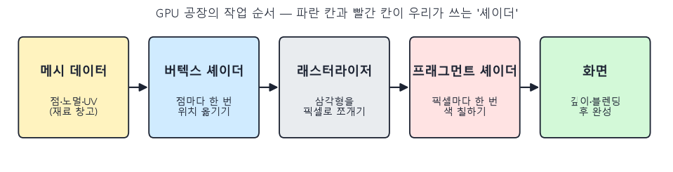
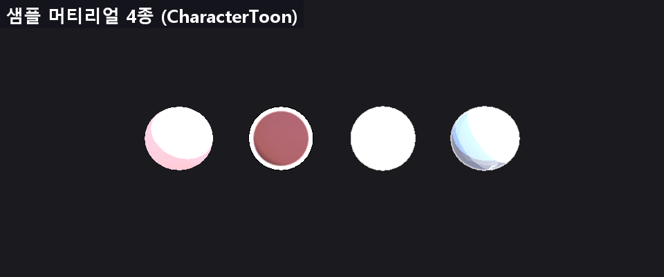

# Day 01. 셰이더가 뭐예요?

## 작업 식별

| 항목 | 내용 |
|---|---|
| Task ID | GMD-TSS-002-DO |
| 유형 | D&O (개념) + 소스 둘러보기 |
| 목적 | 셰이더의 역할, 렌더링 파이프라인의 순서, 툰 셰이더의 특징, `source/` 폴더 구성을 설명한다 |
| 소요 시간 | 약 1시간 (읽기 25분, 소스 둘러보기 20분, 실습 15분) |
| 선수 지식 | 없음 |
| 확인 상태 | 미검증 (소스를 읽고 작성했으며 Unity에서 컴파일·실행하지 않았다) |
| 개정 | R1 (2026-11-18) |

비유: 셰이더는 GPU 공장의 작업 지시서다.

## 학습 목표

- [ ] 셰이더가 하는 일을 한 문장으로 말할 수 있다
- [ ] 버텍스 셰이더와 프래그먼트 셰이더의 차이를 안다
- [ ] 툰 셰이더가 일반(실사) 셰이더와 무엇이 다른지 안다
- [ ] 이 셰이더 패키지의 `source/` 폴더에서 어디에 무엇이 있는지 안다

## 1. 정의


NOTE: 셰이더(Shader)는 GPU에서 실행되는 작은 프로그램이다. 정점의 화면 위치와 픽셀의 최종 색을 계산한다.


CPU는 복잡한 일을 순서대로 처리하고, GPU는 같은 일을 수천 개 코어에서 동시에 처리한다. 1920 × 1080 화면은 약 207만 픽셀이고 60프레임이면 초당 약 1억 2천만 번 색을 정해야 한다. 같은 셰이더를 모든 픽셀(또는 정점)에 병렬로 실행해 이를 처리한다.

| 구분 | CPU | GPU |
|---|---|---|
| 비유 | 요리사 한 명 | 아르바이트생 수천 명 |
| 잘하는 일 | 복잡한 일을 순서대로 | 같은 일을 동시에 대량으로 |
| 게임에서 | 캐릭터 이동, AI, 물리 | 화면 픽셀 수백만 개 칠하기 |

모든 실행 단위가 같은 셰이더를 읽지만 각자 맡은 정점·픽셀의 입력 값이 다르므로 결과가 다르다.

## 2. 구성 요소: 렌더링 파이프라인



| 순서 | 단계 | 실행 횟수 | 하는 일 | 프로그래머 개입 |
|---|---|---|---|---|
| 1 | 메시 데이터 | - | 정점(vertex)과 삼각형. 정점마다 위치, 노멀, UV가 있다 | 데이터만 제공 |
| 2 | 버텍스 셰이더 | 정점당 1회 | 정점이 화면 어디에 찍히는지(클립 공간 위치)를 계산한다 (Day 02) | 작성 |
| 3 | 래스터라이저 | 삼각형당 | 삼각형을 픽셀 크기 조각(fragment)으로 쪼개고 정점 값을 보간한다 | GPU 고정 기능 |
| 4 | 프래그먼트 셰이더 | 조각당 1회 | 조각의 색을 계산한다. 툰 효과 대부분이 여기서 구현된다 | 작성 |
| 5 | 출력 병합 | 조각당 | 깊이 테스트, 스텐실 테스트, 블렌딩을 거쳐 화면에 기록한다 | 렌더 스테이트로 설정 (Day 03) |


NOTE: 이 과정에서 직접 작성하는 단계는 2번과 4번이다. 5번의 일부(깊이 테스트 등)는 GPU 하드웨어가 프래그먼트 셰이더 실행 전에 먼저 수행할 수도 있다(early-Z). 실행 시점은 GPU와 셰이더 내용에 따라 다르다.


## 3. 동작 원리: 툰 셰이더의 차이

실사 셰이더는 밝은 곳에서 어두운 곳까지 수천 단계로 연속 변화하는 음영을 만든다. 툰 셰이더는 음영을 2~3단 계단으로 끊고 윤곽에 외곽선을 그려 만화 그림처럼 보이게 한다.



| 기능 | 하는 일 | 배우는 날 |
|---|---|---|
| 셀(Cel) 음영 | 빛을 2~3단 계단으로 나눈다 | Day 06–07 |
| 그림자, 여러 빛 | 드리운 그림자와 보조 조명을 처리한다 | Day 08–10 |
| 림 라이트 | 가장자리를 빛나게 한다 | Day 11 |
| 외곽선 | 검은 테두리를 그린다 | Day 12–14 |
| 얼굴 그림자 | 얼굴 전용 깔끔한 그림자를 만든다 | Day 15 |
| 반짝임 | 하이라이트, 머리카락 천사 고리, MatCap | Day 16–17 |

셰이더와 머티리얼은 다른 개념이다.

| 용어 | 정의 | 비유 |
|---|---|---|
| 셰이더 | 그리는 방법(코드) | 레시피 |
| 머티리얼 | 셰이더 + 프로퍼티 값(색, 텍스처, 슬라이더)의 조합 | 재료 양을 정한 한 접시 |

같은 `CharacterToon` 셰이더로 피부, 머리카락, 옷 머티리얼을 각각 만들고 색과 슬라이더 값만 다르게 둔다.

## 4. 소스 구성

`source/`는 실제 게임 프로젝트의 툰 셰이더 패키지(`com.blueigloo.shader` v0.2.0)를 복사한 것이다.

```
source/
├── CharacterToon/          캐릭터용 (사람, 몬스터)
│   ├── Shaders/            .shader  셰이더 본체
│   ├── ShaderLibrary/      .hlsl    여러 셰이더가 공유하는 함수·선언
│   ├── Runtime/            .cs      실행 중 셰이더에 값을 넣는 스크립트
│   └── Editor/             .cs      에디터 도구 (인스펙터, 빌드 정리)
├── SceneToon/              배경용 (건물, 나무, 지형, 하늘)
│   ├── Shaders/
│   ├── ShaderLibrary/
│   └── Editor/
└── ToonShared/             배경 셰이더들이 같이 쓰는 공유 코드
    └── ShaderLibrary/
```

| 파일 | 그리는 대상 | 크기 |
|---|---|---|
| [CharacterToon.shader](https://github.com/JJH0204/GitBook/blob/main/GameDev/toon-shader-study/source/CharacterToon/Shaders/CharacterToon.shader) | 캐릭터 (모든 기능) | 947줄, 주력 파일 |
| [CharacterToon_Unlit.shader](https://github.com/JJH0204/GitBook/blob/main/GameDev/toon-shader-study/source/CharacterToon/Shaders/CharacterToon_Unlit.shader) | 빛 계산 없는 가벼운 캐릭터 | 298줄 |
| [ScreenSpaceOutline.shader](https://github.com/JJH0204/GitBook/blob/main/GameDev/toon-shader-study/source/CharacterToon/Shaders/ScreenSpaceOutline.shader) | 화면 전체에 외곽선 덧그리기 | 69줄 |
| [SceneToon.shader](https://github.com/JJH0204/GitBook/blob/main/GameDev/toon-shader-study/source/SceneToon/Shaders/SceneToon.shader) | 배경 물체 | 531줄 |
| [SceneToon_Terrain.shader](https://github.com/JJH0204/GitBook/blob/main/GameDev/toon-shader-study/source/SceneToon/Shaders/SceneToon_Terrain.shader) | 지형 | 310줄 |
| [SceneToon_Sky.shader](https://github.com/JJH0204/GitBook/blob/main/GameDev/toon-shader-study/source/SceneToon/Shaders/SceneToon_Sky.shader) | 하늘 | 70줄, 가장 짧다 (Day 03에서 전체를 읽는다) |

파일별 역할은 [소스 지도](source-map.md)에 정리돼 있다.

## 5. 주의


NOTE: 이 자료의 셰이더는 URP(Universal Render Pipeline) 기준이다. Built-in 파이프라인에서는 `LightMode` 태그, include 경로, 함수 이름이 다르다. 버전 차이는 각 Day에서 NOTE로 표시한다.


## 6. 실습 (15분)

1. [CharacterToon.shader 1줄](https://github.com/JJH0204/GitBook/blob/main/GameDev/toon-shader-study/source/CharacterToon/Shaders/CharacterToon.shader#L1)을 연다. → 결과: `Shader "com.blueigloo/CharacterToon/Character"`가 보인다. 머티리얼의 셰이더 드롭다운에 나오는 이름이다.
2. 같은 파일 [18–19줄](https://github.com/JJH0204/GitBook/blob/main/GameDev/toon-shader-study/source/CharacterToon/Shaders/CharacterToon.shader#L18-L19)에서 `_BaseMap`과 `_BaseColor`를 찾는다. → 결과: 인스펙터의 Base Map, Base Color 칸에 대응하는 두 줄이 확인된다.
3. [285줄](https://github.com/JJH0204/GitBook/blob/main/GameDev/toon-shader-study/source/CharacterToon/Shaders/CharacterToon.shader#L285)의 `half4 frag(...)`와 [665줄](https://github.com/JJH0204/GitBook/blob/main/GameDev/toon-shader-study/source/CharacterToon/Shaders/CharacterToon.shader#L665)의 `return half4(shaded, baseColor.a);`를 찾는다. → 결과: 그 사이 약 380줄이 최종 색 계산임을 확인한다.
4. (Unity가 있을 때) 부모 프로젝트 `unity-toonshader`의 `Assets/Sample/Material`에서 머티리얼 하나를 골라 Base Color를 바꾼다. 되돌리려면 Ctrl+Z를 누른다. → 결과: 셰이더 코드 변경 없이 색만 바뀐다.
5. 파이프라인 그림을 보지 않고 5단계를 종이에 적는다. → 결과: 메시, 버텍스, 래스터라이저, 프래그먼트, 출력 병합 순서가 맞다.

오늘의 요약: [essence.md — Day 01](essence.md#day-01)

## 7. 참조

- [The Book of Shaders (한국어)](https://thebookofshaders.com/?lan=kr): 1~3장
- [LearnOpenGL — Hello Triangle](https://learnopengl.com/Getting-started/Hello-Triangle): 렌더링 파이프라인 (영어)
- [Wikipedia — Graphics pipeline](https://en.wikipedia.org/wiki/Graphics_pipeline) (영어), [위키백과 — 셰이더](https://ko.wikipedia.org/wiki/%EC%85%B0%EC%9D%B4%EB%8D%94)
- [위키백과 — 셀 셰이딩](https://ko.wikipedia.org/wiki/%EC%85%80_%EC%85%B0%EC%9D%B4%EB%94%A9): 툰 셰이딩의 다른 이름

## 내 말로 채우기


AI 없이 답을 적는다. 다 쓰면 체크하고, 이 안내는 지워도 된다.


- [ ] 셰이더가 왜 CPU가 아니라 GPU에서 실행되는지 내 말로 설명한다
- [ ] 버텍스 셰이더와 프래그먼트 셰이더가 각각 무엇을 계산하는지 적는다
- [ ] 내가 아는 게임 화면에서 툰 셰이더가 쓰인 곳과 쓰지 않은 곳의 차이를 적는다

---

[목차](README.md) · [다음: Day 02 →](day02-coordinate-spaces.md)
