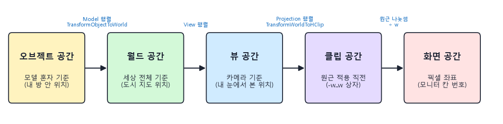

# Day 02. 좌표 공간 여행 — 점은 어떻게 화면에 찍힐까

> ⏱ **약 1시간** — 읽기 25분 · 코드 따라 읽기 20분 · 해보기 15분
> 🧸 **오늘의 비유**: 좌표 공간은 **주소 체계**, 행렬은 **주소를 바꿔 주는 기계**예요.

## 오늘 배울 것

- [ ] 오브젝트·월드·뷰·클립·화면 공간이 각각 무엇인지 안다
- [ ] 행렬이 "점을 옮기는 기계"라는 걸 이해한다
- [ ] `w`가 "멀리 있는 걸 작게 만드는 숫자"라는 걸 안다
- [ ] 코드의 변수 이름 끝(`OS`, `WS`, `CS`)을 읽을 수 있다

---

## 1. 같은 장소, 다른 주소

내 책상 위에 연필이 있어요. 이 연필의 위치를 말하는 방법은 여러 가지예요.

| 말하는 방법 | 예 | 셰이더 용어 | 코드 접미사 |
|---|---|---|---|
| 내 방 기준 | "책상 왼쪽 모서리에서 10cm" | **오브젝트 공간** (Object Space) | `OS` |
| 도시 지도 기준 | "서울시 ○○동 123번지 2층" | **월드 공간** (World Space) | `WS` |
| 내 눈 기준 | "내 눈에서 앞으로 50cm, 왼쪽 20cm" | **뷰 공간** (View Space) | `VS` |
| 카메라 뷰파인더 기준 | "사진 틀 안에서 왼쪽 위쯤" | **클립 공간** (Clip Space) | `CS` |
| 모니터 기준 | "가로 812번째, 세로 403번째 칸" | **화면 공간** (Screen Space) | — |

연필은 움직이지 않았어요. **주소를 쓰는 방식만** 바뀌었죠. 버텍스 셰이더가 하는 일이 바로 이거예요. 모델 파일에 적힌 "내 방 기준 주소"를 "모니터 몇 번째 칸"으로 바꿔요.




이 셰이더 패키지의 코드는 **변수 이름 끝 두 글자로 어느 동네 주소인지** 알려 줘요. `positionOS`는 오브젝트 공간 위치, `normalWS`는 월드 공간 노멀, `positionCS`는 클립 공간 위치예요. 이 규칙만 알아도 코드가 절반은 읽혀요.


## 2. 행렬 = 점을 옮기는 기계

주소를 바꾸려면 **이동**(옮기기), **회전**(돌리기), **크기**(키우기·줄이기)를 해야 해요. 행렬은 이 세 가지를 **한 번에** 해 주는 기계예요.


- 같은 집 모양을 기계에 넣으면 이동·회전·크기가 바뀐 집이 나와요.
- 기계 여러 대를 **이어 붙일 수** 있어요. 이어 붙이는 것 = **행렬 곱셈**이에요.
- 그래서 "오브젝트→월드" 기계 + "월드→뷰" 기계 + "뷰→클립" 기계를 미리 하나로 합쳐 두면, 점마다 기계를 한 번만 통과시키면 돼요.

Unity가 미리 만들어 주는 기계들이에요.

| 기계 (행렬) | 하는 일 | URP 함수 |
|---|---|---|
| Model (`UNITY_MATRIX_M`) | 오브젝트 → 월드 | `TransformObjectToWorld()` |
| View (`UNITY_MATRIX_V`) | 월드 → 뷰 | `TransformWorldToView()` |
| Projection (`UNITY_MATRIX_P`) | 뷰 → 클립 | — |
| View × Projection (`UNITY_MATRIX_VP`) | 월드 → 클립 | `TransformWorldToHClip()` |
| 전부 합친 것 | 오브젝트 → 클립 | `TransformObjectToHClip()` |


수학을 몰라도 함수 이름만 보면 돼요. `Transform A To B` = "A 동네 주소를 B 동네 주소로 바꿔 줘". `HClip`의 H는 Homogeneous(동차)의 약자예요. 바로 아래 `w` 이야기예요.


## 3. 네 번째 숫자 `w` — 멀리 있는 건 작게

3D 위치는 `(x, y, z)` 세 숫자인데, 클립 공간에서는 **`(x, y, z, w)` 네 숫자**를 써요.

비유하자면 `w`는 **"이 점이 카메라에서 얼마나 멀리 있나" 메모**예요. GPU는 마지막에 `x`와 `y`를 `w`로 나눠요(**원근 나눗셈**).

- 가까운 점: `w`가 작음 → 나누면 큰 숫자 → 화면 가장자리까지 퍼짐 → **크게 보임**
- 먼 점: `w`가 큼 → 나누면 작은 숫자 → 화면 가운데로 모임 → **작게 보임**

기찻길이 멀어질수록 한 점으로 모이는 것과 같아요. 나눗셈이 끝나면 화면은 `x`, `y` 모두 **-1부터 +1까지**인 상자가 돼요. 이걸 **NDC**(정규화 장치 좌표)라고 해요.


`w`는 Day 13(외곽선 두께를 픽셀로 고정하기)에서 아주 중요하게 다시 나와요. "나중에 `w`로 나눠질 거니까, 미리 `w`를 곱해 두면 거리와 상관없이 일정한 크기가 된다" — 이 한 문장을 기억해 두세요.


## 4. 노멀은 다르게 옮겨야 해요

**노멀**(normal)은 표면이 바라보는 방향이에요. 해바라기 얼굴이 향하는 방향이라고 생각하세요. 노멀은 위치가 아니라 **방향**이라서 옮기는 방법이 조금 달라요. 물체를 한쪽으로만 납작하게 누르면(비균등 스케일) 위치용 기계로는 노멀이 비뚤어져요.

그래서 URP는 노멀 전용 함수 `TransformObjectToWorldNormal()`을 따로 줘요. 우리는 그 함수를 쓰기만 하면 돼요.

## 5. 실제 코드 읽기

### ① 캐릭터 버텍스 셰이더

[CharacterToon.shader L272–283](https://github.com/JJH0204/GitBook/blob/main/GameDev/toon-shader-study/source/CharacterToon/Shaders/CharacterToon.shader#L272-L283)

```hlsl
Varyings vert(Attributes input)
{
    Varyings o = (Varyings)0;
    VertexPositionInputs p = GetVertexPositionInputs(input.positionOS.xyz);  // 오브젝트 주소를 넣으면
    VertexNormalInputs   n = GetVertexNormalInputs(input.normalOS);
    o.positionCS = p.positionCS;   // 클립 주소 (화면에 찍을 위치)
    o.positionWS = p.positionWS;   // 월드 주소 (빛 계산용으로 챙겨 둠)
    o.normalWS   = n.normalWS;     // 월드 노멀
    o.uv = TRANSFORM_TEX(input.uv, _BaseMap);
    o.fogFactor = (half)ComputeFogFactor(p.positionCS.z);
    return o;
}
```

`GetVertexPositionInputs`는 오브젝트 주소 하나를 넣으면 월드·뷰·클립 주소를 **한꺼번에** 만들어 주는 URP 도우미예요. 버텍스 셰이더의 **필수 임무**는 `positionCS`(클립 주소)를 돌려주는 것 하나뿐이에요. 나머지(`positionWS`, `normalWS`, `uv`)는 프래그먼트 셰이더가 쓰라고 챙겨 주는 거예요.

### ② 제일 짧은 버텍스 셰이더

[CharacterToon.shader L850–856](https://github.com/JJH0204/GitBook/blob/main/GameDev/toon-shader-study/source/CharacterToon/Shaders/CharacterToon.shader#L850-L856) (DepthOnly 패스)

```hlsl
o.positionCS = TransformObjectToHClip(input.positionOS.xyz);   // 오브젝트 → 클립, 한 방에
```

깊이만 기록하는 패스라 다른 건 필요 없어요. 기계 전체를 한 번에 통과시켜요.

### ③ 하늘: 월드 공간에서 방향 구하기

[SceneToon_Sky.shader L47–49](https://github.com/JJH0204/GitBook/blob/main/GameDev/toon-shader-study/source/SceneToon/Shaders/SceneToon_Sky.shader#L47-L49)

```hlsl
float3 posWS = TransformObjectToWorld(input.positionOS.xyz);   // 오브젝트 → 월드
o.positionCS = TransformWorldToHClip(posWS);                   // 월드 → 클립
o.dirWS = posWS - _WorldSpaceCameraPos;                        // 카메라에서 이 점을 향하는 화살표
```

**같은 동네(월드) 주소끼리 빼면 화살표(방향)** 가 나와요. "우리 집 주소 − 학교 주소 = 학교에서 우리 집으로 가는 길". 하늘 셰이더는 이 화살표가 위를 향하는지 아래를 향하는지로 색을 정해요(Day 03).

### ④ 뷰 공간 노멀

[CharacterToon.shader L536–537](https://github.com/JJH0204/GitBook/blob/main/GameDev/toon-shader-study/source/CharacterToon/Shaders/CharacterToon.shader#L536-L537) (MatCap)

```hlsl
float3 normalVS = mul((float3x3)UNITY_MATRIX_V, mcN);   // 월드 노멀 → 뷰(내 눈 기준) 노멀
float2 matcapUV = normalVS.xy * 0.5 + 0.5;
```

`mul(행렬, 벡터)`가 "기계에 넣기"예요. 방향만 바꾸고 이동은 하면 안 되니까 4×4 행렬을 `(float3x3)`으로 잘라서 회전 부분만 써요. (MatCap은 Day 17에서 배워요.)

## 6. 해보기 (15분)

1. **접미사 사냥** — [CharacterToon.shader 255~330줄](https://github.com/JJH0204/GitBook/blob/main/GameDev/toon-shader-study/source/CharacterToon/Shaders/CharacterToon.shader#L255-L330)에서 `OS`, `WS`, `CS`로 끝나는 변수를 찾아 표로 정리해 보세요.

   | 변수 | 어느 동네? | 무슨 정보? |
   |---|---|---|
   | `positionOS` | 오브젝트 | 위치 |
   | … | … | … |

2. **손으로 회전** — 점 `(1, 0)`을 90° 회전하면 어디로 갈까요? (정답: `(0, 1)`) 점 `(1, 1)`은요? (정답: `(-1, 1)`)
3. **원근 나눗셈 계산** — 클립 좌표 `x = 2`, `w = 4`인 점은 NDC에서 `x = ?` (정답: 0.5, 화면 오른쪽 1/4 지점). 같은 `x = 2`라도 `w = 10`이면? (0.2, 더 가운데 = 더 멀어 보임)

## 7. 오늘의 액기스

👉 [ESSENCE.md — Day 02](essence.md#day-02)

## 수학 참고 자료

- 🎥 [3Blue1Brown — 벡터란 무엇인가](https://www.3blue1brown.com/lessons/vectors) · [선형 변환과 행렬](https://www.3blue1brown.com/lessons/linear-transformations) · [행렬 곱셈 = 변환 이어 붙이기](https://www.3blue1brown.com/lessons/matrix-multiplication) — 영상으로 보면 "행렬 = 기계"가 바로 이해돼요. (YouTube 한국어 자막 있음)
- [위키백과 — 행렬 곱셈](https://ko.wikipedia.org/wiki/%ED%96%89%EB%A0%AC_%EA%B3%B1%EC%85%88) · [동차좌표](https://ko.wikipedia.org/wiki/%EB%8F%99%EC%B0%A8%EC%A2%8C%ED%91%9C)
- [LearnOpenGL — Transformations](https://learnopengl.com/Getting-started/Transformations) · [Coordinate Systems](https://learnopengl.com/Getting-started/Coordinate-Systems) — 좌표 공간 여행을 그림으로 설명해요. (영어)
- [Catlike Coding — Rendering 1: Matrices](https://catlikecoding.com/unity/tutorials/rendering/part-1/) — Unity에서 행렬을 직접 만들어 보는 튜토리얼 (영어)
- [Wikipedia — Transformation matrix](https://en.wikipedia.org/wiki/Transformation_matrix) · [Homogeneous coordinates](https://en.wikipedia.org/wiki/Homogeneous_coordinates) (영어)

---

[← Day 01](day01-what-is-a-shader.md) · [목차](README.md) · [다음: Day 03 →](day03-shaderlab-skeleton.md)
