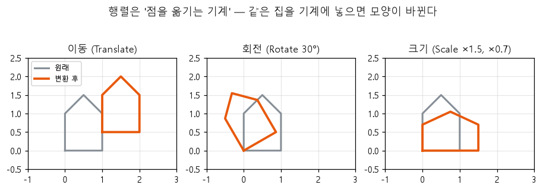

# Day 02. 좌표 공간 여행 — 점은 어떻게 화면에 찍힐까

## 작업 식별

| 항목 | 내용 |
|---|---|
| Task ID | GMD-TSS-003-DO |
| 유형 | D&O (개념) + 코드 읽기 |
| 목적 | 오브젝트, 월드, 뷰, 클립, NDC, 화면 공간의 순서와 변환 행렬, 동차좌표 `w`를 설명하고 `vert()` 코드를 읽는다 |
| 소요 시간 | 약 1시간 (읽기 25분, 코드 읽기 20분, 실습 15분) |
| 선수 지식 | [Day 01](day01-what-is-a-shader.md) |
| 확인 상태 | 미검증 (소스를 읽고 작성했으며 Unity에서 컴파일·실행하지 않았다) |
| 개정 | R1 (2026-11-18) |

비유: 좌표 공간은 주소 체계이고, 행렬은 주소를 바꾸는 기계다.

## 학습 목표

- [ ] 오브젝트, 월드, 뷰, 클립, 화면 공간이 각각 무엇인지 안다
- [ ] 행렬이 점을 옮기는 기계라는 것을 이해한다
- [ ] `w`가 원근 나눗셈에 쓰이는 값이라는 것을 안다
- [ ] 코드의 변수 이름 끝(`OS`, `WS`, `CS`)을 읽을 수 있다

## 1. 정의


NOTE: 좌표 공간(space)은 같은 점의 위치를 표현하는 기준 좌표계다. 점은 움직이지 않고 표기 방식만 바뀐다. 버텍스 셰이더의 핵심 임무는 모델 파일의 오브젝트 공간 좌표를 클립 공간 좌표로 바꾸는 것이다.


변환 순서는 다음과 같다.

```
Object → World → View → Clip → NDC → Screen
```


## 2. 구성 요소

| 공간 | 기준 | 예 (연필) | 코드 접미사 | 변환 수행자 |
|---|---|---|---|---|
| 오브젝트(Object) | 모델 자신의 원점 | 책상 왼쪽 모서리에서 10cm | `OS` | 메시 데이터 그대로 |
| 월드(World) | 씬 전체의 원점 | 도시 지도의 주소 | `WS` | Model 행렬 |
| 뷰(View) | 카메라 원점·방향 | 내 눈에서 앞 50cm, 왼쪽 20cm | `VS` | View 행렬 |
| 클립(Clip) | 카메라 절두체 | 뷰파인더 안의 위치 | `CS` | Projection 행렬 |
| NDC | `w`로 나눈 정규화 좌표 | 정규화된 사진 틀 | - | GPU (원근 나눗셈) |
| 화면(Screen) | 렌더 타깃 픽셀 | 가로 812번째, 세로 403번째 | - | GPU (뷰포트 변환) |


NOTE: 이 패키지는 변수 이름 끝 두 글자로 소속 공간을 표시한다. `positionOS`는 오브젝트 공간 위치, `normalWS`는 월드 공간 노멀, `positionCS`는 클립 공간 위치다.


Unity가 제공하는 행렬과 URP 변환 함수는 다음과 같다.

| 행렬 | 변환 | URP 함수 |
|---|---|---|
| Model (`UNITY_MATRIX_M`) | 오브젝트 → 월드 | `TransformObjectToWorld()` |
| View (`UNITY_MATRIX_V`) | 월드 → 뷰 | `TransformWorldToView()` |
| Projection (`UNITY_MATRIX_P`) | 뷰 → 클립 | - |
| View × Projection (`UNITY_MATRIX_VP`) | 월드 → 클립 | `TransformWorldToHClip()` |
| Projection × View × Model | 오브젝트 → 클립 | `TransformObjectToHClip()` |

`TransformAToB` 형식의 함수는 "A 공간 값을 B 공간 값으로 바꾼다"는 뜻이다. `HClip`의 H는 Homogeneous(동차)다.


CAUTION: `mul(UNITY_MATRIX_MVP, v)`는 Built-in 파이프라인 시절의 구형 방식이며 URP·SRP에서는 `UNITY_MATRIX_MVP`를 직접 쓰지 않는다. `TransformObjectToHClip()`을 쓴다. 행렬을 직접 곱하는 코드는 사용 중인 URP 버전에서 동작을 확인한다.


## 3. 동작 원리

### 3.1 행렬 곱 순서

HLSL의 `mul(M, v)`는 열벡터(`v`가 오른쪽) 관례를 쓴다. 변환은 오른쪽에서 왼쪽으로 적용되므로 합성은 `P * V * M` 순서다.

| 식 | 의미 |
|---|---|
| `posWS = mul(M, float4(posOS, 1))` | 오브젝트 → 월드 |
| `posCS = mul(P, mul(V, posWS))` | 월드 → 뷰 → 클립 |
| `posCS = mul(VP, posWS)` | 합쳐 둔 행렬 한 번으로 월드 → 클립 |

위치 벡터는 `w = 1`, 방향 벡터는 `w = 0`으로 4성분을 만들어 곱한다. `w = 0`이면 행렬의 이동 성분이 적용되지 않는다. 합쳐 둔 행렬을 쓰면 정점마다 행렬 곱 한 번으로 끝난다.

비유: 이동, 회전, 크기 변환을 한 번에 처리하는 기계를 여러 대 이어 붙이는 것이 행렬 곱셈이다.



### 3.2 동차좌표 `w`와 원근 나눗셈

클립 공간 좌표는 `(x, y, z, w)` 4성분이다. GPU는 버텍스 셰이더 이후 클리핑을 하고 `x, y, z`를 `w`로 나눈다(원근 나눗셈).

```
NDC = (x/w, y/w, z/w)
```

| 대상 | 가까운 점 | 먼 점 |
|---|---|---|
| `w` (카메라와의 깊이에 대응) | 작다 | 크다 |
| `x/w` | 크다 (화면 가장자리까지 퍼짐) | 작다 (화면 가운데로 모임) |
| 화면에서 | 크게 보인다 | 작게 보인다 |

- 클립 공간에서 화면 안에 들어오는 조건: `-w <= x <= w`, `-w <= y <= w`.
- NDC의 `x, y` 범위는 `-1 ~ +1`이다.
- NDC의 `z` 범위와 clip `z` 범위는 플랫폼에 따라 다르다.

| 그래픽 API | clip z 범위 | NDC z 범위 | 깊이 방향 |
|---|---|---|---|
| Direct3D, Metal, Vulkan (Unity 기준) | `0 ~ w` | 0 ~ 1 | reversed-Z: near = 1, far = 0 |
| OpenGL, OpenGL ES | `-w ~ w` | -1 ~ 1 | near = -1, far = 1 (Unity는 Reversed-Z 미사용) |


NOTE: Unity는 `UNITY_REVERSED_Z` 매크로로 reversed-Z 플랫폼을 구분한다. 깊이를 직접 비교하거나 선형화하는 코드는 이 매크로와 `_ProjectionParams`(`x` = 1 또는 -1 뒤집힘 여부, `y` = near, `z` = far, `w` = 1/far)의 사용법을 URP·Unity 버전별 매뉴얼에서 확인한다. 이 자료의 `ComputeFogFactor(positionCS.z)` 같은 호출은 URP 내부에서 플랫폼 차이를 처리한다.


NDC 이후 GPU는 뷰포트 변환으로 `x, y`를 렌더 타깃 픽셀 좌표(화면 공간)로 바꾼다.


NOTE: Day 13(외곽선 두께 고정)에서 `w`가 다시 나온다. 나중에 `w`로 나눠지므로 미리 `w`를 곱해 두면 거리와 무관하게 일정한 화면 크기가 된다.


### 3.3 노멀 변환

노멀은 위치가 아니라 방향이다. 비균등 스케일(한 축만 늘리거나 줄임)이 있으면 위치용 행렬로 변환한 노멀이 표면에 수직이 아니게 된다. 수학적으로는 모델 행렬의 역전치 행렬을 쓴다. URP는 `TransformObjectToWorldNormal()`이 이를 처리하므로 노멀에는 이 함수를 쓴다.

## 4. 코드 읽기

### 4.1 캐릭터 버텍스 셰이더

[CharacterToon.shader L272–283](https://github.com/JJH0204/GitBook/blob/main/GameDev/toon-shader-study/source/CharacterToon/Shaders/CharacterToon.shader#L272-L283)

```hlsl
Varyings vert(Attributes input)
{
    Varyings o = (Varyings)0;
    VertexPositionInputs p = GetVertexPositionInputs(input.positionOS.xyz);  // 오브젝트 주소를 넣으면
    VertexNormalInputs   n = GetVertexNormalInputs(input.normalOS);
    o.positionCS = p.positionCS;   // 클립 주소 (화면에 찍을 위치)
    o.positionWS = p.positionWS;   // 월드 주소 (빛 계산용으로 챙겨 둠)
    o.normalWS   = n.normalWS;     // 월드 노멀
    o.uv = TRANSFORM_TEX(input.uv, _BaseMap);
    o.fogFactor = (half)ComputeFogFactor(p.positionCS.z);
    return o;
}
```

| 대상 | 설명 |
|---|---|
| `GetVertexPositionInputs` | 오브젝트 위치 하나로 월드, 뷰, 클립 위치를 한 번에 만드는 URP 함수 |
| `positionCS` | 버텍스 셰이더의 필수 출력 |
| `positionWS`, `normalWS`, `uv` | 프래그먼트 셰이더가 쓰도록 전달하는 값 |
| `ComputeFogFactor` | 클립 `z`에서 안개 계수를 계산 (플랫폼 차이는 URP가 처리) |

### 4.2 가장 짧은 버텍스 셰이더

[CharacterToon.shader L850–856](https://github.com/JJH0204/GitBook/blob/main/GameDev/toon-shader-study/source/CharacterToon/Shaders/CharacterToon.shader#L850-L856) (DepthOnly 패스)

```hlsl
o.positionCS = TransformObjectToHClip(input.positionOS.xyz);   // 오브젝트 → 클립, 한 방에
```

깊이만 기록하는 패스라 다른 값이 필요 없다.

### 4.3 하늘: 월드 공간에서 방향 구하기

[SceneToon_Sky.shader L47–49](https://github.com/JJH0204/GitBook/blob/main/GameDev/toon-shader-study/source/SceneToon/Shaders/SceneToon_Sky.shader#L47-L49)

```hlsl
float3 posWS = TransformObjectToWorld(input.positionOS.xyz);   // 오브젝트 → 월드
o.positionCS = TransformWorldToHClip(posWS);                   // 월드 → 클립
o.dirWS = posWS - _WorldSpaceCameraPos;                        // 카메라에서 이 점을 향하는 화살표
```

같은 공간(월드)의 위치끼리 빼면 방향 벡터가 나온다. 하늘 셰이더는 이 방향이 위인지 아래인지로 색을 정한다(Day 03).

### 4.4 뷰 공간 노멀

[CharacterToon.shader L536–537](https://github.com/JJH0204/GitBook/blob/main/GameDev/toon-shader-study/source/CharacterToon/Shaders/CharacterToon.shader#L536-L537) (MatCap)

```hlsl
float3 normalVS = mul((float3x3)UNITY_MATRIX_V, mcN);   // 월드 노멀 → 뷰(내 눈 기준) 노멀
float2 matcapUV = normalVS.xy * 0.5 + 0.5;
```

방향은 이동을 적용하면 안 되므로 4×4 행렬을 `(float3x3)`으로 잘라 회전 성분만 쓴다. 뷰 행렬이 비균등 스케일을 포함하지 않으므로 이 방식이 성립한다. MatCap은 Day 17에서 다룬다.

## 5. 주의


CAUTION: 4성분을 만들 때 위치는 `w = 1`, 방향은 `w = 0`이다. 위치 변환에 `w = 0`을 쓰면 이동이 빠지고, 방향 변환에 `w = 1`을 쓰면 방향이 이동 성분에 오염된다.



NOTE: URP 버전과 설정(카메라 상대 렌더링 등)에 따라 월드 공간의 정의나 `_WorldSpaceCameraPos` 사용 방식이 달라질 수 있다. 사용 중인 URP 버전의 문서를 확인한다.


## 6. 실습 (15분)

1. [CharacterToon.shader 255~330줄](https://github.com/JJH0204/GitBook/blob/main/GameDev/toon-shader-study/source/CharacterToon/Shaders/CharacterToon.shader#L255-L330)에서 `OS`, `WS`, `CS`로 끝나는 변수를 찾아 표로 정리한다. → 결과: 변수, 소속 공간, 정보(위치/노멀)를 적은 표가 만들어진다. 예: `positionOS` / 오브젝트 / 위치.
2. 2D에서 점 `(1, 0)`을 90° 회전한다. → 결과: `(0, 1)`. 점 `(1, 1)`은 `(-1, 1)`이다.
3. 클립 좌표 `x = 2`, `w = 4`의 NDC `x`를 계산한다. → 결과: 0.5. 같은 `x = 2`에서 `w = 10`이면 0.2이며 더 가운데에 가까워 멀리 있는 점으로 보인다.
4. 같은 점이 OpenGL이면 clip `z`가 `-w ~ w`, Direct3D 계열이면 `0 ~ w`인 이유를 3.2절 표로 확인한다. → 결과: NDC `z` 범위가 플랫폼별로 다르다는 것을 표에서 찾는다.

오늘의 요약: [essence.md — Day 02](essence.md#day-02)

## 7. 참조

- 영상: [3Blue1Brown — 벡터](https://www.3blue1brown.com/lessons/vectors), [선형 변환과 행렬](https://www.3blue1brown.com/lessons/linear-transformations), [행렬 곱셈](https://www.3blue1brown.com/lessons/matrix-multiplication)
- [위키백과 — 행렬 곱셈](https://ko.wikipedia.org/wiki/%ED%96%89%EB%A0%AC_%EA%B3%B1%EC%85%88), [동차좌표](https://ko.wikipedia.org/wiki/%EB%8F%99%EC%B0%A8%EC%A2%8C%ED%91%9C)
- [LearnOpenGL — Transformations](https://learnopengl.com/Getting-started/Transformations), [Coordinate Systems](https://learnopengl.com/Getting-started/Coordinate-Systems) (영어)
- [Catlike Coding — Rendering 1: Matrices](https://catlikecoding.com/unity/tutorials/rendering/part-1/) (영어)
- [Wikipedia — Transformation matrix](https://en.wikipedia.org/wiki/Transformation_matrix), [Homogeneous coordinates](https://en.wikipedia.org/wiki/Homogeneous_coordinates) (영어)

## 내 말로 채우기


AI 없이 답을 적는다. 다 쓰면 체크하고, 이 안내는 지워도 된다.


- [ ] 오브젝트 공간에서 화면 공간까지 6단계를 순서대로 적고, 각 단계를 바꾸는 주체(행렬 또는 GPU)를 적는다
- [ ] 같은 크기의 물체가 멀어지면 작게 보이는 이유를 `w`로 설명한다
- [ ] 위치와 노멀을 변환할 때 달라지는 점을 내 말로 적는다

---

[← Day 01](day01-what-is-a-shader.md) · [목차](README.md) · [다음: Day 03 →](day03-shaderlab-skeleton.md)
