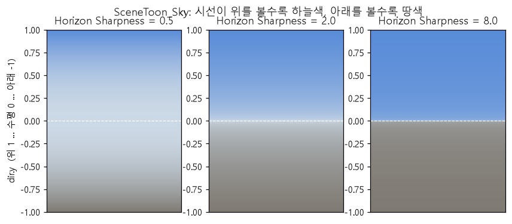

# Day 03. 셰이더 파일의 뼈대 — 하늘 셰이더 통째로 읽기

> ⏱ **약 1시간** — 읽기 20분 · 코드 통째로 읽기 25분 · 해보기 15분
> 🧸 **오늘의 비유**: `.shader` 파일은 **요리책 한 권**이에요.

## 오늘 배울 것

- [ ] `Shader` / `Properties` / `SubShader` / `Pass` / `HLSLPROGRAM`의 역할을 안다
- [ ] `Tags`의 `LightMode`가 "언제 불러 주세요" 이름표라는 걸 안다
- [ ] `Cull`, `ZWrite`, `ZTest`, `Blend` 같은 렌더 스테이트를 읽을 수 있다
- [ ] 70줄짜리 하늘 셰이더를 처음부터 끝까지 설명할 수 있다

---

## 1. 요리책의 구조

Unity 셰이더 파일은 두 가지 언어가 섞여 있어요.

- **ShaderLab** — Unity 전용 "요리책 형식". 책 제목, 재료 목록, 조리 단계 구분을 적어요.
- **HLSL** — GPU가 실제로 실행하는 "조리법". `HLSLPROGRAM`과 `ENDHLSL` 사이에만 있어요.

```shaderlab
Shader "책 제목"                    // 머티리얼 드롭다운에 보이는 이름
{
    Properties { ... }              // 재료 목록 = 머티리얼 인스펙터의 칸들
    SubShader                       // "이 주방(URP)용 레시피"
    {
        Tags { ... }                // 레시피 전체에 붙는 이름표
        Pass                        // 조리 단계 하나 = 화면에 한 번 그리기
        {
            Name "..."  Tags { "LightMode" = "..." }   // "이 단계는 언제 불러 주세요"
            Cull / ZWrite / Blend ...                    // 그리기 규칙 (렌더 스테이트)
            HLSLPROGRAM
                ... GPU 코드 ...
            ENDHLSL
        }
        Pass { ... }                // 단계가 여러 개일 수 있어요
    }
    CustomEditor "..."              // 인스펙터 화면을 꾸미는 C# 클래스
    FallBack "..."                  // 이 레시피를 못 쓰면 대신 쓸 레시피
}
```

## 2. 하늘 셰이더 통째로 읽기

[SceneToon_Sky.shader](https://github.com/JJH0204/GitBook/blob/main/GameDev/toon-shader-study/source/SceneToon/Shaders/SceneToon_Sky.shader)는 70줄뿐이라 처음 읽기에 딱 좋아요. 위에서부터 같이 읽어 봐요.

### ① 제목과 재료 (L1–13)

```shaderlab
Shader "com.blueigloo/SceneToon/Sky"
{
    Properties
    {
        [HDR] _SkyZenithColor  ("Zenith Color (위)",   Color) = (0.35,0.55,0.85,1)
        [HDR] _SkyHorizonColor ("Horizon Color (수평)", Color) = (0.8,0.85,0.9,1)
        [HDR] _SkyGroundColor  ("Ground Color (아래)",  Color) = (0.5,0.48,0.45,1)
        _SkyHorizonSharp ("Horizon Sharpness", Range(0.1,8)) = 2.0
        _SkyExposure ("Exposure", Range(0,4)) = 1.0
    }
```

재료 한 줄은 이렇게 읽어요.

```
[꾸밈] 변수이름 ("인스펙터에 보일 이름", 종류) = 기본값
```

- `Color` → 색 고르는 칸, `Range(0.1, 8)` → 0.1~8 슬라이더, `Float` → 숫자 칸, `2D` → 텍스처 칸
- `[HDR]` → 1보다 밝은 색(빛나는 색)도 고를 수 있게 해 줘요.
- 변수 이름은 관례상 `_`로 시작해요.

### ② 레시피 이름표 (L15–17)

```shaderlab
SubShader
{
    Tags { "RenderPipeline" = "UniversalPipeline" "RenderType" = "Background" "Queue" = "Background" }
```

- `RenderPipeline = UniversalPipeline` → "URP 주방에서만 쓰는 레시피예요"
- `Queue = Background` → **그리는 순서**. 하늘은 제일 먼저(제일 뒤에) 그려요. 숫자로는 Background=1000, Geometry(보통 물체)=2000, Transparent(투명)=3000이에요.

### ③ 조리 단계와 그리기 규칙 (L19–25)

```shaderlab
Pass
{
    Name "SceneSky"
    Tags { "LightMode" = "UniversalForwardOnly" }
    ZWrite Off
    Cull Off
```

- `LightMode = UniversalForwardOnly` → "URP가 **색칠 단계**에서 이 패스를 불러 주세요."
- `ZWrite Off` → **깊이 기록을 안 해요**. 하늘은 무한히 먼 배경이니까 다른 물체를 가리면 안 되죠.
- `Cull Off` → 앞면·뒷면 **모두** 그려요. 하늘 돔(큰 공)의 **안쪽**에서 바라보니까 뒷면도 그려야 보여요.

### ④ GPU 코드 (L27–65)

```hlsl
HLSLPROGRAM
#pragma vertex vert          // 버텍스 셰이더 = vert 함수
#pragma fragment frag        // 프래그먼트 셰이더 = frag 함수
#include "Packages/com.unity.render-pipelines.universal/ShaderLibrary/Core.hlsl"   // URP 공구함

CBUFFER_START(UnityPerMaterial)   // 머티리얼 재료 값 상자 (Day 04, Day 20)
    half4 _SkyZenithColor;
    ...
CBUFFER_END
```

`Properties`에 적은 재료를 HLSL에서 쓰려면 **같은 이름으로 한 번 더** 선언해야 해요. Properties는 "인스펙터에 칸 만들기", CBUFFER는 "GPU에게 그 값 넘기기"예요.

```hlsl
half4 frag(Varyings input) : SV_TARGET
{
    half3 dir = normalize(input.dirWS);   // 카메라에서 이 픽셀로 향하는 방향 (길이 1)
    half h = dir.y;                       // 위로 얼마나 향했나: -1(바로 아래) ~ 1(바로 위)
    half up   = saturate(pow(saturate( h), 1.0h / _SkyHorizonSharp));   // 위쪽 정도
    half down = saturate(pow(saturate(-h), 1.0h / _SkyHorizonSharp));   // 아래쪽 정도
    half3 col = _SkyHorizonColor.rgb;                  // 수평선 색에서 시작해서
    col = lerp(col, _SkyZenithColor.rgb, up);          // 위를 볼수록 하늘색 섞기
    col = lerp(col, _SkyGroundColor.rgb, down);        // 아래를 볼수록 땅색 섞기
    return half4(col * _SkyExposure, 1.0h);
}
```

처음 보는 함수가 셋 있어요.

| 함수 | 비유 | 예 |
|---|---|---|
| `saturate(x)` | 0~1 울타리. 넘치면 잘라요 | `saturate(1.3) = 1`, `saturate(-0.2) = 0` |
| `pow(x, n)` | x를 n번 곱하기 | `pow(0.5, 2) = 0.25` |
| `lerp(a, b, t)` | **물감 섞기**. t=0이면 a, t=1이면 b, 0.3이면 a 70% + b 30% | `lerp(0, 10, 0.3) = 3` |



`_SkyHorizonSharp`를 키우면 `1/sharp` 지수가 작아지고, `pow`가 0 근처 값을 금방 1로 끌어올려요. 그래서 수평선 띠가 **얇고 또렷**해져요. 위 그림의 오른쪽(8.0)이 그 모습이에요.

### ⑤ 끝 (L69)

```shaderlab
FallBack "Hidden/Universal Render Pipeline/FallbackError"
```

못 그리면 분홍색(마젠타) 에러 셰이더로 그려서 "뭔가 잘못됐어요!"라고 알려 줘요.

## 3. 그리기 규칙(렌더 스테이트) 모음

캐릭터 셰이더의 색칠 패스 머리는 이래요. [CharacterToon.shader L197–206](https://github.com/JJH0204/GitBook/blob/main/GameDev/toon-shader-study/source/CharacterToon/Shaders/CharacterToon.shader#L197-L206)

```shaderlab
Pass
{
    Name "ForwardToon"
    Tags { "LightMode" = "UniversalForwardOnly" }
    Cull [_Cull]
    Blend [_SrcBlend] [_DstBlend]
    ZWrite [_ZWrite]
    ZTest [_ZTestMode]
    Stencil { Ref [_StencilRef] Comp [_StencilComp] Pass [_StencilPass] }
```

`[_Cull]`처럼 **대괄호 안에 프로퍼티 이름**을 쓰면 값을 머티리얼에서 정할 수 있어요.

| 규칙 | 비유 | 값 |
|---|---|---|
| `Cull` | 종이 인형의 **앞면만/뒷면만/양면** 칠하기 | Back(기본, 앞면만) / Front / Off(양면) |
| `ZWrite` | "내가 여기 있다"고 **깊이 메모장에 적을까** | On / Off |
| `ZTest` | 메모장과 비교해서 **앞에 있을 때만** 칠하기 | LEqual(기본) / Always / Equal … |
| `Blend` | 이미 칠해진 색과 **섞는 방법** (투명) | One Zero(덮어쓰기) / SrcAlpha OneMinusSrcAlpha(반투명) |
| `Stencil` | **도장 찍힌 곳만** 칠하기 (Day 18) | Ref / Comp / Pass |
| `ColorMask` | 어떤 색 채널에 쓸지 | 0(아무 색도 안 씀), R, RG … |

## 4. 캐릭터 셰이더의 패스 6개

[CharacterToon.shader](https://github.com/JJH0204/GitBook/blob/main/GameDev/toon-shader-study/source/CharacterToon/Shaders/CharacterToon.shader)에는 패스가 6개 있어요. URP가 각자의 `LightMode` 이름표를 보고 **알맞은 순간에** 불러요.

| 패스 이름 | LightMode | 언제 불리나 | 배우는 날 |
|---|---|---|---|
| ForwardToon | `UniversalForwardOnly` | 색칠할 때 | Day 06–17 |
| Outline | `SRPDefaultUnlit` | 색칠 직후 덤으로 한 번 더 | Day 12–13 |
| ShadowCaster | `ShadowCaster` | 그림자 지도 만들 때 | Day 08 |
| DepthOnly | `DepthOnly` | 깊이 지도 만들 때 | Day 18 |
| DepthNormals | `DepthNormals` | 깊이+노멀 지도 만들 때 (SSAO 등) | Day 18 |
| MotionVectors | `MotionVectors` | 움직임 지도 만들 때 (모션 블러, TAA) | Day 18 |


`UniversalForwardOnly`인 이유는 [L190–196 주석](https://github.com/JJH0204/GitBook/blob/main/GameDev/toon-shader-study/source/CharacterToon/Shaders/CharacterToon.shader#L190-L196)에 있어요. 렌더러를 Deferred로 바꿔도 이 캐릭터는 Forward로 올바르게 그려지게 하려는 선택이에요.


## 5. Properties의 꾸밈말들

[CharacterToon.shader L5–184](https://github.com/JJH0204/GitBook/blob/main/GameDev/toon-shader-study/source/CharacterToon/Shaders/CharacterToon.shader#L5-L184)에서 찾아보세요.

| 꾸밈말 | 하는 일 | 예 (줄) |
|---|---|---|
| `[Header(글자)]` | 인스펙터에 제목 줄 | `[Header(Base)]` L17 |
| `[HideInInspector]` | 인스펙터에서 숨김 (코드만 씀) | `_SrcBlend` L10 |
| `[Enum(이름,값,...)]` | 드롭다운 | `_Surface` L9 |
| `[Toggle(키워드)]` | 체크박스 + **키워드 켜기** (Day 19) | `_ALPHATEST_ON` L21 |
| `[ToggleUI]` | 체크박스만 (키워드 없음) | `_UseShadowMask` L50 |
| `[KeywordEnum(...)]` | 드롭다운 + 키워드 | `_Part` L54 |
| `[Normal]` | 노멀맵 전용 텍스처 칸 | `_BumpMap` L26 |
| `[IntRange]` | 정수 슬라이더 | `_StencilRef` L170 |

텍스처 기본값 `"white"`, `"black"`, `"bump"`는 **텍스처를 안 넣었을 때 쓸 색**이에요. 예를 들어 마스크의 기본값을 `"white"`(=1)로 두면 곱해도 아무 변화가 없어요. "안 넣으면 효과 없음"이 되도록 고른 거예요.

## 6. 해보기 (15분)

1. **손으로 하늘 계산** — `dir.y = 0.25`, `_SkyHorizonSharp = 2`일 때 `up`은? `pow(0.25, 0.5) = 0.5`. 그럼 최종 색은 수평선 색과 하늘 색을 50:50 섞은 색이에요.
2. **Desmos로 놀기** — [Desmos](https://www.desmos.com/calculator)에 `y = x^(1/s)`를 입력하고 `s` 슬라이더를 0.5~8로 움직여 보세요. s가 클수록 곡선이 왼쪽 위로 확 꺾이죠? 그게 "수평선 띠가 얇아진다"예요.
3. **패스 찾기** — [CharacterToon.shader](https://github.com/JJH0204/GitBook/blob/main/GameDev/toon-shader-study/source/CharacterToon/Shaders/CharacterToon.shader)에서 `Name "`을 검색해 6개 패스의 이름과 `LightMode`를 표로 적어 보세요.
4. **ColorMask 0의 의미** — ShadowCaster 패스([L759](https://github.com/JJH0204/GitBook/blob/main/GameDev/toon-shader-study/source/CharacterToon/Shaders/CharacterToon.shader#L759))는 왜 `ColorMask 0`일까요? (힌트: 그림자 지도에는 색이 필요 없고 깊이만 필요해요.)

## 7. 오늘의 액기스

👉 [ESSENCE.md — Day 03](essence.md#day-03)

## 더 읽을거리

- Unity 매뉴얼: [Shader 오브젝트](https://docs.unity3d.com/Manual/SL-Shader.html) · [Properties](https://docs.unity3d.com/Manual/SL-Properties.html) · [SubShader](https://docs.unity3d.com/Manual/SL-SubShader.html) · [Pass](https://docs.unity3d.com/Manual/SL-Pass.html)
- 렌더 스테이트: [Cull](https://docs.unity3d.com/Manual/SL-Cull.html) · [ZTest](https://docs.unity3d.com/Manual/SL-ZTest.html) · [Blend](https://docs.unity3d.com/Manual/SL-Blend.html)
- [URP에서 셰이더 쓰기](https://docs.unity3d.com/Packages/com.unity.render-pipelines.universal@17.0/manual/writing-custom-shaders-urp.html) — URP 공식 입문 (영어)
- 수학: [위키백과 — 선형 보간(lerp)](https://en.wikipedia.org/wiki/Linear_interpolation) (영어) · [Desmos 그래프 계산기](https://www.desmos.com/calculator)

---

[← Day 02](day02-coordinate-spaces.md) · [목차](README.md) · [다음: Day 04 →](day04-hlsl-basics.md)
