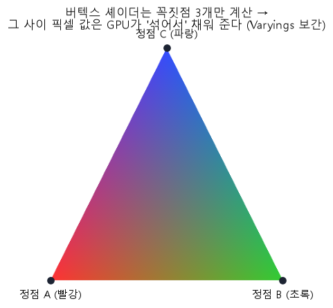

# Day 04. HLSL 문법 기초 — GPU의 말 배우기

> ⏱ **약 1시간** — 읽기 30분 · 코드 따라 읽기 15분 · 해보기 15분
> 🧸 **오늘의 비유**: `struct`는 **택배 상자**, 시맨틱은 **상자 칸의 이름표**예요.

## 오늘 배울 것

- [ ] `float` / `half` / `float3` / `half4` 같은 자료형을 읽을 수 있다
- [ ] 스위즐(`.xyz`, `.rgb`, `.xz`)로 값을 꺼낼 수 있다
- [ ] `Attributes` / `Varyings` 구조체와 시맨틱의 역할을 안다
- [ ] `#include`, `#ifndef`, `#define`, `#if defined()`를 읽을 수 있다
- [ ] 자주 나오는 내장 함수 10개를 안다

---

## 1. 숫자 상자: 자료형

| 자료형 | 비유 | 쓰는 곳 |
|---|---|---|
| `float` | 눈금이 아주 촘촘한 **정밀한 자** (32비트) | 위치, 깊이, UV처럼 정확해야 하는 값 |
| `half` | 눈금이 듬성한 **대충 자** (16비트) | 색, 노멀, 밝기처럼 0~1 근처 값. 모바일에서 더 빠름 |
| `float3`, `half3` | 숫자 **3개 묶음** | 위치 `xyz`, 색 `rgb`, 방향 |
| `float4`, `half4` | 숫자 **4개 묶음** | 색+투명도 `rgba`, 클립 좌표 `xyzw` |
| `float2` | 숫자 2개 | UV 좌표 |
| `float3x3`, `float4x4` | 숫자 표(행렬) | 좌표 변환 기계 (Day 02) |

이 셰이더 패키지는 **위치는 `float`, 색과 빛은 `half`** 규칙을 지켜요. 숫자 뒤의 `h`(예: `1.0h`, `0.5h`)는 "이건 `half` 숫자예요"라는 표시예요.

## 2. 레고 블록 꺼내기: 스위즐(Swizzle)

`float4 v = (1, 2, 3, 4);`가 있으면 점(`.`) 뒤에 글자를 붙여서 원하는 칸만 꺼낼 수 있어요.

```hlsl
v.x      // 1
v.xyz    // (1, 2, 3)
v.xz     // (1, 3)       ← 높이(y) 빼고 바닥 평면만!
v.zyx    // (3, 2, 1)    ← 순서도 바꿀 수 있어요
v.xxx    // (1, 1, 1)    ← 같은 칸을 여러 번
v.rgb    // xyz와 같아요. 색을 다룰 땐 rgba라고 쓰는 게 읽기 좋아요
```

실제 예: 얼굴 그림자는 빛을 **바닥 평면(XZ)** 에 눌러서 써요. [CharacterToon.shader L372](https://github.com/JJH0204/GitBook/blob/main/GameDev/toon-shader-study/source/CharacterToon/Shaders/CharacterToon.shader#L372)

```hlsl
float2 lightXZ = SafeNormalizeXZ(L.xz, float2(0.0, 1.0));   // 빛 방향에서 x와 z만 꺼냄
```

## 3. 택배 상자: Attributes와 Varyings

데이터는 **메시 → 버텍스 셰이더 → 프래그먼트 셰이더**로 택배처럼 전달돼요. 상자가 두 개 있어요.

[CharacterToon.shader L256–270](https://github.com/JJH0204/GitBook/blob/main/GameDev/toon-shader-study/source/CharacterToon/Shaders/CharacterToon.shader#L256-L270)

```hlsl
struct Attributes                      // 📦 상자 1: 메시 창고 → 버텍스 셰이더
{
    float4 positionOS : POSITION;      //   칸 이름표 POSITION = "정점 위치를 여기 넣어 주세요"
    float3 normalOS   : NORMAL;        //   NORMAL = "노멀"
    float2 uv         : TEXCOORD0;     //   TEXCOORD0 = "첫 번째 UV"
};

struct Varyings                        // 📦 상자 2: 버텍스 셰이더 → 프래그먼트 셰이더
{
    float4 positionCS : SV_POSITION;   //   SV_ = 시스템이 쓰는 특별 칸. 화면 위치 (필수!)
    float2 uv         : TEXCOORD0;     //   여기부터는 우리 마음대로 쓰는 칸
    float3 normalWS   : TEXCOORD1;
    float3 positionWS : TEXCOORD2;
    half   fogFactor  : TEXCOORD3;
};
```

**콜론(`:`) 뒤의 대문자가 시맨틱(이름표)** 이에요.

- `Attributes`의 이름표는 "메시의 **어떤 데이터**를 이 칸에 넣을지" 알려 줘요. `POSITION`, `NORMAL`, `TANGENT`, `COLOR`, `TEXCOORD0~7`.
- `Varyings`의 `TEXCOORD1, 2, 3…`은 그냥 **칸 번호**예요. 이름은 TEXCOORD지만 UV가 아니어도 돼요.
- 프래그먼트 함수 끝의 `: SV_TARGET`은 "이 함수가 돌려주는 값이 **최종 색**이에요"라는 뜻이에요.

### 상자 2는 "섞여서" 도착해요

버텍스 셰이더는 삼각형의 **꼭짓점 3개**에서만 실행돼요. 그런데 프래그먼트 셰이더는 그 안의 **수많은 픽셀**에서 실행되죠. 픽셀에 도착하는 `Varyings` 값은 GPU가 세 꼭짓점 값을 **거리에 따라 섞어서** 만들어 줘요. 이걸 **보간**(interpolation)이라고 해요.




길이가 1인 노멀 두 개를 섞으면 **길이가 1보다 짧아져요**. 그래서 프래그먼트 셰이더 첫머리에서 노멀을 꼭 다시 `normalize` 해요. [L302](https://github.com/JJH0204/GitBook/blob/main/GameDev/toon-shader-study/source/CharacterToon/Shaders/CharacterToon.shader#L302): `half3 N = normalize(input.normalWS);`


## 4. 전처리기: 코드를 붙이고 고르는 가위풀

`#`으로 시작하는 줄은 **컴파일 전에** 처리돼요. 코드를 자르고 붙이는 가위풀이에요.

| 명령 | 비유 | 예 |
|---|---|---|
| `#include "파일"` | **공구함 가져오기**. 그 파일 내용을 여기에 통째로 붙여 넣음 | `#include "../ShaderLibrary/ToonInput.hlsl"` |
| `#ifndef X` … `#define X` … `#endif` | **중복 방지 스티커**. "이미 가져왔으면 또 가져오지 마" | 모든 `.hlsl` 파일의 첫 두 줄과 끝 |
| `#define 이름 값` | 이름 붙인 상수 | `#define CHARACTER_EXTRA_LIGHT_MAX 3` |
| `#if defined(키워드)` … `#endif` | **스위치**. 키워드가 꺼져 있으면 이 코드는 아예 없는 것 | `#if defined(_USE_RIM)` |
| `#pragma` | 컴파일러에게 하는 부탁 | `#pragma vertex vert` |

[ToonRim.hlsl](https://github.com/JJH0204/GitBook/blob/main/GameDev/toon-shader-study/source/ToonShared/ShaderLibrary/ToonRim.hlsl)의 처음과 끝을 보면 중복 방지 스티커가 보여요.

```hlsl
#ifndef TOONSHARED_RIM_INCLUDED     // 아직 스티커가 없으면
#define TOONSHARED_RIM_INCLUDED     //   스티커를 붙이고
...                                 //   내용을 넣는다
#endif                              // 이미 있었으면 통째로 건너뜀
```

## 5. 함수 하나 통째로 읽기

[ToonRim.hlsl L10–15](https://github.com/JJH0204/GitBook/blob/main/GameDev/toon-shader-study/source/ToonShared/ShaderLibrary/ToonRim.hlsl#L10-L15) — 17줄짜리 파일의 전부예요.

```hlsl
half3 ToonRim(half3 N, half3 V, half threshold, half softness, half3 rimColor, half intensity)
{
    half fresnel = 1.0h - saturate(dot(N, V));
    half rim = smoothstep(threshold, threshold + max(softness, 1e-4h), fresnel);
    return rim * rimColor * intensity;
}
```

- 첫 줄: `돌려줄 자료형  함수이름(재료1, 재료2, ...)`
- `dot`, `saturate`, `smoothstep`, `max`는 HLSL **내장 함수**예요. (의미는 Day 06, 07, 11에서 배워요.)
- `1e-4h` = 0.0001 (half). "0이 되지 않게 아주 작은 바닥을 깔아 둔다"는 뜻이에요. 0으로 나누면 결과가 망가지거든요.
- `half3 * half3`은 **칸끼리 곱하기**예요. `(r1, g1, b1) * (r2, g2, b2) = (r1·r2, g1·g2, b1·b2)`. 색에 색을 곱하면 "필터를 씌운" 색이 돼요.

## 6. 머티리얼 값 상자: CBUFFER

[ToonInput.hlsl L34–178](https://github.com/JJH0204/GitBook/blob/main/GameDev/toon-shader-study/source/CharacterToon/ShaderLibrary/ToonInput.hlsl#L34-L178)

```hlsl
CBUFFER_START(UnityPerMaterial)
    float4 _BaseMap_ST;
    half4  _BaseColor;
    ...
CBUFFER_END
```

머티리얼의 숫자·색 값을 **한 상자에 모아** GPU에 넘겨요. 텍스처는 상자에 못 넣어서 위쪽에 따로 선언해요([L13–31](https://github.com/JJH0204/GitBook/blob/main/GameDev/toon-shader-study/source/CharacterToon/ShaderLibrary/ToonInput.hlsl#L13-L31)).


[L4–5 주석](https://github.com/JJH0204/GitBook/blob/main/GameDev/toon-shader-study/source/CharacterToon/ShaderLibrary/ToonInput.hlsl#L4-L5)에 "모든 패스가 이 파일 하나만 include 한다"고 적혀 있어요. **모든 패스의 상자 모양이 똑같아야** Unity의 SRP Batcher라는 속도 장치가 작동하거든요. 그래서 상자 내용은 이 파일 한 곳에서만 정해요. (Day 20에서 자세히)


## 7. 자주 나오는 내장 함수 10개

| 함수 | 비유 / 뜻 | 예 |
|---|---|---|
| `saturate(x)` | 0~1 울타리 | `saturate(1.5) = 1` |
| `lerp(a, b, t)` | 물감 섞기 | `lerp(a, b, 0.5)` = 반반 |
| `min(a,b)`, `max(a,b)` | 작은 쪽, 큰 쪽 | `max(x, 1e-4)` = 바닥 깔기 |
| `normalize(v)` | 화살표 길이를 1로 | Day 06 |
| `dot(a, b)` | 두 화살표가 같은 쪽을 보는 정도 | Day 06 |
| `cross(a, b)` | 두 화살표에 모두 수직인 화살표 | Day 16 |
| `pow(x, n)` | x를 n번 곱하기 | Day 03, 17 |
| `step(a, x)` | x가 a 이상이면 1, 아니면 0 (딱딱한 문턱) | Day 07 |
| `smoothstep(a, b, x)` | a~b 사이에서 부드럽게 0→1 (부드러운 문턱) | Day 07 |
| `clip(x)` | x가 0보다 작으면 **이 픽셀 버리기** | Day 05 |

## 8. 해보기 (15분)

1. **손으로 림 계산** — `dot(N, V) = 0.3`, `threshold = 0.6`, `softness = 0.05`이면 `fresnel = 0.7`이에요. 0.7은 0.6~0.65 범위를 넘으니까 `rim = 1`. 그럼 `dot(N, V) = 0.38`이면? (`fresnel = 0.62` → 0.6~0.65 사이 → 0과 1 사이의 값)
2. **상자 세기** — [ToonInput.hlsl CBUFFER](https://github.com/JJH0204/GitBook/blob/main/GameDev/toon-shader-study/source/CharacterToon/ShaderLibrary/ToonInput.hlsl#L34-L178) 안에 `half4`가 몇 개 있는지 세어 보세요.
3. **스위즐 퀴즈** — `float4 c = (0.2, 0.4, 0.6, 1.0);`일 때 `c.bgr`은? (`(0.6, 0.4, 0.2)`) `c.ww`는? (`(1.0, 1.0)`)
4. **Varyings 칸 따라가기** — `fogFactor`는 버텍스 셰이더 [L281](https://github.com/JJH0204/GitBook/blob/main/GameDev/toon-shader-study/source/CharacterToon/Shaders/CharacterToon.shader#L281)에서 넣고, 프래그먼트 셰이더 어디에서 꺼내 쓰나요? (힌트: [L664](https://github.com/JJH0204/GitBook/blob/main/GameDev/toon-shader-study/source/CharacterToon/Shaders/CharacterToon.shader#L664))

## 9. 오늘의 액기스

👉 [ESSENCE.md — Day 04](essence.md#day-04)

## 더 읽을거리

- Microsoft HLSL 문서: [언어 레퍼런스](https://learn.microsoft.com/en-us/windows/win32/direct3dhlsl/dx-graphics-hlsl-reference) · [자료형](https://learn.microsoft.com/en-us/windows/win32/direct3dhlsl/dx-graphics-hlsl-data-types) · [시맨틱](https://learn.microsoft.com/en-us/windows/win32/direct3dhlsl/dx-graphics-hlsl-semantics) · [saturate](https://learn.microsoft.com/en-us/windows/win32/direct3dhlsl/dx-graphics-hlsl-saturate) · [lerp](https://learn.microsoft.com/en-us/windows/win32/direct3dhlsl/dx-graphics-hlsl-lerp)
- [LearnOpenGL — Shaders](https://learnopengl.com/Getting-started/Shaders) — GLSL이지만 개념(입력·출력·보간)이 같아요. (영어)
- [Catlike Coding — Rendering 2: Shader Fundamentals](https://catlikecoding.com/unity/tutorials/rendering/part-2/) — Unity 셰이더의 입력·출력 구조 (영어)
- 수학: [Wikipedia — Barycentric coordinates](https://en.wikipedia.org/wiki/Barycentric_coordinate_system) (보간이 쓰는 "무게중심 좌표") · [Half-precision float](https://en.wikipedia.org/wiki/Half-precision_floating-point_format) · [Swizzling](https://en.wikipedia.org/wiki/Swizzling_(computer_graphics))

---

[← Day 03](day03-shaderlab-skeleton.md) · [목차](README.md) · [다음: Day 05 →](day05-textures-and-uv.md)
