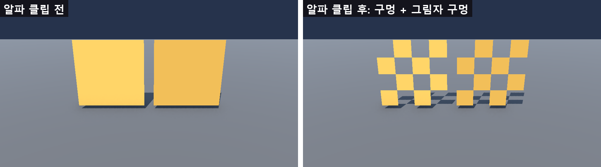

# Day 05. 텍스처와 UV — 그림을 입히고, 가위로 오리기

## 작업 식별

| 항목 | 내용 |
|---|---|
| Task ID | GMD-TSS-006-DO |
| 유형 | D&O (개념) + 코드 읽기 |
| 목적 | UV, 텍스처 샘플링, 타일링·오프셋(`_ST`), 채널 패킹, 알파 클립(`clip`)을 설명한다 |
| 소요 시간 | 약 1시간 (읽기 25분, 코드 읽기 20분, 실습 15분) |
| 선수 지식 | [Day 04](day04-hlsl-basics.md) |
| 확인 상태 | 미검증 (소스를 읽고 작성했으며 Unity에서 컴파일·실행하지 않았다) |
| 개정 | R1 (2026-11-18) |

비유: UV는 상자 전개도에 적힌 좌표이고, `clip`은 가위다.

## 학습 목표

- [ ] UV가 무엇이고 왜 0~1 범위인지 안다
- [ ] `SAMPLE_TEXTURE2D`로 텍스처 색을 읽는 법을 안다
- [ ] `_BaseMap_ST`(타일링, 오프셋)가 하는 일을 안다
- [ ] 한 텍스처의 R, G, B, A 채널에 서로 다른 정보를 담는 채널 패킹을 이해한다
- [ ] `clip()`으로 픽셀을 버리는 알파 클립을 이해한다

## 1. 정의


NOTE: UV는 메시 정점마다 저장된 텍스처 좌표다. `u`는 가로, `v`는 세로 위치이며 텍스처 해상도와 무관하게 0~1 범위로 정규화된다. 텍스처 샘플링은 UV 위치의 색을 샘플러 규칙에 따라 읽는 동작이다.


3D 모델을 종이 상자 전개도처럼 펼쳐 2D 그림 위에 놓은 것이 UV 매핑이다. 512×512든 4096×4096이든 UV는 0~1이므로 텍스처 해상도를 바꿔도 모델을 수정하지 않는다.

## 2. 구성 요소

| 구성 요소 | 선언·사용 | 역할 |
|---|---|---|
| 텍스처 | `TEXTURE2D(_BaseMap);` | 그림 데이터 |
| 샘플러 | `SAMPLER(sampler_BaseMap);` | 읽는 규칙: 필터링(Point/Bilinear/Trilinear), 랩 모드(Repeat/Clamp) |
| 샘플링 매크로 | `SAMPLE_TEXTURE2D(tex, sampler, uv)` | UV 위치의 색을 읽는다 |
| `_ST` 벡터 | `float4 _BaseMap_ST` | `xy` = Tiling, `zw` = Offset |
| `TRANSFORM_TEX(uv, tex)` | 매크로 | `uv * tex_ST.xy + tex_ST.zw` |
| `clip(x)` | 내장 함수 | `x < 0`이면 픽셀을 버린다 |

[ToonInput.hlsl L13](https://github.com/JJH0204/GitBook/blob/main/GameDev/toon-shader-study/source/CharacterToon/ShaderLibrary/ToonInput.hlsl#L13)

```hlsl
TEXTURE2D(_BaseMap);        SAMPLER(sampler_BaseMap);
```

## 3. 동작 원리

### 3.1 샘플링과 색 곱

[CharacterToon.shader L292](https://github.com/JJH0204/GitBook/blob/main/GameDev/toon-shader-study/source/CharacterToon/Shaders/CharacterToon.shader#L292)

```hlsl
half4 baseColor = SAMPLE_TEXTURE2D(_BaseMap, sampler_BaseMap, input.uv) * _BaseColor;
```

`_BaseMap`의 `input.uv` 위치 색을 읽어 머티리얼의 Base Color를 곱한다.

| 텍스처 | Base Color | 결과 |
|---|---|---|
| 흰색 (1,1,1) | 빨강 | 빨강 |
| 무늬 | 흰색 | 무늬 그대로 |

### 3.2 타일링과 오프셋

인스펙터의 Tiling, Offset은 `_BaseMap_ST`에 담긴다(ST = Scale, Translate). 지형 셰이더는 매크로 없이 직접 계산한다. [SceneTerrainInput.hlsl L76](https://github.com/JJH0204/GitBook/blob/main/GameDev/toon-shader-study/source/SceneToon/ShaderLibrary/SceneTerrainInput.hlsl#L76)

```hlsl
uv * _Splat0_ST.xy + _Splat0_ST.zw     // 크기를 곱하고, 위치를 더한다
```

Tiling이 (2, 2)이면 UV가 0~2가 되고, 랩 모드가 Repeat이면 그림이 2×2번 반복된다.

### 3.3 채널 패킹

텍스처 한 장의 R, G, B, A 네 채널에는 색이 아니라 서로 다른 흑백 정보를 담을 수 있다. 이를 채널 패킹이라 하며 텍스처 수를 줄인다. 이 셰이더의 ILM 맵이 예다. ([CharacterToon.shader L340–343](https://github.com/JJH0204/GitBook/blob/main/GameDev/toon-shader-study/source/CharacterToon/Shaders/CharacterToon.shader#L340-L343))

```hlsl
half4 ilm = half4(0.0h, 0.5h, 0.5h, 0.0h);           // ILM이 없을 때의 '중립' 값
#if defined(_USE_ILM)
    ilm = SAMPLE_TEXTURE2D(_ILMMap, sampler_ILMMap, input.uv);
#endif
```

| 채널 | 뜻 | 쓰이는 곳 | 중립 값 |
|---|---|---|---|
| R | MatCap 반사 마스크 | Day 17 | 0 |
| G | 그림자 생성 정도 (0.5보다 작으면 그림자 쪽으로) | Day 07 | 0.5 (영향 없음) |
| B | 스펙큘러 하이라이트 폭 | Day 17 | 0.5 |
| A | 외곽선 제거 (1이면 그 부위 외곽선 없음) | Day 12 | 0 (외곽선 있음) |

ILM을 쓰지 않는 머티리얼도 같은 계산을 거친다. 중립 값을 넣으면 계산은 하되 결과가 바뀌지 않는다. 예를 들어 G = 0.5이면 `(0.5 - 0.5) × 크기 = 0`이어서 그림자가 이동하지 않는다. 같은 이유로 텍스처 기본값은 곱하는 마스크는 `"white"`, 더하는 효과(Emission, MatCap)는 `"black"`으로 둔다.

### 3.4 알파 클립

머리카락 끝이나 속눈썹은 사각형 판에 그림을 그리고 투명한 부분을 오려 내서 만든다(알파 클립, 컷아웃). `clip(x)`는 `x < 0`이면 그 픽셀의 색과 깊이를 기록하지 않는다. [ToonInput.hlsl L183–191](https://github.com/JJH0204/GitBook/blob/main/GameDev/toon-shader-study/source/CharacterToon/ShaderLibrary/ToonInput.hlsl#L183-L191)

```hlsl
void ClipToonSurface(float2 uv)
{
#if defined(_USE_STENCIL_MASK)
    clip(SAMPLE_TEXTURE2D(_StencilMask, sampler_StencilMask, uv).r - _StencilMaskCutoff);
#endif
#if defined(_ALPHATEST_ON)
    clip(SAMPLE_TEXTURE2D(_BaseMap, sampler_BaseMap, uv).a * _BaseColor.a - _Cutoff);
#endif
}
```

| 텍스처 a | `_Cutoff` | `a - _Cutoff` | 결과 |
|---|---|---|---|
| 0.3 | 0.5 | -0.2 | 버린다 |
| 0.8 | 0.5 | 0.3 | 남긴다 |




NOTE: 이 프로젝트에서 실제로 있었던 일 (C3, A4). 처음에는 색칠 패스만 클립해서 구멍 뚫린 자리에 그림자와 외곽선이 남았다. 그림자 패스와 외곽선 패스가 구멍 위치를 몰랐기 때문이다. 클립 규칙을 `ClipToonSurface()` 한 함수로 만들고 모든 패스가 호출하게 고쳤다. 위 그림 오른쪽에서 그림자에도 구멍이 뚫린 것을 볼 수 있다(Day 18).


### 3.5 버텍스 셰이더에서 텍스처 읽기

[CharacterToon.shader L723](https://github.com/JJH0204/GitBook/blob/main/GameDev/toon-shader-study/source/CharacterToon/Shaders/CharacterToon.shader#L723)

```hlsl
half widthMul = SAMPLE_TEXTURE2D_LOD(_OutlineMask, sampler_OutlineMask, input.uv, 0).r;
```

텍스처에는 멀리서 볼 때 쓰는 축소 사본(밉맵)이 있다. 프래그먼트 셰이더는 이웃 픽셀과의 UV 차이(`ddx/ddy`, Day 16)로 밉 레벨을 자동 선택한다. 버텍스 셰이더에는 이웃 픽셀이 없으므로 `_LOD` 매크로로 레벨(0 = 원본 크기)을 직접 지정한다.

## 4. 주의


CAUTION: `clip`은 픽셀을 버리므로 깊이 기록도 건너뛴다. 알파 클립을 쓰는 머티리얼은 그림자(ShadowCaster), 깊이(DepthOnly, DepthNormals), 외곽선, 모션 벡터 패스에도 같은 클립을 적용해야 한다. 한 패스라도 빠지면 구멍 자리에 그림자나 외곽선이 남는다.



NOTE: 알파 클립은 GPU에 따라 early-Z 최적화를 막을 수 있어 비용이 늘 수 있다. 정도는 GPU와 드라이버에 따라 다르며 이 환경에서 측정하지 않았다.


## 5. 실습 (15분)

1. UV (0.3, 0.4), Tiling (2, 2), Offset (0.1, 0)의 최종 UV를 계산한다. → 결과: `(0.3×2+0.1, 0.4×2+0) = (0.7, 0.8)`.
2. ILM 픽셀 값 (0, 0.2, 0.5, 1)의 의미를 3.3절 표로 해석한다. → 결과: G = 0.2 < 0.5이므로 그림자가 잘 생기고, A = 1이므로 외곽선이 없다.
3. `_Cutoff = 0.5`, 텍스처 a = 0.6, `_BaseColor.a = 0.7`일 때 오려지는지 계산한다. → 결과: `0.6 × 0.7 = 0.42`, `0.42 - 0.5 < 0`이므로 오려진다. Base Color의 알파도 곱해진다.
4. [CharacterToon.shader](https://github.com/JJH0204/GitBook/blob/main/GameDev/toon-shader-study/source/CharacterToon/Shaders/CharacterToon.shader)에서 `ClipToonSurface`를 검색해 호출하는 패스를 센다. → 결과: 원본 자료는 이 파일에서 5곳이라고 적었다(미검증). MotionVectors 패스는 [ToonMotionVectors.hlsl L40](https://github.com/JJH0204/GitBook/blob/main/GameDev/toon-shader-study/source/CharacterToon/ShaderLibrary/ToonMotionVectors.hlsl#L40)에서 호출한다.

오늘의 요약: [essence.md — Day 05](essence.md#day-05)

## 6. 참조

- [LearnOpenGL — Textures](https://learnopengl.com/Getting-started/Textures): 샘플러, 필터링, 반복 모드, 밉맵 (영어)
- [Wikipedia — UV mapping](https://en.wikipedia.org/wiki/UV_mapping), [Mipmap](https://en.wikipedia.org/wiki/Mipmap) (영어)
- [Microsoft — clip](https://learn.microsoft.com/en-us/windows/win32/direct3dhlsl/dx-graphics-hlsl-clip)
- [Catlike Coding — Rendering 3: Combining Textures](https://catlikecoding.com/unity/tutorials/rendering/part-3/) (영어)

## 내 말로 채우기


AI 없이 답을 적는다. 다 쓰면 체크하고, 이 안내는 지워도 된다.


- [ ] UV가 해상도와 무관하게 0~1인 이유를 내 말로 적는다
- [ ] 채널 패킹이 왜 유용한지, 중립 값이 왜 필요한지 적는다
- [ ] 알파 클립을 쓰다가 그림자나 외곽선이 어긋난 경험이 있으면 원인과 해결 방법을 적는다

---

[← Day 04](day04-hlsl-basics.md) · [목차](README.md) · [다음: Day 06 →](day06-vectors-and-light.md)
