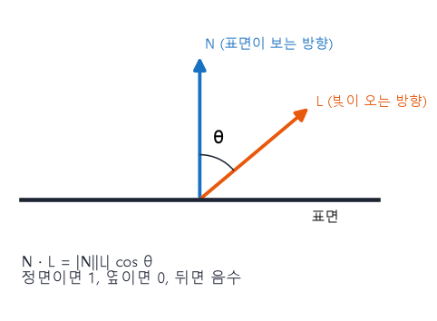
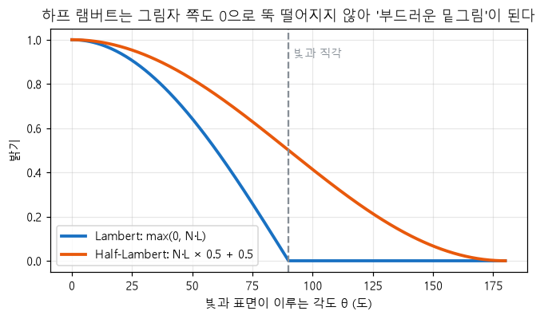

# Day 06. 빛의 수학 — 화살표와 내적, 그리고 램버트

> ⏱ **약 1시간** — 읽기 25분 · 코드 따라 읽기 15분 · 해보기 20분
> 🧸 **오늘의 비유**: 내적은 **"두 화살표가 얼마나 같은 쪽을 보나" 점수**, 빛은 **손전등**이에요.

## 오늘 배울 것

- [ ] 벡터(화살표)와 노멀이 무엇인지 안다
- [ ] `normalize`가 왜 필요한지 안다
- [ ] 내적 `dot(N, L)`이 밝기가 되는 이유를 안다
- [ ] 램버트와 하프 램버트의 차이를 그래프로 설명할 수 있다
- [ ] 이 셰이더의 `lightVal`이 어떻게 만들어지는지 안다

---

## 1. 벡터 = 화살표

벡터는 **방향과 길이를 가진 화살표**예요. `(0, 1, 0)`은 "위쪽으로 길이 1", `(1, 0, 0)`은 "오른쪽으로 길이 1".

셰이더에 자주 나오는 화살표 세 개를 외워 두세요.

| 기호 | 이름 | 비유 |
|---|---|---|
| **N** | 노멀 (Normal) | 표면이 **바라보는 방향**. 해바라기 얼굴 |
| **L** | 빛 방향 (Light) | 표면에서 **해를 가리키는** 손가락 |
| **V** | 시선 방향 (View) | 표면에서 **내 눈을 가리키는** 손가락 |


URP의 `light.direction`은 "빛이 날아가는 방향"이 아니라 **"표면에서 빛 쪽을 가리키는 방향"** 이에요. 그래서 해가 위에 있으면 L = (0, 1, 0)이에요.


## 2. 길이를 1로 맞추기: `normalize`

화살표끼리 "얼마나 같은 쪽을 보나" 점수를 매기려면 **길이가 같아야** 공평해요. 그래서 길이를 1로 맞춰요. 이걸 **정규화**(normalize)라고 해요.

```hlsl
half3 N = normalize(input.normalWS);              // L302
half3 V = normalize(GetWorldSpaceViewDir(...));   // L307
```


길이가 0인 화살표 `(0, 0, 0)`을 정규화하면 0으로 나누게 돼서 **NaN**(숫자가 아님)이 나와요. NaN은 전염병처럼 퍼져서 화면이 까맣게 되거나 깜빡여요. 그래서 이 셰이더는 위험한 곳마다 **안전 정규화**를 써요. [ToonLighting.hlsl L9–13](https://github.com/JJH0204/GitBook/blob/main/GameDev/toon-shader-study/source/CharacterToon/ShaderLibrary/ToonLighting.hlsl#L9-L13):
```hlsl
float2 SafeNormalizeXZ(float2 v, float2 fallback)
{
    float lenSq = dot(v, v);                                  // 길이의 제곱
    return lenSq > 1e-6 ? v * rsqrt(lenSq) : fallback;       // 너무 짧으면 예비 방향
}
```
`rsqrt(x)`는 `1 / sqrt(x)`예요. `v × (1/길이)` = 길이 1인 화살표.


## 3. 내적 = 같은 쪽을 보는 점수



두 화살표 A, B의 내적은 이렇게 계산해요.

```
dot(A, B) = A.x × B.x + A.y × B.y + A.z × B.z
```

**두 화살표가 길이 1이면**, 결과는 둘 사이 각도 θ의 **코사인**(cos θ)과 같아요.

| 두 화살표의 관계 | 각도 | `dot` |
|---|---|---|
| 같은 방향 | 0° | **1** |
| 비스듬히 | 60° | 0.5 |
| 직각 | 90° | **0** |
| 반대 방향 | 180° | **-1** |

### 왜 내적이 밝기일까? — 손전등 실험

손전등으로 벽을 **정면에서** 비추면 작고 밝은 동그라미가 생겨요. **비스듬히** 비추면 빛이 길쭉하게 퍼져서 같은 양의 빛이 넓은 면적에 나뉘니까 **어두워져요**. 벽과 **나란히** 비추면 빛이 벽에 거의 안 닿아요.

이 "얼마나 정면으로 비추나"가 바로 `dot(N, L)`이에요.

## 4. 램버트와 하프 램버트

**램버트**(Lambert)는 이 손전등 법칙을 그대로 쓴 공식이에요.

```
밝기 = max(0, dot(N, L))      // 뒤쪽(음수)은 0으로 자름
```

**하프 램버트**(Half-Lambert)는 게임 회사 Valve가 만든 변형이에요.

```
밝기 = dot(N, L) × 0.5 + 0.5   // -1~1 을 0~1 로 옮김
```



- 램버트(파랑)는 90°를 넘는 순간 **0으로 뚝** 떨어지고 뒤쪽 절반이 전부 0이에요. 뒤쪽은 다 똑같이 깜깜해서 구별이 안 돼요.
- 하프 램버트(주황)는 뒤쪽까지 **0~0.5 사이로 계속** 변해요. 0~1 구간 전체를 고르게 쓰죠.


툰 셰이더는 다음 단계(Day 07)에서 이 값을 **"어디서 그림자로 바꿀까"** 하는 경계선과 비교해요. 하프 램버트는 0~1을 고르게 쓰니까 경계선을 0.5에 두면 딱 **빛과 직각인 곳**에서 그림자가 시작돼요. 경계선을 옮기기도 쉽고요. 그래서 이 셰이더 패키지의 모든 셰이더가 하프 램버트를 써요.


## 5. 실제 코드 읽기

### ① 빛 방향 고르기

[CharacterToon.shader L347–352](https://github.com/JJH0204/GitBook/blob/main/GameDev/toon-shader-study/source/CharacterToon/Shaders/CharacterToon.shader#L347-L352)

```hlsl
half3 L;
if (_CharacterLightDirWS.w > 0.5h && dot(_CharacterLightDirWS.xyz, _CharacterLightDirWS.xyz) > 1e-6) {
    L = normalize(_CharacterLightDirWS.xyz);    // 캐릭터 전용 조명이 있으면 그걸 쓰고
} else {
    L = mainLight.direction;                     // 없으면 씬의 해(메인 라이트)를 쓴다
}
```

캐릭터를 예쁘게 비추는 **전용 조명**(Day 09)이 있으면 그걸 쓰고, 없으면 해를 써요. `dot(v, v)`는 "자기 자신과의 내적 = 길이의 제곱"이에요. 길이가 0이 아닌지 확인하는 흔한 방법이에요.

### ② 하프 램버트 + ILM 편향

[CharacterToon.shader L355–358](https://github.com/JJH0204/GitBook/blob/main/GameDev/toon-shader-study/source/CharacterToon/Shaders/CharacterToon.shader#L355-L358)

```hlsl
half ndotl = dot(N, L);                                   // 손전등 점수 (-1~1)
half halfLambert = ndotl * 0.5h + 0.5h;                    // 0~1 로 옮김
half shadowBias = (ilm.g - 0.5h) * _ShadowOffsetScale;     // ILM.G: 그림자 잘 생기는 곳 지도
half lightVal = saturate(halfLambert + shadowBias);        // 0=그림자, 1=빛
```

이 `lightVal`이 툰 셰이더의 **심장 박동**이에요. 앞으로 그림자 단계(Day 07), 드리운 그림자(Day 08), 얼굴 그림자(Day 15)가 전부 이 값을 다듬어요.

`shadowBias`는 Day 05에서 본 ILM 맵의 G 칸이에요. 겨드랑이나 옷 주름처럼 **"여기는 빛이 와도 그림자가 졌으면 좋겠다"** 하는 곳을 미리 어둡게(0.5보다 작게) 칠해 두면 `lightVal`이 줄어들어 그림자가 먼저 생겨요.

### ③ 배경 셰이더는 같은 식을 함수로

[ToonRamp.hlsl L13–16](https://github.com/JJH0204/GitBook/blob/main/GameDev/toon-shader-study/source/ToonShared/ShaderLibrary/ToonRamp.hlsl#L13-L16) · [SceneToon.shader L239–241](https://github.com/JJH0204/GitBook/blob/main/GameDev/toon-shader-study/source/SceneToon/Shaders/SceneToon.shader#L239-L241)

```hlsl
half ToonHalfLambert(half ndotl) { return ndotl * 0.5h + 0.5h; }
...
half hl = ToonHalfLambert(dot(N, L));
half lightVal = ToonRampU(hl, shadowBias);    // saturate(hl + bias)
```


캐릭터 셰이더는 공식을 **직접** 쓰고, 배경 셰이더는 `ToonShared`의 **함수**를 불러요. 같은 식을 두 군데 둔 이유는 [ToonRamp.hlsl L5–7 주석](https://github.com/JJH0204/GitBook/blob/main/GameDev/toon-shader-study/source/ToonShared/ShaderLibrary/ToonRamp.hlsl#L5-L7)에 있어요. 이미 안정된 캐릭터 셰이더가 배경 작업 때문에 흔들리지 않게 **독립**시킨 거예요. 대신 "한쪽을 고치면 다른 쪽도 손으로 맞춘다"는 약속을 지켜야 해요.


## 6. 해보기 (20분)

1. **내적 손계산** — N = (0, 1, 0), L = (0.6, 0.8, 0)이면 `dot(N, L)` = 0×0.6 + 1×0.8 + 0×0 = **0.8**. 하프 램버트는 0.8×0.5+0.5 = **0.9**.
2. **반대편** — L = (0, -1, 0) (빛이 바로 아래)이면 램버트는? `max(0, -1) = 0`. 하프 램버트는? `-1×0.5+0.5 = 0`. 그럼 L = (1, 0, 0) (옆)이면? 램버트 0, 하프 램버트 **0.5**. 둘이 다르게 나오는 곳이 바로 그래프의 차이예요.
3. **ILM 편향** — `halfLambert = 0.55`, ILM.G = 0.2, `_ShadowOffsetScale = 0.2`이면 `lightVal`은? `0.55 + (0.2-0.5)×0.2 = 0.55 - 0.06 = 0.49`. 경계선 0.5 아래로 내려가서 그림자 쪽이 돼요.
4. **Desmos** — [Desmos](https://www.desmos.com/calculator)에 `y = max(0, cos(x))`와 `y = cos(x)*0.5+0.5`를 같이 그려 보세요. (x는 라디안이라 π ≈ 3.14가 180°예요.)

## 7. 오늘의 액기스

👉 [ESSENCE.md — Day 06](essence.md#day-06)

## 수학 참고 자료

- 🎥 [3Blue1Brown — 벡터](https://www.3blue1brown.com/lessons/vectors) · [내적과 쌍대성](https://www.3blue1brown.com/lessons/dot-products) — 내적이 왜 "같은 쪽을 보는 정도"인지 애니메이션으로 보여 줘요.
- [Khan Academy — 벡터와 공간](https://www.khanacademy.org/math/linear-algebra/vectors-and-spaces) (영어, 한국어 자막 일부)
- [위키백과 — 스칼라곱(내적)](https://ko.wikipedia.org/wiki/%EC%8A%A4%EC%B9%BC%EB%9D%BC%EA%B3%B1) · [삼각함수](https://ko.wikipedia.org/wiki/%EC%82%BC%EA%B0%81%ED%95%A8%EC%88%98) (cos이 처음이면)
- [Valve Developer — Half Lambert](https://developer.valvesoftware.com/wiki/Half_Lambert) — 하프 램버트를 만든 곳의 설명 (영어)
- [Wikipedia — Lambertian reflectance](https://en.wikipedia.org/wiki/Lambertian_reflectance) (영어)
- [LearnOpenGL — Basic Lighting](https://learnopengl.com/Lighting/Basic-Lighting) · [Catlike Coding — Rendering 4: The First Light](https://catlikecoding.com/unity/tutorials/rendering/part-4/) (영어)
- [Microsoft — dot](https://learn.microsoft.com/en-us/windows/win32/direct3dhlsl/dx-graphics-hlsl-dot)

---

[← Day 05](day05-textures-and-uv.md) · [목차](README.md) · [다음: Day 07 →](day07-toon-steps.md)
