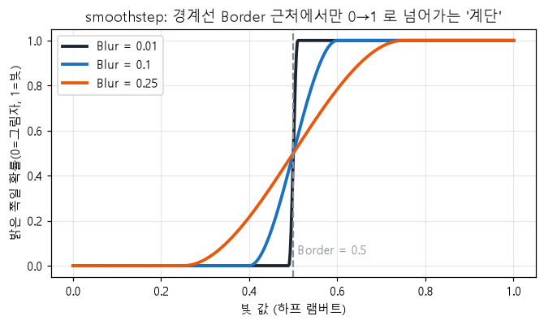
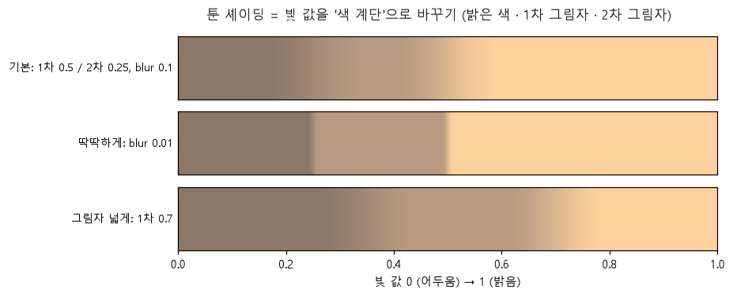

# Day 07. 툰 셰이딩의 심장 — 미끄럼틀을 계단으로

> ⏱ **약 1시간** — 읽기 25분 · 코드 따라 읽기 20분 · 해보기 15분
> 🧸 **오늘의 비유**: 실사 빛은 **미끄럼틀**, 툰 빛은 **계단**. `smoothstep`은 계단 모서리를 다듬는 **사포**예요.

## 오늘 배울 것

- [ ] `step`과 `smoothstep`의 차이를 그래프로 안다
- [ ] Border(경계 위치)와 Blur(경계 부드러움)가 무엇을 바꾸는지 안다
- [ ] 1차·2차 그림자 밴드가 `lerp`로 섞이는 과정을 따라갈 수 있다
- [ ] 그림자 색을 "회색"이 아니라 "틴트"로 곱하는 이유를 안다
- [ ] Ramp 텍스처 방식이 무엇인지 안다

---

## 1. 계단 만들기: `step` → `smoothstep`

Day 06에서 만든 `lightVal`은 0(그림자)부터 1(빛)까지 **부드럽게** 변해요. 미끄럼틀이죠. 만화처럼 보이려면 이걸 **계단**으로 바꿔야 해요.

가장 단순한 계단은 `step`이에요.

```hlsl
step(0.5, x)    // x가 0.5 이상이면 1, 아니면 0
```

문제는 계단 모서리가 **너무 날카로워서** 화면에서 톱니처럼 깨져 보인다는 거예요(계단 현상, aliasing). 그래서 모서리를 **사포로 살짝 다듬은 계단**인 `smoothstep`을 써요.

```hlsl
smoothstep(a, b, x)   // x가 a 이하면 0, b 이상이면 1, 그 사이는 부드러운 S자
```



이 셰이더는 `a`와 `b`를 이렇게 정해요.

```
a = Border - Blur,   b = Border + Blur
```

- **Border** (경계 위치) = 계단이 **어디에** 있나. 0.5면 빛과 직각인 곳에서 그림자 시작.
- **Blur** (경계 폭) = 계단 모서리를 **얼마나** 다듬나. 0.01이면 칼같이, 0.25면 흐릿하게.

### smoothstep 속을 들여다보면

```
t = saturate((x - a) / (b - a))     // a~b 사이에서 0~1 로 늘이기
결과 = t × t × (3 - 2 × t)          // S자로 휘기
```


Blur가 **0**이면 `a = b`라서 `(b - a) = 0`으로 나누게 돼요. 결과는 NaN! 그래서 코드는 항상 `max(Blur, 1e-4)`로 **아주 작은 바닥**을 깔아요.
[CharacterToon.shader L434–435](https://github.com/JJH0204/GitBook/blob/main/GameDev/toon-shader-study/source/CharacterToon/Shaders/CharacterToon.shader#L434-L435) · [ToonBandShadow.hlsl L13](https://github.com/JJH0204/GitBook/blob/main/GameDev/toon-shader-study/source/ToonShared/ShaderLibrary/ToonBandShadow.hlsl#L13)

**💡 실제로 있었던 일 (C4)**: 림 라이트의 `_RimSoftness`와 스펙큘러의 `_SpecularStep`에는 이 바닥이 없었어요. 슬라이더를 0으로 내리면 그 부분이 깨졌죠. 같은 바닥을 깔아서 고쳤어요([L499](https://github.com/JJH0204/GitBook/blob/main/GameDev/toon-shader-study/source/CharacterToon/Shaders/CharacterToon.shader#L499), [L595](https://github.com/JJH0204/GitBook/blob/main/GameDev/toon-shader-study/source/CharacterToon/Shaders/CharacterToon.shader#L595)).


## 2. 그림자 두 칸: 1차와 2차

만화 그림자는 보통 **두 단계**예요. 살짝 어두운 1차 그림자, 그 안쪽의 더 진한 2차 그림자.

[CharacterToon.shader L433–447](https://github.com/JJH0204/GitBook/blob/main/GameDev/toon-shader-study/source/CharacterToon/Shaders/CharacterToon.shader#L433-L447) (얼굴 SDF 부분은 Day 15에서 보고, 여기선 밴드만 볼게요)

```hlsl
half blur1 = max(_ShadowBlur,    1e-4h);
half blur2 = max(_Shadow2ndBlur, 1e-4h);
// 그림자 정도 = 1 - (빛 정도)
half shadow1Band = (1.0h - smoothstep(_ShadowBorder    - blur1, _ShadowBorder    + blur1, lightVal)) * _ShadowStrength;
half shadow2Band = (1.0h - smoothstep(_Shadow2ndBorder - blur2, _Shadow2ndBorder + blur2, lightVal)) * _ShadowStrength;
...
shadedAlbedo = baseColor.rgb;                                                     // 밝은 색에서 시작
shadedAlbedo = lerp(shadedAlbedo, baseColor.rgb * _ShadowColor.rgb,    shadow1);  // 1차 그림자 색 덧칠
shadedAlbedo = lerp(shadedAlbedo, baseColor.rgb * _Shadow2ndColor.rgb, shadow2);  // 2차 그림자 색 덧칠
shadeMask = saturate(max(shadow1, shadow2));                                       // "얼마나 그림자인가" 기록
```

순서대로 읽으면 이래요.

1. `smoothstep`은 "빛 쪽인 정도"를 줘요. `1 - …`로 뒤집어서 **"그림자 쪽인 정도"** 로 바꿔요.
2. `_ShadowStrength`를 곱해서 그림자를 전체적으로 약하게 할 수 있어요 (0이면 그림자 없음).
3. **밝은 색 위에 1차 그림자 색을 덧칠**하고, 그 위에 **2차 그림자 색을 덧칠**해요. `lerp`가 물감 섞기였죠? `shadow1`이 1인 곳은 1차 그림자 색이 100%, 0.3인 곳은 30%만 섞여요.
4. `shadeMask`는 나중에 하늘빛(Day 10)을 더할 때 "그림자 쪽엔 덜 더하기" 위해 기록해 둬요.

2차 Border(기본 0.25)가 1차 Border(기본 0.5)보다 작으니까, 2차 그림자는 **더 깊은 그림자 안쪽**에만 생겨요.




위 그림의 세 줄을 비교해 보세요. **Blur를 줄이면** 경계가 칼같아지고, **1차 Border를 올리면** 그림자가 넓어져요. 이 두 슬라이더가 캐릭터 인상을 크게 바꿔요.


## 3. 그림자 색은 "곱하기 틴트"

그림자를 그냥 검정이나 회색으로 섞지 않고 **바탕색 × 그림자 틴트**로 만들어요.

```hlsl
baseColor.rgb * _ShadowColor.rgb       // 기본 틴트 (0.72, 0.74, 0.82) — 살짝 푸른 회색
```

- 빨간 옷 (1, 0.2, 0.2) × 틴트 (0.72, 0.74, 0.82) = (0.72, 0.15, 0.16) → **어두운 빨강**
- 회색을 섞으면 → 탁한 회색빛 빨강 😕

만화가들이 그림자를 칠할 때 회색이 아니라 **푸르스름하거나 보랏빛 도는 같은 계열 색**을 쓰는 것과 같아요. 틴트의 파란 값(0.82)이 빨강·초록보다 조금 커서 그림자가 살짝 차갑게 느껴져요.

## 4. 또 다른 방법: Ramp 텍스처

공식 대신 **그라데이션 그림 한 장**으로 그림자 색을 정할 수도 있어요. 가로가 빛 값(0~1), 세로가 재질 종류인 작은 그림이에요. 이걸 **Ramp LUT**(색 사전)라고 해요.

[CharacterToon.shader L426–431](https://github.com/JJH0204/GitBook/blob/main/GameDev/toon-shader-study/source/CharacterToon/Shaders/CharacterToon.shader#L426-L431)

```hlsl
#if defined(_USE_RAMP)
    half rampVal = lerp(lightVal, faceLit, sdfApply);
    half3 ramp = SAMPLE_TEXTURE2D(_RampMap, sampler_RampMap, half2(rampVal, _RampRow)).rgb;
    shadedAlbedo = baseColor.rgb * ramp;
```

`lightVal`을 **가로 좌표(U)로**, `_RampRow`를 세로 좌표로 써서 그림에서 색을 찾아와요. 화가가 그림자 색을 그림으로 직접 그릴 수 있다는 게 장점이에요. 이 셰이더 패키지는 기본으로 슬라이더 방식(1·2차 밴드)을 쓰고, `_USE_RAMP`를 켜면 Ramp 방식으로 바꿔요.

## 5. 배경 셰이더도 같은 식

[ToonBandShadow.hlsl L11–32](https://github.com/JJH0204/GitBook/blob/main/GameDev/toon-shader-study/source/ToonShared/ShaderLibrary/ToonBandShadow.hlsl#L11-L32)

```hlsl
half ToonBandFactor(half lightVal, half border, half blur, half strength)
{
    half b = max(blur, 1e-4h);
    return (1.0h - smoothstep(border - b, border + b, lightVal)) * strength;
}

half3 ToonShadeBands(half3 albedo, half lightVal, ..., out half shadeMask)
{
    half s1 = ToonBandFactor(lightVal, border1, blur1, strength);
    half s2 = ToonBandFactor(lightVal, border2, blur2, strength);
    half3 c = albedo;
    c = lerp(c, albedo * shadowColor1, s1);
    c = lerp(c, albedo * shadowColor2, s2);
    shadeMask = saturate(max(s1, s2));
    return c;
}
```

캐릭터 코드와 **완전히 같은 계산**을 함수로 묶은 거예요. `out half shadeMask`는 "돌려주는 값 말고 하나 더 밖으로 내보낼게요"라는 뜻이에요. 캐릭터와 배경의 그림자 톤이 같아야 한 화면에 있을 때 어색하지 않아요.

## 6. 해보기 (15분)

1. **smoothstep 손계산** — `lightVal = 0.55`, Border 0.5, Blur 0.1이면?
   - `a = 0.4`, `b = 0.6`, `t = (0.55 - 0.4) / 0.2 = 0.75`
   - `smoothstep = 0.75² × (3 - 1.5) = 0.5625 × 1.5 = 0.844`
   - `shadow1 = 1 - 0.844 = 0.156` → 1차 그림자 색이 15.6%만 섞인 "거의 밝은" 픽셀
2. **같은 값, Blur 0.01** — `a = 0.49`, `b = 0.51`, x=0.55는 b보다 크니 `smoothstep = 1`, `shadow1 = 0` → 완전히 밝음. Blur가 작으면 경계 근처 값도 확 갈라져요.
3. **Desmos 실험** — [Desmos](https://www.desmos.com/calculator)에 아래를 입력하고 `B`(Border), `b`(Blur) 슬라이더를 움직여 보세요.
   ```
   s(x) = \min(\max((x-(B-b))/(2b), 0), 1)
   y = s(x)^2 (3 - 2s(x))
   ```
4. **(Unity가 있다면)** 샘플 머티리얼의 Shadow Border 1st / Shadow Blur 1st 슬라이더를 움직여 위 그림처럼 변하는지 확인하세요.

## 7. 오늘의 액기스

👉 [ESSENCE.md — Day 07](essence.md#day-07)

## 수학 참고 자료

- [The Book of Shaders — 5장 Shaping Functions (한국어)](https://thebookofshaders.com/05/?lan=kr) — `step`, `smoothstep`, `pow` 같은 "모양 만드는 함수"를 직접 바꿔 보며 배울 수 있어요. **강력 추천!**
- [Wikipedia — Smoothstep](https://en.wikipedia.org/wiki/Smoothstep) — S자 공식이 어디서 나왔는지 (영어)
- [Microsoft — smoothstep](https://learn.microsoft.com/en-us/windows/win32/direct3dhlsl/dx-graphics-hlsl-smoothstep) · [lerp](https://learn.microsoft.com/en-us/windows/win32/direct3dhlsl/dx-graphics-hlsl-lerp)
- [Wikipedia — Linear interpolation](https://en.wikipedia.org/wiki/Linear_interpolation) · [Cel shading](https://en.wikipedia.org/wiki/Cel_shading) (영어)
- [Desmos 그래프 계산기](https://www.desmos.com/calculator)

---

[← Day 06](day06-vectors-and-light.md) · [목차](README.md) · [다음: Day 08 →](day08-shadows.md)
