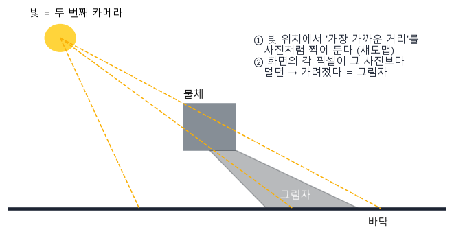
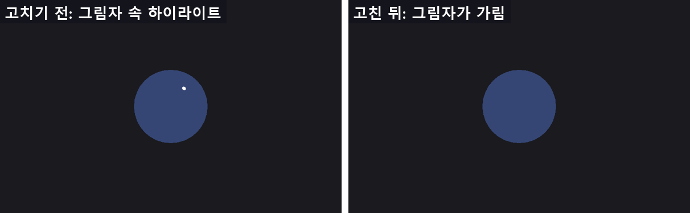

# Day 08. 그림자 — 빛의 자리에서 찍은 사진

## 작업 식별

| 항목 | 내용 |
|---|---|
| Task ID | GMD-TSS-009-DO |
| 유형 | D&O (개념) + 코드 읽기·실습 |
| 목적 | 섀도맵으로 드리운 그림자를 판정하는 원리와, 이 셰이더가 그 결과를 툰 계단에 합치는 방법을 설명한다 |
| 소요 시간 | 약 1시간 (읽기 25분, 코드 읽기 20분, 실습 15분) |
| 선수 지식 | Day 05 (`ClipToonSurface`), Day 06~07 (`lightVal`, 밴드) |
| 확인 상태 | 미검증 (소스를 읽고 작성했으며 Unity에서 컴파일·실행하지 않았다) |
| 개정 | R1 (2026-11-18) |

비유: 섀도맵은 빛이 자기 자리에서 찍어 둔 거리 사진이다.

## 학습 목표

- [ ] 모양 그림자와 드리운 그림자의 차이를 안다
- [ ] 섀도맵이 그림자를 판정하는 방법을 설명할 수 있다
- [ ] ShadowCaster 패스의 역할과 `ApplyShadowBias`가 필요한 이유를 안다
- [ ] 툰 셰이더가 드리운 그림자를 셀 밴드에 합치는 방법을 안다

## 1. 정의

그림자는 두 종류다.

| | 모양 그림자 (Self Shading) | 드리운 그림자 (Cast Shadow) |
|---|---|---|
| 뜻 | 빛 반대편을 향한 면이 어두운 것 | 다른 물체가 빛을 가려서 생긴 그림자 |
| 예 | 공의 아래쪽 절반 | 나무 아래 바닥, 모자 챙 아래 얼굴 |
| 계산 | `dot(N, L)` (Day 06~07) | 섀도맵 (오늘) |

`dot(N, L)`은 자기 표면의 방향만 쓰므로 앞을 가리는 물체를 알 수 없다. 드리운 그림자에는 별도 방법이 필요하다.

섀도맵(shadow map)은 광원 위치에서 장면을 렌더링해 얻은 깊이 텍스처다. 색 대신 광원 기준 깊이(가장 가까운 물체까지의 값)만 기록한다.

## 2. 구성 요소

| 구성 요소 | 역할 |
|---|---|
| ShadowCaster 패스 | 광원 시점에서 물체의 깊이를 섀도맵에 기록한다 |
| 섀도맵 | 광원 기준 깊이를 담은 텍스처 |
| `TransformWorldToShadowCoord` | 월드 좌표를 섀도맵 좌표로 바꾼다 |
| `ApplyShadowBias` | 자기 그림자(그림자 여드름)를 막기 위해 위치를 민다 |
| `Light.shadowAttenuation` | 비교 결과. 1이 빛, 0이 그림자 |
| `_ReceiveShadowStrength` | 드리운 그림자를 받는 정도 (Receive Cast Shadow 슬라이더) |

## 3. 동작 원리



1. 광원 위치에 카메라를 놓고 장면을 렌더링한다. 픽셀마다 광원에서 가장 가까운 표면의 깊이만 기록한다. 이것이 섀도맵이다.
2. 실제 카메라로 화면을 그릴 때 픽셀마다 광원 기준 깊이를 계산한다.
3. 계산한 깊이를 섀도맵 값과 비교한다.

| 비교 결과 | 의미 | 판정 |
|---|---|---|
| 섀도맵 값과 같거나 바이어스 이내 | 광원에 가장 가까운 표면이 자신이다 | 빛 |
| 섀도맵 값보다 광원에서 멀다 | 앞에 가린 물체가 있다 | 그림자 |

비유: 햇빛 아래 줄을 선 아이들을 해 쪽에서 보면 맨 앞 아이만 보인다. 뒤의 아이들은 맨 앞 아이보다 멀리 있으므로 그림자 속이다.

### 그림자 여드름과 바이어스

섀도맵은 해상도가 한정된 텍스처다. 비스듬한 면은 섀도맵 텍셀 하나 안에서도 깊이가 달라 자기 자신을 가린다고 판정된다. 그 결과 표면에 줄무늬나 점무늬 그림자가 생기며 이를 그림자 여드름(shadow acne)이라 한다.

`ApplyShadowBias`는 섀도맵을 만들 때 표면을 광원 방향과 노멀 방향으로 조금 밀어 이 오판을 막는다. 너무 많이 밀면 그림자가 물체에서 떨어져 보이는 피터팬 현상(peter-panning)이 생긴다.


NOTE: 바이어스 값은 URP 에셋의 그림자 설정과 Light 컴포넌트의 Bias 설정에서 온다. 어느 쪽이 우선하는지는 URP 버전에 따라 다르므로 사용하는 버전의 문서를 확인한다.



NOTE: 깊이 값의 방향(가까울수록 작은지 큰지)은 플랫폼과 Reversed-Z 사용 여부에 따라 다르다. clip z 범위는 Direct3D 계열 0~1(Reversed-Z에서는 가까운 쪽이 1), OpenGL 계열 -1~1이다. URP의 매크로(`UNITY_REVERSED_Z` 등)와 `ApplyShadowBias`가 이 차이를 처리하므로 직접 비교식을 쓸 때만 방향을 확인한다.


## 4. 코드 읽기

### 4.1 ShadowCaster 패스

[CharacterToon.shader L752–824](https://github.com/JJH0204/GitBook/blob/main/GameDev/toon-shader-study/source/CharacterToon/Shaders/CharacterToon.shader#L752-L824)

```shaderlab
Pass
{
    Name "ShadowCaster"
    Tags { "LightMode" = "ShadowCaster" }
    ZWrite On          // 거리(깊이)를 기록
    ZTest LEqual
    ColorMask 0        // 색은 안 씀 — 거리 사진이니까
    Cull [_Cull]
```

| 줄 | 설명 |
|---|---|
| `LightMode = "ShadowCaster"` | URP가 섀도맵을 만들 때 이 패스를 호출한다 |
| `ZWrite On` | 깊이를 기록한다 |
| `ColorMask 0` | 색은 쓰지 않는다 |

버텍스 셰이더의 핵심은 [L789–808](https://github.com/JJH0204/GitBook/blob/main/GameDev/toon-shader-study/source/CharacterToon/Shaders/CharacterToon.shader#L789-L808)이다.

```hlsl
float4 GetShadowPositionHClip(Attributes input)
{
    float3 positionWS = TransformObjectToWorld(input.positionOS.xyz);
    float3 normalWS   = TransformObjectToWorldNormal(input.normalOS);
#if defined(_CASTING_PUNCTUAL_LIGHT_SHADOW)
    float3 lightDirectionWS = normalize(_LightPosition - positionWS);   // 포인트/스폿: 빛 위치에서 방향 계산
#else
    float3 lightDirectionWS = _LightDirection;                          // 해: 모두 같은 방향
#endif
    float4 positionCS = TransformWorldToHClip(ApplyShadowBias(positionWS, normalWS, lightDirectionWS));
    ...
}
```

[L818–822](https://github.com/JJH0204/GitBook/blob/main/GameDev/toon-shader-study/source/CharacterToon/Shaders/CharacterToon.shader#L818-L822)는 텍스처로 오려 낸 곳을 그림자에서도 제외한다.

```hlsl
half4 frag(Varyings input) : SV_TARGET
{
    ClipToonSurface(input.uv);   // 오려 낸 곳은 그림자도 안 생김 (Day 05)
    return 0;
}
```

### 4.2 받는 쪽: 그림자 정도 읽기

화면 그리기는 ForwardToon 패스에서 한다. [L332–333](https://github.com/JJH0204/GitBook/blob/main/GameDev/toon-shader-study/source/CharacterToon/Shaders/CharacterToon.shader#L332-L333)

```hlsl
float4 shadowCoord = TransformWorldToShadowCoord(input.positionWS);   // 이 픽셀의 '섀도맵 위 주소'
Light mainLight = GetMainLight(shadowCoord);                          // 그림자 비교 결과가 담긴 빛 정보
```

`mainLight.shadowAttenuation`에 결과가 들어 있다. 1이 빛, 0이 그림자다(소프트 섀도에서는 0~1 사이 값도 나온다).

관련 키워드는 [L215–216](https://github.com/JJH0204/GitBook/blob/main/GameDev/toon-shader-study/source/CharacterToon/Shaders/CharacterToon.shader#L215-L216)에 있다.

| 키워드 | 뜻 |
|---|---|
| `_MAIN_LIGHT_SHADOWS` | 메인 라이트 그림자 켜짐 |
| `_MAIN_LIGHT_SHADOWS_CASCADE` | 캐스케이드. 카메라 거리 구간별로 섀도맵을 나눠, 가까운 구간은 같은 해상도로 좁은 영역을 덮어 촘촘하다 |
| `_MAIN_LIGHT_SHADOWS_SCREEN` | 그림자를 화면 공간 텍스처로 미리 계산해 둔다 |
| `_SHADOWS_SOFT` | 그림자 가장자리를 여러 번 비교해 부드럽게 한다 |


NOTE: 그림자 키워드 이름과 구성은 URP 버전에 따라 다르다. 예를 들어 Unity 6(URP 17) 계열에서는 소프트 섀도 품질별 키워드(`_SHADOWS_SOFT_LOW`, `_SHADOWS_SOFT_MEDIUM`, `_SHADOWS_SOFT_HIGH`)가 `_SHADOWS_SOFT`와 함께 쓰이는 것으로 알려져 있다. 사용하는 URP 버전의 `Shadows.hlsl`과 Lit 셰이더의 `#pragma multi_compile` 목록을 확인한다.


### 4.3 툰 계단에 합치기

드리운 그림자를 색에 그냥 곱하면 그림자 속이 새까맣게 되거나 셀 그림자와 다른 색이 된다. 이 셰이더는 그림자 결과를 `lightVal`에 곱해 Day 07의 계단에 넣는다. [L408–410](https://github.com/JJH0204/GitBook/blob/main/GameDev/toon-shader-study/source/CharacterToon/Shaders/CharacterToon.shader#L408-L410)

```hlsl
half rcvShadow = lerp(1.0h, mainLight.shadowAttenuation, _ReceiveShadowStrength);
lightVal *= rcvShadow;     // 그림자 속이면 lightVal 이 0 쪽으로 → 계단에서 그림자 색으로
faceLit  *= rcvShadow;     // 얼굴 SDF 값에도 똑같이 (Day 15)
```

드리운 그림자가 같은 1차·2차 그림자 색으로 칠해진다. `_ReceiveShadowStrength`가 0이면 다른 물체의 그림자를 무시한다.


CAUTION: 프로젝트 이력(B6). 스페큘러 하이라이트(Day 17)에 `rcvShadow`를 곱하지 않아 그림자 속에서도 반짝임이 떠 있었다. 하이라이트에도 `rcvShadow`를 곱해 고쳤다([L600](https://github.com/JJH0204/GitBook/blob/main/GameDev/toon-shader-study/source/CharacterToon/Shaders/CharacterToon.shader#L600)).




## 5. 주의

- 섀도맵 렌더에는 별도 패스가 필요하다. 셰이더에 `ShadowCaster` 패스가 없으면 그 물체는 그림자를 드리우지 못한다.
- 받는 쪽에서 `shadowCoord`를 만들지 않고 `GetMainLight()`만 부르면 `shadowAttenuation`이 1(그림자 없음)로 나온다.
- 바이어스를 키우면 여드름은 줄지만 피터팬 현상이 늘어난다. 둘 사이에서 장면에 맞게 조정한다.

## 6. 실습

1. 섀도맵 판정을 연습한다. 섀도맵 값이 5m일 때 내 픽셀의 광원 기준 깊이가 5.0m, 7m, 4.98m이면 각각 어떻게 판정되는가. → 결과: 5.0m는 빛, 7m는 그림자, 4.98m는 빛이다(바이어스가 오차를 허용한다).
2. `rcvShadow`를 계산한다. `shadowAttenuation = 0`, `_ReceiveShadowStrength = 0.6`이면 `rcvShadow = lerp(1, 0, 0.6) = 0.4`다. `lightVal = 0.9`이면 → 결과: `0.36`이다. 1차 Border 0.5보다 작아 1차 그림자 쪽이고, 2차 Border 0.25보다 커서 2차는 아직 시작되지 않는다.
3. [SceneToon.shader L242–243](https://github.com/JJH0204/GitBook/blob/main/GameDev/toon-shader-study/source/SceneToon/Shaders/SceneToon.shader#L242-L243)을 열어 배경 셰이더도 같은 방식인지 확인한다. → 결과: 비교 결과를 `lightVal`에 곱하는 식을 찾는다.
4. (Unity가 있다면) 캐릭터 위에 큐브를 띄우고 Receive Cast Shadow를 0과 1로 바꾼다. → 결과: 0에서는 큐브 그림자가 캐릭터에 생기지 않는다. 씬은 저장하기 전에 변경을 Ctrl+Z로 되돌린다.

## 7. 참조

- [LearnOpenGL — Shadow Mapping](https://learnopengl.com/Advanced-Lighting/Shadows/Shadow-Mapping) (영어)
- [Wikipedia — Shadow mapping](https://en.wikipedia.org/wiki/Shadow_mapping) · [Z-buffering](https://en.wikipedia.org/wiki/Z-buffering) (영어)
- [Catlike Coding — Rendering 7: Shadows](https://catlikecoding.com/unity/tutorials/rendering/part-7/) (영어)
- 오늘의 요약: [ESSENCE.md — Day 08](essence.md#day-08)

## 내 말로 채우기


AI 없이 답을 적는다. 다 쓰면 체크하고, 이 안내는 지워도 된다.


- [ ] 섀도맵이 "그림자인가 아닌가"를 정하는 과정을 내 말로 적는다.
- [ ] 그림자 여드름이나 피터팬 현상을 직접 본 적이 있다면 어떤 장면이었는지 적는다.
- [ ] 드리운 그림자를 색에 곱하지 않고 `lightVal`에 곱하는 이유를 적는다.

---

[← Day 07](day07-toon-steps.md) · [목차](README.md) · [다음: Day 09 →](day09-many-lights.md)
