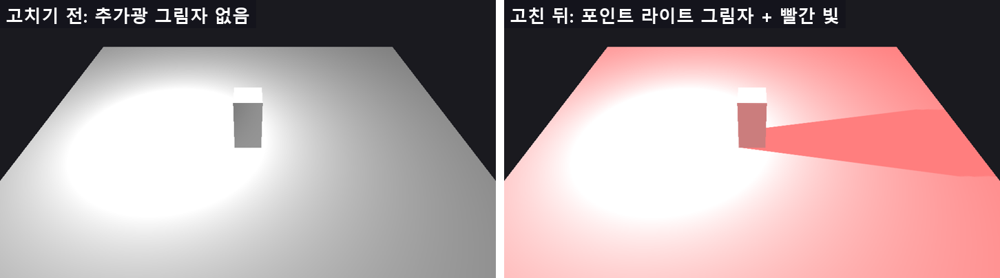
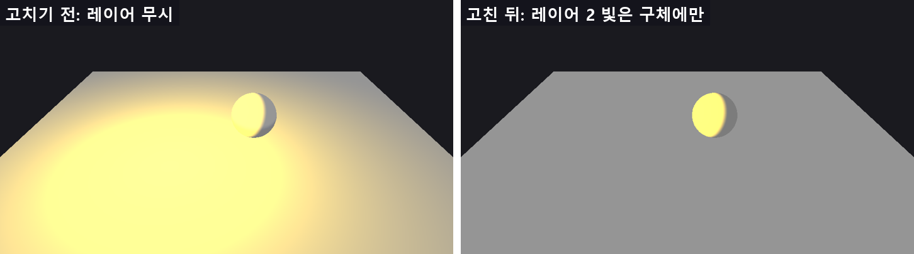

# Day 09. 여러 개의 빛 — 무대 조명 팀

## 작업 식별

| 항목 | 내용 |
|---|---|
| Task ID | GMD-TSS-010-DO |
| 유형 | D&O (개념) + 코드 읽기·실습 |
| 목적 | 메인 라이트와 추가 라이트, Forward와 Forward+, 라이트 레이어, 캐릭터 라이트(글로벌 프로퍼티)의 동작을 설명한다 |
| 소요 시간 | 약 1시간 (읽기 25분, 코드 읽기 20분, 실습 15분) |
| 선수 지식 | Day 06~08 (`lightVal`, 밴드, 그림자 감쇠) |
| 확인 상태 | 미검증 (소스를 읽고 작성했으며 Unity에서 컴파일·실행하지 않았다) |
| 개정 | R1 (2026-11-18) |

비유: 해는 주인공 조명, 포인트·스폿 라이트는 보조 조명, 캐릭터 라이트는 인물 사진 전용 조명이다.

## 학습 목표

- [ ] 메인 라이트와 추가 라이트의 차이를 안다
- [ ] 툰 셰이더가 추가 라이트를 더하기만 하는 이유를 안다
- [ ] Forward와 Forward+가 빛 목록을 찾는 방법의 차이를 안다
- [ ] 라이트 레이어가 무엇인지 안다
- [ ] C# 스크립트가 셰이더에 값을 넣는 방법(글로벌 프로퍼티)을 안다

## 1. 정의

URP는 빛을 메인 라이트와 추가 라이트로 나눈다. 메인 라이트는 가장 밝은 Directional Light 하나이고, 추가 라이트는 그 외의 Point, Spot, 다른 Directional Light다. 캐릭터 라이트는 이 셰이더 패키지가 추가한 기능으로, 캐릭터에만 적용되는 전용 방향 조명이다.

## 2. 구성 요소

| 조명 | URP 이름 | 특징 |
|---|---|---|
| 주인공 조명 | 메인 라이트 | 무한히 먼 곳에서 모든 곳에 같은 방향으로 비춘다 |
| 보조 조명 | 추가 라이트 | 위치가 있고 거리에 따라 약해진다 |
| 인물 조명 | 캐릭터 라이트 (패키지 기능) | 배경 조명과 무관하게 캐릭터만 비춘다 |

## 3. 동작 원리

### 3.1 추가 라이트 한 개 계산

[ToonLighting.hlsl L62–72](https://github.com/JJH0204/GitBook/blob/main/GameDev/toon-shader-study/source/CharacterToon/ShaderLibrary/ToonLighting.hlsl#L62-L72)

```hlsl
half3 ShadeAdditionalToon(Light light, half3 N, half3 albedo, half border, half blur)
{
#ifdef _LIGHT_LAYERS
    if (!IsMatchingLightLayer(light.layerMask, GetMeshRenderingLayer()))   // 이름표가 안 맞는 조명은
        return (half3)0.0h;                                                 //   무시 (아래 3.3)
#endif
    half nl  = saturate(dot(N, light.direction) * 0.5h + 0.5h);   // 하프 램버트 (Day 06)
    half lit = smoothstep(border - blur, border + blur, nl);       // 같은 계단 (Day 07)
    half atten = light.distanceAttenuation * light.shadowAttenuation;   // 거리 감쇠 × 그림자
    return albedo * light.color * (atten * lit);
}
```

| 줄 | 설명 |
|---|---|
| `nl` | 하프 램버트. `saturate`는 안전용 |
| `lit` | Day 07과 같은 `smoothstep` 계단 |
| `distanceAttenuation` | URP가 계산해 넘기는 거리 감쇠. 물리적으로 빛의 세기는 거리의 제곱에 반비례한다(2배 멀면 1/4). URP는 범위 끝에서 0이 되도록 보정한 값을 쓴다 |
| `shadowAttenuation` | 그림자 판정 결과 (Day 08) |

추가 라이트는 결과에 더하기만 한다([L491](https://github.com/JJH0204/GitBook/blob/main/GameDev/toon-shader-study/source/CharacterToon/Shaders/CharacterToon.shader#L491) `shaded += addSum * …`). 빛이 닿지 않는 쪽은 `lit = 0`이므로 0을 더할 뿐 어둡게 만들지 않는다. 메인 라이트가 만든 셀 그림자 모양은 유지되고, 추가 라이트가 닿는 쪽만 그 색으로 밝아진다.

### 3.2 빛 목록 찾기: Forward와 Forward+

보조 조명이 50개이면 픽셀마다 전부 계산하기에는 너무 느리다. 해당 픽셀에 영향을 주는 조명만 골라야 한다.

| 방식 | 비유 | 특징 |
|---|---|---|
| Forward | 물체마다 "닿는 조명 목록" 쪽지를 준다 | 물체당 추가 라이트 개수에 제한이 있다 (URP 에셋의 Per Object Limit) |
| Forward+ | 화면을 격자(타일/클러스터)로 나누고 칸마다 조명 목록을 만든다 | 물체당 개수 제한이 없고 조명이 많아도 대응한다 |


NOTE: Forward+는 URP 14(Unity 2022.2)에서 도입되었고 Unity 6(URP 17)에서 개선되었다. 원본 노트는 Forward를 "모바일", Forward+를 "PC"에서 쓴다고 적었지만 이는 정확하지 않다. 경로 선택은 렌더러 설정이며 플랫폼별 권장과 성능 특성은 사용하는 URP 버전과 대상 기기에서 확인해야 한다. `USE_CLUSTER_LIGHT_LOOP` 같은 매크로 이름도 버전에 따라 다를 수 있다.


### 3.3 라이트 레이어

조명과 물체에 레이어 이름표를 붙이고 이름표가 겹칠 때만 빛을 주는 기능이 라이트 레이어(Rendering Layers)다.

| 대상 | 값 |
|---|---|
| 조명의 이름표 | `light.layerMask` |
| 물체의 이름표 | `GetMeshRenderingLayer()` |
| 비교 | `IsMatchingLightLayer(조명, 물체)` |

### 3.4 값을 셰이더에 넣는 세 가지 방법

| 방법 | 비유 | 범위 |
|---|---|---|
| 머티리얼 프로퍼티 (CBUFFER) | 접시마다 붙인 개인 메모 | 그 머티리얼만 |
| `Shader.SetGlobal…` | 학교 전체 방송 | 같은 이름의 변수를 가진 모든 셰이더 |
| MaterialPropertyBlock | 물체 하나에 붙인 포스트잇 | 그 렌더러만 (Day 15, 20) |

## 4. 코드 읽기

### 4.1 추가 라이트 루프 (Forward와 Forward+ 공용)

[CharacterToon.shader L475–493](https://github.com/JJH0204/GitBook/blob/main/GameDev/toon-shader-study/source/CharacterToon/Shaders/CharacterToon.shader#L475-L493)

```hlsl
#if defined(_ADDITIONAL_LIGHTS) && defined(_USE_ADD_LIGHTS)
{
    InputData inputData = (InputData)0;
    inputData.positionWS = input.positionWS;
    inputData.normalizedScreenSpaceUV = GetNormalizedScreenSpaceUV(input.positionCS);  // 바둑판 칸 찾기용
    uint addCount = GetAdditionalLightsCount();
#if USE_CLUSTER_LIGHT_LOOP
    // Forward+: 추가 Directional 조명은 바둑판에 안 들어가서 따로 돈다
    for (uint di = 0u; di < min(URP_FP_DIRECTIONAL_LIGHTS_COUNT, MAX_VISIBLE_LIGHTS); di++)
        addSum += ShadeAdditionalToon(GetAdditionalLight(di, inputData.positionWS, half4(1,1,1,1)), ...);
#endif
    LIGHT_LOOP_BEGIN(addCount)     // ← Forward면 물체 목록, Forward+면 바둑판 칸 목록을 돈다
        addSum += ShadeAdditionalToon(GetAdditionalLight(lightIndex, inputData.positionWS, half4(1,1,1,1)), ...);
    LIGHT_LOOP_END
    shaded += addSum * _AdditionalLightStrength * aoDirect;
}
#endif
```

| 대상 | 설명 |
|---|---|
| `inputData` | `LIGHT_LOOP_BEGIN` 매크로가 이 이름의 변수를 읽는다. 같은 이름으로 만들어 둔다 |
| `LIGHT_LOOP_BEGIN/END` | URP 매크로. 렌더러 설정에 맞는 반복문으로 바뀐다 |
| Forward+ 앞쪽 `for` | 추가 Directional 조명은 어디에나 닿으므로 격자에 넣을 수 없어 따로 순회한다 |
| `half4(1,1,1,1)` | `GetAdditionalLight`의 세 번째 인자(shadowMask) |

배경 셰이더는 같은 코드를 함수로 묶어 쓴다: [ToonAdditionalLights.hlsl L23–38](https://github.com/JJH0204/GitBook/blob/main/GameDev/toon-shader-study/source/ToonShared/ShaderLibrary/ToonAdditionalLights.hlsl#L23-L38)


CAUTION: 프로젝트 이력(A5). 배경 셰이더(SceneToon)는 인자 2개짜리 `GetAdditionalLight(index, positionWS)`를 썼다. 이 버전은 그림자 정보를 쓰지 않고 `shadowAttenuation = 1`로 고정하므로 포인트·스폿 조명이 그림자 없이 물체를 뚫고 비쳤다. Forward+에서 추가 Directional 조명을 도는 앞쪽 반복문도 빠져 있었다. 루프를 [ToonAdditionalLights.hlsl](https://github.com/JJH0204/GitBook/blob/main/GameDev/toon-shader-study/source/ToonShared/ShaderLibrary/ToonAdditionalLights.hlsl)로 옮기면서 인자 3개짜리(세 번째가 shadowMask)와 앞쪽 반복문으로 고쳤다. 캐릭터 셰이더는 원래 3개짜리를 썼다.




### 4.2 메인 라이트의 라이트 레이어 확인

[L334–337](https://github.com/JJH0204/GitBook/blob/main/GameDev/toon-shader-study/source/CharacterToon/Shaders/CharacterToon.shader#L334-L337)

```hlsl
#ifdef _LIGHT_LAYERS
    if (!IsMatchingLightLayer(mainLight.layerMask, GetMeshRenderingLayer())) mainLight.color = (half3)0.0h;
#endif
```


CAUTION: 프로젝트 이력(A7). 이 셰이더는 원래 라이트 레이어를 무시해서 "구체만 비춘다"고 설정한 빨간 조명이 바닥까지 비췄다. URP Lit 셰이더와 같은 규칙으로 고쳤다.





NOTE: 라이트 레이어(Rendering Layers)는 URP 버전과 렌더러 설정에 따라 사용 방법과 키워드가 다르다. 사용하는 버전의 문서를 확인한다.


### 4.3 캐릭터 라이트: C#에서 셰이더로 값 넣기

게임에서는 배경 조명과 무관하게 캐릭터를 항상 보기 좋은 각도로 비추고 싶을 때가 많다. `CharacterToonLight` 컴포넌트가 방향을 정하고 `CharacterToonManager`가 셰이더 전체에 전달한다.

[CharacterToonManager.cs L90–91](https://github.com/JJH0204/GitBook/blob/main/GameDev/toon-shader-study/source/CharacterToon/Runtime/CharacterToonManager.cs#L90-L91)

```csharp
Shader.SetGlobalVector(IdLightDir, dir0);      // 모든 셰이더의 _CharacterLightDirWS 에 값을 넣는다
Shader.SetGlobalVector(IdLightColor, col0);
```

셰이더 쪽은 CBUFFER 밖에 같은 이름의 변수를 선언해 두면 받는다. [ToonInput.hlsl L193–203](https://github.com/JJH0204/GitBook/blob/main/GameDev/toon-shader-study/source/CharacterToon/ShaderLibrary/ToonInput.hlsl#L193-L203)

```hlsl
// --- 매 프레임 스크립트가 주입하는 글로벌 (UnityPerMaterial 밖!) ---
float4 _CharacterLightDirWS;
float4 _CharacterLightColor;
#define CHARACTER_EXTRA_LIGHT_MAX 3
float4 _CharacterExtraLightDir[CHARACTER_EXTRA_LIGHT_MAX];   // 2순위 이하 캐릭터 라이트 (최대 3개)
...
```

1순위 캐릭터 라이트는 Day 06의 `L` 고르기에 쓰이고, 2순위부터는 보조 조명처럼 더해진다: [ToonLighting.hlsl L85–96](https://github.com/JJH0204/GitBook/blob/main/GameDev/toon-shader-study/source/CharacterToon/ShaderLibrary/ToonLighting.hlsl#L85-L96).


NOTE: 글로벌 변수는 머티리얼 CBUFFER(`UnityPerMaterial`) 밖에 선언해야 한다. 안에 넣으면 머티리얼 프로퍼티로 취급되어 `Shader.SetGlobal…` 값이 반영되지 않고, SRP Batcher 호환 조건에도 영향을 준다. MaterialPropertyBlock을 쓰는 렌더러는 SRP Batcher에서 빠지는 점은 Day 20에서 다룬다.


## 5. 주의

- 추가 라이트 그림자를 받으려면 URP 에셋에서 추가 라이트 그림자를 켜야 하고, 셰이더에 해당 키워드와 그림자 인자(shadowMask 포함 3개짜리 `GetAdditionalLight`)가 있어야 한다.
- Forward+에서는 추가 Directional 조명을 별도 반복문으로 처리해야 한다. 이 반복문을 빠뜨리면 해당 조명이 무시된다.
- 라이트 레이어를 확인하지 않는 셰이더는 레이어 설정을 무시하고 모든 조명을 받는다.

## 6. 실습

1. 거리 감쇠를 계산한다. 1m에서 밝기가 1이면 2m, 4m에서는? → 결과: 약 1/4, 약 1/16이다. 보조 조명이 금방 약해지는 이유다.
2. 더하기를 계산한다. 그림자 쪽 픽셀(`shaded = 0.3`)에 보조 조명이 `lit = 1`, `atten = 0.5`, 색 (1, 0.2, 0.2), albedo 1로 닿으면? → 결과: `0.3 + (0.5, 0.1, 0.1) = (0.8, 0.4, 0.4)`이고 붉게 밝아진다.
3. [CharacterToonManager.cs](https://github.com/JJH0204/GitBook/blob/main/GameDev/toon-shader-study/source/CharacterToon/Runtime/CharacterToonManager.cs)에서 `SetGlobal`을 검색한다. 각 줄이 [ToonInput.hlsl](https://github.com/JJH0204/GitBook/blob/main/GameDev/toon-shader-study/source/CharacterToon/ShaderLibrary/ToonInput.hlsl#L195-L203)의 어느 변수에 값을 넣는지 연결한다. → 결과: `SetGlobal` 호출과 HLSL 변수의 대응표를 만든다.
4. 매니저가 캐릭터 라이트가 없을 때 [L140](https://github.com/JJH0204/GitBook/blob/main/GameDev/toon-shader-study/source/CharacterToon/Runtime/CharacterToonManager.cs#L140)에서 `w = 0`을 넣는다. 셰이더 [L348](https://github.com/JJH0204/GitBook/blob/main/GameDev/toon-shader-study/source/CharacterToon/Shaders/CharacterToon.shader#L348)은 이를 보고 무엇을 하는가. → 결과: 메인 라이트 방향을 대신 쓴다.

## 7. 참조

- [LearnOpenGL — Light casters](https://learnopengl.com/Lighting/Light-casters) (거리 감쇠 공식) · [Multiple lights](https://learnopengl.com/Lighting/Multiple-lights) (영어)
- [URP — Forward+ 렌더링 경로](https://docs.unity3d.com/Packages/com.unity.render-pipelines.universal@17.0/manual/rendering/forward-plus-rendering-path.html) · [Rendering Layers](https://docs.unity3d.com/Packages/com.unity.render-pipelines.universal@17.0/manual/features/rendering-layers.html) (영어)
- [Unity — Shader.SetGlobalVector](https://docs.unity3d.com/ScriptReference/Shader.SetGlobalVector.html)
- [Catlike Coding — Rendering 5: Multiple Lights](https://catlikecoding.com/unity/tutorials/rendering/part-5/) (영어)
- 오늘의 요약: [ESSENCE.md — Day 09](essence.md#day-09)

## 내 말로 채우기


AI 없이 답을 적는다. 다 쓰면 체크하고, 이 안내는 지워도 된다.


- [ ] 추가 라이트를 "더하기만" 하는 설계가 셀 그림자에 어떤 이점을 주는지 적는다.
- [ ] Forward와 Forward+의 차이를 조명이 많은 장면을 예로 들어 적는다.
- [ ] 캐릭터만 따로 비추고 싶었던 경험이 있다면 어떻게 해결했는지 적는다.

---

[← Day 08](day08-shadows.md) · [목차](README.md) · [다음: Day 10 →](day10-ambient-gi-ssao.md)
