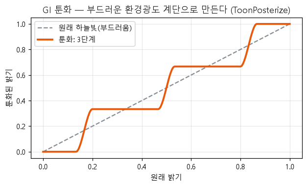
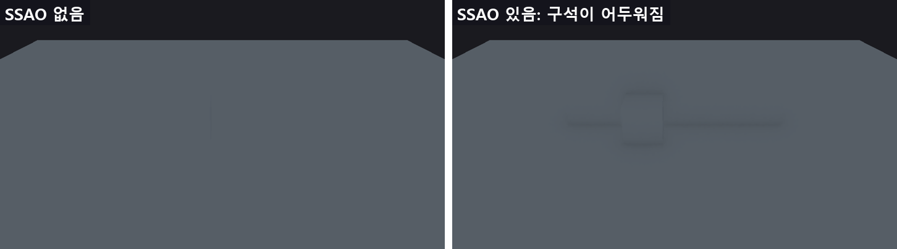

# Day 10. 하늘빛과 구석 그늘 — 환경광, GI, SSAO

> ⏱ **약 1시간** — 읽기 25분 · 코드 따라 읽기 20분 · 해보기 15분
> 🧸 **오늘의 비유**: 직접광은 **해가 직접 비추는 빛**, 간접광은 **벽과 하늘에 튕겨서 온 빛**, SSAO는 **방 구석에 쌓인 그늘**이에요.

## 오늘 배울 것

- [ ] 그림자 속이 완전히 까맣지 않은 이유(간접광)를 안다
- [ ] SH(구면 조화)와 라이트맵이 각각 무엇인지 비유로 설명할 수 있다
- [ ] 툰 셰이더가 환경광을 "그림자 쪽엔 덜" 더하는 이유를 안다
- [ ] 배경 셰이더의 GI 계단화(`ToonPosterize`)를 따라갈 수 있다
- [ ] SSAO가 무엇이고 어디에 곱해지는지 안다

---

## 1. 그림자 속은 왜 안 까맬까

해가 직접 닿지 않는 그늘도 물체가 **보이죠**. 하늘의 파란빛, 땅과 벽에서 튕겨 나온 빛이 사방에서 조금씩 들어오기 때문이에요. 이걸 **간접광** 또는 **GI**(Global Illumination, 전역 조명)라고 해요.

간접광을 정확히 계산하려면 빛이 수없이 튕기는 걸 따라가야 해서 너무 비싸요. 그래서 게임은 **미리 요약**해 두는 방법을 써요.

| 방법 | 비유 | 어디에 |
|---|---|---|
| **SH** (Spherical Harmonics, 구면 조화) | 사방에서 오는 빛을 **숫자 몇 개짜리 날씨 요약 엽서**로 | 움직이는 물체 (캐릭터) |
| **라이트맵** | 정지한 벽과 바닥에 **미리 구워 둔 빛 스티커** | 움직이지 않는 배경 |

SH 엽서에는 "위쪽은 파랗고 밝음, 아래쪽은 갈색이고 어두움" 같은 대략적인 정보만 있어요. 노멀 방향 N을 넣으면 "그쪽에서 오는 빛"을 돌려줘요: `SampleSH(N)`.

## 2. 캐릭터: 환경광을 그림자 쪽엔 덜 더하기

[CharacterToon.shader L461–465](https://github.com/JJH0204/GitBook/blob/main/GameDev/toon-shader-study/source/CharacterToon/Shaders/CharacterToon.shader#L461-L465)

```hlsl
half3 ambient = SampleSH(N) * _AmbientStrength * baseColor.rgb;
shaded += ambient * (1.0h - shadeMask) * aoIndirect;     // 그림자 쪽(shadeMask=1)엔 거의 안 더함
shaded = max(shaded, baseColor.rgb * _ShadeFloor);       // 그래도 너무 까매지지는 않게 바닥
```

왜 `(1 - shadeMask)`를 곱할까요? [L457–460 주석](https://github.com/JJH0204/GitBook/blob/main/GameDev/toon-shader-study/source/CharacterToon/Shaders/CharacterToon.shader#L457-L460)에 실제로 겪은 문제가 적혀 있어요.

> 밝은 조명(세기 > 1)에서 빛 쪽과 그림자 쪽 **둘 다 1.0을 넘어서** 흰색으로 잘리면 → **셀 그림자가 화면에서 사라진다.**

계단을 열심히 만들어도, 계단 위·아래에 똑같이 큰 값을 더하면 둘 다 하얗게 넘쳐 버려요. 그림자 쪽에는 환경광을 빼서 **명암 대비를 지켜요**.

`_ShadeFloor`는 **바닥 깔기**예요. 그림자가 바탕색의 20%(기본값)보다 어두워지지 않게 해요.

## 3. 배경: 라이트맵도 계단으로

배경은 라이트맵의 부드러운 빛을 **계단으로** 바꿔요. 그래야 배경도 만화처럼 보여요.

[SceneToon.shader L264–276](https://github.com/JJH0204/GitBook/blob/main/GameDev/toon-shader-study/source/SceneToon/Shaders/SceneToon.shader#L264-L276)

```hlsl
half3 bakedGI = SAMPLE_GI(input.staticLightmapUV, input.vertexSH, N);   // 라이트맵 있으면 라이트맵, 없으면 SH
MixRealtimeAndBakedGI(mainLight, N, bakedGI);
half giLum  = max(dot(bakedGI, half3(0.2126h, 0.7152h, 0.0722h)), 1e-4h);   // ① 밝기만 뽑기
half giBand = ToonPosterize(giLum, _GIBandCount, _GIBandSoftness);           // ② 밝기를 계단으로
half3 toonGI = bakedGI * (giBand / giLum);                                   // ③ 색조는 그대로, 밝기만 바꿈
toonGI *= lerp(_GIShadeColor.rgb, half3(1.0h, 1.0h, 1.0h), giBand);          // ④ 어두운 계단엔 그림자 틴트
```

### ① 밝기 뽑기: 왜 0.2126, 0.7152, 0.0722?

사람 눈은 **초록에 가장 민감하고 파랑에 가장 둔해요**. 같은 세기의 초록 불과 파란 불을 보면 초록이 훨씬 밝게 느껴져요. 그래서 밝기(휘도)를 구할 때 초록에 71%, 빨강에 21%, 파랑에 7% 무게를 줘요. 색 `(r, g, b)`와 이 무게를 **내적**하면 돼요. (내적이 여기서도 나와요!)

### ② 계단 만들기: `ToonPosterize`

[ToonBandShadow.hlsl L36–45](https://github.com/JJH0204/GitBook/blob/main/GameDev/toon-shader-study/source/ToonShared/ShaderLibrary/ToonBandShadow.hlsl#L36-L45)

```hlsl
half ToonPosterize(half value, half bandCount, half softness)
{
    half n = max(bandCount, 1.0h);
    half scaled = saturate(value) * n;        // 0~1 을 0~n 으로 늘림
    half lower = floor(scaled);               // 몇 번째 계단인가 (내림)
    half fracPart = scaled - lower;           // 계단 안에서의 위치 0~1
    half s = max(softness, 1e-4h);
    half edge = smoothstep(0.5h - s, 0.5h + s, fracPart);   // 계단 한가운데서 다음 칸으로 넘어감
    return saturate((lower + edge) / n);
}
```



포스터 인쇄처럼 색 단계를 줄이는 걸 **포스터라이즈**라고 해요. 3단계면 밝기가 0, 1/3, 2/3, 1 중 하나로 붙어요.

### ③ 색조 지키기

`bakedGI × (새 밝기 / 원래 밝기)`는 **색 비율은 그대로 두고 밝기만** 바꿔요. 노을빛 GI는 계단이 되어도 노을빛이에요.



위 사진은 지형 셰이더에 라이트맵을 구운 결과예요. 빨간 조명이 비춘 자리가 라이트맵에 남았어요. 지형이 라이트맵에 구워지게 하려면 **Meta 패스**가 필요해요(Day 21).


## 4. SSAO — 구석에 쌓인 그늘

방 구석, 소파 아래, 옷 주름 틈은 빛이 들어가기 어려워서 조금 더 어두워요. **SSAO**(Screen Space Ambient Occlusion)는 화면의 **깊이 지도**를 보고 "주변에 벽이 많이 둘러싼 곳"을 찾아 어둡게 해요.



URP는 SSAO 결과를 두 값으로 줘요.

| 값 | 곱하는 곳 |
|---|---|
| `indirectAmbientOcclusion` | 간접광(환경광)에 — 구석의 하늘빛을 줄임 |
| `directAmbientOcclusion` | 직접광에 — 아주 약하게 |

[CharacterToon.shader L313–319](https://github.com/JJH0204/GitBook/blob/main/GameDev/toon-shader-study/source/CharacterToon/Shaders/CharacterToon.shader#L313-L319)

```hlsl
half aoIndirect = 1.0h;
half aoDirect   = 1.0h;
#if defined(_SCREEN_SPACE_OCCLUSION)
    AmbientOcclusionFactor aoFac = GetScreenSpaceAmbientOcclusion(GetNormalizedScreenSpaceUV(input.positionCS));
    aoIndirect = lerp(1.0h, aoFac.indirectAmbientOcclusion, _AOStrength);
    aoDirect   = lerp(1.0h, aoFac.directAmbientOcclusion,   _AOStrength);
#endif
```

`_AOStrength`로 영향을 줄일 수 있어요. 툰은 진한 AO가 깔끔한 셀 그림자를 **뭉개 보이게** 할 수 있어서 다이얼을 달아 뒀어요.


**💡 실제로 있었던 일 (B2)**: 배경 셰이더는 SSAO 키워드를 선언하지 않아서 렌더러에 SSAO를 켜도 **배경만 반응하지 않았어요**. 키워드를 추가하고 URP Lit과 같은 방식으로 직접·간접광에 나눠 곱해서 고쳤어요([SceneToon.shader L226](https://github.com/JJH0204/GitBook/blob/main/GameDev/toon-shader-study/source/SceneToon/Shaders/SceneToon.shader#L226)).


## 5. 해보기 (15분)

1. **휘도 계산** — 순수한 초록 (0, 1, 0)과 순수한 파랑 (0, 0, 1)의 휘도는? (0.7152 vs 0.0722 — 초록이 10배 밝게 느껴져요)
2. **포스터라이즈 손계산** — `value = 0.55`, `bandCount = 3`, `softness = 0.1`
   - `scaled = 1.65`, `lower = 1`, `fracPart = 0.65`
   - `edge = smoothstep(0.4, 0.6, 0.65) = 1`
   - 결과 `(1 + 1) / 3 = 0.667` → 0.55가 0.667로 **올라붙었어요**
   - 그럼 `value = 0.4`면? (`scaled = 1.2`, `frac = 0.2` → `edge = 0` → `1/3 = 0.333`)
3. **환경광 대비** — 빛 쪽 직접광 1.2 + 환경광 0.5, 그림자 쪽 직접광 0.7 + 환경광 0.5면 둘 다 1을 넘어 하얗게 잘려요. 그림자 쪽 환경광에 `(1 - shadeMask) = 0`을 곱하면? (0.7 — 대비가 살아나요)
4. **Desmos** — `y = (\operatorname{floor}(3x) + 0.5)/3`처럼 floor를 써서 계단 그래프를 그려 보세요.

## 6. 오늘의 액기스

👉 [ESSENCE.md — Day 10](essence.md#day-10)

## 더 읽을거리

- [Wikipedia — Spherical harmonic lighting](https://en.wikipedia.org/wiki/Spherical_harmonic_lighting) (영어) · [Unity — 라이트 프로브 기술 정보](https://docs.unity3d.com/Manual/LightProbes-TechnicalInformation.html) (Unity가 SH를 어떻게 쓰는지)
- [Wikipedia — Lightmap](https://en.wikipedia.org/wiki/Lightmap) · [Relative luminance](https://en.wikipedia.org/wiki/Relative_luminance) (휘도 가중치의 출처) · [Posterization](https://en.wikipedia.org/wiki/Posterization) (영어)
- [Wikipedia — Ambient occlusion](https://en.wikipedia.org/wiki/Ambient_occlusion) · [SSAO](https://en.wikipedia.org/wiki/Screen_space_ambient_occlusion) · [LearnOpenGL — SSAO](https://learnopengl.com/Advanced-Lighting/SSAO) (영어)
- [URP — Ambient Occlusion 설정](https://docs.unity3d.com/Packages/com.unity.render-pipelines.universal@17.0/manual/post-processing-ssao.html)

---

[← Day 09](day09-many-lights.md) · [목차](README.md) · [다음: Day 11 →](day11-rim-light.md)
