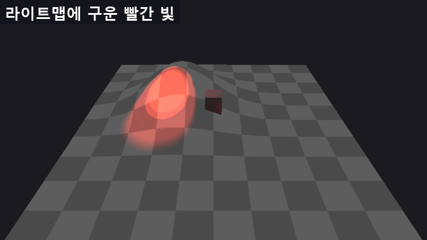

# Day 10. 하늘빛과 구석 그늘 — 환경광, GI, SSAO

## 작업 식별

| 항목 | 내용 |
|---|---|
| Task ID | GMD-TSS-011-DO |
| 유형 | D&O (개념) + 코드 읽기·실습 |
| 목적 | 간접광(SH, 라이트맵)과 SSAO를 툰 셰이더에 더하는 방법과 그 이유를 설명한다 |
| 소요 시간 | 약 1시간 (읽기 25분, 코드 읽기 20분, 실습 15분) |
| 선수 지식 | Day 06~08 (`lightVal`, 밴드, `shadeMask`) |
| 확인 상태 | 미검증 (소스를 읽고 작성했으며 Unity에서 컴파일·실행하지 않았다) |
| 개정 | R1 (2026-11-18) |

비유: 직접광은 해가 직접 비추는 빛, 간접광은 벽과 하늘에 튕겨서 온 빛, SSAO는 방 구석에 쌓인 그늘이다.

## 학습 목표

- [ ] 그림자 속이 완전히 까맣지 않은 이유(간접광)를 안다
- [ ] SH(구면 조화)와 라이트맵이 각각 무엇인지 비유로 설명할 수 있다
- [ ] 툰 셰이더가 환경광을 그림자 쪽에는 덜 더하는 이유를 안다
- [ ] 배경 셰이더의 GI 계단화(`ToonPosterize`)를 따라갈 수 있다
- [ ] SSAO가 무엇이고 어디에 곱해지는지 안다

## 1. 정의

간접광(GI, Global Illumination, 전역 조명)은 하늘과 주변 표면에서 튕겨 들어오는 빛이다. 직접광이 닿지 않는 그늘이 완전히 까맣지 않은 이유다. 정확한 계산은 비용이 크므로 게임은 미리 요약한 값을 쓴다.

SSAO(Screen Space Ambient Occlusion)는 화면 공간 정보로 주변이 막힌 곳(구석, 틈)을 찾아 환경광을 줄이는 기법이다.

## 2. 구성 요소

| 구성 요소 | 비유 | 적용 대상 |
|---|---|---|
| SH (Spherical Harmonics, 구면 조화) | 사방에서 오는 빛을 숫자 몇 개로 요약한 날씨 엽서 | 움직이는 물체(캐릭터). Unity는 라이트 프로브와 환경광을 SH로 저장한다 |
| 라이트맵 | 정지한 벽과 바닥에 미리 구워 둔 빛 스티커 | 움직이지 않는 배경 |
| `SampleSH(N)` | 노멀 방향 `N`에서 오는 빛을 돌려주는 함수 | 캐릭터 환경광 |
| `SAMPLE_GI` | 라이트맵이 있으면 라이트맵, 없으면 SH를 읽는 매크로 | 배경 환경광 |
| `ToonPosterize` | 밝기를 몇 단계로 붙이는 함수 | 배경 GI 계단화 |
| SSAO | 구석을 어둡게 하는 URP Renderer Feature | 직접·간접광에 곱한다 |


NOTE: Unity의 SH는 L2(2차) 구면 조화다. 색 채널마다 9개 계수로 사방의 빛을 저주파로 근사한다. 그래서 "위는 파랗고 밝고 아래는 갈색이고 어둡다" 정도의 대략적인 정보만 담는다.


## 3. 동작 원리

### 3.1 캐릭터: 환경광을 그림자 쪽에는 덜 더한다

[CharacterToon.shader L461–465](https://github.com/JJH0204/GitBook/blob/main/GameDev/toon-shader-study/source/CharacterToon/Shaders/CharacterToon.shader#L461-L465)

```hlsl
half3 ambient = SampleSH(N) * _AmbientStrength * baseColor.rgb;
shaded += ambient * (1.0h - shadeMask) * aoIndirect;     // 그림자 쪽(shadeMask=1)엔 거의 안 더함
shaded = max(shaded, baseColor.rgb * _ShadeFloor);       // 그래도 너무 까매지지는 않게 바닥
```

| 줄 | 설명 |
|---|---|
| `ambient` | SH 환경광에 세기와 바탕색을 곱한다 |
| `(1 - shadeMask)` | 그림자 쪽일수록 환경광을 덜 더한다 |
| `aoIndirect` | SSAO 간접광 계수 (4절) |
| `_ShadeFloor` | 그림자가 바탕색의 일정 비율(기본 20%)보다 어두워지지 않게 하는 바닥 |

`(1 - shadeMask)`를 곱하는 이유는 [L457–460 주석](https://github.com/JJH0204/GitBook/blob/main/GameDev/toon-shader-study/source/CharacterToon/Shaders/CharacterToon.shader#L457-L460)에 있다. 밝은 조명(세기 > 1)에서 빛 쪽과 그림자 쪽이 모두 1.0을 넘어 흰색으로 잘리면 셀 그림자가 화면에서 사라진다. 그림자 쪽에 환경광을 빼서 명암 대비를 지킨다.

### 3.2 배경: 라이트맵도 계단으로

[SceneToon.shader L264–276](https://github.com/JJH0204/GitBook/blob/main/GameDev/toon-shader-study/source/SceneToon/Shaders/SceneToon.shader#L264-L276)

```hlsl
half3 bakedGI = SAMPLE_GI(input.staticLightmapUV, input.vertexSH, N);   // 라이트맵 있으면 라이트맵, 없으면 SH
MixRealtimeAndBakedGI(mainLight, N, bakedGI);
half giLum  = max(dot(bakedGI, half3(0.2126h, 0.7152h, 0.0722h)), 1e-4h);   // ① 밝기만 뽑기
half giBand = ToonPosterize(giLum, _GIBandCount, _GIBandSoftness);           // ② 밝기를 계단으로
half3 toonGI = bakedGI * (giBand / giLum);                                   // ③ 색조는 그대로, 밝기만 바꿈
toonGI *= lerp(_GIShadeColor.rgb, half3(1.0h, 1.0h, 1.0h), giBand);          // ④ 어두운 계단엔 그림자 틴트
```

| 단계 | 설명 |
|---|---|
| ① 밝기 추출 | 선형 RGB와 가중치 `(0.2126, 0.7152, 0.0722)`의 내적이다. 사람 눈이 초록에 가장 민감하고 파랑에 가장 둔하다는 점을 반영한 상대 휘도(Rec.709/sRGB 기본색 기준) 계수다. 초록 (0,1,0)은 0.7152, 파랑 (0,0,1)은 0.0722다. |
| ② 계단화 | `ToonPosterize` |
| ③ 색조 보존 | `bakedGI × (새 밝기 / 원래 밝기)`는 색 비율을 그대로 두고 밝기만 바꾼다. 노을빛 GI는 계단이 되어도 노을빛이다 |
| ④ 그림자 틴트 | 계단 값이 낮을수록 `_GIShadeColor`를 곱한다 |

### 3.3 계단 만들기: `ToonPosterize`

[ToonBandShadow.hlsl L36–45](https://github.com/JJH0204/GitBook/blob/main/GameDev/toon-shader-study/source/ToonShared/ShaderLibrary/ToonBandShadow.hlsl#L36-L45)

```hlsl
half ToonPosterize(half value, half bandCount, half softness)
{
    half n = max(bandCount, 1.0h);
    half scaled = saturate(value) * n;        // 0~1 을 0~n 으로 늘림
    half lower = floor(scaled);               // 몇 번째 계단인가 (내림)
    half fracPart = scaled - lower;           // 계단 안에서의 위치 0~1
    half s = max(softness, 1e-4h);
    half edge = smoothstep(0.5h - s, 0.5h + s, fracPart);   // 계단 한가운데서 다음 칸으로 넘어감
    return saturate((lower + edge) / n);
}
```

포스터 인쇄처럼 색 단계를 줄이는 처리를 포스터라이즈(posterize)라고 한다. 출력은 `k/n` 형태의 값이다. `bandCount = 3`이면 0, 1/3, 2/3, 1 중 하나에 붙는다.




위 사진은 지형 셰이더에 라이트맵을 구운 결과다. 빨간 조명이 비춘 자리가 라이트맵에 남았다. 지형이 라이트맵에 구워지려면 Meta 패스가 필요하다(Day 21).

### 3.4 SSAO: 구석에 쌓인 그늘

방 구석, 소파 아래, 옷 주름 틈은 빛이 들어가기 어려워 더 어둡다. SSAO는 화면 공간의 깊이 정보(설정에 따라 노멀 포함)로 주변이 많이 둘러싼 곳을 찾아 어둡게 한다.


URP는 SSAO 결과를 두 값으로 준다.

| 값 | 곱하는 곳 |
|---|---|
| `indirectAmbientOcclusion` | 간접광(환경광). 구석의 하늘빛을 줄인다 |
| `directAmbientOcclusion` | 직접광. 영향이 약하다 |

[CharacterToon.shader L313–319](https://github.com/JJH0204/GitBook/blob/main/GameDev/toon-shader-study/source/CharacterToon/Shaders/CharacterToon.shader#L313-L319)

```hlsl
half aoIndirect = 1.0h;
half aoDirect   = 1.0h;
#if defined(_SCREEN_SPACE_OCCLUSION)
    AmbientOcclusionFactor aoFac = GetScreenSpaceAmbientOcclusion(GetNormalizedScreenSpaceUV(input.positionCS));
    aoIndirect = lerp(1.0h, aoFac.indirectAmbientOcclusion, _AOStrength);
    aoDirect   = lerp(1.0h, aoFac.directAmbientOcclusion,   _AOStrength);
#endif
```

`_AOStrength`로 영향을 줄인다. 툰에서는 진한 AO가 깔끔한 셀 그림자를 뭉개 보이게 할 수 있어 조절 값을 둔 것이다.


NOTE: SSAO는 URP의 Renderer Feature(Screen Space Ambient Occlusion)이며 렌더러 에셋에 추가해야 동작한다. 입력(Depth 또는 Depth Normals), 키워드(`_SCREEN_SPACE_OCCLUSION`), `AmbientOcclusionFactor` 구조는 URP 버전에 따라 다르다. 사용하는 버전의 문서와 `AmbientOcclusion.hlsl`을 확인한다.



CAUTION: 프로젝트 이력(B2). 배경 셰이더는 SSAO 키워드를 선언하지 않아 렌더러에서 SSAO를 켜도 배경만 반응하지 않았다. 키워드를 추가하고 URP Lit과 같은 방식으로 직접·간접광에 나눠 곱해 고쳤다([SceneToon.shader L226](https://github.com/JJH0204/GitBook/blob/main/GameDev/toon-shader-study/source/SceneToon/Shaders/SceneToon.shader#L226)).


## 4. 주의

- 환경광과 직접광을 단순히 더하면 밝은 장면에서 값이 1을 넘어 대비가 사라진다. 그림자 쪽 환경광을 줄이고 바닥 값(`_ShadeFloor`)을 둔다.
- 밝기 가중치 `(0.2126, 0.7152, 0.0722)`는 선형 색 공간 값에 쓴다. 감마 값에 쓰면 결과가 어긋난다.
- `giBand / giLum`에서 `giLum`이 0이면 0으로 나눈다. 코드는 `max(…, 1e-4)`로 막는다.

## 5. 실습

1. 휘도를 계산한다. 순수한 초록 (0, 1, 0)과 순수한 파랑 (0, 0, 1)의 휘도는? → 결과: 0.7152와 0.0722이며 초록이 약 10배 밝게 느껴진다.
2. `ToonPosterize`를 손으로 계산한다. `value = 0.55`, `bandCount = 3`, `softness = 0.1`이면 `scaled = 1.65`, `lower = 1`, `fracPart = 0.65`, `edge = smoothstep(0.4, 0.6, 0.65) = 1`이다. → 결과: `(1 + 1) / 3 = 0.667`로 올라붙는다.
3. `value = 0.4`로 바꿔 계산한다. → 결과: `scaled = 1.2`, `frac = 0.2`, `edge = 0`이므로 `1/3 = 0.333`이다.
4. 환경광 대비를 계산한다. 빛 쪽 직접광 1.2 + 환경광 0.5, 그림자 쪽 직접광 0.7 + 환경광 0.5이면 둘 다 1을 넘어 흰색으로 잘린다. 그림자 쪽 환경광에 `(1 - shadeMask) = 0`을 곱하면? → 결과: 0.7이 되어 대비가 살아난다.
5. [Desmos](https://www.desmos.com/calculator)에 `y = (\operatorname{floor}(3x) + 0.5)/3`을 입력해 계단 그래프를 그린다. → 결과: 3구간의 계단이 보인다.

## 6. 참조

- [Wikipedia — Spherical harmonic lighting](https://en.wikipedia.org/wiki/Spherical_harmonic_lighting) (영어) · [Unity — 라이트 프로브 기술 정보](https://docs.unity3d.com/Manual/LightProbes-TechnicalInformation.html)
- [Wikipedia — Lightmap](https://en.wikipedia.org/wiki/Lightmap) · [Relative luminance](https://en.wikipedia.org/wiki/Relative_luminance) · [Posterization](https://en.wikipedia.org/wiki/Posterization) (영어)
- [Wikipedia — Ambient occlusion](https://en.wikipedia.org/wiki/Ambient_occlusion) · [SSAO](https://en.wikipedia.org/wiki/Screen_space_ambient_occlusion) · [LearnOpenGL — SSAO](https://learnopengl.com/Advanced-Lighting/SSAO) (영어)
- [URP — Ambient Occlusion 설정](https://docs.unity3d.com/Packages/com.unity.render-pipelines.universal@17.0/manual/post-processing-ssao.html)
- 오늘의 요약: [ESSENCE.md — Day 10](essence.md#day-10)

## 내 말로 채우기


AI 없이 답을 적는다. 다 쓰면 체크하고, 이 안내는 지워도 된다.


- [ ] 그림자 속이 완전히 까맣지 않은 이유를 내 말로 적는다.
- [ ] 환경광을 그림자 쪽에 덜 더하는 이유를 적는다.
- [ ] SSAO를 켰을 때 툰 화면이 좋아졌는지 나빠졌는지 관찰한 경험을 적는다.

---

[← Day 09](day09-many-lights.md) · [목차](README.md) · [다음: Day 11 →](day11-rim-light.md)
