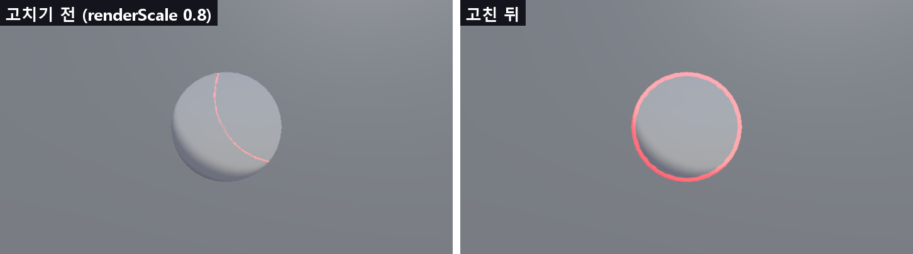

# Day 11. 테두리 빛 — 림 라이트

## 작업 식별

| 항목 | 내용 |
|---|---|
| Task ID | GMD-TSS-012-DO |
| 유형 | D&O (개념) + 코드 읽기·실습 |
| 목적 | 프레넬 림과 깊이 림의 원리를 설명하고 렌더 스케일에서 화면 UV를 올바로 구하는 방법을 설명한다 |
| 소요 시간 | 약 1시간 (읽기 25분, 코드 읽기 20분, 실습 15분) |
| 선수 지식 | Day 02 (뷰 공간), Day 06 (내적), Day 07 (`smoothstep`) |
| 확인 상태 | 미검증 (소스를 읽고 작성했으며 Unity에서 컴파일·실행하지 않았다) |
| 개정 | R1 (2026-11-18) |

비유: 역광 사진에서 머리카락 가장자리가 반짝이는 것이 림 라이트다.

## 학습 목표

- [ ] 프레넬(`1 - N·V`)이 "테두리 정도"가 되는 이유를 안다
- [ ] 프레넬 림의 threshold/softness를 해석할 수 있다
- [ ] 깊이 림이 화면의 깊이 텍스처를 읽어 실루엣을 찾는 방법을 안다
- [ ] `_ScreenParams`와 `_ScaledScreenParams`의 차이(렌더 스케일)를 안다

## 1. 정의

림 라이트(rim light)는 물체의 실루엣 가장자리를 밝게 하는 효과다. 이 셰이더는 두 방식을 쓴다.

| 방식 | 판정 기준 | 계산 위치 |
|---|---|---|
| 프레넬 림 | 노멀 `N`과 시선 `V`의 내적. 시선과 직각에 가까운 면이 테두리다 | 모델 표면 기준 |
| 깊이 림 | 화면에서 옆 픽셀의 깊이가 나보다 훨씬 멀면 실루엣 가장자리다 | 화면 픽셀 기준 |

## 2. 구성 요소

| 구성 요소 | 기본값 | 역할 |
|---|---|---|
| `_RimThreshold` | 0.6 | 프레넬이 이 값을 넘는 곳부터 빛난다. 올리면 더 바깥쪽의 얇은 테두리만 남는다 |
| `_RimSoftness` | 0.05 | 경계의 부드러움. 작으면 만화처럼 딱 끊긴다 |
| `_DepthRimWidth` | — | 옆 픽셀을 보는 거리(픽셀) |
| `_DepthRimThreshold` | — | 옆 픽셀과의 깊이 차 기준(미터) |
| `SampleSceneDepth` | — | 깊이 텍스처 읽기 |
| `LinearEyeDepth` | — | 깊이 버퍼 값을 카메라 기준 거리로 변환 |
| `_ScaledScreenParams` | — | 렌더 스케일이 적용된 실제 렌더 타깃 크기 |

## 3. 동작 원리

### 3.1 프레넬 림

공의 가운데는 시선과 같은 방향을 향하고(`dot(N, V) = 1`), 테두리는 시선과 직각이 된다(`dot(N, V) = 0`). 따라서 `1 - dot(N, V)`는 테두리일수록 커지는 값이며 프레넬(Fresnel) 값이라고 부른다.

| 위치 | `dot(N, V)` | `fresnel = 1 - saturate(dot(N, V))` |
|---|---|---|
| 공의 가운데 | 1 | 0 |
| 중간 | 0.5 | 0.5 |
| 테두리 | 0 | 1 |



NOTE: 실제 프레넬 효과는 비스듬히 볼수록 표면 반사율이 올라가는 물리 현상이며, 게임에서는 Schlick 근사 `F0 + (1 - F0) * (1 - cosθ)^5`를 쓴다. 림 라이트에서 흔한 형태는 `pow(1 - saturate(dot(N, V)), p)`로, 지수 `p`로 테두리 폭을 조절한다. 이 소스는 `pow` 대신 `smoothstep`(threshold/softness)으로 경계를 정해 값이 계단처럼 끊기게 한다.


[CharacterToon.shader L496–502](https://github.com/JJH0204/GitBook/blob/main/GameDev/toon-shader-study/source/CharacterToon/Shaders/CharacterToon.shader#L496-L502)

```hlsl
half3 rimColor = (half3)0.0h;
#if defined(_USE_RIM)
    half fresnel = 1.0h - saturate(dot(N, V));
    half rim = smoothstep(_RimThreshold, _RimThreshold + max(_RimSoftness, 1e-4h), fresnel);
    rimColor = rim * _RimColor.rgb * _RimIntensity * _RimInteractionBoost;
#endif
...
shaded += rimColor;     // L640: 나중에 더함
```

배경 셰이더는 같은 식을 함수로 쓴다: [ToonRim.hlsl](https://github.com/JJH0204/GitBook/blob/main/GameDev/toon-shader-study/source/ToonShared/ShaderLibrary/ToonRim.hlsl#L10-L15) (Day 04에서 읽은 함수)

프레넬 림의 약점은 두 가지다. 평평한 면은 `N`이 어디서나 같아 테두리가 생기지 않는다. 폭이 모델 표면 기준이므로 카메라 거리에 따라 화면에서의 두께가 달라진다. 깊이 림이 이를 보완한다.

### 3.2 깊이 림

비유: 내 바로 옆 픽셀이 나보다 훨씬 멀리 있다면(배경) 나는 실루엣 가장자리이므로 빛난다. 판단에는 깊이 텍스처가 필요하다. 깊이 텍스처는 화면 모든 픽셀의 카메라까지의 거리를 담은 지도이며 Day 18의 DepthOnly 패스가 만든다.

[CharacterToon.shader L507–520](https://github.com/JJH0204/GitBook/blob/main/GameDev/toon-shader-study/source/CharacterToon/Shaders/CharacterToon.shader#L507-L520)

```hlsl
#if defined(_USE_DEPTH_RIM)
if (hqAmount > 0.0h)
{
    float2 screenUV   = GetNormalizedScreenSpaceUV(input.positionCS);            // ① 내가 화면 어디 있나 (0~1)
    float  centerDepth = LinearEyeDepth(SampleSceneDepth(screenUV), _ZBufferParams);   // ② 내 깊이
    float3 nVS    = mul((float3x3)UNITY_MATRIX_V, N);                            // ③ 노멀을 '내 눈 기준'으로
    half   facing = saturate((half)length(nVS.xy));                              //    정면을 보는 곳은 림 억제
    float2 rimDir = normalize(nVS.xy + float2(1e-5, 1e-5));                      // ④ 화면에서 '바깥쪽' 방향
    float2 rimUV  = screenUV + rimDir * (_DepthRimWidth / _ScaledScreenParams.xy);   //    그쪽으로 N픽셀 옆
    float  nbrDepth = LinearEyeDepth(SampleSceneDepth(rimUV), _ZBufferParams);   // ⑤ 옆 칸의 깊이
    half   depthRim = smoothstep(_DepthRimThreshold, _DepthRimThreshold * 2.0h,
                                 (half)(nbrDepth - centerDepth)) * facing;       // ⑥ 차이가 크면 림
    rimColor += depthRim * _DepthRimColor.rgb * _DepthRimIntensity * hqAmount;
}
#endif
```

| 단계 | 하는 일 |
|---|---|
| ① | 픽셀의 화면 좌표를 0~1 UV로 만든다 |
| ② | 깊이 텍스처에서 내 깊이를 읽는다. 깊이 버퍼 값은 거리와 비례하지 않는 비선형 값이므로 `LinearEyeDepth`로 카메라 기준 거리(월드 단위, 보통 미터)로 바꾼다 |
| ③ | 노멀을 뷰 공간으로 바꾼다(Day 02). `nVS.xy`는 화면에서 노멀이 가리키는 방향이다. `facing`은 정면을 향한 면에서 림을 억제한다 |
| ④ | 그 방향으로 `_DepthRimWidth` 픽셀 떨어진 UV를 구한다 |
| ⑤ | 옆 칸의 깊이를 읽는다 |
| ⑥ | 옆 칸이 나보다 threshold 이상 멀면 림이다 |

화면 픽셀 단위로 옆을 보므로 카메라 거리와 관계없이 두께가 일정하다.


NOTE: 깊이 림은 카메라 깊이 텍스처가 필요하다. URP 에셋에서 Depth Texture를 켜거나 렌더러 설정에 따라 깊이 프리패스가 있어야 한다. `SampleSceneDepth`가 돌려주는 값의 방향은 플랫폼의 clip z 범위와 Reversed-Z에 따라 다르지만, `LinearEyeDepth(…, _ZBufferParams)`가 이를 거리로 환산한다. 직접 raw 깊이를 비교하는 코드는 플랫폼별 방향을 확인한다.


### 3.3 렌더 스케일과 화면 크기

모바일은 성능을 위해 화면을 낮은 해상도(예: 80%)로 그린 뒤 확대한다(URP Render Scale = 0.8). 그러면 화면 크기가 두 개가 된다.

| 변수 | 뜻 | 1080p, scale 0.8일 때 |
|---|---|---|
| `_ScreenParams` | 카메라 타깃(출력) 해상도 | 1920 × 1080 |
| `_ScaledScreenParams` | 실제로 그리는 렌더 타깃 해상도 | 1536 × 864 |


CAUTION: 프로젝트 이력(A2). 예전 코드는 화면 UV를 `positionCS.xy / _ScreenParams.xy`로 구했다. 픽셀 위치(`positionCS.xy`)는 80% 렌더 타깃 기준인데 큰 해상도로 나누어 UV가 0~1이 아니라 0~0.8이 되었다. 깊이 텍스처의 엉뚱한 곳을 읽어 테두리 대신 구체 한가운데에 호가 그려졌다. 비유: 80% 도화지에 그리면서 원래 크기 도화지의 자로 위치를 재면 눈금이 맞지 않는다. URP 함수 `GetNormalizedScreenSpaceUV()`와 `_ScaledScreenParams`를 쓰도록 고쳤다. 외곽선(Day 13)과 화면 공간 외곽선(Day 14)도 같은 이유로 고쳤다.




## 4. 주의

- `normalize(nVS.xy)`는 길이 0일 때 NaN이 나오므로 코드는 `1e-5`를 더해 막는다(Day 06).
- 깊이 림은 `_DepthRimWidth`를 픽셀로 받으므로 `_ScaledScreenParams`가 아니라 `_ScreenParams`로 나누면 렌더 스케일이 1이 아닐 때 어긋난다.
- 프레넬 림은 폭이 거리와 무관하게 모델 기준이므로 큰 물체와 작은 물체에서 두께가 다르게 보일 수 있다.

## 5. 실습

1. 프레넬을 계산한다. `dot(N, V) = 0.35`이면 `fresnel = 0.65`다. threshold 0.6, softness 0.05이면 `smoothstep(0.6, 0.65, 0.65) = 1`이다. → 결과: 림 100%다.
2. `dot(N, V) = 0.5`로 바꿔 계산한다. → 결과: `fresnel = 0.5`가 threshold 0.6보다 작아 림 0이다.
3. 깊이 림을 판정한다. 내 깊이 3.0m, 옆 칸 깊이 3.05m, threshold 0.1이면 차이 0.05가 0.1 미만이다. → 결과: 림 없음(같은 몸통 위)이다. 옆 칸이 12m(배경)이면 차이 9가 0.2 이상이므로 림 100%다.
4. 스케일을 계산한다. renderScale 0.7, 출력 2560×1440이면 `_ScaledScreenParams.xy`는? → 결과: 1792 × 1008이다.
5. (Unity가 있다면) Use Depth Rim을 켜고 Depth Rim Width를 0~10으로 움직이며 카메라를 멀리·가까이 한다. → 결과: 두께가 화면에서 일정한지 확인한다. 값을 바꾸기 전에 기존 값을 기록해 되돌린다.

## 6. 참조

- [Wikipedia — Schlick's approximation](https://en.wikipedia.org/wiki/Schlick%27s_approximation) · [Fresnel equations](https://en.wikipedia.org/wiki/Fresnel_equations) (영어)
- [LearnOpenGL — Depth testing](https://learnopengl.com/Advanced-OpenGL/Depth-testing) (영어)
- [Unity — 카메라 깊이 텍스처](https://docs.unity3d.com/Manual/SL-CameraDepthTexture.html)
- 오늘의 요약: [ESSENCE.md — Day 11](essence.md#day-11)

## 내 말로 채우기


AI 없이 답을 적는다. 다 쓰면 체크하고, 이 안내는 지워도 된다.


- [ ] `1 - dot(N, V)`가 테두리를 찾아내는 이유를 내 말로 적는다.
- [ ] 프레넬 림 대신 깊이 림이 필요한 상황을 적는다.
- [ ] 렌더 스케일을 바꿨을 때 화면이 어긋나 본 경험이 있다면 적는다.

---

[← Day 10](day10-ambient-gi-ssao.md) · [목차](README.md) · [다음: Day 12 →](day12-outline-inverted-hull.md)
