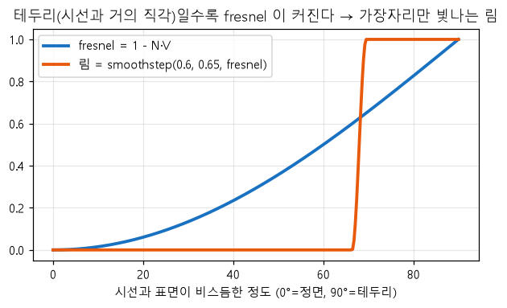

# Day 11. 테두리 빛 — 림 라이트

> ⏱ **약 1시간** — 읽기 25분 · 코드 따라 읽기 20분 · 해보기 15분
> 🧸 **오늘의 비유**: 역광 사진에서 **머리카락 가장자리가 반짝이는 것**이 림 라이트예요.

## 오늘 배울 것

- [ ] 프레넬(`1 - N·V`)이 "테두리 정도"가 되는 이유를 안다
- [ ] 프레넬 림의 threshold/softness를 해석할 수 있다
- [ ] 깊이 림이 화면의 깊이 텍스처를 읽어 실루엣을 찾는 방법을 안다
- [ ] `_ScreenParams`와 `_ScaledScreenParams`의 차이(렌더 스케일)를 안다

---

## 1. 테두리는 "시선과 직각인 곳"

공을 정면에서 보면 가운데는 **나를 똑바로** 보고, 가장자리로 갈수록 **옆을 보다가** 테두리에서는 나와 **직각**이 돼요.

Day 06의 내적을 떠올려 보세요. 노멀 N과 시선 V의 내적은

- 공의 가운데: N과 V가 같은 방향 → `dot = 1`
- 공의 테두리: N과 V가 직각 → `dot = 0`

그러니까 `1 - dot(N, V)`는 **테두리일수록 커지는 값**이에요. 이걸 **프레넬**(Fresnel) 값이라고 불러요. (진짜 프레넬 효과는 "비스듬히 볼수록 표면이 거울처럼 반사한다"는 물리 현상인데, 그걸 아주 단순하게 흉내 낸 거예요.)



## 2. 프레넬 림 코드

[CharacterToon.shader L496–502](https://github.com/JJH0204/GitBook/blob/main/GameDev/toon-shader-study/source/CharacterToon/Shaders/CharacterToon.shader#L496-L502)

```hlsl
half3 rimColor = (half3)0.0h;
#if defined(_USE_RIM)
    half fresnel = 1.0h - saturate(dot(N, V));
    half rim = smoothstep(_RimThreshold, _RimThreshold + max(_RimSoftness, 1e-4h), fresnel);
    rimColor = rim * _RimColor.rgb * _RimIntensity * _RimInteractionBoost;
#endif
...
shaded += rimColor;     // L640: 나중에 더함
```

- `_RimThreshold` (기본 0.6) — 프레넬이 이 값을 넘는 곳부터 빛나요. 올리면 **더 바깥쪽 얇은** 테두리만.
- `_RimSoftness` (기본 0.05) — 경계를 얼마나 부드럽게 할지. 작으면 **만화처럼 딱 끊기는** 림.
- 또 `smoothstep`이에요! 툰 셰이더에서는 "부드러운 값 → 계단"이 계속 반복돼요.

배경 셰이더도 같은 식을 함수로 써요: [ToonRim.hlsl](https://github.com/JJH0204/GitBook/blob/main/GameDev/toon-shader-study/source/ToonShared/ShaderLibrary/ToonRim.hlsl#L10-L15) (Day 04에서 읽은 그 함수)


프레넬 림의 약점: 평평한 면은 N이 어디나 같아서 테두리가 없어요. 또 카메라가 다가가거나 멀어져도 **폭이 모델 표면 기준**이라 화면에서 두께가 들쭉날쭉해요. 그래서 아래의 깊이 림이 있어요.


## 3. 깊이 림 — 옆 칸을 보고 판단하기

**깊이 림**은 화면을 보고 판단해요. 비유하면:

> 내 바로 옆 픽셀을 봤더니 **나보다 훨씬 멀리 있는 것**(배경)이 있다 → 나는 **실루엣 가장자리**다 → 빛나자!

이 판단에 필요한 게 **깊이 텍스처**예요. 화면의 모든 픽셀에 "카메라에서 얼마나 먼가"를 적어 둔 지도예요(Day 18의 DepthOnly 패스가 만들어요).

[CharacterToon.shader L507–520](https://github.com/JJH0204/GitBook/blob/main/GameDev/toon-shader-study/source/CharacterToon/Shaders/CharacterToon.shader#L507-L520)

```hlsl
#if defined(_USE_DEPTH_RIM)
if (hqAmount > 0.0h)
{
    float2 screenUV   = GetNormalizedScreenSpaceUV(input.positionCS);            // ① 내가 화면 어디 있나 (0~1)
    float  centerDepth = LinearEyeDepth(SampleSceneDepth(screenUV), _ZBufferParams);   // ② 내 깊이
    float3 nVS    = mul((float3x3)UNITY_MATRIX_V, N);                            // ③ 노멀을 '내 눈 기준'으로
    half   facing = saturate((half)length(nVS.xy));                              //    정면을 보는 곳은 림 억제
    float2 rimDir = normalize(nVS.xy + float2(1e-5, 1e-5));                      // ④ 화면에서 '바깥쪽' 방향
    float2 rimUV  = screenUV + rimDir * (_DepthRimWidth / _ScaledScreenParams.xy);   //    그쪽으로 N픽셀 옆
    float  nbrDepth = LinearEyeDepth(SampleSceneDepth(rimUV), _ZBufferParams);   // ⑤ 옆 칸의 깊이
    half   depthRim = smoothstep(_DepthRimThreshold, _DepthRimThreshold * 2.0h,
                                 (half)(nbrDepth - centerDepth)) * facing;       // ⑥ 차이가 크면 림
    rimColor += depthRim * _DepthRimColor.rgb * _DepthRimIntensity * hqAmount;
}
#endif
```

| 단계 | 하는 일 |
|---|---|
| ① | 픽셀의 화면 좌표를 0~1 UV로 |
| ② | 깊이 텍스처에서 내 깊이를 읽음. 깊이 버퍼에 저장된 값은 거리와 **정비례하지 않아서**(가까운 곳을 촘촘하게 저장) `LinearEyeDepth`로 진짜 거리(미터)로 바꿈 |
| ③ | 노멀을 뷰 공간으로 (Day 02). `nVS.xy`는 "화면에서 노멀이 가리키는 방향" |
| ④ | 그 방향으로 `_DepthRimWidth` **픽셀**만큼 떨어진 UV |
| ⑤ | 옆 칸의 깊이 |
| ⑥ | 옆 칸이 나보다 threshold 이상 멀면 림 |

화면 픽셀 단위로 옆을 보니까 **카메라 거리와 상관없이 두께가 일정**해요.

## 4. 렌더 스케일의 함정

모바일 게임은 성능을 위해 화면을 **80% 크기로 그린 다음 확대**해서 보여 주곤 해요(URP의 Render Scale = 0.8). 그러면 "화면 크기"가 두 개가 돼요.

| 변수 | 뜻 | 1080p, scale 0.8일 때 |
|---|---|---|
| `_ScreenParams` | 최종 **출력** 해상도 | 1920 × 1080 |
| `_ScaledScreenParams` | 실제로 **그리는** 도화지 해상도 | 1536 × 864 |


**💡 이 프로젝트에서 실제로 있었던 일 (A2)**
예전 코드는 화면 UV를 `positionCS.xy / _ScreenParams.xy`로 구했어요. 그런데 픽셀 위치(`positionCS.xy`)는 **80% 도화지 기준**이니까 큰 해상도로 나누면 UV가 0~1이 아니라 **0~0.8**이 돼요. 깊이 텍스처의 엉뚱한 곳을 읽어서, 테두리 대신 **구체 한가운데에 호**가 그려졌어요.

비유: 80% 크기 도화지에 그리면서 **원래 크기 도화지의 자**로 위치를 재면 눈금이 안 맞죠.

URP 함수 `GetNormalizedScreenSpaceUV()`와 `_ScaledScreenParams`를 쓰도록 고쳤어요. 외곽선(Day 13)과 화면 공간 외곽선(Day 14)도 같은 이유로 고쳤어요.




## 5. 해보기 (15분)

1. **프레넬 손계산** — `dot(N, V) = 0.35`면 fresnel = 0.65. threshold 0.6, softness 0.05면 `smoothstep(0.6, 0.65, 0.65) = 1` → 림 100%. `dot = 0.5`면? (fresnel 0.5 < 0.6 → 림 0)
2. **깊이 림 판정** — 내 깊이 3.0m, 옆 칸 깊이 3.05m, threshold 0.1이면? (차이 0.05 → 0.1 미만 → 림 없음, 같은 몸통 위) 옆 칸이 12m(배경)라면? (차이 9 → 0.2 이상 → 림 100%)
3. **스케일 계산** — renderScale 0.7, 출력 2560×1440이면 `_ScaledScreenParams.xy`는? (1792 × 1008)
4. **(Unity가 있다면)** Use Depth Rim을 켜고 Depth Rim Width를 0~10으로 움직이면서 카메라를 멀리·가까이 해 보세요. 두께가 화면에서 일정한지 확인하세요.

## 6. 오늘의 액기스

👉 [ESSENCE.md — Day 11](essence.md#day-11)

## 더 읽을거리

- [Wikipedia — Schlick's approximation](https://en.wikipedia.org/wiki/Schlick%27s_approximation) (게임에서 쓰는 프레넬 근사식) · [Fresnel equations](https://en.wikipedia.org/wiki/Fresnel_equations) (진짜 물리) (영어)
- [LearnOpenGL — Depth testing](https://learnopengl.com/Advanced-OpenGL/Depth-testing) — 깊이 값이 왜 비선형인지, 선형으로 바꾸는 식 (영어)
- [Unity — 카메라 깊이 텍스처](https://docs.unity3d.com/Manual/SL-CameraDepthTexture.html)

---

[← Day 10](day10-ambient-gi-ssao.md) · [목차](README.md) · [다음: Day 12 →](day12-outline-inverted-hull.md)
