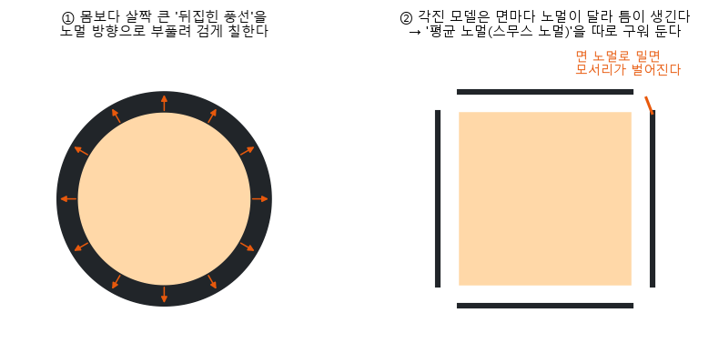
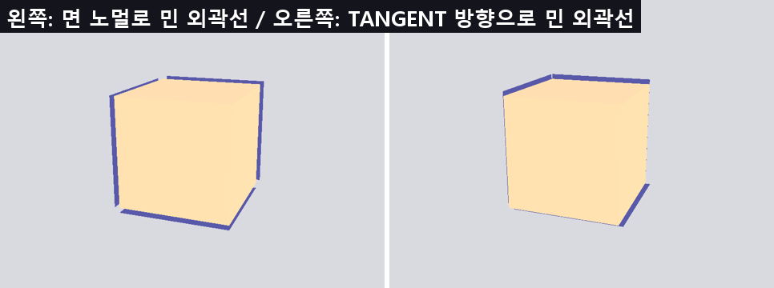

# Day 12. 외곽선 ① — 뒤집힌 풍선 (인버티드 헐)

> ⏱ **약 1시간** — 읽기 25분 · 코드 따라 읽기 20분 · 해보기 15분
> 🧸 **오늘의 비유**: 캐릭터보다 살짝 큰 **검은 풍선을 뒤집어 씌우면** 몸 뒤로 테두리만 삐죽 보여요.

## 오늘 배울 것

- [ ] 인버티드 헐 외곽선의 원리(부풀리기 + `Cull Front`)를 안다
- [ ] 각진 모델에서 외곽선이 갈라지는 이유와 스무스 노멀 해결법을 안다
- [ ] 스무스 노멀을 TANGENT 칸에 숨기는 이유를 안다
- [ ] 외곽선 폭을 부위별로 조절하는 마스크들을 안다

---

## 1. 뒤집힌 풍선



1. 캐릭터 모델을 **한 번 더** 그려요. 이번엔 점마다 **노멀 방향으로 살짝 밀어서** 조금 부풀려요.
2. 이 부푼 껍질의 **앞면은 버리고 뒷면만** 그려요 (`Cull Front`).
3. 그리고 검은색으로 칠해요.

정면에서 보면 부푼 껍질의 뒷면은 **원래 몸에 가려져서** 안 보이고, 몸보다 바깥으로 삐져나온 **가장자리만** 보여요. 그게 외곽선이에요!

"인버티드 헐"(Inverted Hull)은 "뒤집힌 껍질"이라는 뜻이에요.

## 2. Outline 패스

[CharacterToon.shader L673–681](https://github.com/JJH0204/GitBook/blob/main/GameDev/toon-shader-study/source/CharacterToon/Shaders/CharacterToon.shader#L673-L681)

```shaderlab
Pass
{
    Name "Outline"
    Tags { "LightMode" = "SRPDefaultUnlit" }   // URP가 색칠 패스 다음에 '덤으로' 그려 주는 이름표
    Cull Front                                 // ★ 뒷면만
    Blend [_SrcBlend] [_DstBlend]
    ZWrite [_ZWrite]
    ZTest LEqual
```

`SRPDefaultUnlit`은 URP가 **한 물체의 패스를 하나 더** 그릴 때 쓰는 이름표예요. 그래서 따로 설정하지 않아도 캐릭터를 그릴 때 외곽선도 같이 그려져요.

버텍스 셰이더는 부풀리기 계산을 공용 함수에 맡겨요. [L712–735](https://github.com/JJH0204/GitBook/blob/main/GameDev/toon-shader-study/source/CharacterToon/Shaders/CharacterToon.shader#L712-L735)

```hlsl
half widthMul = SAMPLE_TEXTURE2D_LOD(_OutlineMask, sampler_OutlineMask, input.uv, 0).r;   // 부위별 폭
#if defined(_USE_ILM)
    widthMul *= 1.0h - SAMPLE_TEXTURE2D_LOD(_ILMMap, sampler_ILMMap, input.uv, 0).a;      // ILM.A=1 이면 외곽선 끔
#endif
o.positionCS = CharacterToonOutlinePositionCS(
    input.positionOS.xyz, input.normalOS, input.tangentOS.xyz, input.color, widthMul);
```

프래그먼트 셰이더는 단순해요. 외곽선 색 × 외곽선 텍스처, 그리고 안개. [L737–745](https://github.com/JJH0204/GitBook/blob/main/GameDev/toon-shader-study/source/CharacterToon/Shaders/CharacterToon.shader#L737-L745)

## 3. 각진 모델의 문제 — 풍선이 찢어져요

정육면체를 생각해 보세요. 각 면의 노멀이 **서로 다른 방향**이에요. 모서리의 점은 사실 면마다 **따로따로** 있어서(노멀이 다르니까), 노멀 방향으로 밀면 면들이 **각자 다른 방향으로 벌어져요.** 모서리에 틈이 생기죠. 위 그림 오른쪽이 그 모습이에요.

### 해결: 평균 노멀(스무스 노멀)

같은 위치에 있는 점들의 노멀을 **평균 내서** 하나의 방향으로 밀면 면들이 같이 움직여서 틈이 안 생겨요. 이걸 **스무스 노멀**이라고 해요.



왼쪽은 면 노멀로 밀어서 모서리가 벌어진 외곽선, 오른쪽은 스무스 노멀로 밀어서 이어진 외곽선이에요.

### 왜 TANGENT 칸에 숨길까?

진짜 노멀 칸(`NORMAL`)은 **빛 계산**에 써야 해요. 모서리가 각진 그림자를 유지하려면 원래 노멀이 필요하거든요. 그래서 스무스 노멀은 **비어 있는 다른 칸**에 숨겨요. 이 셰이더 패키지는 **TANGENT 칸**을 써요.

- 모델을 가져올 때 에디터 스크립트가 자동으로 굽고: [SmoothNormalModelPostprocessor.cs](https://github.com/JJH0204/GitBook/blob/main/GameDev/toon-shader-study/source/CharacterToon/Editor/SmoothNormalModelPostprocessor.cs)
- 굽는 계산은 여기 있어요: [SmoothNormalUtil.cs](https://github.com/JJH0204/GitBook/blob/main/GameDev/toon-shader-study/source/CharacterToon/Editor/SmoothNormalUtil.cs), [SmoothNormalBaker.cs](https://github.com/JJH0204/GitBook/blob/main/GameDev/toon-shader-study/source/CharacterToon/Editor/SmoothNormalBaker.cs)


대가가 있어요. 원래 TANGENT 칸은 **노멀맵** 계산에 쓰는 칸이에요. 그 칸을 빼앗겼으니 캐릭터의 노멀맵은 다른 방법(픽셀 미분)으로 계산해요. 그 이야기는 Day 16에서 해요.


## 4. 공용 함수 따라 읽기 (1부)

[ToonOutline.hlsl](https://github.com/JJH0204/GitBook/blob/main/GameDev/toon-shader-study/source/CharacterToon/ShaderLibrary/ToonOutline.hlsl)의 앞부분이에요. 뒷부분(픽셀 단위 폭)은 Day 13에서 읽어요.

### ① 스무스 노멀이 진짜인지 검사 (L30–38)

```hlsl
float3 smoothNormalOS = bakedSmoothNormalOS;   // TANGENT.xyz
float  tlen = length(smoothNormalOS);
if (tlen < 1e-4 || dot(smoothNormalOS / max(tlen, 1e-5), normalOS) < 0.02)
    smoothNormalOS = normalOS;                 // 가짜 같으면 원래 노멀로
```

스무스 노멀을 **안 구운** 모델이면 TANGENT 칸에 **진짜 탄젠트**가 들어 있어요. 진짜 탄젠트는 표면을 따라 눕는 화살표라서 노멀과 **직각**이에요(`dot ≈ 0`). 그걸로 밀면 외곽선이 엉뚱한 방향으로 튀겠죠. 그래서 노멀과 거의 직각이면 "구운 게 아니구나" 하고 원래 노멀을 써요.


**💡 이 프로젝트에서 실제로 있었던 일 (C5)**
예전 기준은 `< 0.3`(약 72.5°)이었어요. 그런데 머리카락 끝이나 옷 끝처럼 **날카롭게 접힌 곳**은 진짜 스무스 노멀도 원래 노멀과 72°보다 더 벌어질 수 있어요. 그 점들만 "가짜"로 오해받아 원래 노멀로 돌아가서, 거기서 외곽선이 **갈라졌어요**. 가짜 탄젠트는 거의 **정확히** 직각(dot ≈ 0)이니까 기준을 `0.02`로 낮춰서 고쳤어요.


### ② 폭 조절 장치들 (L43–55)

```hlsl
float widthScale = widthMul;                                         // 마스크 텍스처 R × (1 - ILM.A)
if (_OutlineVertexColorWidth > 1.5h)      widthScale *= vertexColor.a;   // 정점 색으로도 조절 가능
else if (_OutlineVertexColorWidth > 0.5h) widthScale *= vertexColor.r;
float3 toCam   = _WorldSpaceCameraPos - positionWS;
float  camDist = length(toCam);
widthScale *= lerp(1.0, saturate(camDist), _OutlineFixWidth);                          // 아주 가까우면 얇게
widthScale *= lerp(1.0, saturate(_OutlineFadeStart / max(camDist, 1e-3)), _OutlineDistanceFade);   // 멀면 얇게
```

| 장치 | 쓰는 곳 |
|---|---|
| 외곽선 마스크 텍스처 (R) | 눈·입 안쪽처럼 외곽선이 없어야 하는 부위 |
| ILM.A | 같은 목적, ILM 맵 하나로 해결할 때 |
| 정점 색 R 또는 A | 모델러가 정점마다 두께를 칠해 둘 때 |
| Fix Width | 카메라가 얼굴에 바짝 붙었을 때 외곽선이 너무 두꺼워지는 것 방지 |
| Distance Fade | 멀리 있는 캐릭터의 외곽선을 얇게 |

이 조절 방식들은 VRChat에서 유명한 툰 셰이더 **lilToon**에서 가져왔어요. 코드 주석에 `lilToon _OutlineFixWidth`처럼 원래 이름이 적혀 있어요.

### ③ 외곽선 끄기의 옛날 방법 (L715–719)

```hlsl
#if !defined(_USE_OUTLINE)
    o.positionCS = float4(2.0, 2.0, 2.0, 1.0);   // 세 점을 모두 화면 밖 한 점으로
    return o;
#endif
```

외곽선을 끄면 모든 점을 **화면 밖 한 점**에 모아서 삼각형이 사라지게 해요. 하지만 GPU는 이 패스를 **여전히 실행**해요(점 계산 비용은 그대로). 그래서 지금은 패스 자체를 꺼 버리는 방법을 같이 써요. Day 19에서 봐요.

## 5. 해보기 (15분)

1. **스무스 노멀 손계산** — 정육면체 모서리 꼭짓점의 세 면 노멀이 (1,0,0), (0,1,0), (0,0,1)이에요. 더하면 (1,1,1), 정규화하면 약 **(0.577, 0.577, 0.577)**. 원래 노멀 (1,0,0)과의 내적은? (0.577 → 0.02보다 크니까 "진짜 스무스 노멀"로 통과)
2. **가짜 판별** — TANGENT가 (0, 0, 1)이고 노멀이 (1, 0, 0)이면? (내적 0 → 0.02 미만 → 원래 노멀 사용)
3. **폭 마스크 곱하기** — 마스크 R = 0.5, ILM.A = 0.4, 정점색 끔이면 `widthMul = 0.5 × (1 - 0.4) = 0.3`. 이 부위 외곽선은 기본의 30% 두께예요.
4. **(Unity가 있다면)** 샘플 캐릭터 머티리얼의 Outline Width를 0 → 1로 움직여 보세요. 카메라를 멀리 보내면 외곽선이 어떻게 되나요? (Day 13의 질문이에요!)

## 6. 오늘의 액기스

👉 [ESSENCE.md — Day 12](essence.md#day-12)

## 더 읽을거리

- [lilToon (GitHub)](https://github.com/lilxyzw/lilToon) — 외곽선 조절 장치의 원조 (일본어/영어)
- [LearnOpenGL — Face culling](https://learnopengl.com/Advanced-OpenGL/Face-culling) · [Wikipedia — Back-face culling](https://en.wikipedia.org/wiki/Back-face_culling) — 앞면/뒷면은 어떻게 정해지나 (영어)
- [Unity — Cull 명령](https://docs.unity3d.com/Manual/SL-Cull.html)
- 수학: [3Blue1Brown — 벡터](https://www.3blue1brown.com/lessons/vectors) (벡터 더하기 = 평균 노멀의 원리)

---

[← Day 11](day11-rim-light.md) · [목차](README.md) · [다음: Day 13 →](day13-outline-pixel-width.md)
