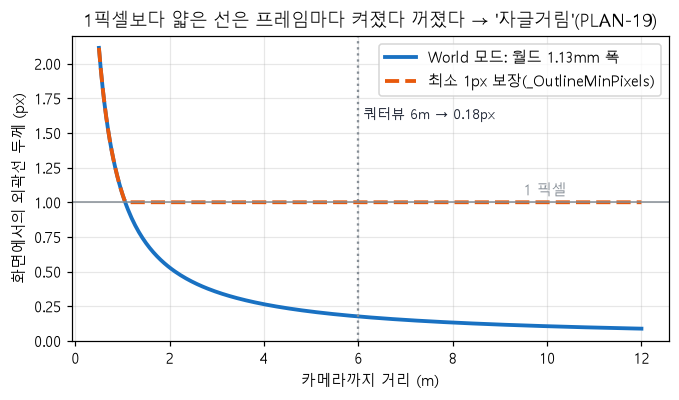
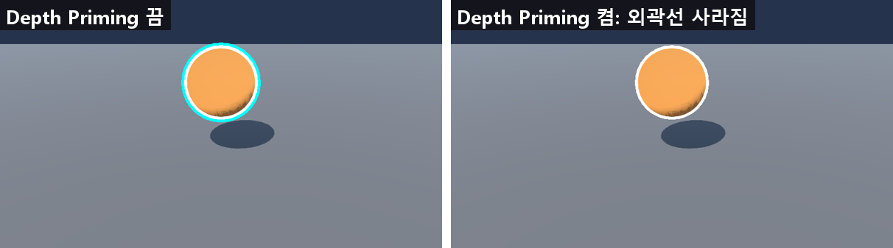

# Day 13. 외곽선 ② — 두께를 픽셀로 고정하기

> ⏱ **약 1시간** — 읽기 25분 · 코드 따라 읽기 25분 · 해보기 10분
> 🧸 **오늘의 비유**: 아주 가는 실은 멀리서 보면 **보였다 안 보였다 반짝여요**. 그래서 실의 두께를 "눈에 보이는 굵기"로 정해요.

## 오늘 배울 것

- [ ] 월드 단위 외곽선이 멀리서 "자글거리는" 이유를 안다
- [ ] 클립 공간 오프셋에 `w`를 곱하면 화면 두께가 고정되는 원리를 이해한다
- [ ] NDC에서 1픽셀이 `2 / 화면폭`인 이유를 안다
- [ ] 최소 1픽셀 클램프와 그 "게이트"를 이해한다
- [ ] Depth Priming이 외곽선을 지워 버리는 이유를 안다

---

## 1. 문제: 1픽셀보다 얇은 선

Day 12의 외곽선은 **월드 단위**(미터)로 밀었어요. 그런데 멀리 있는 건 작게 보이죠(Day 02의 `w` 나눗셈). 그래서 화면에서 외곽선 두께는 **거리에 반비례**해요.



[ToonOutline.hlsl L10–13 주석](https://github.com/JJH0204/GitBook/blob/main/GameDev/toon-shader-study/source/CharacterToon/ShaderLibrary/ToonOutline.hlsl#L10-L13)에 실제로 잰 값이 있어요.

> `_OutlineWidth = 0.113` → 월드 1.13mm → FOV 60°, 1080p 기준 **6m에서 0.18px**.

픽셀은 **가운데 점이 삼각형에 덮였는지**로 칠할지 말지를 정해요. 0.18px짜리 가는 띠는 어떤 프레임엔 픽셀 가운데를 덮고, 캐릭터가 살짝 움직인 다음 프레임엔 못 덮어요. 그래서 외곽선이 **깜빡이며 기어다니는 것처럼** 보여요. 이게 "자글거림"이에요.

**해결**: 두께를 **픽셀 단위**로 정하고, 최소 1픽셀은 보장한다.

## 2. 원리: 나눌 걸 미리 곱해 두기

Day 02에서 GPU는 클립 좌표의 `x, y`를 `w`로 나눠서 화면 좌표(NDC)를 만든다고 했어요.

```
NDC.x = clip.x / w
```

여기에 오프셋 `d`를 더해서 나누면 `(clip.x + d) / w = NDC.x + d / w`. 멀수록(`w`가 클수록) 오프셋이 작아져요. 이게 자글거림의 원인이죠.

그럼 **처음부터 `d × w`를 더하면?**

```
(clip.x + d × w) / w = NDC.x + d          ← w가 사라졌어요!
```

나중에 `w`로 나눠질 걸 알고 **미리 `w`를 곱해 두면**, 나눗셈 후 오프셋이 정확히 `d`가 돼요. **거리와 무관**하죠.


비유: 친구가 받은 돈을 반드시 **4명이 나눠 가진다**는 걸 알아요. 친구 한 명에게 1000원을 주고 싶으면? 처음부터 **4000원**을 주면 돼요.


## 3. NDC에서 1픽셀은 얼마?

NDC는 화면 왼쪽 끝 **-1**부터 오른쪽 끝 **+1**까지, 폭이 **2**예요. 화면이 1920픽셀이면 1픽셀 = `2 / 1920`이에요.

그러니까 "N픽셀만큼 밀고 싶다"는 NDC로 `N × 2 / 화면폭`이고, 클립 공간에서는 거기에 `w`를 곱하면 돼요.

```
clip 오프셋 = 방향 × N × (2 / 화면폭) × w
```

## 4. 공용 함수 따라 읽기 (2부)

[ToonOutline.hlsl L61–95](https://github.com/JJH0204/GitBook/blob/main/GameDev/toon-shader-study/source/CharacterToon/ShaderLibrary/ToonOutline.hlsl#L61-L95)

```hlsl
float4 posCS = TransformWorldToHClip(positionWS);     // 아직 부풀리지 않은 원래 위치
float w = max(posCS.w, 1e-4);                          // 카메라 뒤(w≤0) 안전장치

// ① 노멀을 클립 공간으로 → 픽셀 공간에서의 방향과 '월드 폭이면 몇 픽셀인지'
float2 dirCS = mul(GetWorldToHClipMatrix(), float4(normalWS, 0.0)).xy;
float2 wPix  = dirCS * ((_OutlineWidth * 0.01 * widthScale) / w) * 0.5 * _ScaledScreenParams.xy;
float  pixLen = length(wPix);                          // World 모드라면 화면에서 몇 px 일까

// ② 화면에서 밀 방향 (길이 1)
float2 dirPix = (pixLen > 1e-6) ? (wPix / pixLen) : ...;

// ③ 목표 두께(px): Screen 모드는 지정한 px, World 모드는 ①에서 환산한 px
float screenPix = _OutlineWidthPixels * widthScale;
float targetPix = (_OutlineWidthMode > 0.5h) ? screenPix : pixLen;

// ④ 최소 두께 — 단, 원래 외곽선이 있어야 할 곳만
half  baseWidth = (_OutlineWidthMode > 0.5h) ? _OutlineWidthPixels : _OutlineWidth;
float enable    = step(1e-6, baseWidth) * saturate(widthScale);
targetPix = max(targetPix, _OutlineMinPixels * enable);

// ⑤ 픽셀 → NDC (×2/화면크기) → 클립 (×w)
posCS.xy += dirPix * (targetPix * 2.0 / _ScaledScreenParams.xy) * w;
return posCS;
```

| 단계 | 쉬운 말 |
|---|---|
| ① | "월드 폭으로 밀면 화면에서 몇 픽셀이 될까?" 계산. `0.5 × 화면크기`는 NDC(폭 2)를 픽셀로 바꾸는 값 |
| ② | 화면 위에서 **어느 쪽으로** 밀지 (길이 1 화살표) |
| ③ | **Screen 모드**: "1.5px"처럼 픽셀로 직접 지정. **World 모드**: 옛 방식 그대로 |
| ④ | 어떤 모드든 **최소 `_OutlineMinPixels`(기본 1px)** 는 보장 → 서브픽셀이 없어짐 |
| ⑤ | 2절의 공식 그대로. 나중에 `w`로 나눠지면 정확히 `targetPix` 픽셀 |

### ④의 "게이트"가 중요해요

`max(targetPix, 1px)`만 하면 큰일 나요. 마스크로 **일부러 외곽선을 지운 곳**(widthScale = 0)이나 폭을 0으로 둔 머티리얼까지 1px로 **되살아나요.** 그래서 `enable`을 곱해요.

- 폭이 0이면 `step(1e-6, 0) = 0` → enable 0 → 최소 두께도 0
- 마스크가 0이면 `saturate(0) = 0` → enable 0

[L20–22 주석](https://github.com/JJH0204/GitBook/blob/main/GameDev/toon-shader-study/source/CharacterToon/ShaderLibrary/ToonOutline.hlsl#L20-L22)에서 "폭 가중(widthMul)과 폭 자체를 분리해 받는" 이유가 바로 이거예요.


여기서도 `_ScaledScreenParams`를 써요(Day 11). 렌더 스케일 0.8에서 `_ScreenParams`를 쓰면 "1px"이 실제 도화지에선 0.8px이 돼서 자글거림이 돌아와요. 래스터화가 일어나는 **실제 도화지 기준**으로 재야 해요. ([L69–70 주석](https://github.com/JJH0204/GitBook/blob/main/GameDev/toon-shader-study/source/CharacterToon/ShaderLibrary/ToonOutline.hlsl#L69-L70))


## 5. Depth Priming — 외곽선이 통째로 사라지는 함정

URP 렌더러에는 **Depth Priming**이라는 최적화가 있어요.

1. 먼저 모든 불투명 물체의 **깊이만** 그려요 (DepthOnly 패스).
2. 그다음 색칠할 때 `ZTest Equal` — **"깊이 메모장과 정확히 같은 깊이인 픽셀만"** 칠해요. 가려질 픽셀은 아예 계산하지 않으니 빨라요.

문제는 외곽선이에요. 외곽선은 **몸보다 살짝 뒤에 있는 부푼 껍질**이에요. 깊이 메모장에 적힌 건 몸의 깊이라서 "정확히 같은 깊이"인 픽셀이 없어요. 그래서 외곽선이 **전부 탈락**해요.




**💡 이 프로젝트에서 실제로 있었던 일 (C2)**
이 문제는 셰이더 안에서 고칠 수가 없어요(URP가 패스의 ZTest를 강제로 바꿔요). 그래서 머티리얼 인스펙터에 **경고 상자**를 띄우게 했어요. 렌더러 에셋 중 Depth Priming을 쓰는 게 있으면 "외곽선이 사라질 수 있어요"라고 알려 줘요. 코드: [CharacterToonManager.AnyRendererUsesDepthPriming()](https://github.com/JJH0204/GitBook/blob/main/GameDev/toon-shader-study/source/CharacterToon/Runtime/CharacterToonManager.cs) + [CharacterToonShaderGUI.cs](https://github.com/JJH0204/GitBook/blob/main/GameDev/toon-shader-study/source/CharacterToon/Editor/CharacterToonShaderGUI.cs)


## 6. 해보기 (10분)

1. **픽셀 → 클립 계산** — 화면 높이 1080, 목표 1.5px이면 NDC 오프셋은 `1.5 × 2 / 1080 ≈ 0.00278`. 그 점의 `w = 6`(약 6m)이면 클립 오프셋은? (`0.00278 × 6 ≈ 0.0167`) `w = 60`이면? (`0.167` — 10배 크게 더해야 화면에선 같은 1.5px)
2. **게이트 확인** — `_OutlineWidthMode = 1`(Screen), `_OutlineWidthPixels = 1.5`, 마스크로 `widthScale = 0`이면 최종 `targetPix`는? (`screenPix = 0`, `enable = 0` → `max(0, 0) = 0` → 외곽선 없음 ✅)
3. **월드 모드 환산** — 위 그래프에서 6m일 때 몇 px인가요? (약 0.18px) 최소 1px 클램프를 켜면? (1px)

## 7. 오늘의 액기스

👉 [ESSENCE.md — Day 13](essence.md#day-13)

## 수학 참고 자료

- [LearnOpenGL — Coordinate Systems](https://learnopengl.com/Getting-started/Coordinate-Systems) — 원근 투영과 `w` 나눗셈 (영어)
- [위키백과 — 동차좌표](https://ko.wikipedia.org/wiki/%EB%8F%99%EC%B0%A8%EC%A2%8C%ED%91%9C) · [Wikipedia — Homogeneous coordinates](https://en.wikipedia.org/wiki/Homogeneous_coordinates)
- [Wikipedia — Spatial anti-aliasing](https://en.wikipedia.org/wiki/Spatial_anti-aliasing) — 서브픽셀이 왜 깜빡이는지 (영어)
- [LearnOpenGL — Depth testing](https://learnopengl.com/Advanced-OpenGL/Depth-testing) · [Unity — ZTest](https://docs.unity3d.com/Manual/SL-ZTest.html)

---

[← Day 12](day12-outline-inverted-hull.md) · [목차](README.md) · [다음: Day 14 →](day14-screen-space-outline.md)
